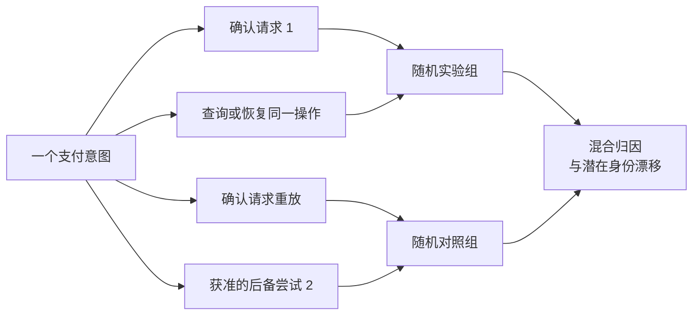
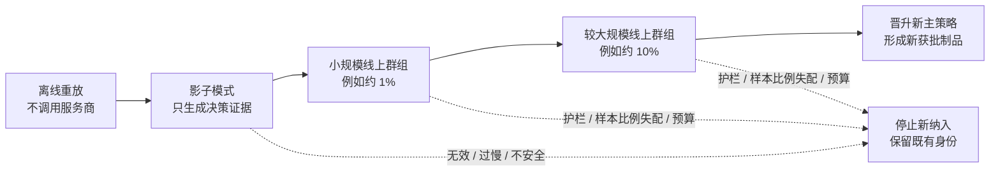
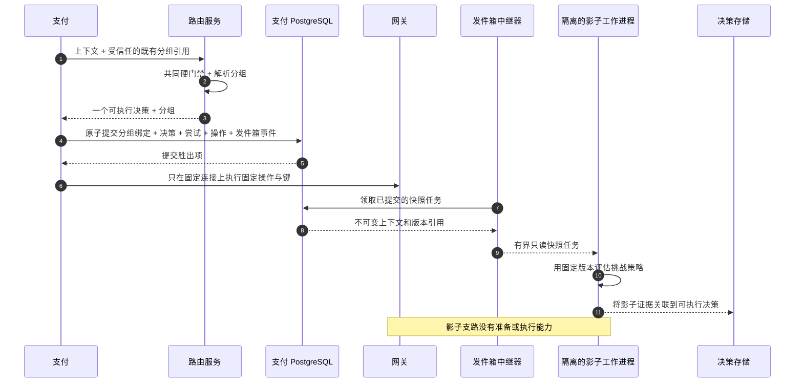

# 第 16 章 路由实验

**中文** | [English](../en/part-4-operating-at-scale/experimentation.md)

Aurora 准备发布一个新的成本感知评分器。团队把 10% 的请求交给挑战策略，其他请求继续使用主策略。一天后，仪表盘显示挑战策略的即时成功率高出 0.8 个百分点，工程师正准备全量发布，却发现同一个支付意图在三次确认中出现了两个实验组；新策略偏好的 `cand_us_b` 也开始触发并发限制。几周后，最早那批支付才陆续出现欺诈预警与拒付。

这些现象不是“样本还不够大”就能解决的。实验单位不稳定，结果无法归因；共享服务商容量让两组相互影响，小流量效果无法直接外推；只看即时成功，又把尚未成熟的风险与成本当成零。支付实验首先是业务身份、执行权和证据的设计，其次才是随机数与统计检验。

本章的核心命题是：

> **稳定业务单元、不可变版本和不可绕过的护栏，必须先于“随机切 10%”。默认按支付意图固定 `ExperimentAssignment`，并把它封存进决策；离线重放与影子只产生分析证据，影子绝不创建服务商操作。只有经过批准的小流量实盘阶段，才允许一个被指定为可执行的决定影响真实支付。**

本章依赖[第 14 章](routing-decision-store.md)的不可变事实和[第 15 章](observability.md)的分层测量，但不重写它们。外部结果纠错留给[第 17 章](reconciliation.md)，实际费用留给[第 18 章](settlement.md)，跨区域一致性与配置审批分别留给[第 19 章](../part-5-global-routing/multi-region.md)、[第 20 章](../part-5-global-routing/configuration-platform.md)，多臂老虎机（bandit）与离策略学习留给[第 21 章](../part-5-global-routing/intelligent-routing.md)。当前配套系统没有实验包、分组或影子执行器，后文 Go 设计均是明确的待配套增量。

## 16.1 问题：随机的是请求，付钱的却是同一个意图

最容易写出的实验分流只有几行：

```go
package naiveexperiment

import "math/rand"

// PickStrategy 有意展示不适合支付实验的做法：
// 同一意图的重复请求可能进入不同实验组。
func PickStrategy() string {
	if rand.Intn(100) < 10 {
		return "challenger"
	}
	return "champion"
}
```

随机数本身没有错，错的是把每个 HTTP 请求当成独立实验单位。一次确认的响应丢失后，商户会用同一幂等键重试；服务商操作进入 UNKNOWN 后，工作进程会查询或同键恢复；旧尝试明确无副作用且策略许可时，还可能创建后备尝试。这些动作属于同一个业务目标，不能每次重新抽签。



即使系统没有因此双扣，统计也已经被污染。若实验组更容易超时，它会产生更多请求、更多尝试和更多重新分组机会；按请求计数便给它更大的权重。若后备路由成功被记到最后一次抽中的对照组，最初实验组的失败又被转嫁出去。一个看似随机的分流器，最终产生的却是由错误、重试和恢复次数选择过的样本。

| 简单实现 | 实验层面的损害 | 支付层面的风险 |
| --- | --- | --- |
| 每次 HTTP 请求随机 | 同一业务单位跨组，重复请求改变权重 | 可能误把重放当新执行 |
| 用 `attempt_id` 分桶 | 失败更多的一组产生更多样本 | 后备路由可能逃离原策略与路由计划 |
| 只统计已成功派发的请求 | 排除实验组自己造成的路由服务/准备失败 | 掩盖真实服务退化 |
| 把挑战策略也发给网关测试 | 获得的不是影子，而是两条真实路径 | 可能重复授权或扣款 |
| 实验规则强制选择不合格候选通道 | 比较不再处于相同安全区域 | 绕过能力、风险、认证或合同限制 |

因此，实验不能成为路由服务流水线之外的旁路。上下文校验、准入筛选、规则/风险护栏仍先限定合法集合；实验只在被批准的范围内选择策略版本，策略再比较集合内的软目标。一个高分或统计上“显著更好”的实验组，都不能把 `Risk BLOCK`、未知能力或 `UNKNOWN` 恢复改写成可执行许可。

## 16.2 简单设计：先冻结实验合同，再冻结分组

### 16.2.1 假设必须比“新策略更好”具体

Aurora 可以把首个假设限定为：“在已通过共同硬护栏的美国令牌化银行卡自动请款 `SALE` 意图中，评分器 v43 相对 v42 降低每个成功意图的成熟成本，同时不降低规定窗口内的请款完成率，也不突破风险与可靠性上限。”这不是宣称某家服务商天生更好，而是在明确人群、策略、时间与约束下估计一次策略变化的效果。

| 合同项 | 示例定义 | 为什么必须先写 |
| --- | --- | --- |
| 实验身份 | `exp_cost_v43`，不可复用为另一假设 | 防止中途换问题后合并数据 |
| 随机化单位 | `merchant_id + payment_intent_id` | 一次业务目标只分配一次 |
| 实验前人群 | 指定商户/区域/币种/金额范围与自动 `SALE` | 入组条件不能由实验组的结果决定 |
| 对照组/实验组 | 固定评分器、规范化器、软偏好规则与特征模式版本 | 同一个变体不能每天换算法 |
| 共同护栏 | 共同准入筛选/风险/健康度语义与容量上限 | 实验不能修改支付安全底线 |
| 主要指标 | `captured_intent_within_H` 或每个成功意图的成熟成本，二选一为主 | 避免事后挑选最好看的指标 |
| 护栏指标 | 重复副作用、UNKNOWN 时长、技术错误、延迟、欺诈/拒付、成本上界 | 收益不能抵消安全损失 |
| 统计计划 | 效应方向、MDE、样本/时长上限、置信方法、多重比较与停止规则 | 防止看到结果后修改判定标准 |
| 分配计划 | 分桶算法/键版本、实际分配概率、放量阶段 | 让 SRM 与重放有精确基线 |
| 所有权 | 实验所有者、风险批准者、停止权限、事故操作手册 | 告警必须有人负责且能停止新暴露 |

这里的 `H` 是实验合同明确的观察期限，不是统一的支付最终性期限。自动请款的完成率也不等于授权速率，更不等于结算。动态风险/健康度值仍要按当前安全契约检查并记录；“版本冻结”冻结的是求值语义与策略制品，不是无限复用一个已经过期的风险 `ALLOW`。

### 16.2.2 意图是默认单位，不是所有实验的万能单位

| 分桶单位 | 适用问题 | 主要代价 |
| --- | --- | --- |
| 支付意图 | 比较一次业务目标的路由、完成率与成本 | 同一顾客多笔支付可能相关，分析需考虑聚类 |
| 获准的顾客假名 | 研究跨次支付的连续体验或行为 | 需要额外数据授权与稳定身份，样本独立数下降 |
| 商户 / 商户账户 | 策略强烈影响共享额度、运营或合同 | 商户数可能很少，集群不平衡使推断更难 |
| 区域/连接的时间块 | 共享容量干扰很强且可控制延滞效应 | 需要专门切回设计，不能简单每小时轮换 |

本书默认意图，因为它与支付的业务边界吻合，能自然覆盖重复确认、查询与后备路由。若同一顾客的多次支付相互影响，或者实验组改变整个商户的服务商配额，就应重新设计随机化与分析单位；不能把一百万个相关尝试宣称为一百万个独立样本。

### 16.2.3 分组、暴露与结果必须分列

`ExperimentAssignment{experiment, variant, version, bucket}` 表示“这个意图被分配到哪个实验组”。它不是服务商调用，也不是成功或失败。至少要保存五个不同事实：

| 事实 | 发生时点 | 用途 |
| --- | --- | --- |
| 纳入 | 通过预先定义的入组条件 | 定义目标人群与未入组原因 |
| 分组 | 为意图原子固定变体/版本/桶 | SRM、意向处理分析与稳定归属 |
| 已应用决策 | 某个策略版本生成并被支付固定为可执行 | 记录护栏、降级和真实生效路径 |
| 服务商暴露 | 操作进入实际派发 | 分析通道技术行为，不等同于分组 |
| 结果 | 同步、查询、回调通知、对账或结算事实成熟 | 计算不同窗口的业务与经济指标 |

未派发的分组应标为 `not_exposed`，不能伪装成 PSP 拒绝；但也不能因为实验组导致无候选或准备失败，就从效果分析中删除。意向处理分析以预先定义的已分配群组为基础，按事先声明的意图结果与窗口计算；服务商技术成功率则只针对真正派发的操作。两种分母服务不同问题，不能互换。

## 16.3 规模化问题：实验会改变它正在测量的系统

### 16.3.1 稳定哈希仍挡不住版本漂移

把随机数换成 `hash(intent_id)` 只是第一步。若分桶盐值、阈值、实验版本或策略引用在运行中变化，同一意图仍可能得到不同答案。生产设计应区分三个版本：`bucket_key_version` 固定分桶空间；`allocation_version` 记录当时的比例与阶段；`policy_version` 固定对照组/实验组的算法。只调整放量比例不应重新抽签已有意图，更不能顺便替换实验组权重。

分组必须由支付持久化，并进入第 14 章的 `DecisionEnvelope`/哈希。生成可执行路由时，它与首次创建尝试在同一个事务中固定。若已完成分组，但实验组求值产生无候选或明确的不可执行结果，则应提交仅分组绑定与 `not_exposed` 证据，不创建尝试/操作。否则“只在成功准备时才记分组”会删除策略自己造成的失败。尚未通过请求校验、尚未正式分配或整个本地事务未提交的请求，则不能凭路由服务建议冒充已分配样本。

数据库对 `(merchant_id, experiment_id, payment_intent_id)` 或等价的由意图持有的绑定保证唯一。两个并发确认即使分别看到新旧制品，也只有一个分组胜出项；失败者必须读取已固定的版本重新得到一致决定，不能拿着自己那份落选项决策去调用网关。持久化绑定后出现的执行失败仍保留原归属，不因没有资金副作用就移出群组。

分桶输入不能包含 `attempt_id`、请求 ID、时间、当前候选顺序或服务商健康度。它们会随恢复或环境变化而变化。公开 API 也不能让商户任意注入变体/版本；这些字段只来自受信任的实验制品与已持久化绑定。

### 16.3.2 重试、查询与后备路由保持实验归属，但不是同一种执行

| 动作 | 分组 | 资金身份 | 实验记录 |
| --- | --- | --- | --- |
| 相同确认键的重放 | 读取原绑定，不重算 | 返回原资源/状态 | 不新增独立样本 |
| 同一操作重送 | 不调用 `Assigner` | 原操作、连接、服务商幂等键、载荷 | 记录恢复，不计新意图 |
| 查询 / 回调通知 | 不分组、不选路 | 原操作与引用 | 更新结果证据，不回写分组 |
| 明确获准的后备路由 | 继承原意图变体/版本 | 新尝试、操作、键；沿由路由服务生成的固定路由计划 | 由支付服务生成的 `FallbackExecutionBinding` 引用同一分组与原计划，保留血缘；不签发新排名 |
| UNKNOWN / `review_required` | 原归属不变 | 禁止新资金路径 | 进入恢复/复核，不用换组掩盖失败 |
| 请款 / 撤销 / 退款 | 关联原归属，不重新实验路由 | 固定原连接与事务引用 | 作为后续经济结果关联原意图 |

“后备路由仍在实验组”并不意味着实验组可以随意再选一家 PSP。第 12 章的“终态 + 无副作用 + 原因在允许列表中”、风险、次数和截止时间闸门照常生效；实验组只是归属，绝不是新尝试的许可证。若新安全护栏令原计划不可执行，系统停止自动化并记录原因，不能把该意图改写成对照组后继续。

### 16.3.3 先检查样本比例失配，再解释收益

假设制品声明对照组/实验组为 90/10，1,000 个入组意图却只有 50 个实验组。原因可能是哈希输入错误、某个实例配置未更新、实验组日志漏发、连接操作丢行或结果相关的过滤。SRM 是观测样本比例与预期比例不符的诊断信号，并不直接告诉我们哪项实现坏了。Fabijan 等人的原始研究把原因分布在分组、执行、日志处理与分析等阶段，强调未解释的 SRM 会让效果结论失去可信度。[诊断样本比例失配：原始论文](https://www.microsoft.com/en-us/research/publication/diagnosing-sample-ratio-mismatch-in-online-controlled-experiments-a-taxonomy-and-rules-of-thumb-for-practitioners/)

SRM 的单位应是去重后的已分配意图，不是请求数、尝试数或被某个候选通道实际处理的数量。若实验组只在部分合法候选通道上改变排序，候选通道分布本来就不会等于 10%；把它当作分组 SRM 是口径错误。放量比例从 1% 变为 10% 后，还必须按 `allocation_version` 分层，或汇总各阶段的预期数量，不能用一个当前比例检查整个历史。

对预期比例已固定的两组，可使用 Pearson 卡方拟合优度检验作为教学起点：

\[
\chi^2=\frac{(O_C-E_C)^2}{E_C}+\frac{(O_T-E_T)^2}{E_T}
\]

它依赖足够的预期计数，不能在只有两三个实验组的桶里机械套近似。NIST 对该检验给出了相同统计量与样本充分性的限制。[NIST 卡方拟合优度检验](https://www.itl.nist.gov/div898/handbook/eda/section3/eda35f.htm) 下面代码限定单个分配版本、两组、已知概率，并在预期计数不足时显式拒绝；统计用浮点数不意味着金额计算也可以用浮点数。

```go
package srm

import (
	"errors"
	"math"
)

var (
	ErrInvalidPlan = errors.New("invalid SRM plan")
	ErrSparseCount = errors.New("expected count too small for chi-square approximation")
)

type Result struct {
	MethodVersion string
	ChiSquare     float64
	PValue        float64
	Flagged       bool
}

func Check(control, treatment uint64, treatmentProbability, alpha float64) (Result, error) {
	if math.IsNaN(treatmentProbability) || math.IsInf(treatmentProbability, 0) ||
		treatmentProbability <= 0 || treatmentProbability >= 1 ||
		math.IsNaN(alpha) || math.IsInf(alpha, 0) || alpha <= 0 || alpha >= 1 {
		return Result{}, ErrInvalidPlan
	}
	total := float64(control) + float64(treatment)
	expectedTreatment := total * treatmentProbability
	expectedControl := total * (1 - treatmentProbability)
	if expectedTreatment < 5 || expectedControl < 5 {
		return Result{}, ErrSparseCount
	}
	deltaTreatment := float64(treatment) - expectedTreatment
	deltaControl := float64(control) - expectedControl
	statistic := deltaTreatment*deltaTreatment/expectedTreatment +
		deltaControl*deltaControl/expectedControl
	// 两组实验且概率预先指定时，渐近自由度为 1。
	pValue := math.Erfc(math.Sqrt(statistic / 2))
	return Result{
		MethodVersion: "pearson-chi-square-df1-v1",
		ChiSquare:     statistic,
		PValue:        pValue,
		Flagged:       pValue < alpha,
	}, nil
}
```

这里的 `alpha` 必须来自预先发布的诊断计划，不是看到数据后挑选的阈值。这个函数也不是序贯有效的实验停止器：频繁重复检查仍需要定义告警策略。SRM 告警应先冻结收益解读，沿分组→决策→发件箱→投影→分析检查计数差异；不能删掉“不正常的”样本后宣布通过。

### 16.3.4 离线重放与影子都看不到未执行通道的真实结果

历史日志只记录被选中候选通道的结果。把同一上下文交给挑战策略，能知道它会选 B，却不知道这笔支付真走 B 后会不会获批、超时或产生拒付。把主策略的成功标签复制给挑战策略，是在给没有发生过的路径制造事实。第 8 章的选择偏差不会因为新增了实验字段而消失。

Li 等人的重放研究针对部分标签反馈，证明无偏离线评估需要相应的数据收集与匹配条件；它不是“任何生产日志都能无偏重放”的许可证。[无偏离线评估：原始论文](https://arxiv.org/abs/1003.5956) 本章把离线重放用于确定性、护栏一致性、候选差异、特征覆盖与资源预算。只有日志确有合适的随机支持与行动概率，并满足分析假设，才可以进入第 21 章更严格的离策略估计。

线上 A/B 的随机分配也只支持其目标人群与实际实施策略的比较，不自动证明一个服务商在全球更优。若分析时只保留“实验组与对照组都成功路由到同一家 PSP”的记录，或排除实验组产生的无候选结果，又会按处理后的变量选择样本。入组与分层条件应尽量基于处理前事实，并在实验合同中冻结；事后切片只能标为探索性发现。

### 16.3.5 共享容量会让对照组也受到实验组影响

假设挑战策略把更多流量送到 B。B 的账户级速率限制、连接器并发池和网络连接被占满后，对照组原本就会使用 B 的那部分流量也变慢。此时两组不是互不影响的独立世界，差值反映的是“在当前混合比例与共享容量下”的效果，而不是全量上线后的效果。

Stripe 官方文档明确区分速率限制与并发限制，并列出账户/全局、端点、资源等限制信号。这说明实验容量预算不能只写一个全局 TPS；应结合实际服务商契约和精确连接故障域检查。[Stripe 速率限制](https://docs.stripe.com/rate-limits) 这是对支付架构的推论：每次放量都要同时观察两组的服务商负载、429、队列、UNKNOWN 积压与共享舱壁隔离，而不是只看实验组的平均延迟。

可选缓解包括预留容量、隔离实验额度、限制每个商户/连接的暴露，或在确有强干扰时采用集群/切回设计。后者会引入集群数量、时间趋势与延滞效应等新的假设；Bojinov 等人的原始研究正是围绕延滞效应长度设计与分析切回，不能把它简化为整点轮换两套策略。[切回实验的设计与分析](https://arxiv.org/abs/2009.00148) 因此 1% 通过是下一阶段的证据，不是 100% 的容量证明。

### 16.3.6 即时成功不是成熟收益

| 指标层 | 最早可见的信号 | 实验报告必须保留的状态 |
| --- | --- | --- |
| 路由服务 / 网关技术质量 | 决策错误、超时、派发延迟、限流 | 即时可见，但要区分路由服务与服务商 |
| 意图完成率 | 请款结果，或明确业务失败 | `within_H`、处理中/UNKNOWN、观测时间/生效时间 |
| 欺诈风险 | 风险动作、早期预警 | 代理信号与最终欺诈结果分列 |
| 拒付 | 争议/拒付证据 | 群组时长、成熟比例、开放/已结案状态 |
| 成本 | 预期成本、尝试费用、结算/FX/更正行 | 预期/应计/实际分列，币种与版本明确 |

Stripe 的官方争议生命周期说明，争议可能在原支付之后较长时间才发起，完整处理也可能持续数月；早期欺诈预警与争议甚至不保证同一到达顺序。[Stripe：争议如何运作](https://docs.stripe.com/disputes/how-disputes-work) 因此两天内“没有拒付”不能证明实验组的拒付率更低，只能说明这批群组尚未成熟。

报告应按纳入群组时长对齐两组，明确数据截止点与结果版本。一个 `captured_within_H` 指标可以衡量规定时间内的完成，但不能被命名为最终成功率；一个尚未拿到实际费用的意图也不能贡献零成本。后备路由的所有尝试费用应归入原意图，而不是只算最后成功那次。第 17、18 章负责事实纠错和实际归因，本章只规定实验如何等待、分列与消费这些结果。

### 16.3.7 看到显著就停止，会改变检验本身

每天查看固定终点的 `p < 0.05`，只要显著就停止，再把结果称为“95% 可信”，并不保留原检验的错误控制。Johari、Pekelis 与 Walsh 的原始研究讨论了持续监测下的始终有效推断，并说明应使用与停止方式相匹配的推断方法。[始终有效推断原始论文](https://arxiv.org/abs/1512.04922)

第一版可以选择预先声明的固定样本/固定时间与成熟窗口；若业务确实需要连续判定，应采用经过验证的序贯方法或显著性水平支出计划，而不是在仪表盘上不断重算普通 p-值。主要指标、护栏、商户切片和多阶段放量还涉及多重比较；效应大小、置信区间与最小有意义改善必须一起报告，不能只给一个绿色显著性标记。

停止条件至少分三类：资金安全或严重可靠性回归可以立即停止新暴露，不必等显著；SRM/日志缺失等数据质量问题先停止推断并调查；效果优胜或无效停止则遵守统计计划。达到最大时长或暴露预算仍无结论时，应返回 `inconclusive`，而不是继续跑到显著为止。

## 16.4 生产级设计：让实验循序进入执行权限

### 16.4.1 从离线到主策略，每一步都增加一项被证明的能力



| 阶段 | 是否产生真实资金副作用 | 能证明什么 | 进入下一阶段前 |
| --- | ---: | --- | --- |
| 离线重放 | 否 | 确定性、准入边界、版本与输入覆盖、候选差异 | 无硬约束绕过，缺失证据显式失败 |
| 影子 | 只有原主策略正常执行 | 线上上下文/特征兼容、延迟与资源开销、决策分歧 | 影子不影响主策略，零影子操作 |
| 小流量实盘 | 每个意图只有一个可执行变体 | 窄人群下真实实现效果与即时安全 | SRM/数据完整性通过，风险和容量预算内 |
| 扩大实盘 | 同上，逐级增加新入组 | 检查负载依赖、商户异质性与成熟结果 | 统计计划与成熟窗口满足，残余风险获批准 |
| 主策略晋升 | 新意图使用新生产制品 | 将已接受策略变成默认 | 保留回滚版本，旧意图不重分组 |

表中的 1% 与 10% 只是演进示例，不是生产安全认证。首个 Go 配套增量应止于稳定分组与影子：支付仍只执行主策略。进入实盘 A/B 时，也只是把该意图分配到的策略声明为唯一可执行决策；任何阶段都不允许把两个服务商调用当作“对照”。

### 16.4.2 一个确定、可重放的 Go `Assigner`

下面示例使用 65,536 个等宽桶，直接取 HMAC-SHA256 的前 16 位，避免用十进制百分比掩盖实际阈值。`TreatmentBuckets / BucketSpace` 才是 SRM 使用的计划概率。HMAC 的键由密钥服务按 `bucket_key_version` 提供，不进入决策或日志；Go 标准库提供对应实现。[Go crypto/hmac](https://pkg.go.dev/crypto/hmac)

已存在分组的分支必须在纳入紧急开关之前返回，这样关闭新入组不会改写已有归属。函数本身不处理资金状态，也不证明输入仍满足执行护栏；后者始终由共同安全流水线检查。

```go
package experiment

import (
	"crypto/hmac"
	"crypto/sha256"
	"encoding/binary"
	"errors"
)

const BucketSpace uint32 = 1 << 16

var ErrInvalidAssignment = errors.New("invalid experiment assignment")

type Unit struct {
	MerchantID      string
	PaymentIntentID string
}

type Artifact struct {
	ExperimentID           string
	AllocationVersion      string
	BucketKeyVersion       string
	ControlPolicyVersion   string
	TreatmentPolicyVersion string
	TreatmentBuckets       uint32
}

type Assignment struct {
	ExperimentID           string
	Version                string
	BucketKeyVersion       string
	Unit                   Unit
	Variant                string
	PolicyVersion          string
	Bucket                 uint32
	ProbabilityNumerator   uint32
	ProbabilityDenominator uint32
}

type Result struct {
	Assignment *Assignment
	Reason     string
}

func Resolve(
	unit Unit,
	existing *Assignment,
	active Artifact,
	key []byte,
	preTreatmentEligible bool,
	enrollmentOpen bool,
) (Result, error) {
	if unit.MerchantID == "" || unit.PaymentIntentID == "" || active.ExperimentID == "" {
		return Result{}, ErrInvalidAssignment
	}
	if existing != nil {
		if existing.Unit != unit || existing.ExperimentID != active.ExperimentID ||
			existing.Version == "" || existing.PolicyVersion == "" || existing.BucketKeyVersion == "" ||
			(existing.Variant != "control" && existing.Variant != "treatment") ||
			existing.Bucket >= BucketSpace || existing.ProbabilityDenominator != BucketSpace ||
			existing.ProbabilityNumerator == 0 || existing.ProbabilityNumerator >= BucketSpace {
			return Result{}, ErrInvalidAssignment
		}
		if (existing.Variant == "treatment" && existing.Bucket >= existing.ProbabilityNumerator) ||
			(existing.Variant == "control" && existing.Bucket < BucketSpace-existing.ProbabilityNumerator) {
			return Result{}, ErrInvalidAssignment
		}
		copyOfExisting := *existing
		return Result{Assignment: &copyOfExisting, Reason: "existing_assignment"}, nil
	}
	if !preTreatmentEligible {
		return Result{Reason: "not_enrolled_scope"}, nil
	}
	if !enrollmentOpen {
		return Result{Reason: "not_enrolled_disabled"}, nil
	}
	if len(key) < 32 || active.AllocationVersion == "" || active.BucketKeyVersion == "" ||
		active.ControlPolicyVersion == "" || active.TreatmentPolicyVersion == "" ||
		active.TreatmentBuckets == 0 || active.TreatmentBuckets >= BucketSpace {
		return Result{}, ErrInvalidAssignment
	}
	mac := hmac.New(sha256.New, key)
	parts := []string{
		"aurora-experiment-bucket-v1", active.ExperimentID, active.BucketKeyVersion,
		unit.MerchantID, unit.PaymentIntentID,
	}
	for _, part := range parts {
		if len(part) > 1024 {
			return Result{}, ErrInvalidAssignment
		}
		var length [4]byte
		binary.BigEndian.PutUint32(length[:], uint32(len(part)))
		_, _ = mac.Write(length[:])
		_, _ = mac.Write([]byte(part))
	}
	digest := mac.Sum(nil)
	bucket := uint32(binary.BigEndian.Uint16(digest[:2]))
	variant := "control"
	policyVersion := active.ControlPolicyVersion
	probability := BucketSpace - active.TreatmentBuckets
	if bucket < active.TreatmentBuckets {
		variant = "treatment"
		policyVersion = active.TreatmentPolicyVersion
		probability = active.TreatmentBuckets
	}
	assignment := &Assignment{
		ExperimentID:           active.ExperimentID,
		Version:                active.AllocationVersion,
		BucketKeyVersion:       active.BucketKeyVersion,
		Unit:                   unit,
		Variant:                variant,
		PolicyVersion:          policyVersion,
		Bucket:                 bucket,
		ProbabilityNumerator:   probability,
		ProbabilityDenominator: BucketSpace,
	}
	return Result{Assignment: assignment, Reason: "new_assignment"}, nil
}
```

`allocation_version` 故意不进入桶哈希：放量改变新意图的阈值，不改变分桶空间。已经入组的意图仍返回它原来的变体、概率和策略版本。若需要更换桶键，应建立新的实验命名空间并保持旧绑定可读，而不是把正在运行的人群重新洗牌。HMAC 只提供稳定的伪随机映射，不自动证明人群独立或日志完整；A/A 校准、固定向量与 SRM 检查仍不可省略。

这里保存的是变体分组概率，不是某个候选通道的暴露行动概率。护栏、策略与路由计划还会影响实际候选通道；第 21 章不能直接把这项概率当成服务商选择概率用于反事实估计。

### 16.4.3 分组随决策固定，影子走独立只读支路



影子任务从已提交的执行快照派生，避免把从未生效的路由服务建议当成已执行决策。这也限定了首个影子切片的覆盖人群；若以后记录提交前建议，必须标记 `not_applied`，不能混入已执行样本。工作进程只收到第 4 章允许的上下文投影、共同护栏/特征快照与挑战策略制品引用，不收到支付凭证令牌、PAN、CVV、服务商秘密信息或网关凭据。它与在线主策略分离并发池和截止时间；队列满可以在预定截止时间内等待或显式记为 `shadow_skipped`，超时记录 `shadow_timeout`，都不能拖慢支付或把空结果算成挑战策略失败。

下面的 Go 类型只允许产生 `Report`。没有 `PrepareConfirmation`、服务商操作或网关接口；生产环境还要用独立服务身份、API 允许列表和测试落实这个边界，类型设计本身不是安全认证。

```go
package shadow

import (
	"context"
	"errors"
	"time"
)

type Snapshot struct {
	PaymentIntentID         string
	ContextDigest           string
	AmountMinor             int64
	Currency                string
	Operation               string
	CandidateIDs            []string
	GuardrailVersion        string
	FeatureSnapshotVersion  string
	ChallengerPolicyVersion string
}

type Decision struct {
	ID                  string
	SelectedCandidateID string
	PolicyVersion       string
}

type Evaluator interface {
	Evaluate(context.Context, Snapshot) (Decision, error)
}

type Job struct {
	Snapshot            Snapshot
	ChampionDecisionID  string
	ChampionCandidateID string
}

type Report struct {
	Mode                string
	State               string
	Reason              string
	ParentDecisionID    string
	ShadowDecisionID    string
	SelectedCandidateID string
	Agreement           bool
}

// Run 在隔离工作进程中执行，绝不占用冠军方案的延迟预算。
func Run(ctx context.Context, evaluator Evaluator, job Job, budget time.Duration) Report {
	report := Report{Mode: "shadow", ParentDecisionID: job.ChampionDecisionID}
	if budget <= 0 || job.ChampionDecisionID == "" || job.Snapshot.ContextDigest == "" {
		report.State, report.Reason = "invalid", "invalid_shadow_job"
		return report
	}
	snapshot := job.Snapshot
	snapshot.CandidateIDs = append([]string(nil), job.Snapshot.CandidateIDs...)
	shadowContext, cancel := context.WithTimeout(ctx, budget)
	defer cancel()
	decision, err := evaluator.Evaluate(shadowContext, snapshot)
	if err == nil {
		err = shadowContext.Err()
	}
	if err != nil {
		report.State, report.Reason = "error", "shadow_evaluation_error"
		if errors.Is(err, context.DeadlineExceeded) {
			report.State, report.Reason = "timeout", "shadow_budget_exhausted"
		} else if errors.Is(err, context.Canceled) {
			report.State, report.Reason = "canceled", "shadow_job_canceled"
		}
		return report
	}
	if decision.ID == "" || decision.ID == job.ChampionDecisionID ||
		decision.PolicyVersion != snapshot.ChallengerPolicyVersion {
		report.State, report.Reason = "invalid", "shadow_version_mismatch"
		return report
	}
	report.State = "evaluated"
	report.ShadowDecisionID = decision.ID
	report.SelectedCandidateID = decision.SelectedCandidateID
	if decision.SelectedCandidateID == "" {
		report.State, report.Reason = "no_candidate", "shadow_no_candidate"
		return report
	}
	allowed := false
	for _, id := range job.Snapshot.CandidateIDs {
		if id == decision.SelectedCandidateID {
			allowed = true
			break
		}
	}
	if !allowed {
		report.State, report.Reason = "invalid", "shadow_candidate_not_allowed"
		report.SelectedCandidateID = ""
		return report
	}
	report.Agreement = decision.SelectedCandidateID == job.ChampionCandidateID
	return report
}
```

`Evaluator` 必须响应上下文取消，工作进程还需要独立的资源与并发上限；仅创建一个截止时间并不能强制终止不合作的计算。影子结果要有独立 ID、`mode=shadow`、父决策、上下文摘要、版本与执行状态，不能覆盖主策略的 `DecisionEnvelope`。若需要分析“哪些请求出现分歧”，必须同时报告影子覆盖与超时分布；只分析成功跑完的影子任务，也可能因复杂上下文更容易超时而产生选择偏差。

### 16.4.4 紧急开关停的是新分配，不是历史身份

关闭实验时，最危险的实现是把数据库里所有实验组改成对照组，或者让正在 UNKNOWN 的操作改用主策略路由。前者重写实验分母与历史证据，后者可能制造第二条资金路径。安全开关应把纳入状态改为已关闭，并记录截止点、原因、操作者与版本；已有分组保持不变。

| 关闭时的对象 | 允许动作 | 禁止动作 |
| --- | --- | --- |
| 尚未入组的新意图 | 不创建实验组分组，使用正常主策略路径并记录未入组原因 | 把它混入旧实验对照组分母 |
| 已有分组、尚未派发 | 保留归属；若另有安全执行暂停，可停止执行/人工复核 | 改写变体或偷偷换服务商 |
| 已派发 / UNKNOWN | 按原操作、连接、键、载荷查询/等待/恢复 | 以“回滚实验”为名创建新尝试 |
| 已获准的后备路由 | 保持原变体；继续检查当前安全护栏，必要时停止 | 重新分桶或跨到对照组路由计划 |
| 已成功的意图 | 保留后续欺诈、拒付与成本观察 | 删除群组或把迟到损失移到对照组 |

停止纳入与执行安全暂停是两种权力：前者停止新的实验分配，后者由支付/风险/能力的安全契约阻止新的不安全副作用。它们可以在事故中同时触发，但都不能改变已发出操作的身份。策略晋升也遵守同一原则：新主策略是新发布的默认制品，旧意图的分组、决策与服务商引用不被迁移。

### 16.4.5 当前实现与本章最小工程增量

| 组件 | 当前代码事实 | 本章待配套增量 |
| --- | --- | --- |
| 路由服务 v3 数据平面 | 已执行 `routing_context.v2`、风险契约、能力/规则硬门禁、版本化成本/表现查找、受约束评分和稳定排序 | `internal/experiment` `Assigner`、不可变的实验制品、作用域校验器 |
| 路由服务响应 | 已返回完整候选顺序、风险/优化证据与可执行截止时间；无分组、实验模式或影子结果 | 返回分组与单一可执行决策，影子报表使用独立类型 |
| 支付 `ConfirmIntent` / `PrepareConfirmation` | 创建一个尝试/操作，并在同一事务固定上下文/决策、风险/优化、候选顺序、可执行截止点与精确连接 | 由意图持有的分组绑定，随现有执行快照/发件箱原子固定 |
| 影子工作进程 | 无 | 有界队列、只读求值器、独立预算与身份、零网关能力 |
| 实验操作 | 无 | 停止纳入、版本化放量计划、SRM/成熟度评估卡与失败测试 |

因此当前基线已不是“静态路由服务”，但也没有实验执行权：成本/表现/评分能生成一个可执行决定，不会凭空产生分组、行动概率或影子证据。最小纵向切片不需要一开始就做完整实验平台：先对 1,000 个固定意图验证稳定分桶，再让主策略正常执行、挑战策略只产影子证据，最后验证紧急关闭后没有新实验组分组。线上 A/B、统计上线判定、成熟欺诈/拒付与实际成本流水线都不能由这些单测或模拟器结果冒充完成。

### 16.4.6 证明性测试矩阵

| 场景 | 注入 | 必须证明 |
| --- | --- | --- |
| 稳定分组 | 重复确认、进程重启、候选通道输入乱序 | 同一意图的变体/版本/桶完全一致 |
| 并发版本 | 两个确认分别看到分配 v1/v2 | 数据库只固定一个胜出项，落选项不执行网关 |
| 恢复 | 实验组操作响应丢失 | 查询/同键恢复保持原分组与连接，只有一条资金路径 |
| 后备路由 | A 明确无副作用且允许列表允许 B | 新尝试/操作/键，但继承同一变体/版本和固定路由计划 |
| 影子胜出项 | 挑战策略给另一候选通道最高分 | 网关中只有可执行决策的操作，影子数量为零 |
| 影子过载 | 工作进程队列满、超时或缺制品 | 主策略仍按预算执行；覆盖率/状态显式可查 |
| 紧急开关 | 已分配与未分配意图同时到达 | 已有归属不变，新实验组分组为零，不重路由 UNKNOWN |
| SRM | 丢弃一部分实验组投影 | 计数诊断失败，停止收益解读，不能补造对照组数据 |
| 迟到结果 | 先成功，后到拒付/费用更正 | 原分组不变，群组结果版本更新，未成熟值不当零 |
| 护栏绕过 | 实验组选择未通过准入筛选的候选通道或风险阻断 | 无可执行决策、无网关调用，不因实验优先级而放行 |

## 16.5 故障模式：实验不能成为第二套支付状态机

| 失败模式 | 后果 | 受控动作 |
| --- | --- | --- |
| 按请求或尝试重新随机 | 污染与样本权重漂移 | 意图级一次分配，恢复读取原绑定 |
| 中途修改同名实验组 | “一个实验组”包含多套算法 | 不可变的制品，新假设新版本/实验 |
| 只看已执行或已成功样本 | 删除实验组自己造成的失败 | 分列分组/暴露/结果，按预注册人群分析 |
| SRM 未解释就发布 | 数据质量问题伪装成收益 | 暂停推断，定位完整证据链 |
| 影子双发服务商 | 真实重复资金副作用 | 无网关权限、无操作类型、契约与 E2E 证明零执行 |
| 1% 收益直接外推全量 | 忽略容量干扰与非线性 | 逐级放量，联合观测两组共享资源 |
| 每天普通 p-值显著即停 | 停止规则改变错误率 | 固定计划或有效序贯方法，报告无结论 |
| 未成熟拒付/费用填零 | 高风险低质量策略被过早提升 | 群组时长、成熟率、代理与最终值分列 |
| 停止后把实验组改成对照组 | 改写历史并可能换资金路径 | 只停新纳入，必要时独立安全暂停 |
| 实验覆盖准入筛选/风险 | 以优化为由突破硬约束 | 共同护栏先于所有实验策略 |

安全停止不要求等到统计显著，但停止后也不能宣称实验组已被“统计证明有害”。事故证据、运营止损与因果结论是三个不同产物。保留停止原因、暴露量、未成熟结果和原始决策，才能在后续复盘中解释当时为何采取行动。

## 16.6 权衡：更少的暴露与更强的证据并不总能同时得到

**意图稳定性与统计独立性。** 意图是清晰的资金业务边界，但顾客、商户与服务商容量可能制造相关性。扩大为集群层随机化可以减少污染，却减少独立单位并增加异质性；这应由假设与干扰机制决定，而不是为了让 p-值更小。

**小比例与检测能力。** 小流量限制潜在损失，但实验组样本增长慢，也未必触发全量容量压力。在总样本相同、其他条件接近时，极不平衡分配通常使两组差值更不精确。合理选择不是默认 50/50 或默认 1%，而是把损失预算、MDE、成熟窗口与阶段目标一起写进计划。

**冻结与安全更新。** 冻结策略版本保证可解释性，动态安全事实却不能被冻结。共同风险/健康度/能力契约仍可阻止执行；这种不生效要保留在已分配群组的证据里，而不能通过重分组消失。若需要改变实验目标或核心算法，应结束旧实验并创建新合同。

**速度与迟到损失。** 即时技术指标支持快速止损，成熟拒付与实际费用支持经济判断。等待所有尾部结果会拖慢演进，完全不等则会高估收益；可以分阶段设置临时晋升与后续成熟度复核，但必须明确剩余风险、暴露上限和撤回条件，不能把代理指标冒充最终事实。

**可重放与数据最小化。** 分组只需要内部稳定身份、版本、桶与概率，不需要支付凭证或原始风控特征。第 14 章的最小上下文投影和不可变引用已经足够支撑本章；“为了实验方便”不应扩大路由服务的敏感数据边界。

## 16.7 小结

本章把一次随手写下的 90/10 分流，演进为带明确执行权限和证据边界的策略实验：

1. 先固定假设、人群、业务单位、版本、主要指标/护栏指标、成熟窗口与停止计划；默认以意图稳定分桶。
2. 分组、已应用决策、服务商暴露与结果是不同事实。分组在支付本地事务中固定；可执行路径与决策/尝试一起提交，不可执行的已分配路径保留 `not_exposed` 证据。重复确认、查询、重试与后备路由不重新分组。
3. 离线重放与影子能验证决定与工程行为，不能观察未执行服务商的反事实成功率；影子永远不创建服务商操作。
4. SRM、选择偏差、共享容量干扰、相关样本与迟到结果必须先处理，再解释收益；1% 的结果不是全量上线承诺。
5. 固定终点检验不能无限窥视到显著为止；资金安全停止、数据质量暂停与效果判定分开，`inconclusive` 是有效结论。
6. 紧急开关只关闭新纳入，不改历史变体、不换 UNKNOWN 的连接/键，也不让请款、撤销、退款重新路由。
7. 准入筛选、风险与资金安全高于任何实验。当前路由服务 v3 已有成本/表现/评分受约束流水线，但系统尚无实验/分组/影子实现；稳定分桶与零副作用影子是下一条需要代码和失败测试兑现的窄增量。

实验可以帮助平台选择下一份策略，但不能决定已经发生过的资金事实。下一章将转向独立的服务商证据：当内部状态与外部世界不一致时，系统必须通过对账发现、匹配和受控修复，而不是让实验仪表盘直接改支付终态。
