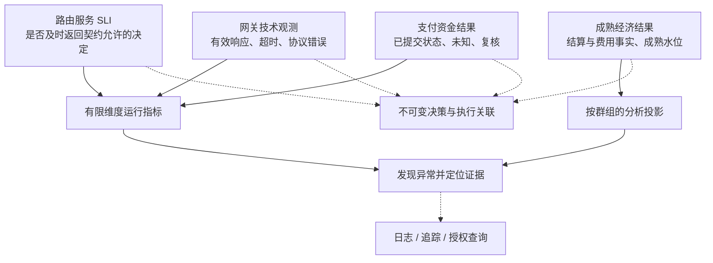
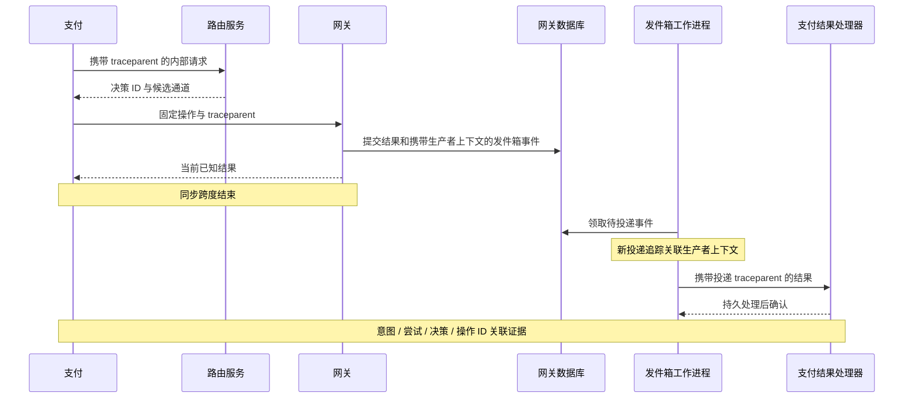
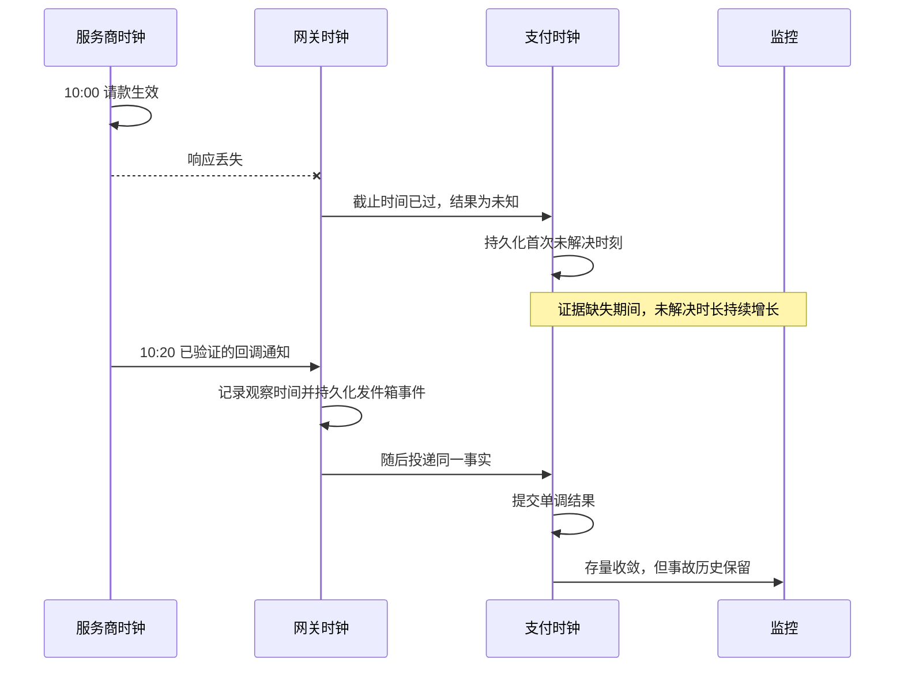
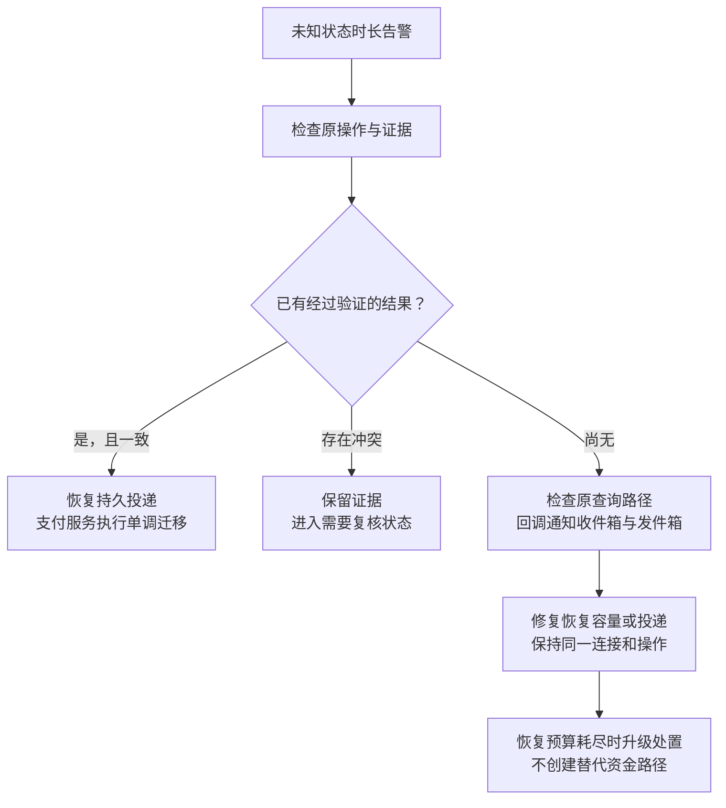

# 第 15 章 路由可观测性

**中文** | [English](../en/part-4-operating-at-scale/observability.md)

周五晚上，Aurora 的支付大盘仍然显示“成功率 94%”，客服却收到几十条“扣款了但订单还在等待”的投诉。路由服务的请求延迟没有变化，某条欧洲连接的 `SALE` 却连续超时。网关随后收到了成功回调通知，但投递到支付的发件箱已经积压二十分钟。第二天结算文件到达时，财务又发现这一批支付的实际费用高于在线估计。

四件事发生在同一条支付链路上，却不属于同一个“成功率”。路由服务可以正常作出决定，服务商调用可以发生技术故障，资金可以已经请款，而平台暂时不知道；费用则还要等待另一份事实。用一条曲线描述它们，只会让每个团队看见自己想看的解释。

本章的核心命题是：

> **可观测性必须分别回答路由服务是否履约、服务商技术调用发生了什么、支付资金状态是否收敛、经济结果是否成熟。授权速率不能替代其中任何一个问题；观测系统提供证据和告警，不拥有修改资金事实的权限。**

[第 14 章](routing-decision-store.md)已经固定了决策证据。本章把运行观测接到这条证据链上，不重新设计决策存储；实验分组与因果判断留给[第 16 章](experimentation.md)，外部事实校正留给[第 17 章](reconciliation.md)，结算与实际费用归因留给[第 18 章](settlement.md)，容量验证留给第 22 章和附录 C。

## 15.1 问题：一个总成功率为什么无法指导值班

第一版系统只有一个 `payment_requests_total` 和一个 `payment_success_total`。确认接口返回成功，就把第二个计数器加一；返回错误，就记一条日志。这个方案很容易上线，但只要问一句“这两个计数器在数什么”，分歧就出现了。

商户重复确认是新请求，却不是新意图。一次网络重试是新的 HTTP 调用，却可能仍是同一个服务商操作。发卡机构明确拒绝是业务未获批，但服务商已按协议作答。HTTP `202` 可以表示平台正在等待证据，不表示资金失败，更不是结算成功。用响应码统一解释这些事实，既会夸大失败，也会制造虚假的成功。

最危险的错误不是图表不准确，而是错误图表驱动了错误动作。若把发卡机构拒绝当成服务故障，值班人员会重启健康的网关，甚至尝试切换 PSP；若把 UNKNOWN 排除出大盘又不显示其数量，响应丢失最多的连接反而可能看起来更好。Stripe 官方将发卡机构拒绝、被阻断的支付和无效 API 调用区分处理，这也说明“未完成付款”并不是单一的技术错误类型。[Stripe：拒绝](https://docs.stripe.com/declines)

我们先要求每个指标回答六个问题：统计对象是什么，什么时候计数，分子和分母是什么，哪些结果尚未确定，允许按什么维度切分，以及谁负责采取行动。无法回答这些问题的仪表盘，即使曲线平滑，也不能成为生产控制的依据。

## 15.2 简单设计：从一个布尔结果拆成四类事实

下面的 Go 函数是第一版埋点的缩影。它没有数据竞争，也能编译，但无法表达支付语义：

```go
package naive

func MetricResult(err error) string {
	if err != nil {
		return "failure"
	}
	return "success"
}
```

某个适配器可能用 `error` 返回业务拒绝，另一个可能返回结构化 `declined` 加 `nil`；同样的业务结果会落到不同指标里。我们不能靠统一 Go 返回值修复它，而要让每个权威组件提供自己理解的事实。



四层不是四种可互换的展示方式，而是四份独立统计契约：

| 层 | 统计单位与分母 | 成功或异常的含义 | 负责人 |
| --- | --- | --- | --- |
| 路由服务 SLI | 约定入口的有效路由请求；每次服务调用各计一次 | 在预算内返回合法决定；内部错误、超时另计 | 路由/SRE |
| 服务商技术结果 | 实际派发的网络调用，按 API 操作分开 | 协议有效响应、超时、传输/协议/不可用 | 网关/集成团队 |
| 支付资金结果 | 唯一意图、尝试、逻辑操作，各用自己的分母 | 已授权、已请款、已拒绝、UNKNOWN、复核等领域事实 | 支付团队 |
| 成熟经济结果 | 指定创建群组、成熟规则与报告版本的支付集合 | 已结算金额、实际费用、退款或拒付影响 | 财务/数据团队 |

本书为路由服务的基础可用性契约选择“返回合法结果”：`selected` 和带完整排除证据的 `no_candidate` 都是可解释响应。因此当前接口的 `422 no_eligible_provider` 不自动成为路由服务内部错误；但必须另报 `route_usable` 比例与无候选通道原因，否则“正确地拒绝全部支付”也会呈现全绿。若业务 SLO 要求提供可执行路线，应另立履约指标，不能事后改变基础 SLI 的分母。

服务端埋点还看不见请求进入处理器之前的连接失败。基础 SLI 需要与支付调用方或入口层的观测互证，把尚未到达路由服务的超时纳入约定边界；不能只统计已经成功结束的处理器，再宣称端到端可用性。无效认证和畸形输入单列，避免恶意流量改变有效业务请求的分母。

服务商技术层同样只回答协议问题。发卡机构拒绝可以计为 `response`，不能计为授权批准；尚未派发的本地风险阻断、舱壁隔离拒绝也不能冒充服务商失败。`SALE` 超时同时产生一次技术超时和当前操作的 UNKNOWN，这两份事实并不矛盾。它们只能分别进入[第 13 章](../part-3-reliability/provider-health.md)的未来健康度决策和支付的原操作恢复流程。

## 15.3 规模化问题：分母、维度和时间都会变化

### 15.3.1 先固定分母，再讨论变化

假设某个授权群组启动了 1,000 次唯一授权试验，当前已知 840 次批准、100 次明确拒绝、60 次 UNKNOWN。若把“已知结果批准率”定义为 `840 / 940`，结果约为 89.36%；把“已观察到批准数 / 全部启动试验”定义为 `840 / 1000`，结果为 84%。前者必须同时显示 94% 的结果覆盖率，后者必须标明尚有 6% 未决。两者都不能被无条件命名为最终授权速率。

这里的试验单位沿用第 8 章，不是 HTTP 次数。一次查询不增加授权分母；同键的网络重试不新增逻辑试验；合法后备路由产生另一尝试，但意图成交率仍只计一个业务目标。授权、请款、结算还要分开：授权批准不能填进“已结算支付数”。

全局变化也未必表示某条路线退化。假设 A 在简单客群的批准率为 98%，在困难客群为 80%；B 分别为 97% 和 79%。A 在两类人群都更高，但若 A 接收 90% 困难流量，其总体为 81.8%；B 接收 90% 简单流量，其总体为 95.2%。总量比较会反转结论。这个示例只证明流量构成会影响聚合结果，不证明 A 的因果优势；实验方法属于下一章。

因此运营大盘要同时显示流量构成、样本量、未决比例和分段趋势。精细到商户或发卡机构的调查可以进入受控分析查询，不等于把所有分段都常驻为 Prometheus 标签。

### 15.3.2 每多一个维度，都在申请长期资源

为了定位上述变化，工程师很自然地给指标加上商户、意图、支付凭证令牌、完整网址和错误文本。一笔支付至少创造一条新时序后，监控系统自己先开始丢数据。把 ID 哈希后作为标签并不能降低基数，也不能自动匿名化。

Prometheus 官方说明，每个不同的标签集合都产生独立时间序列并消耗资源；指标维度应从少量、确有用途的集合开始。[Prometheus：埋点实践](https://prometheus.io/docs/practices/instrumentation/) Aurora 因而建立有限维度注册表：它不是事后删除标签的清洗器，而是指标 API 的输入合同。

| 数据 | 运行指标规则 | 详细调查位置 |
| --- | --- | --- |
| 服务、部署区域、环境 | 受控部署资源标签，不从请求读取 | 发布记录 |
| 候选通道、API 操作、故障域 | 只接受注册表中已批准且有总量上限的组合 | 连接快照 |
| 结果类别、排除原因、状态 | 封闭枚举；未知值计入固定异常类别 | 最小化的结构化日志 |
| 策略/能力/连接修订 | 默认不加每次发布生成的标签；必要时采用有上限的受控槽位 | 决策、追踪、发布元数据 |
| 意图/尝试/决策/操作 ID | 不进入指标标签 | 受控日志/追踪关联 |
| 商户、用户、完整发卡机构/BIN、原始网址 | 不作为无界指标维度；少量分析分组需另行审批 | 有访问控制的分析投影 |
| 支付凭证令牌、PAN、CVV/SAD、API 密钥、原始请求体 | 禁止进入观测管道 | 不为排障复制支付凭证 |

候选通道 ID 也不天然低基数。若平台为每个商户创建一条连接，就不能把全部连接直接注册；需要固定的运营分组，精确身份保留在证据链中。健康度内部仍按 `candidate + revision + operation + fault_domain` 隔离，不能因为指标聚合而合并熔断状态。发布时应计算活跃实例、允许组合、结果类别和直方图桶的乘积，并约束保留期内的变动，而不只检查当前某个进程的映射大小。

### 15.3.3 回执晚到会改变知识，不会抹掉过去的等待

假设服务商在 10:00 完成请款，平台在 10:20 才收到可验证的回执。资金事件的有效时间和平台观察时间相差二十分钟。若只保留 `updated_at=10:20`，业务群组会错位；若只保留 `occurred_at=10:00`，值班人员又看不见平台曾经等待二十分钟。

更正报表也会晚到。昨天显示的成本可能只是预期成本，今天是已收集部分费用，之后才到达结算或更正行。大盘不能用一个“实时成本”字段覆盖所有阶段，也不能把尚未成熟的便宜路线直接解释为更优。对账和成本计算留给后章，本章必须先暴露事实覆盖率、处理延迟和成熟水位。

成熟不等于永远不会变化。若报表采用七日观察期，就必须同时给出群组、观察期、`as_of` 和版本；更晚的退款、拒付或费用更正产生新的分析事实。计算每笔成功支付的实际成本时，要对齐同一成熟集合，说明如何计入失败尝试的费用，并保持币种一致。分子是今天到达的费用、分母却是今天刚获批的授权，这个商数没有稳定的经济含义。

## 15.4 生产级设计：可检验的观测契约

### 15.4.1 用类型和注册表限制指标入口

指标应从归一化的领域观察产生，而不是扫描日志猜测。以下教学实现只演示网关技术调用计数：启动时注册有限组合，预先创建全部结果序列，运行时拒绝任何未注册维度。它不读取支付身份，不计算授权率，也不改变操作。生产中应把相同边界接到官方指标客户端，使用受限的内部 `/metrics` 入口；不要把这段小型导出器当成完整监控 SDK。

```go
package telemetry

import (
	"errors"
	"fmt"
	"net/http"
	"regexp"
	"sync"
)

type TechnicalOutcome string

const (
	Response     TechnicalOutcome = "response"
	Timeout      TechnicalOutcome = "timeout"
	Transport    TechnicalOutcome = "transport_error"
	Protocol     TechnicalOutcome = "protocol_error"
	Unavailable  TechnicalOutcome = "provider_unavailable"
	Unclassified TechnicalOutcome = "unclassified"
)

var outcomes = [...]TechnicalOutcome{
	Response, Timeout, Transport, Protocol, Unavailable, Unclassified,
}

type ProviderDimensions struct {
	Candidate   string
	Operation   string
	FaultDomain string
}

type Metrics struct {
	mu       sync.Mutex
	keys     []ProviderDimensions
	counts   map[ProviderDimensions]map[TechnicalOutcome]uint64
	rejected uint64
}

func NewMetrics(keys []ProviderDimensions) (*Metrics, error) {
	if len(keys) == 0 || len(keys) > 64 { // 教学预算，不是通用容量上限。
		return nil, errors.New("invalid registry size")
	}
	slug := regexp.MustCompile(`^[a-z][a-z0-9_]{0,47}$`)
	m := &Metrics{counts: make(map[ProviderDimensions]map[TechnicalOutcome]uint64)}
	for _, key := range keys {
		if !slug.MatchString(key.Candidate) || !slug.MatchString(key.FaultDomain) ||
			(key.Operation != "sale" && key.Operation != "query") {
			return nil, errors.New("invalid registered dimension")
		}
		if _, exists := m.counts[key]; exists {
			return nil, errors.New("duplicate registered dimension")
		}
		m.keys = append(m.keys, key)
		m.counts[key] = make(map[TechnicalOutcome]uint64, len(outcomes))
		for _, outcome := range outcomes {
			m.counts[key][outcome] = 0
		}
	}
	return m, nil
}

func (m *Metrics) Observe(key ProviderDimensions, outcome TechnicalOutcome) bool {
	m.mu.Lock()
	defer m.mu.Unlock()
	values, registered := m.counts[key]
	if _, known := values[outcome]; !registered || !known {
		m.rejected++ // 只计固定计数器，不记录被拒绝的原始值。
		return false
	}
	values[outcome]++
	return true
}

func (m *Metrics) ServeHTTP(w http.ResponseWriter, r *http.Request) {
	if r.Method != http.MethodGet {
		w.Header().Set("Allow", http.MethodGet)
		w.WriteHeader(http.StatusMethodNotAllowed)
		return
	}
	type sample struct {
		key     ProviderDimensions
		outcome TechnicalOutcome
		value   uint64
	}
	m.mu.Lock()
	samples := make([]sample, 0, len(m.keys)*len(outcomes))
	for _, key := range m.keys {
		for _, outcome := range outcomes {
			samples = append(samples, sample{key, outcome, m.counts[key][outcome]})
		}
	}
	rejected := m.rejected
	m.mu.Unlock() // 不持锁等待抓取响应的网络写入。
	w.Header().Set("Content-Type", "text/plain; version=0.0.4")
	fmt.Fprintln(w, "# HELP payment_provider_api_calls_total Observed provider API calls.")
	fmt.Fprintln(w, "# TYPE payment_provider_api_calls_total counter")
	for _, s := range samples {
		fmt.Fprintf(w, "payment_provider_api_calls_total{candidate=%q,api_operation=%q,fault_domain=%q,outcome=%q} %d\n",
			s.key.Candidate, s.key.Operation, s.key.FaultDomain, s.outcome, s.value)
	}
	fmt.Fprintln(w, "# TYPE payment_telemetry_rejected_observations_total counter")
	fmt.Fprintf(w, "payment_telemetry_rejected_observations_total %d\n", rejected)
}
```

这里的 `Response` 来自已验证身份、可解析且符合服务商契约的响应，包括明确发卡机构拒绝；含糊的 5xx 不能凭 HTTP 状态变成确定无副作用。`Unclassified` 既不是批准，也不是健康成功，应配套分类覆盖率告警。未派发的本地拒绝不调用这个计数器。`Observe` 返回 `false` 只说明埋点违反注册表，不能让已经执行的支付重做。

这条边界要扩展成少量指标合同，而不是一个可接收任意标签映射的万能函数：

| 指标示例 | 类型与计数点 | 有限维度 | 可见延迟 |
| --- | --- | --- | --- |
| `router_decisions_total` | 计数器，每次有效决策完成 | 结果：已选/no_candidate/internal_error/截止时间 | 在线 |
| `router_decision_duration_seconds` | 直方图，路由服务入口到完成；不含服务商 | 操作、固定结果 | 在线 |
| `router_candidate_exclusions_total` | 计数器，一次求值中每个候选的去重排除原因 | 获批候选通道组、原因 | 在线 |
| `router_stale_features_total` | 计数器，消费到过期证据；不能藏入一般无候选通道 | 固定特征类型、处置类别 | 在线 |
| `payment_provider_api_calls_total` | 计数器，每次实际网络调用结束 | 注册表组合、技术结果 | 在线 |
| `payment_unknown_operations` / `payment_unknown_oldest_age_seconds` | 仪表，当前未收敛库存及最老年龄 | 固定操作、部署区域 | 有界刷新周期 |
| `payment_outbox_pending` / `payment_outbox_oldest_age_seconds` | 仪表，已提交但未完成投递的事实 | 固定生产者、目的端、事件类别 | 有界刷新周期 |
| `economic_cohort_coverage` | 分析投影字段，不伪装为在线批准指标 | 受控群组、币种、报告版本 | 由来源与成熟规则决定 |

技术计数器可以逐网络调用增加；若观察经发件箱投递到聚合器，就必须先按稳定观测 ID 去重。支付状态计数只能在领域转换提交后更新，重复回调通知的空操作不算新成交。不过进程可能在事务提交后、计数器增加前崩溃，所以内存计数器不是精确资金账。需要完整业务总量时，应从有幂等摄取的持久事实投影查询，不能用 `increase(counter)` 对账。

### 15.4.2 用追踪串联工作，用 ID 关联证据

指标负责指出“哪里异常”，追踪解释一次工作穿过哪些服务，结构化日志保存受控事件，第 14 章的决策保存不可变路由理由。四者分工明确后，无须给指标附上每笔支付的 ID。

同步内部调用由支付→路由服务、支付→网关传播 `traceparent`；每个服务创建自己的跨度，而不是把上游跨度 ID 原样当成本地工作。W3C 追踪上下文规定了传播字段，并明确这些字段只应用于追踪关联，不得存放个人或敏感信息。[W3C：追踪上下文](https://www.w3.org/TR/trace-context/) 公网入口的上下文不可信，应限制长度、校验格式并按信任边界选择重建追踪；它绝不能代替服务认证、商户身份或幂等键。

异步投递可能在原 HTTP 请求结束很久之后发生。为了表达这段关系，本章为每次发件箱投递创建短生命周期的新追踪，并以链接（Link）指向原生产者上下文；重投也是新的投递跨度，但关联同一事实。批量消费可链接多个来源，必须限制链接数量，不能为等待中的 UNKNOWN 保留一个数小时不结束的请求跨度。OpenTelemetry 的链接正是用于表达跨跨度、跨追踪的因果关系，已知链接宜在创建跨度时附加。[OpenTelemetry：追踪 API](https://opentelemetry.io/docs/specs/otel/trace/api/)



下面是同一教学包的追踪边界。`CaptureProducer` 只保留用于链接的 `traceparent`，不转存任意 Baggage 或请求头；`StartDelivery` 不继承原支付请求的超时，使用工作进程自己的取消和预算上下文。示例使用 OpenTelemetry Go API，真实 HTTP 中间件仍需按固定路由模板命名跨度，并在结束时记录有限结果类别。[OpenTelemetry Go：追踪](https://pkg.go.dev/go.opentelemetry.io/otel/trace) [OpenTelemetry Go：传播](https://pkg.go.dev/go.opentelemetry.io/otel/propagation)

```go
package telemetry

import (
	"context"
	"log/slog"
	"net/http"

	"go.opentelemetry.io/otel/propagation"
	"go.opentelemetry.io/otel/trace"
)

type Correlation struct {
	PaymentIntentID string
	AttemptID       string
	DecisionID      string
	OperationID     string
}

func InjectInternal(ctx context.Context, headers http.Header) {
	propagation.TraceContext{}.Inject(ctx, propagation.HeaderCarrier(headers))
}

func CaptureProducer(ctx context.Context) string {
	carrier := propagation.MapCarrier{}
	propagation.TraceContext{}.Inject(ctx, carrier)
	return carrier.Get("traceparent")
}

func StartDelivery(ctx context.Context, tracer trace.Tracer, parent string) (context.Context, trace.Span) {
	extracted := propagation.TraceContext{}.Extract(context.Background(),
		propagation.MapCarrier{"traceparent": parent})
	source := trace.SpanContextFromContext(extracted)
	options := []trace.SpanStartOption{
		trace.WithNewRoot(), trace.WithSpanKind(trace.SpanKindConsumer),
	}
	if source.IsValid() {
		options = append(options, trace.WithLinks(trace.Link{SpanContext: source}))
	}
	return tracer.Start(ctx, "outbox.deliver", options...)
}

func LogCorrelation(ctx context.Context, logger *slog.Logger, ids Correlation) {
	attrs := []slog.Attr{
		slog.String("payment_intent_id", ids.PaymentIntentID),
		slog.String("attempt_id", ids.AttemptID),
		slog.String("decision_id", ids.DecisionID),
		slog.String("operation_id", ids.OperationID),
	}
	if sc := trace.SpanContextFromContext(ctx); sc.IsValid() {
		attrs = append(attrs, slog.String("trace_id", sc.TraceID().String()),
			slog.String("span_id", sc.SpanID().String()))
	}
	logger.LogAttrs(ctx, slog.LevelInfo, "payment.work_observed", attrs...)
}
```

`Correlation` 的值只能来自已验证的内部领域对象，不能直接复制外部标头。请求关联 ID、意图 ID、操作 ID 和追踪 ID 各有职责，不能互相替代；同一操作的多次网络调用可以有不同跨度，重启后的恢复也可以进入新追踪。日志权限、保留期和检索审计仍然必要，非凭证 ID 不等于可以公开传播的数据。

同步采样可能漏掉后续才出现的冲突，尾部采样也不应假设会等待整笔支付成熟。因此关键状态与决策依靠持久化事实，不依靠“一定保留追踪”。如使用样例引用，只存受控追踪引用，不把它转成指标标签。生产还要禁止 HTTP 自动埋点收集原始请求体、授权信息、完整查询参数和服务商幂等键。

### 15.4.3 两条时间轴，加上一条不可重置的年龄

每份观察至少分开来源有效时间与平台首次观察时间；异步处理再增加本地提交时间。OpenTelemetry 日志模型区分 `Timestamp` 与 `ObservedTimestamp`，为这种区分提供了通用表达，但支付的 `effective_at` 仍须由服务商契约或领域事实定义，不能自动等同于所有外部日志时间。[OpenTelemetry：日志数据模型](https://opentelemetry.io/docs/specs/otel/logs/data-model/)



| 时间或水位 | 定义 | 禁止的简化 |
| --- | --- | --- |
| `effective_at` / 来源 `occurred_at` | 来源声称的业务事件时间，同时记录来源和可信状态 | 缺失时用接收时间冒充；用时间戳大小裁决资金冲突 |
| `observed_at` | 本平台首次观察该事实的时间 | 每次重复事件重置为现在 |
| `processed_at` | 消费者成功提交事实或领域转换的时间 | 收到消息就记作处理完成 |
| `first_unresolved_at` | 首次进入本轮未收敛资金状态的本地持久时刻 | 查询、租约、重试更新 `updated_at` 时一并重置 |
| 群组成熟水位 | 报告宣称哪些时间段、来源和结果已达到覆盖要求 | 把时间经过本身当成费用已经齐全 |

UNKNOWN 年龄是库存指标：在同一数据库快照中计算当前数量、最老时间和固定年龄区间，只有证据使状态真正收敛后才离开库存。对 `sending/possible` 且进程崩溃的情况，应另有最早可能派发时间与发送停滞指标，避免因为尚未来得及写 UNKNOWN 而完全隐形。不能拿不断更新的操作 `updated_at` 当年龄起点。

转入人工复核也不等于问题已解决。即使它不再属于自动恢复队列，仍须进入独立的未关闭复核库存与年龄指标，保留原始未决起点。值班目标是缩短不确定性和解决冲突，不是通过换状态名称让红色曲线归零。

发件箱也同时看深度和最旧时长。深度为十不一定健康，最老一条可能堵了三小时；深度为一万也未必异常，若消费速度足够且年龄很小，可能只是短时突发。重投不重置 `created_at`，永久毒消息隔离后还要留下隔离区库存，不能靠移出队列美化积压。按数据库分片由唯一采集器输出库存，或使用明确去重的采集拓扑，不能让十个应用副本重复汇报同一份全库仪表后再求和。

跨机器时间差还包括时钟偏差。可疑的负延迟应标成时间质量异常；缺失来源时间要明确表示未知。请求耗时使用本进程单调时钟，而资金证据不靠“最后收到的一条”覆盖。故障恢复后，今天的处理计数可以增加，旧群组可以追加更正版本，但当时的超时和等待不能从事故历史中消失。

### 15.4.4 延迟必须带测量边界、分位和窗口

“支付 p99”为何从 20ms 变成 800ms？可能是路由服务变慢，也可能是有人把服务商耗时并入了旧指标。应分别测路由服务决策、支付确认接口、网关单次网络调用和异步完成时间；查询与 SALE 分开，成功、超时和本地拒绝不能随意混为同一个分布。

统一使用秒，按服务预算选择直方图精度；示例预算不是 PSP 的承诺。超时调用应记录实际等待到截止时间的耗时，同时标记超时；只采集成功响应会系统性遗漏最慢的一端。它测得的是“调用方等待时间”，并不是服务商完成资金操作的真实时间。

完成时才计入直方图的调用，还会漏掉一直挂起的工作。因此要同时看执行中、队列等待、活跃租约与最老未完成工作；进程重启后不能因为内存中的慢请求消失就宣布恢复。服务持续可观测还依赖采集器自身的抓取成功率、最后成功采集时间和导出器丢弃量。

跨实例不能平均 p99。应先对可合并的直方图分布聚合，再求目标窗口的分位；经典直方图需保持桶边界兼容，原生直方图也须核验客户端与后端支持。Prometheus 官方说明了直方图与摘要指标的分位计算和聚合差异。[Prometheus：直方图与摘要](https://prometheus.io/docs/practices/histograms/) 每张图同时给出样本数与窗口，零请求显示“无样本”，不能显示“100% 健康”；预初始化的零序列、采集失败与数据过期也必须区分。

## 15.5 故障模式：从告警到可执行操作手册

### 15.5.1 告警表达损失，不替代支付决策

有了正确指标，也不该对每个短时波动呼叫值班。路由服务 SLO 应定义有效请求范围、延迟阈值、时间窗口和错误预算，再用短长窗口共同识别快速恶化与持续消耗。Google SRE 工作手册讨论的多窗口、多燃烧率方法可作为告警设计依据；具体阈值要由 Aurora 的流量和响应目标决定，不能直接照搬为支付行业标准。[Google SRE：SLO 告警](https://sre.google/workbook/alerting-on-slos/)

低流量连接的“一次超时导致 100% 错误率”需要最小样本和绝对量补充，但资金完整性冲突不应为了凑样本被忽略。服务错误预算报警、资金未决库存报警和数据成熟延迟报警分别设所有者，不用同一条阈值管理所有风险。

| 告警 | 首先检查 | 允许的受控动作 | 明确禁止 |
| --- | --- | --- | --- |
| 路由服务错误/延迟预算快速消耗 | 入口与调用方证据、配置发布、CPU/连接/缓存 | 回滚有问题的构建或已审批制品，保护新流量 | 把发卡机构拒绝改成服务错误 |
| 无候选通道或过期特征激增 | 原因分布、能力/健康度时效、影响范围 | 修复来源或回滚配置；保持硬约束安全拒绝 | 为恢复成功率绕过准入筛选 |
| 服务商超时激增 | 精确连接、操作、故障域与样本 | 网关团队定位；按第 13 章限制未来新流量 | 自动把当前 UNKNOWN 切到其他 PSP |
| UNKNOWN 最旧时长超预算 | 原操作、查询、回调通知收件箱、发件箱、恢复任务 | 恢复原连接查询与投递；冲突进入复核 | SQL 批量改失败、创建新键 |
| 发件箱时长/深度或隔离区上升 | 源端提交、目的端认证/可用性、毒消息 | 幂等重投；按契约隔离并保留证据 | 删除未处理事实或跳过冲突覆盖 |
| 经济结果覆盖率落后 | 来源文件、检查点、币种与成熟水位 | 通知财务/数据所有者，标记报告不完整 | 用估计费用冒充实际成本 |

操作手册必须包含指标定义、查询窗口、负责人、影响范围查询、只读诊断命令、获准动作、停止条件和升级出口。“重启试试”不是操作手册。权限也要落地：监控后端和仪表盘服务账户不能写支付状态，更不能直接调用网关发起资金操作。

调查继续使用原操作和精确连接。即使看到另一家 PSP 更健康，也不能把请款、撤销或退款路由过去；这些操作仍绑定原服务商连接与事务引用。重放事实、重试同一调用和创建新资金操作，是三种不同权限。



### 15.5.2 让埋点错误成为可复现的测试

指标接口能抓取不代表语义正确。下面的测试证明注册表不会因一万个未知候选通道扩张，也证明 `response` 与超时保持分离。批准和发卡机构拒绝在这里都属于协议有效响应，业务结果仍由另一份领域事实表达。

```go
package telemetry

import (
	"fmt"
	"net/http/httptest"
	"strings"
	"testing"
)

func TestBoundedProviderMetrics(t *testing.T) {
	key := ProviderDimensions{"cand_eu_a", "sale", "provider_api_eu"}
	m, err := NewMetrics([]ProviderDimensions{key})
	if err != nil {
		t.Fatal(err)
	}
	for _, observation := range []TechnicalOutcome{Response, Response, Timeout} {
		if !m.Observe(key, observation) {
			t.Fatal("valid observation rejected")
		}
	}
	for i := 0; i < 10000; i++ {
		bad := key
		bad.Candidate = fmt.Sprintf("merchant_private_%d", i)
		if m.Observe(bad, Response) {
			t.Fatal("unknown dimension accepted")
		}
	}
	for _, secret := range []string{"pi_private", "attempt_private", "tok_private"} {
		bad := key
		bad.Candidate = secret
		m.Observe(bad, Response)
	}
	response := httptest.NewRecorder()
	m.ServeHTTP(response, httptest.NewRequest("GET", "/metrics", nil))
	body := response.Body.String()
	for _, forbidden := range []string{"merchant_private", "pi_private", "attempt_private", "tok_private"} {
		if strings.Contains(body, forbidden) {
			t.Fatalf("metrics leaked %q", forbidden)
		}
	}
	if strings.Count(body, "\npayment_provider_api_calls_total{") != len(outcomes) {
		t.Fatal("metric cardinality changed")
	}
	if !strings.Contains(body, `outcome="response"} 2`) ||
		!strings.Contains(body, `outcome="timeout"} 1`) {
		t.Fatal("technical outcomes were mixed")
	}
}
```

完整增量还必须经过服务级场景：成功、拒绝、超时三条链路中路由服务都可正常返回决定，只有第三条增加服务商超时，并使支付暂时 UNKNOWN；后续成功回执只让资金状态收敛，不删除超时历史。重复确认不应增加意图成交数，重复回调通知不应新增状态转换，重复发件箱投递不应把一条事实计三次。

还要用假时钟证明查询重试不会重置 UNKNOWN 年龄，用暂停消费者证明发件箱最旧时长持续增长，用重启证明库存仪表可从持久状态重建。追踪测试应验证同步标头可传播、异步使用方是新根跨度且带生产者链接、非法 traceparent 不影响支付认证。最后扫描抓取、日志和导出跨度，确保敏感字段完全缺席，而不只检查指标标签名称。

## 15.6 权衡与当前实现边界

观测系统也会失败。导出器不可用时，在线支付不应同步等待远端收集器；使用有界队列、导出超时与明确丢弃计数。无导出器端点时初始化为空操作，仍可保留本地日志和抓取。这个降级只适用于运行遥测，不适用于第 14 章的本地执行证据：若支付无法持久化尝试、操作与必需的发件箱，仍不能先执行资金副作用。

采样降低日志和追踪成本，却削弱单次调查的可见性；无采样计数器更适合运行趋势，却不能保证事务级精确；持久投影能提供完整业务口径，却有处理延迟。生产系统需要明确选择每一种数据的用途，不能追求“一份数据同时解决告警、审计和会计”。

当前配套 Go 系统（`YouEclipse/payments`）的真实基线如下。本章代码是独立教学增量，不表示仓库已经接入完整遥测：

| 工程位置 | 已经具备 | 本章待配套能力 |
| --- | --- | --- |
| 路由服务 `internal/httpapi/handler.go` | `/metrics` 输出 `payment_router_up 1`；区分合法决策、无通过准入筛选的候选与内部错误响应 | 决策数量、延迟、排除原因、过期特征的有限维度埋点 |
| 支付 `internal/httpapi/handler.go` | `/metrics` 输出 `payment_service_up 1`；有错误日志与独立就绪检查 | 统一请求关联、状态观测、UNKNOWN 库存采集器与年龄直方图 |
| 网关 `internal/gateway/http.go` | `/metrics` 输出 `provider_gateway_up 1` | 逐 API 调用的类型化技术观测与直方图 |
| 三个服务启动入口 | 使用 `slog` JSON 处理器；部分错误带操作/事件 ID | 统一日志允许列表、追踪上下文、采样和导出策略 |
| 网关 `RunOutbox`、支付恢复工作进程 | 已有持久投递与原操作恢复路径；恢复截止时间、剩余预算、领取代数/租约和动作均持久化 | 发件箱深度/时长、处理水位、恢复结果与时间质量指标 |
| 支付/网关操作存储 | `created_at` 不可变，`first_dispatched_at` 首次外发时写入且不可重置；支付的恢复截止时间与预算也不能回拨 | 区分每一轮未决区间的显式 `first_unresolved_at` 与库存投影 |
| 网关观测账簿 | 销售操作/查询/回调通知的归一化观察追加保存，原始观测禁止 UPDATE/DELETE/TRUNCATE | 把有限技术结果稳定投影为本章指标，并定义保留与导出水位 |
| 当前依赖和契约 | 有进程存活指标入口 | 尚无共享 `internal/telemetry`、OpenTelemetry 导出器或完整业务 SLI |

三个 `up=1` 只说明抓取时相应处理器能响应，不证明服务商健康、支付已收敛或资金已结算。当前发件箱表具备创建时间，但库存采集器尚未实现。与旧基线不同，恢复链已经有不会随查询、租约或退避更新而重置的持久锚点：不可变 `created_at`、只写一次 `first_dispatched_at`，以及不可回拨的恢复截止时间/预算。它们足以构造保守的“从创建或首次可能外发起已等待多久”指标；若要准确区分同一操作多次进入和离开未决区间，仍需新增显式 `first_unresolved_at` 投影。不能再用可变 `updated_at` 冒充年龄。已有结构化日志与追加式观察也不等于跨服务追踪已经连通。

合理的纵向增量是先定义共享但按服务独立初始化的 `internal/telemetry` 契约，再把支付/路由服务/网关的同步传播、网关已有技术观察、支付库存采集接起来，最后补齐抓取与失败场景测试。持久观测字段需由各自数据所有者添加迁移，不能让共享包跨库读取业务表。这里只覆盖当前自动请款 SALE 与查询链路，不因此宣称人工请款、退款、完整遥测平台或真实 PSP 生产接入已经完成。

## 15.7 小结

本章从一个无法指导事故处理的总成功率，推导出四层观测合同、有限维度注册表、跨服务关联与双时间轴。路由服务履约、服务商技术结果、支付资金结果和成熟经济结果分别有自己的统计单位、时间窗口和负责人。

可靠的可观测性不只是增加数据：它防止发卡机构拒绝污染服务错误率，防止 UNKNOWN 被隐藏，防止重试重置等待年龄，也防止高基数与敏感数据进入遥测管道。指标定位异常，追踪与日志连接工作，决策与领域事实承担审计；告警把问题交给有权限的所有者，始终不能授权新的资金路径。下一章将在这些可解释口径之上讨论实验，而不是把一条上涨的曲线直接当成新路由策略有效的证明。
