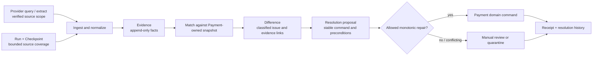
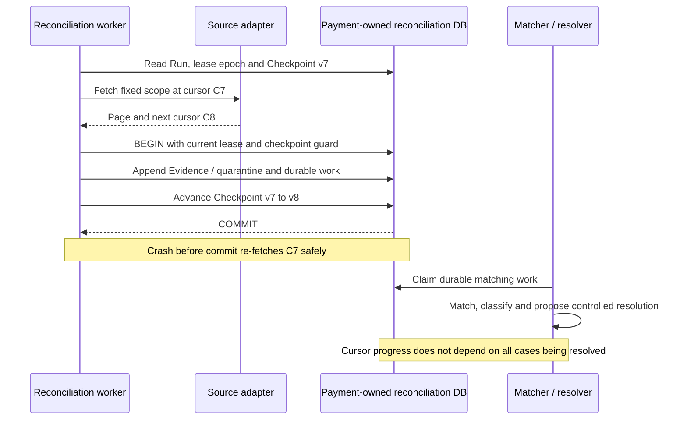
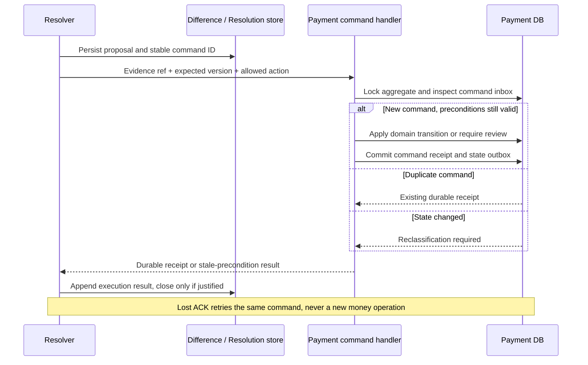

# 第 17 章 Reconciliation

Aurora 的在线支付链路已经能够处理响应丢失：一笔 129.00 USD 的 SALE 超时后保持 UNKNOWN，恢复任务查询原 Operation，确认 Capture 后再收敛。但月底核查仍发现三类异常：一笔平台显示 failed 的交易在 Provider 侧确实有 Capture 记录；一笔已成功支付被运营人员在 Provider 后台退款；另一条 Provider reference 根本找不到对应的内部 Attempt。

在线恢复没有做错，它只是从来没有被赋予发现全部外部差异的能力。它知道哪些内部 Operation 尚未完成，却不知道 Provider 侧有哪些平台未记录的操作；它恢复正在等待的工作，也不一定重新检查已经被内部判定为终态的记录。

本章的核心命题是：

> **Reconciliation 是对多源事实进行持久化摄取、匹配、差异分类和受控修复的流程。Run、Checkpoint、Evidence、Difference、Resolution 必须可追踪、可重放；对账发现矛盾，并不授予它绕过 Payment 领域模型改写资金终态的权力。**

本章承接[第 15 章](observability.md)的观测与[第 16 章](experimentation.md)的结果口径。它不重写[第 10 章](../part-3-reliability/timeout-and-retry.md)的同操作恢复，也不负责 Ledger 调账；SettlementLine、费用、FX 和 Actual Cost 留给[第 18 章](settlement.md)，跨 Region 对账所有权留给[第 19 章](../part-5-global-routing/multi-region.md)。

## 17.1 Problem：一直等 webhook，为什么还是会有盲区

最初，Aurora 相信成功响应和 webhook 足以更新状态。只要接口可用，回调迟一点也没关系。这个假设忽略了接收端停机、事件重复、投递耗尽、处理代码缺陷，以及 Provider 控制台中绕过平台发起的操作。

Stripe 官方明确说明 webhook 不保证按生成顺序投递，接收方还必须处理重复事件；这些约束足以否定“每笔支付最终都会按顺序收到一次正确通知”的设计前提。[Stripe：Webhooks](https://docs.stripe.com/webhooks) Adyen 的官方管理文档也展示了从 Customer Area 发起退款、取消或 Capture 的能力；因此外部事实并不总由平台 API 请求产生。[Adyen：Manage payments](https://docs.adyen.com/account/manage-payments)

发现这些差异后，最诱人的补丁是按年龄批量改状态：超过一天仍 processing，就认为失败；或者从运营提供的成功名单中直接 UPDATE 为 succeeded。前一种做法把“没有答案”当成“没有副作用”，后一种做法绕过了账户、金额、引用与既有终态检查。两者都可能让一个排障动作制造新的资金错误。

这时系统需要的不是更大胆的修复脚本，而是能够回答：谁在什么范围内提供了什么证据，它与哪一个内部操作对应，哪里有差异，谁批准了什么动作，以及这个动作是否确实生效。

## 17.2 Simple Design：先补 Query，再看见 Query 的边界

第一步可以给超时支付增加后台查询，但不能把“超时太久”写成状态判定函数：

```go
package naive

import "time"

// WrongForFunds is deliberately unsafe: elapsed time is not payment evidence.
func WrongForFunds(updatedAt, now time.Time) string {
	if now.Sub(updatedAt) > 24*time.Hour {
		return "failed"
	}
	return "processing"
}
```

正确的在线 recovery 读取已持久化的 Operation，沿原 connection、revision、Provider key 与语义 payload 查询或恢复。明确证据到来前保持 UNKNOWN；它不因等待太久而切 PSP。这个能力必要，但仍是一个从内部待办出发的闭环。

| 维度 | 在线 UNKNOWN recovery | 周期 Reconciliation |
| --- | --- | --- |
| 出发点 | 已知、未完成的内部 Operation | 固定范围内的内部记录与独立 Provider 清单 |
| 主要问题 | 这次操作现在能否安全收敛 | 两边有哪些缺失、重复、矛盾或人工变更 |
| 覆盖对象 | created/sending/pending/unknown 等可恢复工作 | 按合同包含必要的终态与外部孤立记录 |
| 进度状态 | 每条 Operation 的恢复时间、预算与 lease | Run、分区 Checkpoint、来源覆盖水位 |
| 资金权限 | 已有恢复契约内的原操作动作 | 只提交证据与受控领域命令，不另造资金路径 |
| 完成标准 | 单条已知工作收敛或转 review | 范围摄取、分类和处置进度分别可证明 |

只扫描内部 UNKNOWN，无论扫得多勤，都找不到“Provider 有、内部没有”的交易；只导入 Provider 成功记录，也看不见“内部宣称成功、外部清单没有”的差异。因此周期对账需要双向视角：从内部已知对象检查外部证据，从 Provider inventory 检查内部匹配。两边的范围、时间和完整性必须先对齐，不能把两个不同统计口径的集合直接相减。

## 17.3 Problems at Scale：比对之前，先让证据可靠

### 17.3.1 来源没有一条通用的优先级排行榜

“结算文件高于 Query，Query 高于 webhook”听起来明确，却混淆了不同事实。授权事件证明批准或额度保留，Capture 结果证明另一阶段，结算文件表达报告期间的资金或记账事项；它们并不是同一个字段的三个副本。

| 来源 | 可以提供的证据 | 不能直接推出 |
| --- | --- | --- |
| 同步响应 | 当次请求的 Provider-specific 结果 | 响应丢失等于未执行 |
| 已验签 webhook | 指定事件或对象的归一化观察 | 到达更晚便有权覆盖所有旧事实 |
| 精确对象 Query | 在该 API 契约下读取的当前对象或操作状态 | 缓存、搜索索引与精确查询具有同等一致性 |
| Provider transaction extract | 某个账户、时期、操作类别的记录集合 | 一个文件就是该账户全生命周期的完整清单 |
| Settlement/费用文件 | 第 18 章定义的结算与经济事实 | Authorization、Capture、Settlement 可以互换 |

每份 Evidence 保存 source kind、来源记录 identity、parser/API version、认证范围、有效时间、首次观察时间和必要的完整性信息。缺失来源时间时明确缺失，不用本地接收时间冒充。若两个可信来源矛盾，应保留双方，而不是给某种来源一个永久覆盖权。

“没有查到”尤其需要谨慎。Stripe PaymentIntent Search 官方说明它不适用于要求严格读后写一致性的流程，索引传播存在延迟。[Stripe：Search PaymentIntents](https://docs.stripe.com/api/payment_intents/search) 因而搜索为空、报表尚未到齐或查询超时，都不是原操作明确无副作用的证明。即使某个 Adapter 的精确 Query 契约能给出确定 not-found，是否允许同操作恢复仍由第 10 章的契约决定，对账 worker 不据此生成新 Attempt。

### 17.3.2 Matching 首先是身份问题，不是金额相等问题

两笔 129.00 USD 的支付可以发生在同一分钟；商户也可能重用订单备注。同 PSP 的两个 Merchant Account 还可能有相同格式的 reference。金额、币种和时间适合做一致性校验，却不应该独立构成自动认领交易的主键。

Matching 先限定 Provider 账户与稳定 namespace，再使用被契约验证的 Operation correlation 或 transaction/operation reference，最后核对精确 connection、revision、操作类型、金额和币种。只有一个候选且证明充分时才允许自动关联。多个候选、未知账户、reference 冲突或身份漂移都产生差异，不采用“最接近时间的那条”。

| 匹配层 | 使用证据 | 结果规则 |
| --- | --- | --- |
| 强内部关联 | 经 Provider 契约验证的原 Operation ID，并核对完整执行身份 | 唯一且属性一致才接受 |
| 强 Provider 关联 | 稳定 namespace 内的 payment/operation reference 与操作类型 | 检查所有既有 owner，不能跨 namespace 猜测 |
| 受控复合匹配 | 已审批的 Merchant reference、账户、操作、金额币种与时间范围 | 通常生成调查候选；自动化需要单独证明唯一性 |
| 无匹配或多匹配 | 外部孤立记录、重复 reference、资料不足 | 保存原 Evidence，进入 unmatched/ambiguous Difference |

Adyen 的报告文档分别定义 PSP Reference、Merchant Reference 与 modification reference，并提醒合并报告时核对报告期间和时区。这说明父支付与后续 Capture/Refund 记录的引用不能机械混用，Merchant reference 的唯一性也需要平台自己保证。[Adyen：Prepare the reports](https://docs.adyen.com/platforms/prepare-reports/)

本轮代码中的 `provider_namespace_id` 是碰撞域，不是回调授权域。同 namespace 的 recovery alias 不能因为名字不同绕过 reference 唯一性，也不能因为共享 namespace 就认领另一条 connection 的操作。来源路径需要明确授权，证据持久化时还要回归原 Operation 的 canonical identity。这个边界沿用第 3、11 章，本章只将它应用到比对流程。

### 17.3.3 扫过一个时间点，不等于完整覆盖了此前所有事实

第一版扫描器常把“最后一条记录时间”保存为 checkpoint。若同一秒有多条记录，或者 Provider 后来补入一条更早发生的交易，下一轮就会漏掉数据。使用 OFFSET 也可能受集合插入、删除和排序变化影响。

一个 Run 应先冻结来源、账户范围、操作类别、时间区间、时区、过滤条件和 Adapter version。上界固定，分页游标按该 API 的真实语义保存；不要跨来源复用一种假想的 `offset`。Stripe 的列表接口使用 object-ID cursor，而 Search 使用另一种分页 token，这种差异应该留在 Source Adapter 中。[Stripe：Pagination](https://docs.stripe.com/api/pagination)

如果 Provider 提供 snapshot token 或完整文件 manifest，就记录它；若没有一致快照，则采用安全延迟、重叠回看和幂等摄取，并诚实标明最终一致的覆盖范围。仅按 `created_at` 扫描会漏掉旧对象的新修改，需要变更流、更新时间扫描、已知对象复查或周期宽窗口回看中的相应能力。重叠窗口只能覆盖其声明的迟到范围，不能假装解决任意久之后的更正。

扫描完成与结果全部一致是两个状态。一个 Run 可以完成摄取，却仍有未分类记录、待核实的 missing-external 或开放 review。任何“缺失”判定都必须引用覆盖合同：账户、操作类型、时间区间和完整性水位；在数据尚未到齐时只能称为 `awaiting_evidence`。

### 17.3.4 重复记录和记录更正需要不同身份

Webhook event、报告版本中的一行、一次 Query observation，各有自己的来源身份。不能把可变 Provider object ID 直接当作不可变事件 ID：同一对象今天 pending、明天 captured，是两次合法观察，不是 payload 篡改。Query 每次生成新的 observation identity；同一观察的重复投递则复用原 ID。

对于真正不可变的来源记录，以 `source scope + record ID + record revision` 建唯一约束；同键同 digest 是重复，同键不同 digest 应隔离并保留两份内容。Provider 发布了正式更正版本，就追加新 Evidence 并关联被更正记录，不能覆写旧文件或旧规范化结果。Parser 修复也生成新的 interpretation version，原始最小化证据保持可追溯。

这些记录不能成为新的敏感数据仓库。源文件或 API 返回可能包含顾客资料、支付凭证或秘密字段；摄取边界先做 allowlist，凭证不进入 Evidence、日志、Trace 或事件。必要的来源原件按受控数据类别保存与授权访问，而不是把整个响应体随意塞进 JSONB。

## 17.4 Production Design：把对账变成持久工作流

### 17.4.1 五类对象，各自回答一个问题



| 对象 | 核心字段 | 持久化不变量 |
| --- | --- | --- |
| Run | run ID、source/scope、固定窗口、schema/Adapter version、snapshot ref、lease epoch、状态 | 重启不改变原范围；新范围产生新 Run |
| Checkpoint | run/partition、opaque cursor、checkpoint version、摄取水位 | 只推进到已持久接管的页，旧 owner 不能覆盖新进度 |
| Evidence | evidence ID、来源 identity/revision、digest、canonical connection、operation/ref、金额币种、时间 | 原件追加；重复幂等；冲突隔离；解释版本独立 |
| Difference | difference ID、类型、subject、证据集合、classifier version、当前处置状态 | 不因重跑同一问题产生大量重复工单；历史分类不抹除 |
| Resolution | resolution/command ID、difference ID、动作、证据 ref、预期领域版本、批准者、执行回执 | 提议不是执行；回执不是猜测；每次处置留审计记录 |

Difference 的身份通常围绕一个稳定问题，例如某 Operation 的 reference 冲突；多轮 Run 发现相同问题时追加 observation links，而不是按 `run_id` 每次新建一张工单。问题解决后出现新矛盾，可以显式 reopen 或产生关联的新 case，不能覆盖旧 Resolution。记录这些身份是为了恢复工作，不是把它们放进高基数 metric label。

首个部署可以是 `services/payment/cmd/reconciler`：独立进程和资源预算，但仍在 Payment 数据所有权内。它通过 Gateway 的只读契约取得外部观察，不读取 Gateway schema；若以后成为独立服务，则用 Payment API/事件快照匹配并提交命令，不持有跨库任意 UPDATE 权限。

### 17.4.2 Checkpoint 必须与“已接管的工作”原子提交

最关键的 crash window 位于取回一页与保存进度之间。先更新 cursor、再写 Evidence，崩溃后会永久跳过这一页；先逐条修复支付、最后才记录工作，崩溃后又无法证明哪些动作已经生效。

正确边界是一个短本地事务：保存该页的 Evidence 或 quarantine、为每条可处理记录创建幂等 matching work、推进 Checkpoint，并记录页完成信息。网络抓取发生在事务之外，分类与资金状态收敛通过后续持久任务完成。Checkpoint 代表“工作已经可靠接管”，不代表“所有差异已经修复”。



下面的标准库 Go 示例表达页级交接，不提供内存数据库冒充持久化。`CommitPage` 必须由真实 PostgreSQL transaction 实现，注释中的原子性要由 integration test 兑现。

```go
package reconciliation

import (
	"context"
	"errors"
)

type Run struct {
	ID             string
	ScopeDigest    string
	AdapterVersion string
	LeaseEpoch     uint64
}

type Checkpoint struct {
	RunID   string
	Version uint64
	Cursor  string
}

type SourceRecord struct {
	RecordID       string
	RecordRevision string
	PayloadDigest  [32]byte
	SanitizedBody  []byte
}

type Page struct {
	ScopeDigest    string
	AdapterVersion string
	FromCursor     string
	NextCursor     string
	Last           bool
	Records        []SourceRecord
}

type Source interface {
	Fetch(context.Context, Run, string) (Page, error)
}

type PageStore interface {
	// One transaction verifies the live lease epoch and checkpoint version,
	// durably stores every record or quarantine plus idempotent matching work,
	// and advances the checkpoint. It never performs a Provider money call.
	CommitPage(context.Context, Run, Checkpoint, Page) (Checkpoint, error)
}

func ScanPage(ctx context.Context, source Source, store PageStore, run Run, current Checkpoint) (Checkpoint, error) {
	if run.ID == "" || run.ScopeDigest == "" || run.AdapterVersion == "" ||
		run.LeaseEpoch == 0 || current.RunID != run.ID {
		return current, errors.New("invalid run or checkpoint")
	}
	page, err := source.Fetch(ctx, run, current.Cursor)
	if err != nil {
		return current, err
	}
	if page.ScopeDigest != run.ScopeDigest || page.AdapterVersion != run.AdapterVersion ||
		page.FromCursor != current.Cursor ||
		(!page.Last && (page.NextCursor == "" || page.NextCursor == current.Cursor)) {
		return current, errors.New("page does not match fixed scan contract")
	}
	return store.CommitPage(ctx, run, current, page)
}
```

`ScopeDigest` 引用冻结的账户、操作、窗口和过滤条件，不由临时请求拼接。Store 还需防止 cursor 循环、重复页产生重复 work，以及已失去 lease 的旧 worker 提交。单纯“领取后等一分钟”不提供 fencing；每次提交都要验证当前 epoch 与 checkpoint version。

`FOR UPDATE SKIP LOCKED` 可用于分配待处理任务，但不能用“本次没取到行”证明整个范围为空。PostgreSQL 官方明确指出跳过锁定行会产生不一致视图，因此它适合队列式消费，不适合当作一般完整性扫描的证明。[PostgreSQL：SELECT](https://www.postgresql.org/docs/current/sql-select.html) 范围完成应由全部 partition checkpoint 和明确的覆盖元数据判断。

### 17.4.3 分类器只提出动作，不执行动作

差异类型与修复动作应当分开保存。同一种 `status_mismatch`，可能只是未知状态被充分证据补齐，也可能是两个终态互相矛盾；名字相同不代表有相同的自动化权限。

| Difference 类型 | 产生条件 | 默认处置边界 |
| --- | --- | --- |
| missing_internal | 可信外部记录没有唯一内部对象 | 调查来源和关联，不自动创建 Payment |
| missing_external | 声明的完整范围中缺少预期外部记录 | 复查范围与精确对象；缺失本身不证明无副作用 |
| status_mismatch | 两侧同一操作的阶段或状态不一致 | 仅充分且无冲突的新事实可提出单调收敛 |
| amount_currency_mismatch | 强身份关联后金额或币种矛盾 | review，不自动补差额或创建退款 |
| reference_collision | 同一碰撞域内出现竞争 owner | 保留全部关联并复核，不抢占 reference |
| awaiting_evidence | 覆盖未成熟或关键属性缺失 | 保留待办和年龄，不伪装成已一致 |

不可信或无法验证来源身份的输入先进入 quarantine，不能仅凭外部声称的 Operation ID 给某笔支付贴上冲突标签。通过信任边界但尚未匹配的记录则可形成独立 Difference，等调查取得强关联后再涉及 Payment。

下面的纯函数只覆盖“已有内部 Operation ID 的 automatic-capture SALE”这条窄路径。基于 reference 的候选发现与唯一性检查在它之前完成；无法获得强关联的 Evidence 保留在 unmatched 队列。`Verified` 由受信任的 Gateway/Source Adapter 设置，不是外部调用者可自行声明的权限字段。

```go
package reconciliation

type Connection struct {
	ID        string
	Revision  string
	Namespace string
	Provider  string
}

type Snapshot struct {
	OperationID        string
	Connection         Connection
	Version            int64
	Status             string
	Kind               string
	AmountMinor        int64
	Currency           string
	PaymentReference   string
	OperationReference string
	ReviewRequired     bool
	AuthorizationSeen  bool
}

type Evidence struct {
	ID                 string
	OperationID        string
	Connection         Connection
	Kind               string
	State              string
	Verified           bool
	AmountKnown        bool
	AmountMinor        int64
	Currency           string
	PaymentReference   string
	OperationReference string
	NoSideEffect       bool
	ReferenceCollision bool
}

type Plan struct {
	Action          string
	Reason          string
	EvidenceID      string
	ExpectedVersion int64
}

func Classify(local Snapshot, evidence Evidence) Plan {
	plan := func(action, reason string) Plan {
		return Plan{action, reason, evidence.ID, local.Version}
	}
	if !evidence.Verified || evidence.ID == "" || local.Version <= 0 ||
		local.OperationID == "" || evidence.OperationID != local.OperationID ||
		local.Connection.ID == "" || local.Connection.Revision == "" ||
		local.Connection.Namespace == "" || local.Connection.Provider == "" ||
		evidence.Connection != local.Connection {
		return plan("quarantine", "untrusted_or_unmatched_identity")
	}
	if local.Kind != "sale" || evidence.Kind != local.Kind {
		return plan("review", "unsupported_operation_mapping")
	}
	if local.ReviewRequired {
		return plan("review", "existing_review_is_sticky")
	}
	if evidence.ReferenceCollision ||
		(local.PaymentReference != "" && evidence.PaymentReference != "" &&
			local.PaymentReference != evidence.PaymentReference) ||
		(local.OperationReference != "" && evidence.OperationReference != "" &&
			local.OperationReference != evidence.OperationReference) {
		return plan("review", "reference_conflict")
	}
	if local.AmountMinor <= 0 || local.Currency == "" ||
		(evidence.AmountKnown && (evidence.AmountMinor != local.AmountMinor ||
			evidence.Currency != local.Currency)) {
		return plan("review", "amount_or_currency_mismatch")
	}
	terminal := local.Status == "succeeded" || local.Status == "failed"
	switch evidence.State {
	case "unknown", "pending", "not_found":
		if terminal {
			return plan("no_op", "retain_terminal_against_weaker_evidence")
		}
		return plan("wait", "more_evidence_required")
	case "authorized":
		if local.Status == "failed" {
			return plan("review", "authorization_conflicts_with_failure")
		}
		if local.Status == "succeeded" {
			return plan("no_op", "authorization_is_not_new_capture_evidence")
		}
		return plan("wait", "authorization_is_not_capture")
	case "captured", "declined", "failed":
	default:
		return plan("review", "unsupported_source_state")
	}
	if evidence.State == "captured" && local.Status == "failed" {
		return plan("review", "terminal_status_conflict")
	}
	if evidence.State != "captured" && evidence.NoSideEffect &&
		(local.Status == "succeeded" || local.AuthorizationSeen) {
		return plan("review", "funds_evidence_conflicts_with_failure")
	}
	if !evidence.AmountKnown {
		return plan("wait", "amount_evidence_missing")
	}
	if evidence.State == "captured" {
		if evidence.PaymentReference == "" || evidence.OperationReference == "" {
			return plan("review", "capture_reference_missing")
		}
	} else {
		if !evidence.NoSideEffect {
			return plan("wait", "failure_does_not_prove_no_side_effect")
		}
	}
	if terminal {
		return plan("no_op", "consistent_terminal_evidence")
	}
	switch local.Status {
	case "created", "sending", "pending", "unknown", "retry_scheduled":
		return plan("apply_outcome", "monotonic_evidence_candidate")
	default:
		return plan("review", "unsupported_local_state")
	}
}
```

这段函数不会把 Authorization 当 Capture，也不会把任意 failed 字符串当作 `side_effect=none`。金额缺失与金额为零不同；已经显露的终态矛盾也不能因为金额缺失而降级为普通等待。部分 Capture、Refund 或不支持的操作必须由对应模型解释，不能硬塞进全额 SALE 的成功分支。它返回 `apply_outcome` 也只是候选动作，最终仍由 Payment 在最新事务状态下重新校验。

这里的 `no_op` 只表示不改变资金状态，并不删除 Evidence 或自动关闭全部 Difference。例如内部已成功而搜索暂未查到，原终态必须保留，但来源覆盖问题仍然可以继续调查。

### 17.4.4 自动修复必须经过 Payment 的原子边界

Matcher 读取 Snapshot v8 后，webhook 可能已经把 Operation 更新为 v9。若它拿旧比较结果直接 UPDATE，就会覆盖刚到达的事实。Resolution command 因此必须携带稳定 command ID、Difference/Evidence 引用、预期领域版本和允许的动作类别。

Payment 在本地事务内验证调用者权限、幂等命令 identity、证据绑定与当前 aggregate，调用同一套 `ApplyProviderOutcome` 或 `RequireManualReview`，持久化回执并写状态 outbox。版本改变时重新读取与分类；不能简单取消版本条件。PostgreSQL 的事务隔离并不会自动替应用维护所有业务约束，需要正确的锁、版本检查与必要的整事务重试。[PostgreSQL：Transaction Isolation](https://www.postgresql.org/docs/current/transaction-iso.html)



若命令已生效而回执响应丢失，Resolver 继续发送同一个 command ID，Payment 返回已保存回执。若保存 Resolution 结果时崩溃，也通过这份回执补齐，而不是再次“修复资金”。唯一约束应覆盖命令 identity 与来源事实 identity；数据库唯一索引是并发去重的保护，不是先查询再插入的乐观约定。[PostgreSQL：Unique Indexes](https://www.postgresql.org/docs/current/indexes-unique.html)

这里的 repair command ID 不是 Merchant key、Provider key，也不应伪装成新的 Provider event ID。它属于 Payment 受控修复接口的幂等命名空间；真实来源 identity 继续保留在 Evidence 中。自动修复最多补入已经发生且被验证的事实，不发起新的 SALE、Capture、Void 或 Refund。

### 17.4.5 冲突复核是正式出口，不是失败消息的垃圾桶

内部 failed 与外部 captured 矛盾时，系统保存双方证据并标记 integrity review；不能为了让日报一致就覆盖成 succeeded。内部已确认成功也不能被迟到的失败覆盖。对未终结且无法安全归属的 Operation，可以停止自动恢复并进入 review_required；对已确认终态，则保持原资金事实并叠加完整性问题。

人工队列需要 owner、优先级、年龄、调查步骤和可审计处置。操作者可以补充证据、确认来源映射错误、将问题转给 Provider、提出受控领域修复，或交由外部 Ledger 流程处理会计调整；不能直接在对账表写一个“余额已修正”。需要退款等新的资金操作时，它是另一个明确授权、幂等且绑定原 connection/reference 的工作流，不是关闭 Difference 的副作用。

未知内部对象的 Provider 记录先成为 `missing_internal`，不能自动创建假的 Payment Intent 来让 join 成功。reference 被两个 Attempt 声称时，应保留两个 owner 的关系并让相关资金对象进入复核，而不是把 reference 抢给最后到达的一方。

## 17.5 Failure Modes：用崩溃与矛盾证明设计

| 失败场景 | 必须保留的事实 | 正确结果 |
| --- | --- | --- |
| webhook 丢失，Query 确认原 SALE captured | 原 Operation、精确身份、金额币种和必要 references | 通过 Payment 领域命令收敛，只有原资金路径 |
| 内部 failed，外部 captured | 两个互相矛盾的观察及来源时间 | review，不覆盖终态、不发起另一笔支付 |
| 来源搜索为空或报告未到齐 | 查询范围、覆盖水位与来源质量 | awaiting_evidence，不推出无副作用 |
| 同 namespace 的 reference 被两条 connection 声称 | 所有 owner、canonical identity 与 incoming Evidence | reference collision，不能借 alias 绕过检测 |
| 页提交前崩溃 | 旧 Checkpoint | 重取同页，记录幂等，不漏工作 |
| 页提交后、分类前崩溃 | 新 Checkpoint、Evidence 和 durable work | 从任务表继续，不依赖进程内列表 |
| 修复提交后 ACK 丢失 | 同一个 command ID 与 Payment durable receipt | 幂等返回，不产生第二次领域动作 |
| 老 worker 在 lease 失效后提交 | 新 epoch、Checkpoint version | fencing 拒绝旧 owner，不回退游标 |
| 更正文件或 parser 升级 | 原版本、新版本与 supersedes/interpretation 关系 | 追加解释，不删除原证据 |
| 终态复查发现外部 Refund | 原 Capture 与独立 modification evidence | 按支持的操作模型或 review 处理，不把原 Capture 改成从未成功 |

纯函数测试可以先证明“分类不等于资金变更”。以下用例覆盖 UNKNOWN 收敛候选、矛盾终态、授权未 Capture、含糊失败以及 namespace 漂移。它们不代替真实数据库的事务和 crash-window 测试。

```go
package reconciliation

import "testing"

func TestClassifyNeverOverwritesFunds(t *testing.T) {
	connection := Connection{"cand_us_a", "rev7", "account_us_a", "psp_a"}
	base := Snapshot{
		OperationID: "op_1", Connection: connection, Version: 8,
		Status: "unknown", Kind: "sale", AmountMinor: 12900, Currency: "USD",
	}
	proof := Evidence{
		ID: "ev_1", OperationID: "op_1", Connection: connection,
		Kind: "sale", State: "captured", Verified: true, AmountKnown: true,
		AmountMinor: 12900, Currency: "USD",
		PaymentReference: "payment_ref_1", OperationReference: "sale_ref_1",
	}
	tests := []struct {
		name   string
		change func(*Snapshot, *Evidence)
		action string
	}{
		{"unknown to captured candidate", func(*Snapshot, *Evidence) {}, "apply_outcome"},
		{"failed conflicts with captured", func(s *Snapshot, _ *Evidence) { s.Status = "failed" }, "review"},
		{"missing amount cannot hide terminal conflict", func(s *Snapshot, e *Evidence) {
			s.Status, e.AmountKnown = "failed", false
		}, "review"},
		{"success conflicts with conclusive failure even without amount", func(s *Snapshot, e *Evidence) {
			s.Status, e.State, e.NoSideEffect, e.AmountKnown = "succeeded", "failed", true, false
		}, "review"},
		{"authorization is not capture", func(_ *Snapshot, e *Evidence) { e.State = "authorized" }, "wait"},
		{"ambiguous failure stays unresolved", func(_ *Snapshot, e *Evidence) { e.State = "failed" }, "wait"},
		{"foreign namespace cannot attach", func(_ *Snapshot, e *Evidence) { e.Connection.Namespace = "other_account" }, "quarantine"},
		{"reference collision", func(_ *Snapshot, e *Evidence) { e.ReferenceCollision = true }, "review"},
		{"amount mismatch", func(_ *Snapshot, e *Evidence) { e.AmountMinor++ }, "review"},
		{"search miss is not failure", func(_ *Snapshot, e *Evidence) { e.State = "not_found" }, "wait"},
		{"existing review stays sticky", func(s *Snapshot, _ *Evidence) { s.ReviewRequired = true }, "review"},
	}
	for _, test := range tests {
		t.Run(test.name, func(t *testing.T) {
			local, evidence := base, proof
			test.change(&local, &evidence)
			before := local
			plan := Classify(local, evidence)
			if plan.Action != test.action || plan.ExpectedVersion != local.Version {
				t.Fatalf("plan=%+v, want action %s", plan, test.action)
			}
			if local != before {
				t.Fatal("classifier mutated payment snapshot")
			}
		})
	}
}
```

工程验收还必须在真实 PostgreSQL 中测试同页并发摄取、同 key 不同 digest、checkpoint CAS、旧 lease epoch 和命令回执丢失。测试应同时检查 Evidence 数量、开放 Difference、Resolution receipt、领域状态和资金调用次数；只断言一个函数返回 nil，无法证明没有丢记录或重复动作。

运营上分别监控来源覆盖落后、最老未分类任务、开放 Difference 年龄、review 积压和自动修复拒绝原因。Run 的“绿色”必须说明是摄取完成、分类完成还是差异已处置；有一千条人工问题未关闭的任务不能只报一句“对账成功”。

## 17.6 Trade-offs 与配套实现边界

频繁精确 Query 能更快发现变化，却消耗 Provider 限额并可能挤占在线恢复；批量 extract 适合广覆盖，但具有来源延迟和不同报告语义。合理设计保留独立并发预算与优先级，让周期扫描可退让，不能在大规模回看时饿死正在等待答案的支付。

宽窗口回看提高迟到覆盖，却增加重复摄取；幂等 Evidence 与稳定 Difference 能降低重复工作的代价，但不能代替明确的迟到上限。完整保留来源有助于审计，数据最小化与保留要求又限制可存内容；因此保留版本、摘要和受控原件引用，不把全部 Provider 数据复制到 Router 或日志。

自动修复能降低人工量，却必须保持狭窄条件。若为了提高“自动解决率”放宽 reference 匹配或忽略资金冲突，系统只是把可见差异变成不可见错误。宁可留下可解释的 review，也不要获得一张无法说明来历的平衡报表。

当前 `YouEclipse/payments` 的实现与本章目标需要明确分开：

| 工程位置 | 当前已经具备 | 仍是待配套增量 |
| --- | --- | --- |
| Payment `app.RunReconciler` | 轮询已知可恢复 Operation，领取后 Query 或按现有契约恢复原操作 | 独立周期 Run、双向 inventory、终态复查 |
| `ClaimRecoverableOperations` | PostgreSQL 中按恢复时间领取 created/sending/pending/unknown 等工作 | 来源分区 Checkpoint、固定扫描范围、lease epoch fencing |
| Gateway `Get(..., reconcile=true)` | 对适用的未终态查询原 connection；终态直接返回本地记录 | 对终态仍可取得新外部事实的显式只读 audit Query / extract API |
| Gateway `provider_operation_observations` | sale/query/webhook 与 legacy seed 观察以来源、内容摘要、时间和精确 Operation 身份追加保存；数据库阻止 UPDATE/DELETE/TRUNCATE | 跨来源 inventory、范围水位、修订链和面向对账的读取 API |
| Payment `ApplyOutcome` | inbox、身份校验、状态转换与 outbox 的持久事务；拒绝数据进入 quarantine | 面向 Reconciliation 的 Evidence/Difference/Resolution 模型与修复命令回执 |
| Domain `ApplyProviderOutcome` / `RequireManualReview` | 单调收敛、保留确认终态、冲突完整性标记；停止不安全自动恢复 | 完整人工调查与已审批修复流程 |
| 周期对账服务 | 尚不存在独立实现 | `services/payment/cmd/reconciler`、`internal/reconciliation` 及迁移、失败测试 |

特别是现有 Gateway GET 会对 succeeded、failed 和 review_required 短路返回；循环调用它并不能独立验证这些终态。新 audit 接口应明确只读取 Provider，不执行 resubmit，不把 `operation_resubmit_required` 当作对账 worker 的执行授权。Gateway 继续拥有凭证、Provider-specific Query 与归一化，Payment 继续拥有资金状态。

当前基线已有精确 connection/revision/namespace、UNKNOWN Query 收敛、终态冲突与 reference collision 测试，也新增了 Gateway 侧的追加式原始观察账本。该账本解决“协议观察不能被后来的状态覆盖”，却不等于本章独立对账服务已经交付：它没有冻结外部 inventory 范围，没有 Run/Checkpoint/Difference/Resolution，也没有 repair-command crash-window。不能把 observation rows 或教学分类器冒充完整平台。固定实现提交与 CI 证据以[本章交付说明](../deliveries/chapter-17-reconciliation.md)为准。

建议的首个纵向切片只覆盖一个 Provider Simulator 的全额 automatic-capture SALE：通过 Gateway 只读观察导入固定窗口，匹配原 Operation，持久化 missing/status/reference 差异，再由 Payment 受控命令收敛或复核。能识别外部退款记录，不等于当前系统已经提供 manual Capture、Void、Refund 或 Ledger 调账 API。

## 17.7 Summary

本章从“等回调、补 Query”走到一条持久的事实比对链：冻结 Run 范围，原子接管分页工作，追加 Evidence，先做强身份匹配，再分类 Difference，最后通过有前置条件和幂等回执的 Resolution 进入 Payment 领域边界。

时间过去、搜索为空、记录晚到或报表出现一行，都不足以自动改写资金终态。UNKNOWN 可以在充分证据下单调收敛；矛盾必须保留并进入 review；任何新资金操作需要自己的授权与幂等契约。周期对账扩大的是发现事实的范围，不是系统任意修改事实的权力。下一章将在这条证据链上归因结算与实际费用，而不是再创造一套“看起来对得上”的支付真相。
