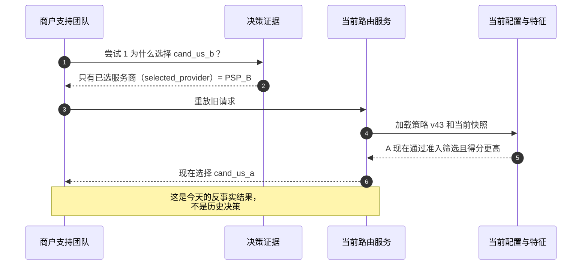
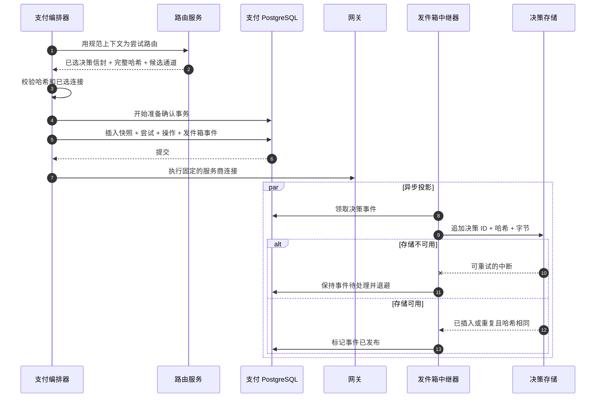
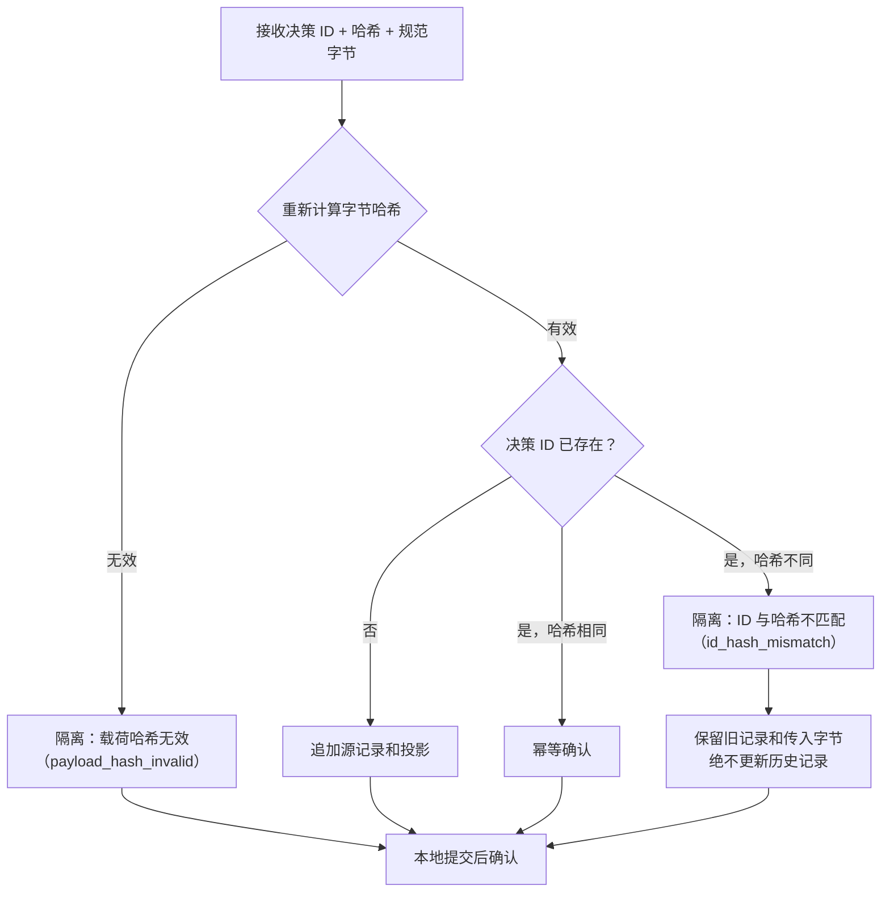
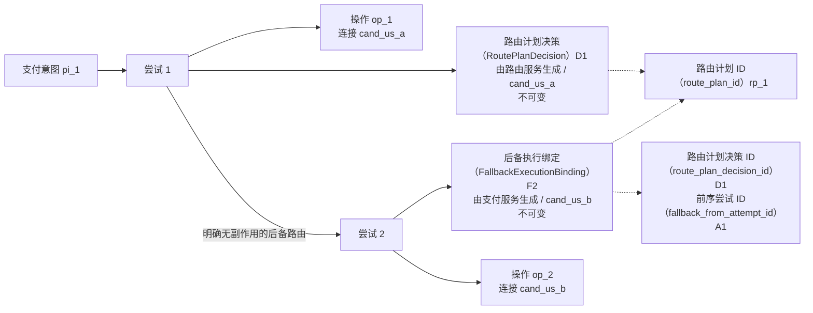

# 第 14 章 路由决策存储

**中文** | [English](../en/part-4-operating-at-scale/routing-decision-store.md)

三个月后，Aurora 的商户问：“这笔 129.00 USD 的支付为什么走了 `cand_us_b`？”值班工程师找到了 `selected_provider=PSP_B`，再用当前路由服务配置重算，结果却是 `cand_us_a`。这并不证明过去选错了，也不证明现在选对了：规则已发布新版本，能力已修订，费用与成功率窗口已经滚动，健康度快照也早已过期。今天的重算只回答“现在会怎么选”，不能回答“当时为什么那样选”。

若这笔支付还发生过后备路由，问题会更尖锐。尝试 1 可能根据由路由服务生成的 `RoutePlanDecision` 选择 A；在 A 明确无副作用、固定下一项 B 通过新鲜护栏后，尝试 2 由支付服务生成的 `FallbackExecutionBinding` 绑定 B。只保存意图的“最终服务商”，会把两条独立资金路径压成一条；把支付绑定伪装成第二次路由服务决策，又会混淆“谁排序”和“谁有权创建新资金路径”；只保存日志则可能因为采样、保留期或字段变更失去证据。

本章建立第四部分的第一个不变量：

> **过去为什么选择这条路由，必须由决策时封存的不可变事实回答，不能用当前配置、当前特征或当前代码重算。路由服务构造规范化的 `DecisionEnvelope`，支付在创建尝试的本地事务中固定执行快照并写发件箱；远端决策存储只做只追加查询投影，它不可成为支付执行的同步依赖。**

这里的决策记录是路由黑匣子，不是资金账本。它记录候选、排除、规则、版本、分数和选择；支付意图、服务商操作与资金状态仍由支付编排器掌握，余额、会计分录和结算事实仍属于账本、对账与结算边界。指标/追踪留给[第 15 章](observability.md)，实验分组的产生留给[第 16 章](experimentation.md)，外部事实差异与修复留给[第 17 章](reconciliation.md)，保留期与跨区域复制留给[第 19 章](../part-5-global-routing/multi-region.md)，配置发布权限留给[第 20 章](../part-5-global-routing/configuration-platform.md)。

配套实现已经完成了本章的**本地执行快照基线**：路由服务 v3 返回完整 `routing_context.v2`、风险、优化、候选通道证据/顺序、已选连接与 `executable_until`；支付在创建尝试/操作的同一 PostgreSQL 事务中校验并固定完整上下文/决策 JSON 快照与截止时间，首次网关 I/O 必须服从这份权威。它尚未完成本章最终形态：JSONB 快照不是跨语言规范来源字节；`rtd_` 仍是截断内容 ID，不是持久化完整 SHA；也没有决策专用发件箱、只追加决策存储或投影器。后文会一直区分这两层。


黑匣子保存的是“当时知道什么、据此选择了什么”。箱外的新配置可以继续演进，箱内的旧证据不能跟着改写。

## 14.1 问题：`selected_provider` 不是历史解释

最简单的系统只在路由服务返回后写一条结构化日志：

```go
package selectedonly

type Record struct {
	DecisionID       string
	PaymentIntentID  string
	AttemptID        string
	SelectedProvider string
}

func NewRecord(decisionID, paymentIntentID, attemptID, provider string) Record {
	return Record{
		DecisionID:       decisionID,
		PaymentIntentID:  paymentIntentID,
		AttemptID:        attemptID,
		SelectedProvider: provider,
	}
}
```

这段代码能证明某次日志调用看见了一个服务商字符串，却回答不了以下问题：B 是哪一个商户账户、连接器与区域？A 是否因币种不支持而被排除？某条 `exclude` 规则是否命中？成本与成功率的原值、单位、窗口和版本是什么？同分时使用了什么决胜规则？支付最终执行的 `provider_connection_id` 是否真与路由服务选择一致？

更糟的是，“重跑路由服务”会把历史问题换成反事实问题：



一条可审计记录至少要让调查者区分“决策时事实”“执行时事实”和“事后结果”：

| 调查问题          | 权威证据                                      | 不能替代它的东西             |
| ------------- | ----------------------------------------- | -------------------- |
| 路由服务当时看到了什么   | 上下文摘要与摘要、全部候选通道证据、制品/特征版本                 | 当前请求、当前配置或自由文本日志     |
| 为什么排除某条连接     | 准入筛选/规则/风险排除与稳定原因代码                       | 只看胜出项，或用今天的能力猜       |
| 为什么 B 排在 A 前面 | 原始特征、状态/单位/窗口、归一化器与分数分解、决胜规则              | 一项没有版本的 `score=8120` |
| 支付实际获准执行什么    | 尝试事务中固定的已选候选通道、路由计划与决策哈希                  | 路由服务的临时内存或异步分析表      |
| 网关实际调用了什么     | 服务商操作的 `provider_connection_id`、操作/键/请求哈希 | 服务商品牌名               |
| 最后发生了什么       | 支付/服务商观测、对账与结算事实                          | 路由决策记录               |

因此，决策存储的目标不是保存“足够多的日志”，而是建立一个可验证的事实契约：同一个 `decision_id` 永远指向同一组规范字节；当时执行所依据的版本、候选和解释不可被后来更新；查询投影丢失可以重建，但原始执行快照不能靠重算补回。

## 14.2 简单设计：从胜出项扩展为不可变 `DecisionEnvelope`

第一步可以把服务商字符串扩展为一个文档，并给它一个决策 ID。然而“把路由服务响应原样塞进 JSONB”仍不够。未经定义的映射顺序、浮点数、时间格式、`null` 与缺失、集合顺序都会让同一语义生成不同字节；数据库再序列化还可能改变对象表示。我们需要先定义事实，再定义规范化的表示，最后才选择存储。

### 14.2.1 信封保存的是决策时证据，不是所有上游数据

一个生产 `DecisionEnvelope` 可按下表分组。表中的“值”是决策时冻结的小型事实，“引用”指向不可变制品；只有摘要而没有解释字段也不够，因为调查者仍看不到为什么某项约束生效。

| 分组        | 关键字段                                                                                                                        | 值或引用     | 所有者与目的                    |
| --------- | --------------------------------------------------------------------------------------------------------------------------- | -------- | ------------------------- |
| 身份        | `schema_version`、`decision_id`、`created_at`、`payment_intent_id`、`attempt_id`                                                | 值        | 关联一次尝试的历史决定               |
| 上下文       | `context_schema_version`、`context_digest`、金额/币种/操作/请款模式/非敏感类别摘要                                                             | 最小值 + 摘要 | 证明本次求值主体；不复制支付凭证          |
| 候选通道      | 全部 `candidate_id`、服务商、商户账户、连接器、区域、连接修订                                                                                      | 值        | 候选通道是可执行连接，不是品牌名          |
| 准入筛选      | 每个候选通道的三值结果、排除原因、`capability_version`、健康度引用                                                                                 | 值 + 引用   | 证明硬集合如何缩小                 |
| 策略/风险     | 规则命中、动作、优先级、原因、规则集合版本；最小风险动作/引用/版本/过期时间                                                                                     | 值 + 引用   | 证明护栏，不复制风控原始特征            |
| 特征        | 成本/表现/健康度等原值、单位、状态、窗口、样本/置信、制品版本                                                                                            | 值 + 引用   | 保留量纲与证据，不只保存归一化分          |
| 分数        | 评分器画像、归一化器版本、逐项分项贡献、总分、稳定决胜规则                                                                                               | 值 + 引用   | 解释排序，而不是只存胜出项             |
| 结果        | `selected`、`no_eligible_candidate`、`blocked`、`unsupported`、`requires_review`、`risk_unavailable`、`feature_unavailable` 与原因代码 | 值        | 让合法的不可执行决定也有可审计记录，不伪造胜出项  |
| 选择 / 路由计划 | 仅 `selected` 结果携带有序候选通道 ID、已选候选通道快照与由路由服务生成的 `route_plan_id`                                                                | 值        | 固定允许顺序和实际胜出项；负向结果不创建尝试/操作 |
| 分组        | 可选实验/版本/变体/桶与 `assigned` 或 `not_exposed`                                                                                    | 值        | 支持第 16 章的分组-仅绑定，不把未执行样本删除 |

信封只封存“决定发生时已知”的事实。服务商后来成功、拒绝、超时或被对账纠正，应该成为另一份结果/证据，通过 `attempt_id`、`operation_id` 和 `decision_id` 关联；不能回写旧信封，把历史预测伪装成最终真相。

上下文也不应被整包复制。第 4 章的路由上下文已经排除了支付凭证令牌、PAN、CVV/SAD；决策记录仍应使用显式允许列表，只保存解释所需的金额小单位、币种、支付方式类别、操作、请款模式和批准过的派生类别。PCI SSC 明确说明授权后不得保存敏感认证数据（SAD），即使加密也不例外；数据保留应限于法律、监管或业务所必需，并在不再需要时安全删除，而不是以“以后排障可能有用”为由无限收集。[PCI SSC FAQ 1154](https://www.pcisecuritystandards.org/faqs/1154/) [PCI SSC FAQ 1318](https://www.pcisecuritystandards.org/faqs/1318/)

`context_digest` 也不是匿名化工具。若把邮箱、完整地址或低熵标识直接做无盐 SHA-256，攻击者仍可能枚举原值。正确边界是先构造版本化、最小化的路由投影，再规范化并摘要；确需做受控相等关联时，应由安全设计提供带键版本的带密钥摘要，而不是把原始敏感字段交给路由服务。风险只进入批准的 `action/reason_ref/version/expires_at`，不进入设备指纹、IP、邮箱或模型向量。

### 14.2.2 规范字节与哈希是协议，不是序列化小技巧

规范化必须先明确哪些数组有语义顺序：`candidate_order` 和规则求值顺序不能排序；候选证据、特征列表等逻辑集合则必须按稳定键排序。金额、成本、概率和分数使用整数或定点单位，不使用 `float64`；时间统一为 UTC Unix 毫秒或一种固定文本格式；缺失、未知、过期与已知是显式状态，不能让 Go 零值代替。

下面的 Go 示例定义了一个刻意收窄的 `aurora-decision-json-v1`。`Outcome` 是判别字段：`selected` 分支必须携带可执行尝试/路由计划/选择，负向分支必须没有这些执行字段，但可以保留候选、排除原因和 `not_exposed` 分组。它的规范输出不含映射和浮点数，深拷贝后只排序无序集合，保留 `CandidateOrder` 的业务顺序，并输出完整 SHA-256。真实系统还应把黄金样例向量放进跨版本契约测试。

```go
package envelope

import (
	"crypto/sha256"
	"encoding/json"
	"errors"
	"sort"
)

var ErrInvalidEnvelope = errors.New("invalid decision envelope")

type ContextSummary struct {
	SchemaVersion string `json:"schema_version"`
	AmountMinor   int64  `json:"amount_minor"`
	Currency      string `json:"currency"`
	PaymentMethod string `json:"payment_method"`
	Operation     string `json:"operation"`
	CaptureMode   string `json:"capture_mode"`
}

type CandidateEvidence struct {
	CandidateID        string `json:"candidate_id"`
	ConnectionRevision string `json:"connection_revision"`
	Provider           string `json:"provider"`
	MerchantAccount    string `json:"merchant_account"`
	Connector          string `json:"connector"`
	Region             string `json:"region"`
	Eligibility        string `json:"eligibility"`
	CapabilityVersion  string `json:"capability_version"`
}

type Exclusion struct {
	CandidateID string `json:"candidate_id"`
	Stage       string `json:"stage"`
	ReasonCode  string `json:"reason_code"`
	EvidenceRef string `json:"evidence_ref"`
}

type RuleHit struct {
	EvaluationOrder int64  `json:"evaluation_order"`
	RuleID          string `json:"rule_id"`
	Action          string `json:"action"`
	ReasonCode      string `json:"reason_code"`
}

type FeatureEvidence struct {
	CandidateID     string `json:"candidate_id"`
	Name            string `json:"name"`
	State           string `json:"state"`
	Value           int64  `json:"value"`
	Unit            string `json:"unit"`
	Window          string `json:"window"`
	SampleSize      int64  `json:"sample_size"`
	ArtifactVersion string `json:"artifact_version"`
}

type ScoreComponent struct {
	Name         string `json:"name"`
	RawValue     int64  `json:"raw_value"`
	Points       int64  `json:"points"`
	WeightPPM    int64  `json:"weight_ppm"`
	Contribution int64  `json:"contribution"`
}

type ScoreBreakdown struct {
	CandidateID string           `json:"candidate_id"`
	TotalPoints int64            `json:"total_points"`
	Components  []ScoreComponent `json:"components"`
}

type Selection struct {
	CandidateID     string `json:"candidate_id"`
	Provider        string `json:"provider"`
	MerchantAccount string `json:"merchant_account"`
	Connector       string `json:"connector"`
	Region          string `json:"region"`
	TieBreak        string `json:"tie_break"`
}

type DecisionOutcome string

const (
	OutcomeSelected            DecisionOutcome = "selected"
	OutcomeNoEligibleCandidate DecisionOutcome = "no_eligible_candidate"
	OutcomeBlocked             DecisionOutcome = "blocked"
	OutcomeUnsupported         DecisionOutcome = "unsupported"
	OutcomeRequiresReview      DecisionOutcome = "requires_review"
	OutcomeRiskUnavailable     DecisionOutcome = "risk_unavailable"
	OutcomeFeatureUnavailable  DecisionOutcome = "feature_unavailable"
)

type AssignmentEvidence struct {
	ExperimentID string `json:"experiment_id"`
	Variant      string `json:"variant"`
	Version      string `json:"version"`
	Bucket       int64  `json:"bucket"`
	State        string `json:"state"`
}

type DecisionEnvelope struct {
	SchemaVersion        string              `json:"schema_version"`
	DecisionID           string              `json:"decision_id"`
	CreatedAtUnixMilli   int64               `json:"created_at_unix_milli"`
	PaymentIntentID      string              `json:"payment_intent_id"`
	Outcome              DecisionOutcome     `json:"outcome"`
	ReasonCodes          []string            `json:"reason_codes"`
	AttemptID            string              `json:"attempt_id,omitempty"`
	RoutePlanID          string              `json:"route_plan_id,omitempty"`
	ContextDigest        string              `json:"context_digest"`
	Context              ContextSummary      `json:"context"`
	PolicyVersion        string              `json:"policy_version"`
	ScorerProfileVersion string              `json:"scorer_profile_version"`
	RiskReference        string              `json:"risk_reference"`
	RiskVersion          string              `json:"risk_version"`
	Assignment           *AssignmentEvidence `json:"assignment,omitempty"`
	Candidates           []CandidateEvidence `json:"candidates"`
	Exclusions           []Exclusion         `json:"exclusions"`
	RuleHits             []RuleHit           `json:"rule_hits"`
	Features             []FeatureEvidence   `json:"features"`
	Scores               []ScoreBreakdown    `json:"scores"`
	CandidateOrder       []string            `json:"candidate_order,omitempty"`
	Selected             *Selection          `json:"selected,omitempty"`
}

func CanonicalBytes(input DecisionEnvelope) ([]byte, [32]byte, error) {
	e := input
	e.Candidates = append([]CandidateEvidence(nil), input.Candidates...)
	e.Exclusions = append([]Exclusion(nil), input.Exclusions...)
	e.RuleHits = append([]RuleHit(nil), input.RuleHits...)
	e.Features = append([]FeatureEvidence(nil), input.Features...)
	e.Scores = append([]ScoreBreakdown(nil), input.Scores...)
	e.CandidateOrder = append([]string(nil), input.CandidateOrder...)
	e.ReasonCodes = append([]string(nil), input.ReasonCodes...)

	sort.Strings(e.ReasonCodes)

	sort.Slice(e.Candidates, func(i, j int) bool {
		return e.Candidates[i].CandidateID < e.Candidates[j].CandidateID
	})
	sort.Slice(e.Exclusions, func(i, j int) bool {
		left, right := e.Exclusions[i], e.Exclusions[j]
		if left.CandidateID != right.CandidateID {
			return left.CandidateID < right.CandidateID
		}
		if left.Stage != right.Stage {
			return left.Stage < right.Stage
		}
		if left.ReasonCode != right.ReasonCode {
			return left.ReasonCode < right.ReasonCode
		}
		return left.EvidenceRef < right.EvidenceRef
	})
	sort.Slice(e.RuleHits, func(i, j int) bool {
		if e.RuleHits[i].EvaluationOrder == e.RuleHits[j].EvaluationOrder {
			return e.RuleHits[i].RuleID < e.RuleHits[j].RuleID
		}
		return e.RuleHits[i].EvaluationOrder < e.RuleHits[j].EvaluationOrder
	})
	sort.Slice(e.Features, func(i, j int) bool {
		if e.Features[i].CandidateID == e.Features[j].CandidateID {
			return e.Features[i].Name < e.Features[j].Name
		}
		return e.Features[i].CandidateID < e.Features[j].CandidateID
	})
	for i := range e.Scores {
		e.Scores[i].Components = append([]ScoreComponent(nil), e.Scores[i].Components...)
		sort.Slice(e.Scores[i].Components, func(a, b int) bool {
			return e.Scores[i].Components[a].Name < e.Scores[i].Components[b].Name
		})
	}
	sort.Slice(e.Scores, func(i, j int) bool {
		return e.Scores[i].CandidateID < e.Scores[j].CandidateID
	})

	if err := validate(e); err != nil {
		return nil, [32]byte{}, err
	}
	b, err := json.Marshal(e)
	if err != nil {
		return nil, [32]byte{}, err
	}
	return b, sha256.Sum256(b), nil
}

func validate(e DecisionEnvelope) error {
	if e.SchemaVersion != "aurora-decision-json-v1" ||
		e.DecisionID == "" || e.CreatedAtUnixMilli <= 0 ||
		e.PaymentIntentID == "" || e.ContextDigest == "" ||
		!validOutcome(e.Outcome) || len(e.ReasonCodes) == 0 {
		return ErrInvalidEnvelope
	}
	for i, reason := range e.ReasonCodes {
		if reason == "" || (i > 0 && e.ReasonCodes[i-1] == reason) {
			return ErrInvalidEnvelope
		}
	}
	if e.Assignment != nil {
		if e.Assignment.ExperimentID == "" || e.Assignment.Variant == "" ||
			e.Assignment.Version == "" || e.Assignment.Bucket < 0 ||
			(e.Assignment.State != "assigned" && e.Assignment.State != "not_exposed") {
			return ErrInvalidEnvelope
		}
	}
	if e.Outcome == OutcomeSelected {
		if e.AttemptID == "" || e.RoutePlanID == "" || e.Selected == nil ||
			e.Selected.CandidateID == "" || e.Selected.Provider == "" ||
			len(e.CandidateOrder) == 0 ||
			(e.Assignment != nil && e.Assignment.State != "assigned") {
			return ErrInvalidEnvelope
		}
	} else if e.AttemptID != "" || e.RoutePlanID != "" || e.Selected != nil ||
		len(e.CandidateOrder) != 0 || (e.Assignment != nil && e.Assignment.State != "not_exposed") {
		return ErrInvalidEnvelope
	}

	var selectedID string
	if e.Selected != nil {
		selectedID = e.Selected.CandidateID
	}
	seen := make(map[string]struct{}, len(e.CandidateOrder))
	selectedInOrder := false
	for _, id := range e.CandidateOrder {
		if id == "" {
			return ErrInvalidEnvelope
		}
		if _, ok := seen[id]; ok {
			return ErrInvalidEnvelope
		}
		seen[id] = struct{}{}
		if id == selectedID {
			selectedInOrder = true
		}
	}
	selectedEvidence := false
	candidateSeen := make(map[string]struct{}, len(e.Candidates))
	eligible := make(map[string]bool, len(e.Candidates))
	for _, candidate := range e.Candidates {
		if candidate.CandidateID == "" {
			return ErrInvalidEnvelope
		}
		if _, ok := candidateSeen[candidate.CandidateID]; ok {
			return ErrInvalidEnvelope
		}
		candidateSeen[candidate.CandidateID] = struct{}{}
		eligible[candidate.CandidateID] = candidate.Eligibility == "eligible"
		if candidate.CandidateID == selectedID {
			selectedEvidence = candidate.Provider == e.Selected.Provider &&
				candidate.MerchantAccount == e.Selected.MerchantAccount &&
				candidate.Connector == e.Selected.Connector &&
				candidate.Region == e.Selected.Region
		}
	}
	if e.Outcome == OutcomeSelected {
		if !selectedInOrder || !selectedEvidence {
			return ErrInvalidEnvelope
		}
		for _, id := range e.CandidateOrder {
			if !eligible[id] {
				return ErrInvalidEnvelope
			}
		}
	}
	for i, feature := range e.Features {
		if feature.Name == "" || (i > 0 && e.Features[i-1].CandidateID == feature.CandidateID && e.Features[i-1].Name == feature.Name) {
			return ErrInvalidEnvelope
		}
	}
	for i, score := range e.Scores {
		if score.CandidateID == "" || (i > 0 && e.Scores[i-1].CandidateID == score.CandidateID) {
			return ErrInvalidEnvelope
		}
		for j, component := range score.Components {
			if component.Name == "" || (j > 0 && score.Components[j-1].Name == component.Name) {
				return ErrInvalidEnvelope
			}
		}
	}
	for i, hit := range e.RuleHits {
		if hit.RuleID == "" || (i > 0 && e.RuleHits[i-1].EvaluationOrder == hit.EvaluationOrder && e.RuleHits[i-1].RuleID == hit.RuleID) {
			return ErrInvalidEnvelope
		}
	}
	return nil
}

func validOutcome(outcome DecisionOutcome) bool {
	switch outcome {
	case OutcomeSelected, OutcomeNoEligibleCandidate, OutcomeBlocked,
		OutcomeUnsupported, OutcomeRequiresReview, OutcomeRiskUnavailable,
		OutcomeFeatureUnavailable:
		return true
	default:
		return false
	}
}
```

这里的映射只用于校验，不进入输出。Go `encoding/json` 对映射键有稳定排序规则，但这并不能自动解决跨语言数字表示、Unicode、无序数组、时区与缺失语义，因此不能把“`json.Marshal` 当前看起来稳定”当成协议。[Go：encoding/json](https://pkg.go.dev/encoding/json) 若决策要由多语言生产或验证，可以采用 RFC 8785 JSON 规范化方案，并遵守其 I-JSON、属性排序和数字序列化约束；RFC 8785 是一份信息性 RFC，不应误称为强制标准。[RFC 8785](https://www.rfc-editor.org/rfc/rfc8785.html)

决策 ID 与完整哈希应承担不同职责。ID 是稳定关联键，可出现在尝试、操作、追踪与客服查询中；哈希校验规范字节是否一致。不要只保存截断 ID 并把它称为完整性证明，也不要把 SHA-256 当成来源认证：若需要抵抗恶意篡改，还要有服务身份、访问控制、传输认证或签名机制。`schema_version + canonicalization_version + canonical_bytes + full_hash` 必须作为一组保存。

## 14.3 规模化问题：证据链最容易断在“双写”与“重建”之间

### 14.3.1 JSONB 是查询结构，不是规范原件

PostgreSQL `jsonb` 适合索引与查询，但官方文档明确说明它不保留输入文本的空白、对象键顺序和重复键；因此不能从 JSONB 重新序列化，再与路由服务的原始哈希比较。[PostgreSQL：JSON 类型](https://www.postgresql.org/docs/current/datatype-json.html) 一个稳妥的存储分层是：

| 层             | 保存内容                         |     是否权威 |      可否重建 |
| ------------- | ---------------------------- | -------: | --------: |
| 支付执行快照        | 规范字节、完整哈希、已选连接、路由计划、尝试/操作关联  | 是，决定执行什么 |   不应靠远端重建 |
| 支付发件箱事件       | 决策 ID、哈希、规范化的载荷或可靠本地引用、事件 ID | 是，保证最终投影 |  可由本地快照重发 |
| 决策存储源记录       | 规范字节、哈希、模式、摄取元数据             |    是，只追加 | 可由支付发件箱重放 |
| 决策存储 JSONB 投影 | 从已验证字节提取的查询字段与索引             |  否，查询便利层 |      可以重建 |
| 日志、追踪、仪表盘     | 关联与运行观测                      |        否 |     不保证完整 |

这也意味着模式演进不能就地更新旧 JSON。读端可以根据 `schema_version` 向上转换到内存视图，迁移查询投影，也可以保留多个解码器；但原始规范字节与哈希必须不动。否则一次“补字段迁移”会让审计证据看起来像当时就包含后来才知道的信息。

### 14.3.2 路由服务写存储、支付再创建尝试会形成危险窗口

若路由服务同步写决策存储，再把响应交给支付，会出现两类孤儿：存储写成功而支付创建尝试失败，得到一条从未执行的决策；或支付已创建操作，存储写失败，支付路径被远端审计数据库阻断。更危险的是支付先提交尝试，再单独写存储：进程在两次写之间崩溃，网关可能已执行，而证据永久缺失。

正确的原子边界在支付自己的数据库。路由服务返回决策信封与规范哈希。只有 `outcome=selected` 时，支付才验证选定候选通道与将要创建的 `provider_connection_id` 一致，并在 `PrepareConfirmation` 的同一事务中插入决策执行快照、尝试、服务商操作和发件箱事件；事务提交后才允许网关执行。负向结果可以在本地事务中固定决策/发件箱，若已有实验分组则同时写 `not_exposed` 绑定，但绝不创建尝试/操作。远端存储不参与任一事务，也不位于资金调用的同步路径。



“存储故障不阻断支付”只指远端决策存储和异步投影故障。若支付的本地事务无法持久化执行快照、尝试或发件箱，系统还没有持久化权威执行证据，必须在调用网关前失败；不能为了可用性先发起资金副作用。相反，本地事务已经提交后，即使决策存储停机，支付仍可按固定操作安全执行，发件箱只会积压。恢复后重复投递必须收敛成一条投影。

下面的 Go 边界只展示 `outcome=selected` 分支，并让远端存储完全不出现在 `Confirm` 中。负向分支必须在到达此函数前停止，不能用零值选择进入准备。`PrepareConfirmation` 的接口注释只是教学契约，真正实现必须用单个数据库事务兑现，并由集成测试证明。

```go
package pinning

import (
	"context"
	"crypto/sha256"
	"encoding/json"
	"errors"
)

var (
	ErrDecisionHashMismatch    = errors.New("decision hash mismatch")
	ErrDecisionBindingMismatch = errors.New("decision subject or selection mismatch")
	ErrConnectionMismatch      = errors.New("selected connection mismatch")
)

type CandidateRef struct {
	CandidateID     string `json:"candidate_id"`
	Provider        string `json:"provider"`
	MerchantAccount string `json:"merchant_account"`
	Connector       string `json:"connector"`
	Region          string `json:"region"`
}

type RoutedDecision struct {
	DecisionID     string
	AttemptID      string
	CanonicalBytes []byte
	Hash           [32]byte
	Selected       CandidateRef
}

type PrepareCommand struct {
	PaymentIntentID      string
	AttemptID            string
	OperationID          string
	ProviderConnectionID string
	Provider             string
	DecisionID           string
	DecisionHash         [32]byte
	DecisionBytes        []byte
}

type PreparedOperation struct {
	OperationID          string
	ProviderConnectionID string
	Provider             string
}

type Store interface {
	// PrepareConfirmation 在返回前原子插入决策快照、尝试、
	// 服务商操作以及决策发件箱事件。
	PrepareConfirmation(context.Context, PrepareCommand) (PreparedOperation, error)
}

type Gateway interface {
	Execute(context.Context, PreparedOperation) error
}

type Service struct {
	Store   Store
	Gateway Gateway
}

func (s Service) Confirm(
	ctx context.Context,
	paymentIntentID string,
	operationID string,
	decision RoutedDecision,
) error {
	if sha256.Sum256(decision.CanonicalBytes) != decision.Hash {
		return ErrDecisionHashMismatch
	}
	// 将传输字段绑定到已封存主体和所选元组；
	// 仅对字节做哈希不能证明正在准备的命令与它们一致。
	var sealed struct {
		DecisionID      string       `json:"decision_id"`
		AttemptID       string       `json:"attempt_id"`
		PaymentIntentID string       `json:"payment_intent_id"`
		Selected        CandidateRef `json:"selected"`
	}
	if err := json.Unmarshal(decision.CanonicalBytes, &sealed); err != nil ||
		decision.DecisionID == "" || decision.AttemptID == "" || paymentIntentID == "" || operationID == "" ||
		sealed.DecisionID != decision.DecisionID || sealed.AttemptID != decision.AttemptID ||
		sealed.PaymentIntentID != paymentIntentID || sealed.Selected != decision.Selected {
		return ErrDecisionBindingMismatch
	}
	providerConnectionID := decision.Selected.CandidateID
	if providerConnectionID == "" || decision.Selected.Provider == "" {
		return ErrConnectionMismatch
	}
	prepared, err := s.Store.PrepareConfirmation(ctx, PrepareCommand{
		PaymentIntentID:      paymentIntentID,
		AttemptID:            decision.AttemptID,
		OperationID:          operationID,
		ProviderConnectionID: providerConnectionID,
		Provider:             decision.Selected.Provider,
		DecisionID:           decision.DecisionID,
		DecisionHash:         decision.Hash,
		DecisionBytes:        append([]byte(nil), decision.CanonicalBytes...),
	})
	if err != nil {
		return err
	}
	if prepared.OperationID != operationID || prepared.ProviderConnectionID != providerConnectionID ||
		prepared.Provider != decision.Selected.Provider {
		return ErrConnectionMismatch
	}
	return s.Gateway.Execute(ctx, prepared)
}
```

生产实现还必须在事务中验证 `attempt_id`、`decision_id` 和意图版本的一致性，并用唯一约束阻止同一尝试绑定两个决策。可串行化事务在并发冲突下可能返回序列化失败，调用方应在**尚未执行网关**时重试整个准备事务，而不是跳过快照。[PostgreSQL：事务隔离](https://www.postgresql.org/docs/current/transaction-iso.html)

### 14.3.3 只追加不等于“INSERT 失败就重试到永远”

发件箱中继器、网络和消费者重启都会产生重复消息。决策存储的摄取语义必须同时看 ID 与哈希：



同 ID、同哈希是正常的至少一次投递产生的重复；同 ID、不同哈希是数据完整性事件，不能后写覆盖，也不能让毒消息无限重试。消费者应在一个本地事务里保留原记录、写隔离区记录（包含传入哈希、字节、事件身份和原因）、提交后确认，并触发高优先级告警。这样既没有覆盖证据，也不会因永久冲突堵住整个分区。

下面的纯 Go 规划器把三种结果写成封闭动作。真正存储库应以 `decision_id` 唯一约束或等价主键保证并发胜出项；PostgreSQL 唯一索引能保证表中相等键最多一行，`INSERT ... ON CONFLICT` 可以作为原子冲突入口。[PostgreSQL：唯一索引](https://www.postgresql.org/docs/current/indexes-unique.html) [PostgreSQL：INSERT](https://www.postgresql.org/docs/current/sql-insert.html)

```go
package decisionprojection

import (
	"crypto/sha256"
	"errors"
)

var ErrMissingIdentity = errors.New("missing decision identity")

type Action string

const (
	ActionInsert     Action = "insert"
	ActionDuplicate  Action = "duplicate_same_hash"
	ActionQuarantine Action = "quarantine"
)

type Existing struct {
	DecisionID string
	Hash       [32]byte
}

type Incoming struct {
	DecisionID     string
	DeclaredHash   [32]byte
	CanonicalBytes []byte
}

type Plan struct {
	Action Action
	Reason string
}

func PlanIngest(existing *Existing, incoming Incoming) (Plan, error) {
	if incoming.DecisionID == "" {
		return Plan{}, ErrMissingIdentity
	}
	calculated := sha256.Sum256(incoming.CanonicalBytes)
	if calculated != incoming.DeclaredHash {
		return Plan{Action: ActionQuarantine, Reason: "payload_hash_invalid"}, nil
	}
	if existing == nil {
		return Plan{Action: ActionInsert, Reason: "new_decision"}, nil
	}
	if existing.DecisionID != incoming.DecisionID {
		return Plan{}, ErrMissingIdentity
	}
	if existing.Hash == incoming.DeclaredHash {
		return Plan{Action: ActionDuplicate, Reason: "same_id_same_hash"}, nil
	}
	return Plan{Action: ActionQuarantine, Reason: "same_id_different_hash"}, nil
}
```

摄取成功只表示“查询投影已有一份可验证历史决定”，不表示服务商操作成功，也不应改变支付状态。决策存储的服务账户不应拥有支付、账本或结算表的写权限。

### 14.3.4 后备路由产生支付执行绑定，不改写路由服务决策

一笔意图可以有多个尝试，但路由服务与支付生成的证据不能混成同一种权威对象。尝试 1 使用由路由服务生成的 `RoutePlanDecision` D1 选择 A。只有在第 12 章的“终态 + 无副作用 + 原因在允许列表中”等闸门全部通过后，支付才能创建尝试 2；它获得新的操作、服务商幂等键，以及由支付服务生成的 `FallbackExecutionBinding` F2。F2 引用 D1/计划、旧尝试/版本、固定下一候选通道 B、刷新后的风险证据和由路由服务持有的仅护栏重新校验结果。重新校验只能否决 B，不能换成计划外 C、改变原顺序、计算新排名或签发 D2；证据过期、不完整或服务不可用时必须停止。



`route_plan_id` 与 `route_plan_decision_id` 解释 F2 为什么只能绑定固定允许序列中的 B，`fallback_from_attempt_id` 解释恢复谱系；它们都不授权后备路由，许可仍由支付服务持有的 `FallbackPlanner` 和旧尝试证据给出。D1 与 F2 使用不同模式/来源/规范化领域，各自生成 ID/完整哈希；支付不能冒充路由服务修改 D1，路由服务也不能替支付判断旧尝试是否允许新资金路径。当前仓库还没有这项专用后继尝试事务，因此 F2/血缘是设计合同，不是已运行能力。对于请款、撤销、退款，路由服务不应重新选择路线：这些操作必须绑定原服务商连接与服务商交易引用。

若迟到回调通知证明 A 成功，而 B 也已成功，决策存储应完整保留 D1、F2 以及两条执行关联；支付的业务状态仍保持 `succeeded`，两份已请款事实都不能被抹掉，独立 `integrity_status` 才进入 `review_required`，再由第 17 章的事实流程处理。删除 D1、把 F2 标为“最终正确路由”或后写覆盖都是在破坏证据。

### 14.3.5 分区、保留与区域复制不能削弱全局冲突语义

决策数据量会推动按时间分区与冷热分层，但设计必须先保护 `decision_id` 的唯一性。PostgreSQL 官方文档指出，分区表上的唯一/主键约束必须包含全部分区键；若按 `created_date` 分区而唯一键只是 `decision_id`，数据库无法用单一约束保证跨分区唯一。[PostgreSQL：表分区](https://www.postgresql.org/docs/current/ddl-partitioning.html) 可选方案包括：保留一个不分区的身份/哈希注册表，再把大载荷按时间分区；或让 ID 约束中显式包含受验证的分区键并在协议层保持全局查找。不能为了压缩数据把不匹配检查降成“只查本月”。

具体保留期限、法律保留、区域驻留、删除证明和跨区域所有权属于第 19 章与附录安全章节。本章只要求三点：策略必须按数据类别显式定义；删除来源字节后不能继续声称可完整审计；投影的生命周期不能反向改写支付的资金事实。

## 14.4 生产级设计：本地执行真相与远端查询投影分离

把前面的压力收束后，生产数据流有六个固定步骤：

1. 支付为首次尚未执行的请求构造最小、版本化上下文；路由服务完成校验、准入筛选、规则/风险护栏、特征查找与必要的分数/选择，并为已选或明确负向结果设置封闭 `Outcome`。
2. 路由服务构造完整 `DecisionEnvelope`，按冻结的路由服务规范化版本生成字节与完整哈希；只有已选分支携带 `RoutePlanDecision`、尝试主体和选择，负向分支不伪造这些执行字段。路由服务不调用服务商，也不把决策存储写入作为返回前置条件。
3. 对已选分支，支付重新验证哈希、尝试主体、已选候选通道和 `provider_connection_id`，拒绝候选通道/服务商/连接修订不一致；对负向分支，支付必须阻止网关，并按需原子固定决策/发件箱与 `not_exposed` 分组。
4. 支付只对已选分支在一个 `PrepareConfirmation` 事务中固定决策快照、尝试、服务商操作与发件箱；提交成功是执行网关的必要条件。
5. 网关只执行操作上固定的连接、键与载荷；它不能按健康、费用或错误自行选择备用服务商。
6. 中继器异步把发件箱投影到只追加存储。存储中断只增加积压/时长；恢复时按对象类型、ID 与哈希收敛，不匹配进入隔离区。若未来发生获准后备路由，支付另行写入 `FallbackExecutionBinding`；它引用原路由服务计划和护栏否决证据，不复用路由服务模式或签发新的排名。

### 14.4.1 存储中的源记录与投影记录

推荐把“不可变原件”和“面向查询的列”分开建模：

| 数据对象                    | 代表字段                        | 写入规则              | 典型查询            |
| ----------------------- | --------------------------- | ----------------- | --------------- |
| `decision_source`       | 决策 ID、模式、规范化版本、字节、哈希、创建时间   | 首次追加；永不 UPDATE 载荷 | 按 ID 验证与下载原件    |
| `decision_projection`   | 意图/尝试、已选候选通道、策略/特征版本、原因代码   | 只从已验证来源派生；可重建     | 商户客服、事故分析、版本影响面 |
| `decision_quarantine`   | 事件 ID、决策 ID、已有/传入哈希、传入字节、原因 | 只追加，受限访问          | 完整性事故处置         |
| `projection_checkpoint` | 使用方/分区、偏移量、更新时间             | 可更新运行状态           | 中继恢复与延迟         |

投影不应把任意商户 ID、决策 ID 放进第 15 章的低基数指标标签；查询权限也应按商户/区域/角色隔离。PCI SSC 对日志的目的描述包含谁、做了什么、在何处、何时、以何种方式，但这不等于把所有支付数据都复制进审计表；身份、访问与操作审计应围绕受控数据建立。[PCI SSC FAQ 1081](https://www.pcisecuritystandards.org/faqs/1081/)

### 14.4.2 查询、验证与反事实重放是三种不同操作

客服查询通常只需要胜出项、原因代码和尝试血缘；审计验证需要规范字节、模式、完整哈希与摄取状态；策略工程师则可能想问“如果使用策略 v44，会选谁”。这三种权限和结果不能混成一个 `GET /decision?replay=true`。

| 操作    | 输入                          | 输出                         | 允许改变什么          |
| ----- | --------------------------- | -------------------------- | --------------- |
| 历史查询  | `decision_id` 与调用者作用域       | 已封存投影、来源哈希、模式、尝试链接         | 什么都不改           |
| 完整性验证 | 来源字节、声明哈希、受支持的规范化版本         | 已验证、不支持模式或不匹配              | 不匹配只追加隔离区事实     |
| 反事实重放 | 一份明确选择的历史上下文投影 + 新路由服务/制品版本 | 新 `analysis_id`、新决策候选与差异报告 | 只写分析域；不得创建尝试/操作 |

查询返回 `not_found` 也不能立刻解释成“路由服务没有做决定”。记录可能仍在支付发件箱、投影可能落后、访问者可能无权查看，或事件已被隔离。面向内部支持的聚合 API 可以先按权限读取支付的本地决策身份/状态，再读取远端投影，并把 `pending_projection`、`projected`、`quarantined` 与真正不存在分开；决策存储自己不能越权直连支付数据库猜测状态。

反事实重放必须显式标出所用路由服务构建版本、上下文投影、策略/能力/特征版本与运行时间，并返回“分析”，而不是复用原 `decision_id`。它不能调用网关，不能更新原投影，也不能用新结果宣判历史胜出项错误。若输入所引用的旧制品已无法取得，应返回 `insufficient_evidence`，而不是悄悄换成最新版本。第 16 章的影子/实验和第 21 章的离线重放可以消费这类能力，但它们仍受同一无副作用边界约束。

### 14.4.3 当前实现基线与本章待配套增量

必须区分“配套系统已经运行的事实”和“本章设计完成后的目标”。当前 Go 实现已经提供一些可靠起点，但尚不存在完整决策存储：

| 位置                             | 当前已有                                                                                                                      | 仍未实现，不能在正文中冒充完成                                                                                                   |
| ------------------------------ | ------------------------------------------------------------------------------------------------------------------------- | ----------------------------------------------------------------------------------------------------------------- |
| 路由服务 v3 契约                     | 完整 `routing_context.v2`、上下文摘要、规则/能力/风险证据、成本/表现/评分优化分解、`candidate_order`、已选精确连接修订与 `executable_until`；共享黄金样例校验路由服务/支付线格式一致 | 没有独立的跨语言 `DecisionEnvelope` 规范字节/完整哈希协议；健康度证据也尚未接入                                                                |
| 路由服务内容 ID                      | 对类型化的决策的全部现有字段做稳定 JSON 材料 + SHA-256，并返回 `rtd_` 加前 16 字节；支付重新计算验证                                                          | 这是截断关联/内容 ID，不是持久化的完整 SHA-256，也不保留规范来源字节或规范化版本                                                                    |
| 支付 `PrepareConfirmation` / SQL | 在同一可串行化事务中校验上下文主体/摘要、风险允许、优化/顺序、已选连接与截止时间，并原子插入完整上下文/决策 JSONB 快照、尝试、操作和 `routing_executable_until`；更新触发器禁止改写              | JSONB 会规范化表示，不能充当原规范字节；表中还没有完整哈希/模式与规范化规则对                                                                        |
| 支付发件箱                          | 同一准备事务已写 `payment_intent.status_changed` 与 `provider_operation.created` 通用事件                                              | 没有 `routing_decision.recorded` 的规范字节/完整哈希载荷，也没有决策中继器/投影器                                                          |
| 后备路由血缘                         | 首次尝试已固定完整候选通道顺序，UNKNOWN 恢复默认阻断新尝试                                                                                         | 没有正式 `RoutePlanDecision`、仅护栏重新校验、`fallback_from_attempt_id` 后继尝试事务、由支付服务生成的 `FallbackExecutionBinding` 或跨服务商端到端测试 |
| 决策存储                           | 无                                                                                                                         | 追加摄取/查询、ID+哈希幂等、隔离区、来源/投影表与重建都是本章待配套增量                                                                            |

因此本章建议的窄增量不再从“保存决策 JSON”起步，而是：在现有 v3 快照之上定义规范字节/完整 SHA/模式协议；让支付在同一 `PrepareConfirmation` 事务中同时保存来源字节/哈希并写 `routing_decision.recorded` 发件箱事件；最后增加独立 PostgreSQL 只追加投影使用方。专用后备路由后继尝试事务是另一条尚未实现的执行增量，不能用决策存储偷渡。这个顺序保持当前自动请款 `SALE` 纵向链路不变，只补证据链，不虚构人工请款、真实 PSP、完整实验或自动对账已完成。

### 14.4.4 证明不变量的失败测试

正常路径查询一条决策不足以证明设计。至少需要以下失败注入：

| 测试     | 注入                                      | 必须观察到的结果                                      |
| ------ | --------------------------------------- | --------------------------------------------- |
| 历史真相   | 决策后替换策略、能力、费用、表现、健康度与评分器版本              | 按原 ID 查询仍返回原字节/哈希、胜出项、排除与分解；不会调用当前路由服务重算      |
| 存储中断   | 停止远端决策存储，再确认一笔安全支付                      | 支付本地快照/尝试/操作/发件箱同事务提交，网关可执行，发件箱保持处理中          |
| 恢复     | 恢复存储，让中继器重投同一事件多次                       | 最终只有一条源记录；重复投递均为同 ID/同哈希确认                    |
| 哈希不匹配  | 重用决策 ID，改变一个候选通道原因或分数字节                 | 旧记录不变，传入载荷进入隔离区，事件不无限毒化队列                     |
| 崩溃边界   | 在支付提交前、提交后/网关前、发件箱发布后分别崩溃               | 提交前无网关；提交后始终可从快照继续；投影重复仍收敛                    |
| 后备路由血缘 | A 明确无副作用后创建 B；随后 A 迟到成功                 | 路由服务 D1 与支付 F2 均保留且关联不同尝试/操作；冲突进入复核，不覆盖任一证据对象 |
| 敏感字段   | 在上下文/信封任意层嵌入 PAN、CVV、支付凭证令牌、秘密信息或原始风控特征 | 契约/禁用字段扫描器在写发件箱前拒绝，日志也不泄漏载荷                   |
| 未知模式   | 使用方收到未支持的规范化/模式版本                       | 不猜测解析、不生成错误投影；隔离并告警，来源证据保留                    |

## 14.5 故障模式：常见错误及受控动作

| 失败模式                        | 危险结果                | 受控设计                                                                     |
| --------------------------- | ------------------- | ------------------------------------------------------------------------ |
| 用当前配置重放历史上下文                | 把反事实当历史解释           | 查询不可变的信封；重放只能明确标成反事实分析                                                   |
| 只保存胜出项或总分                   | 无法证明硬排除、单位与版本       | 保存全部候选通道/排除、原特征与分数分解                                                     |
| 对 JSONB 重序列化后验哈希            | 合法文档被误报或篡改漏检        | 哈希原规范字节；JSONB 只做投影                                                       |
| 路由服务同步依赖审计存储                | 存储故障扩大为支付不可用        | 支付本地快照 + 发件箱，远端异步投影                                                      |
| 本地快照写失败仍调用网关                | 产生无法证明来源的资金操作       | 准备事务失败即停止，网关必须在提交后                                                       |
| 同 ID 不同载荷做更新或插入             | 历史证据被覆盖             | 保留已有记录 + 隔离区传入 + 告警                                                      |
| 使用方遇永久不匹配一直重试               | 毒消息阻塞同分区            | 隔离区事务提交后确认                                                               |
| 模式迁移 UPDATE 旧载荷             | 后来事实伪装成当时事实         | 原字节/哈希永不变；读时向上转换，投影可重建                                                   |
| 上下文摘要包含敏感/低熵原值              | 可枚举泄漏、扩大 PCI/隐私范围   | 先最小化和允许列表；必要关联使用受控带密钥摘要                                                  |
| 后备路由覆盖原路由服务决策，或把后继尝试绑定写成新排名 | 丢失多资金路径、权威边界与迟到成功证据 | 保留原 `RoutePlanDecision`；每个后继尝试写由支付服务生成的 `FallbackExecutionBinding` 与显式血缘 |
| 把存储当账本                      | 路由组件越权改余额或资金终态      | 存储只读/追加路由证据，资金所有者分离                                                      |

还要注意一个组织性失败：把“有决策记录”当成“已经可观测、可实验、可对账”。记录只保证决策事实存在。第 15 章才定义延迟、错误和结果的可靠度量；第 16 章才定义分组、影子与因果边界；第 17 章才引入服务商独立事实并通过领域命令修复。三者都可以引用 `decision_id`，但不能改变本章的来源字节。

## 14.6 权衡：多存证据，少引入执行耦合

| 选择                | 收益              | 代价与约束                    |
| ----------------- | --------------- | ------------------------ |
| 只存制品引用            | 载荷小、保留简单        | 制品若不可用便无法解释；关键结果值仍应内嵌    |
| 内嵌全部上游文档          | 离线自足            | 敏感扩散、体积大、把无关数据带入存储；本章不采用 |
| 最小值 + 不可变的引用 + 摘要 | 兼顾解释、验证与数据最小化   | 需要制品注册表保证引用内容不可变且可读取     |
| 同步写远端存储           | 查询立即可见          | 提高确认延迟与故障耦合，不适合作为资金前置依赖  |
| 支付快照 + 发件箱        | 执行证据与尝试原子，存储可降级 | 有最终一致性，必须监控积压/时长并运营中继器   |
| 只存 JSONB          | 查询方便            | 丢失原始表示，不能承担规范化的完整性       |
| 字节/哈希 + JSONB 投影  | 可验证又可索引         | 双份存储、解码器与投影重建成本更高        |
| 就地更新模式            | 查询模型单一          | 破坏历史；不可接受                |
| 只追加来源 + 读取时向上转换   | 历史不变、演进明确       | 需要多版本读取器、黄金样例向量与迁移纪律     |

这套设计有意接受异步查询延迟。商户刚收到确认响应时，决策存储可能尚未可查，但支付已拥有本地执行快照，支付安全不依赖投影速度。运营 SLO 应关心发件箱最旧时长、隔离区数量和投影延迟；这些指标的定义属于下一章，而不是在本章把存储拉回同步链路。

完整信封也会增加存储成本。缩减成本的优先级应是删除重复展示字段、使用稳定制品引用、分离热投影与冷来源，而不是丢掉全部候选、排除理由、特征状态或血缘。没有这些字段，系统存下来的只是“结果”，不是“决定”。

## 14.7 小结

本章从一条无法解释的 `selected_provider` 日志，推导出了一条不跨越支付所有权的历史证据链：

1. 路由服务为决策时的最小上下文、全部候选通道/排除、规则/风险、特征、分数与版本引用构造不可变 `DecisionEnvelope`；当前配置重算不是历史真相。
2. 规范化是版本化协议。业务有序数组保持顺序，无序集合稳定排序，数值使用整数；保存规范字节、模式/规范化版本与完整 SHA-256，JSONB 只做可重建投影。
3. 支付在创建尝试与服务商操作的同一事务中固定执行快照并写发件箱，提交后才允许网关调用精确 `provider_connection_id`。
4. 远端决策存储是只追加查询投影。故障时支付继续使用本地快照，发件箱积压；恢复后同 ID/同哈希幂等，同 ID/不同哈希隔离且绝不覆盖。
5. 后备路由为每个新尝试产生新的由支付服务生成的 `FallbackExecutionBinding`、操作与键，并用路由服务 `RoutePlanDecision`/后备路由血缘关联；绑定只绑定固定计划的下一项并记录风险与仅护栏否决证据，不产生新候选/排名。请款、撤销、退款永远绑定原连接与事务引用，不重新路由。
6. 决策存储不是账本、指标后端、实验分配器或对账状态机。它只保证“当时为什么这样选”可以由封存事实回答。

当前配套实现已经把完整上下文/决策/风险/优化/候选通道顺序/`executable_until` 作为不可变 JSONB 执行快照，与尝试/操作原子固定，并在首次网关 I/O 前重新验证；它不再只是“有一个决策 ID”。但规范来源字节/完整 SHA 协议、决策专用发件箱、只追加投影器，以及正式 `RoutePlanDecision`、仅护栏重新校验、后备路由后继尝试/`FallbackExecutionBinding` 事务仍是明确待配套增量。只有这些增量和失败测试完成后，系统才拥有跨语言可验证、可查询、不会反向阻断支付的完整历史决定。
