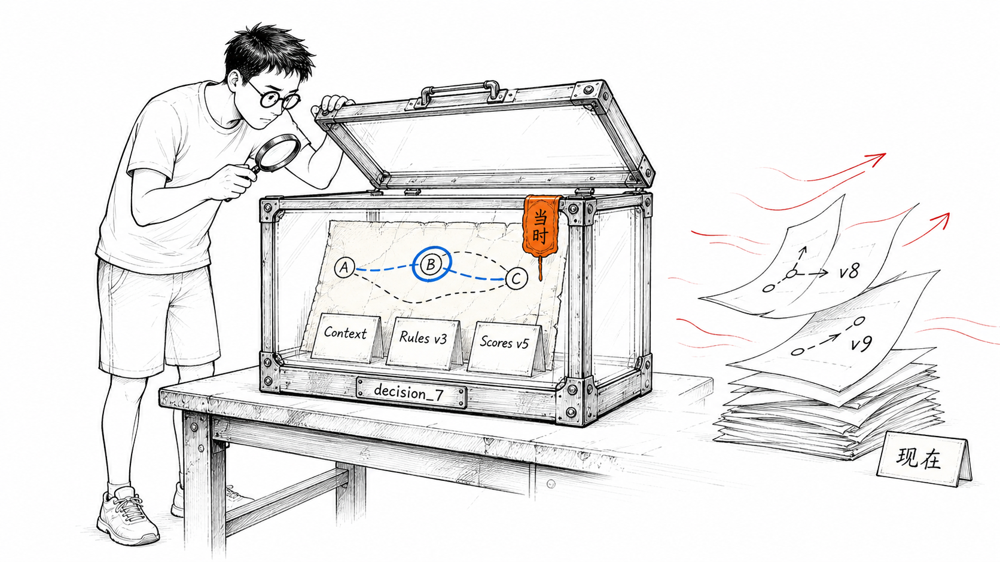
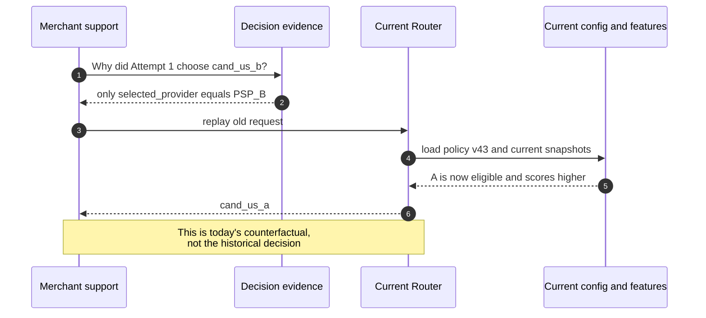
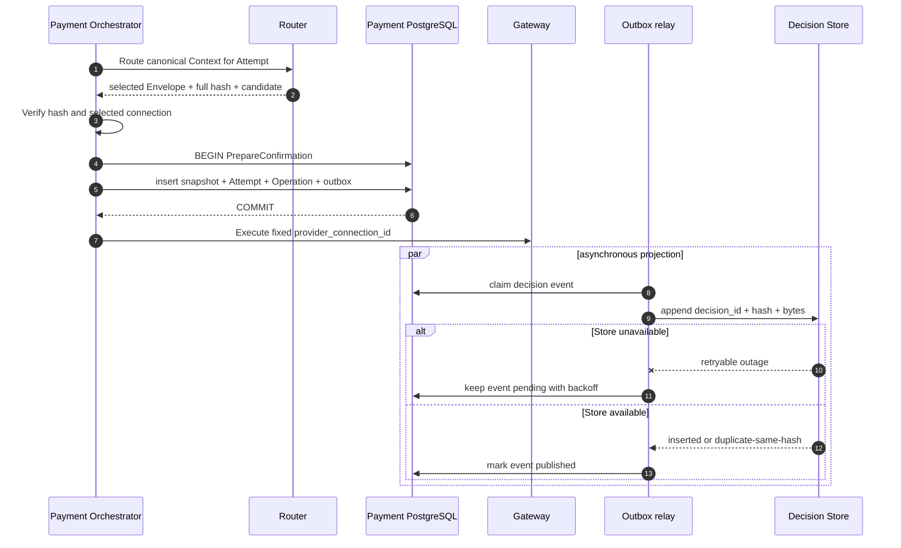
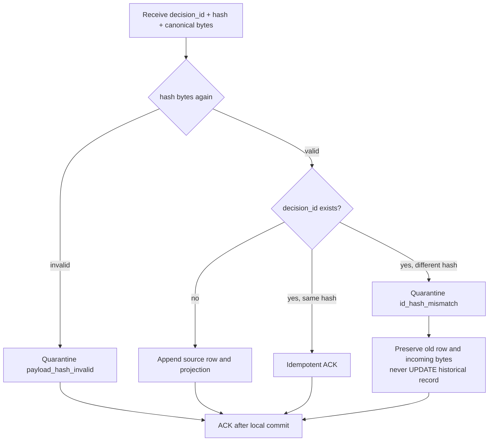
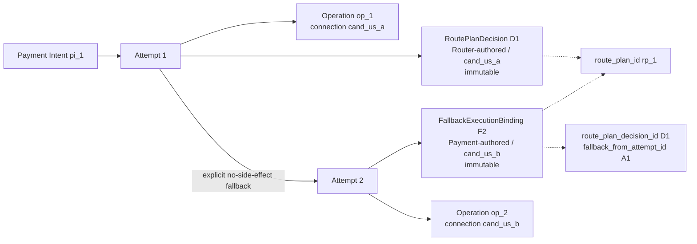

# 第 14 章 Routing Decision Store

三个月后，Aurora 的商户问：“这笔 129.00 USD 的支付为什么走了 `cand_us_b`？”值班工程师找到了 `selected_provider=PSP_B`，再用当前 Router 配置重算，结果却是 `cand_us_a`。这并不证明过去选错了，也不证明现在选对了：Rule 已发布新版本，Capability 已修订，费用与成功率窗口已经滚动，Health Snapshot 也早已过期。今天的重算只回答“现在会怎么选”，不能回答“当时为什么那样选”。

若这笔 Payment 还发生过 Fallback，问题会更尖锐。Attempt 1 可能根据 Router-authored `RoutePlanDecision` 选择 A；在 A 明确无副作用、固定下一项 B 通过新鲜 guardrail 后，Attempt 2 由 Payment-authored `FallbackExecutionBinding` 绑定 B。只保存 Intent 的“最终 Provider”，会把两条独立资金路径压成一条；把 Payment binding 伪装成第二次 Router Decision，又会混淆“谁排序”和“谁有权创建新资金路径”；只保存日志则可能因为采样、保留期或字段变更失去证据。

本章建立第四部分的第一个不变量：

> **过去为什么选择这条 route，必须由决策时封存的不可变事实回答，不能用当前配置、当前 Feature 或当前代码重算。Router 构造 canonical `DecisionEnvelope`，Payment 在创建 Attempt 的本地事务中固定执行快照并写 outbox；远端 Decision Store 只做 append-only 查询投影，它不可成为支付执行的同步依赖。**

这里的 Decision Record 是路由黑匣子，不是资金账本。它记录候选、排除、规则、版本、分数和选择；Payment Intent、Provider Operation 与资金状态仍由 Payment Orchestrator 掌握，余额、会计分录和结算事实仍属于 Ledger、Reconciliation 与 Settlement 边界。Metric/Trace 留给[第 15 章](observability.md)，Experiment assignment 的产生留给[第 16 章](experimentation.md)，外部事实差异与修复留给[第 17 章](reconciliation.md)，保留期与跨区域复制留给[第 19 章](../part-5-global-routing/multi-region.md)，配置发布权限留给[第 20 章](../part-5-global-routing/configuration-platform.md)。

配套实现已经完成了本章的**本地执行快照基线**：Router v3 返回完整 `routing_context.v2`、Risk、Optimization、Candidate evidence/order、selected connection 与 `executable_until`；Payment 在创建 Attempt/Operation 的同一 PostgreSQL transaction 中校验并固定完整 Context/Decision JSON snapshots 与 deadline，首次 Gateway I/O 必须服从这份权威。它尚未完成本章最终形态：JSONB 快照不是跨语言 canonical source bytes；`rtd_` 仍是截断 content ID，不是持久化 full SHA；也没有 decision-specific outbox、append-only Decision Store 或 projector。后文会一直区分这两层。



黑匣子保存的是“当时知道什么、据此选择了什么”。箱外的新配置可以继续演进，箱内的旧证据不能跟着改写。

## 14.1 Problem：`selected_provider` 不是历史解释

最简单的系统只在 Router 返回后写一条结构化日志：

```go
package selectedonly

type Record struct {
	DecisionID       string
	PaymentIntentID  string
	AttemptID        string
	SelectedProvider string
}

func NewRecord(decisionID, paymentIntentID, attemptID, provider string) Record {
	return Record{
		DecisionID:       decisionID,
		PaymentIntentID:  paymentIntentID,
		AttemptID:        attemptID,
		SelectedProvider: provider,
	}
}
```

这段代码能证明某次日志调用看见了一个 Provider 字符串，却回答不了以下问题：B 是哪一个 Merchant Account、Connector 与 Region？A 是否因币种不支持而被排除？某条 `exclude` Rule 是否命中？成本与成功率的原值、单位、窗口和版本是什么？同分时使用了什么 tie-break？Payment 最终执行的 `provider_connection_id` 是否真与 Router 选择一致？

更糟的是，“重跑 Router”会把历史问题换成反事实问题：



一条可审计记录至少要让调查者区分“决策时事实”“执行时事实”和“事后结果”：

| 调查问题 | 权威证据 | 不能替代它的东西 |
| --- | --- | --- |
| Router 当时看到了什么 | Context 摘要与 digest、全部 Candidate evidence、Artifact/Feature version | 当前请求、当前配置或自由文本日志 |
| 为什么排除某条 connection | Eligibility/Rule/Risk exclusion 与稳定 reason code | 只看 winner，或用今天的 Capability 猜 |
| 为什么 B 排在 A 前面 | 原始 Feature、状态/单位/窗口、Normalizer 与 Score breakdown、tie-break | 一项没有版本的 `score=8120` |
| Payment 实际获准执行什么 | Attempt 事务中固定的 selected Candidate、Route Plan 与 Decision hash | Router 的临时内存或异步分析表 |
| Gateway 实际调用了什么 | Provider Operation 的 `provider_connection_id`、operation/key/request hash | Provider 品牌名 |
| 最后发生了什么 | Payment/Provider observation、Reconciliation 与 Settlement 事实 | Routing Decision Record |

因此，Decision Store 的目标不是保存“足够多的日志”，而是建立一个可验证的事实契约：同一个 `decision_id` 永远指向同一组 canonical bytes；当时执行所依据的版本、候选和解释不可被后来更新；查询投影丢失可以重建，但原始执行快照不能靠重算补回。

## 14.2 Simple Design：从 winner 扩展为不可变 `DecisionEnvelope`

第一步可以把 Provider 字符串扩展为一个文档，并给它一个 Decision ID。然而“把 Router response 原样塞进 JSONB”仍不够。未经定义的 map 顺序、浮点数、时间格式、`null` 与 missing、集合顺序都会让同一语义生成不同 bytes；数据库再序列化还可能改变对象表示。我们需要先定义事实，再定义 canonical 表示，最后才选择存储。

### 14.2.1 信封保存的是决策时证据，不是所有上游数据

一个生产 `DecisionEnvelope` 可按下表分组。表中的“值”是决策时冻结的小型事实，“引用”指向不可变 Artifact；只有 digest 而没有解释字段也不够，因为调查者仍看不到为什么某项约束生效。

| 分组 | 关键字段 | 值或引用 | 所有者与目的 |
| --- | --- | --- | --- |
| Identity | `schema_version`、`decision_id`、`created_at`、`payment_intent_id`、`attempt_id` | 值 | 关联一次 Attempt 的历史决定 |
| Context | `context_schema_version`、`context_digest`、金额/币种/operation/capture mode/非敏感类别摘要 | 最小值 + digest | 证明本次求值 subject；不复制支付凭证 |
| Candidate | 全部 `candidate_id`、Provider、Merchant Account、Connector、Region、connection revision | 值 | Candidate 是可执行 connection，不是品牌名 |
| Eligibility | 每个 Candidate 的三值结果、排除 reason、`capability_version`、Health ref | 值 + 引用 | 证明硬集合如何缩小 |
| Policy/Risk | Rule hits、action、priority、reason、Rule Set version；最小 Risk action/ref/version/expiry | 值 + 引用 | 证明 guardrail，不复制 Fraud 原始特征 |
| Feature | Cost/Performance/Health 等原值、单位、状态、窗口、样本/置信、artifact version | 值 + 引用 | 保留量纲与证据，不只保存归一化分 |
| Score | scorer profile、Normalizer version、逐项 contribution、total、stable tie-break | 值 + 引用 | 解释排序，而不是只存 winner |
| Outcome | `selected`、`no_eligible_candidate`、`blocked`、`unsupported`、`requires_review`、`risk_unavailable`、`feature_unavailable` 与 reason codes | 值 | 让合法的不可执行决定也有可审计记录，不伪造 winner |
| Selection / Route Plan | 仅 `selected` outcome 携带 ordered Candidate IDs、selected Candidate snapshot 与 Router-authored `route_plan_id` | 值 | 固定允许顺序和实际 winner；负向 outcome 不创建 Attempt/Operation |
| Assignment | 可选 experiment/version/variant/bucket 与 `assigned` 或 `not_exposed` | 值 | 支持第 16 章的 assignment-only binding，不把未执行样本删除 |

信封只封存“决定发生时已知”的事实。Provider 后来成功、拒绝、超时或被对账纠正，应该成为另一份 outcome/evidence，通过 `attempt_id`、`operation_id` 和 `decision_id` 关联；不能回写旧信封，把历史预测伪装成最终真相。

Context 也不应被整包复制。第 4 章的 Routing Context 已经排除了 token、PAN、CVV/SAD；Decision Record 仍应使用显式 allowlist，只保存解释所需的金额小单位、币种、payment-method category、operation、capture mode 和批准过的派生类别。PCI SSC 明确说明授权后不得保存 Sensitive Authentication Data，即使加密也不例外；数据保留应限于法律、监管或业务所必需，并在不再需要时安全删除，而不是以“以后排障可能有用”为由无限收集。[PCI SSC FAQ 1154](https://www.pcisecuritystandards.org/faqs/1154/) [PCI SSC FAQ 1318](https://www.pcisecuritystandards.org/faqs/1318/)

`context_digest` 也不是匿名化工具。若把邮箱、完整地址或低熵标识直接做无盐 SHA-256，攻击者仍可能枚举原值。正确边界是先构造版本化、最小化的 routing projection，再 canonicalize 并摘要；确需做受控相等关联时，应由安全设计提供带 key version 的 keyed digest，而不是把原始敏感字段交给 Router。Risk 只进入批准的 `action/reason_ref/version/expires_at`，不进入设备指纹、IP、邮箱或模型向量。

### 14.2.2 Canonical bytes 与 hash 是协议，不是序列化小技巧

Canonicalization 必须先明确哪些数组有语义顺序：`candidate_order` 和 Rule evaluation order 不能排序；候选证据、Feature 列表等逻辑集合则必须按稳定键排序。金额、成本、概率和分数使用整数或定点单位，不使用 `float64`；时间统一为 UTC Unix milliseconds 或一种固定文本格式；missing、unknown、stale 与 known 是显式状态，不能让 Go 零值代替。

下面的 Go 示例定义了一个刻意收窄的 `aurora-decision-json-v1`。`Outcome` 是判别字段：`selected` 分支必须携带可执行 Attempt/Route Plan/Selection，负向分支必须没有这些执行字段，但可以保留候选、排除原因和 `not_exposed` assignment。它的 canonical 输出不含 map 和浮点数，深拷贝后只排序无序集合，保留 `CandidateOrder` 的业务顺序，并输出完整 SHA-256。真实系统还应把 golden vectors 放进跨版本契约测试。

```go
package envelope

import (
	"crypto/sha256"
	"encoding/json"
	"errors"
	"sort"
)

var ErrInvalidEnvelope = errors.New("invalid decision envelope")

type ContextSummary struct {
	SchemaVersion string `json:"schema_version"`
	AmountMinor   int64  `json:"amount_minor"`
	Currency      string `json:"currency"`
	PaymentMethod string `json:"payment_method"`
	Operation     string `json:"operation"`
	CaptureMode   string `json:"capture_mode"`
}

type CandidateEvidence struct {
	CandidateID        string `json:"candidate_id"`
	ConnectionRevision string `json:"connection_revision"`
	Provider           string `json:"provider"`
	MerchantAccount    string `json:"merchant_account"`
	Connector          string `json:"connector"`
	Region             string `json:"region"`
	Eligibility        string `json:"eligibility"`
	CapabilityVersion  string `json:"capability_version"`
}

type Exclusion struct {
	CandidateID string `json:"candidate_id"`
	Stage       string `json:"stage"`
	ReasonCode  string `json:"reason_code"`
	EvidenceRef string `json:"evidence_ref"`
}

type RuleHit struct {
	EvaluationOrder int64  `json:"evaluation_order"`
	RuleID          string `json:"rule_id"`
	Action          string `json:"action"`
	ReasonCode      string `json:"reason_code"`
}

type FeatureEvidence struct {
	CandidateID     string `json:"candidate_id"`
	Name            string `json:"name"`
	State           string `json:"state"`
	Value           int64  `json:"value"`
	Unit            string `json:"unit"`
	Window          string `json:"window"`
	SampleSize      int64  `json:"sample_size"`
	ArtifactVersion string `json:"artifact_version"`
}

type ScoreComponent struct {
	Name         string `json:"name"`
	RawValue     int64  `json:"raw_value"`
	Points       int64  `json:"points"`
	WeightPPM    int64  `json:"weight_ppm"`
	Contribution int64  `json:"contribution"`
}

type ScoreBreakdown struct {
	CandidateID string           `json:"candidate_id"`
	TotalPoints int64            `json:"total_points"`
	Components  []ScoreComponent `json:"components"`
}

type Selection struct {
	CandidateID     string `json:"candidate_id"`
	Provider        string `json:"provider"`
	MerchantAccount string `json:"merchant_account"`
	Connector       string `json:"connector"`
	Region          string `json:"region"`
	TieBreak        string `json:"tie_break"`
}

type DecisionOutcome string

const (
	OutcomeSelected            DecisionOutcome = "selected"
	OutcomeNoEligibleCandidate DecisionOutcome = "no_eligible_candidate"
	OutcomeBlocked             DecisionOutcome = "blocked"
	OutcomeUnsupported         DecisionOutcome = "unsupported"
	OutcomeRequiresReview      DecisionOutcome = "requires_review"
	OutcomeRiskUnavailable     DecisionOutcome = "risk_unavailable"
	OutcomeFeatureUnavailable  DecisionOutcome = "feature_unavailable"
)

type AssignmentEvidence struct {
	ExperimentID string `json:"experiment_id"`
	Variant      string `json:"variant"`
	Version      string `json:"version"`
	Bucket       int64  `json:"bucket"`
	State        string `json:"state"`
}

type DecisionEnvelope struct {
	SchemaVersion        string              `json:"schema_version"`
	DecisionID           string              `json:"decision_id"`
	CreatedAtUnixMilli   int64               `json:"created_at_unix_milli"`
	PaymentIntentID      string              `json:"payment_intent_id"`
	Outcome              DecisionOutcome     `json:"outcome"`
	ReasonCodes          []string            `json:"reason_codes"`
	AttemptID            string              `json:"attempt_id,omitempty"`
	RoutePlanID          string              `json:"route_plan_id,omitempty"`
	ContextDigest        string              `json:"context_digest"`
	Context              ContextSummary      `json:"context"`
	PolicyVersion        string              `json:"policy_version"`
	ScorerProfileVersion string              `json:"scorer_profile_version"`
	RiskReference        string              `json:"risk_reference"`
	RiskVersion          string              `json:"risk_version"`
	Assignment           *AssignmentEvidence `json:"assignment,omitempty"`
	Candidates           []CandidateEvidence `json:"candidates"`
	Exclusions           []Exclusion         `json:"exclusions"`
	RuleHits             []RuleHit           `json:"rule_hits"`
	Features             []FeatureEvidence   `json:"features"`
	Scores               []ScoreBreakdown    `json:"scores"`
	CandidateOrder       []string            `json:"candidate_order,omitempty"`
	Selected             *Selection          `json:"selected,omitempty"`
}

func CanonicalBytes(input DecisionEnvelope) ([]byte, [32]byte, error) {
	e := input
	e.Candidates = append([]CandidateEvidence(nil), input.Candidates...)
	e.Exclusions = append([]Exclusion(nil), input.Exclusions...)
	e.RuleHits = append([]RuleHit(nil), input.RuleHits...)
	e.Features = append([]FeatureEvidence(nil), input.Features...)
	e.Scores = append([]ScoreBreakdown(nil), input.Scores...)
	e.CandidateOrder = append([]string(nil), input.CandidateOrder...)
	e.ReasonCodes = append([]string(nil), input.ReasonCodes...)

	sort.Strings(e.ReasonCodes)

	sort.Slice(e.Candidates, func(i, j int) bool {
		return e.Candidates[i].CandidateID < e.Candidates[j].CandidateID
	})
	sort.Slice(e.Exclusions, func(i, j int) bool {
		left, right := e.Exclusions[i], e.Exclusions[j]
		if left.CandidateID != right.CandidateID {
			return left.CandidateID < right.CandidateID
		}
		if left.Stage != right.Stage {
			return left.Stage < right.Stage
		}
		if left.ReasonCode != right.ReasonCode {
			return left.ReasonCode < right.ReasonCode
		}
		return left.EvidenceRef < right.EvidenceRef
	})
	sort.Slice(e.RuleHits, func(i, j int) bool {
		if e.RuleHits[i].EvaluationOrder == e.RuleHits[j].EvaluationOrder {
			return e.RuleHits[i].RuleID < e.RuleHits[j].RuleID
		}
		return e.RuleHits[i].EvaluationOrder < e.RuleHits[j].EvaluationOrder
	})
	sort.Slice(e.Features, func(i, j int) bool {
		if e.Features[i].CandidateID == e.Features[j].CandidateID {
			return e.Features[i].Name < e.Features[j].Name
		}
		return e.Features[i].CandidateID < e.Features[j].CandidateID
	})
	for i := range e.Scores {
		e.Scores[i].Components = append([]ScoreComponent(nil), e.Scores[i].Components...)
		sort.Slice(e.Scores[i].Components, func(a, b int) bool {
			return e.Scores[i].Components[a].Name < e.Scores[i].Components[b].Name
		})
	}
	sort.Slice(e.Scores, func(i, j int) bool {
		return e.Scores[i].CandidateID < e.Scores[j].CandidateID
	})

	if err := validate(e); err != nil {
		return nil, [32]byte{}, err
	}
	b, err := json.Marshal(e)
	if err != nil {
		return nil, [32]byte{}, err
	}
	return b, sha256.Sum256(b), nil
}

func validate(e DecisionEnvelope) error {
	if e.SchemaVersion != "aurora-decision-json-v1" ||
		e.DecisionID == "" || e.CreatedAtUnixMilli <= 0 ||
		e.PaymentIntentID == "" || e.ContextDigest == "" ||
		!validOutcome(e.Outcome) || len(e.ReasonCodes) == 0 {
		return ErrInvalidEnvelope
	}
	for i, reason := range e.ReasonCodes {
		if reason == "" || (i > 0 && e.ReasonCodes[i-1] == reason) {
			return ErrInvalidEnvelope
		}
	}
	if e.Assignment != nil {
		if e.Assignment.ExperimentID == "" || e.Assignment.Variant == "" ||
			e.Assignment.Version == "" || e.Assignment.Bucket < 0 ||
			(e.Assignment.State != "assigned" && e.Assignment.State != "not_exposed") {
			return ErrInvalidEnvelope
		}
	}
	if e.Outcome == OutcomeSelected {
		if e.AttemptID == "" || e.RoutePlanID == "" || e.Selected == nil ||
			e.Selected.CandidateID == "" || e.Selected.Provider == "" ||
			len(e.CandidateOrder) == 0 ||
			(e.Assignment != nil && e.Assignment.State != "assigned") {
			return ErrInvalidEnvelope
		}
	} else if e.AttemptID != "" || e.RoutePlanID != "" || e.Selected != nil ||
		len(e.CandidateOrder) != 0 || (e.Assignment != nil && e.Assignment.State != "not_exposed") {
		return ErrInvalidEnvelope
	}

	var selectedID string
	if e.Selected != nil {
		selectedID = e.Selected.CandidateID
	}
	seen := make(map[string]struct{}, len(e.CandidateOrder))
	selectedInOrder := false
	for _, id := range e.CandidateOrder {
		if id == "" {
			return ErrInvalidEnvelope
		}
		if _, ok := seen[id]; ok {
			return ErrInvalidEnvelope
		}
		seen[id] = struct{}{}
		if id == selectedID {
			selectedInOrder = true
		}
	}
	selectedEvidence := false
	candidateSeen := make(map[string]struct{}, len(e.Candidates))
	eligible := make(map[string]bool, len(e.Candidates))
	for _, candidate := range e.Candidates {
		if candidate.CandidateID == "" {
			return ErrInvalidEnvelope
		}
		if _, ok := candidateSeen[candidate.CandidateID]; ok {
			return ErrInvalidEnvelope
		}
		candidateSeen[candidate.CandidateID] = struct{}{}
		eligible[candidate.CandidateID] = candidate.Eligibility == "eligible"
		if candidate.CandidateID == selectedID {
			selectedEvidence = candidate.Provider == e.Selected.Provider &&
				candidate.MerchantAccount == e.Selected.MerchantAccount &&
				candidate.Connector == e.Selected.Connector &&
				candidate.Region == e.Selected.Region
		}
	}
	if e.Outcome == OutcomeSelected {
		if !selectedInOrder || !selectedEvidence {
			return ErrInvalidEnvelope
		}
		for _, id := range e.CandidateOrder {
			if !eligible[id] {
				return ErrInvalidEnvelope
			}
		}
	}
	for i, feature := range e.Features {
		if feature.Name == "" || (i > 0 && e.Features[i-1].CandidateID == feature.CandidateID && e.Features[i-1].Name == feature.Name) {
			return ErrInvalidEnvelope
		}
	}
	for i, score := range e.Scores {
		if score.CandidateID == "" || (i > 0 && e.Scores[i-1].CandidateID == score.CandidateID) {
			return ErrInvalidEnvelope
		}
		for j, component := range score.Components {
			if component.Name == "" || (j > 0 && score.Components[j-1].Name == component.Name) {
				return ErrInvalidEnvelope
			}
		}
	}
	for i, hit := range e.RuleHits {
		if hit.RuleID == "" || (i > 0 && e.RuleHits[i-1].EvaluationOrder == hit.EvaluationOrder && e.RuleHits[i-1].RuleID == hit.RuleID) {
			return ErrInvalidEnvelope
		}
	}
	return nil
}

func validOutcome(outcome DecisionOutcome) bool {
	switch outcome {
	case OutcomeSelected, OutcomeNoEligibleCandidate, OutcomeBlocked,
		OutcomeUnsupported, OutcomeRequiresReview, OutcomeRiskUnavailable,
		OutcomeFeatureUnavailable:
		return true
	default:
		return false
	}
}
```

这里的 map 只用于 validation，不进入输出。Go `encoding/json` 对 map key 有稳定排序规则，但这并不能自动解决跨语言数字表示、Unicode、无序数组、时区与缺失语义，因此不能把“`json.Marshal` 当前看起来稳定”当成协议。[Go encoding/json](https://pkg.go.dev/encoding/json) 若 Decision 要由多语言生产或验证，可以采用 RFC 8785 JSON Canonicalization Scheme，并遵守其 I-JSON、属性排序和数字序列化约束；RFC 8785 是一份 Informational RFC，不应误称为强制标准。[RFC 8785](https://www.rfc-editor.org/rfc/rfc8785.html)

Decision ID 与完整 hash 应承担不同职责。ID 是稳定关联键，可出现在 Attempt、Operation、Trace 与客服查询中；hash 校验 canonical bytes 是否一致。不要只保存截断 ID 并把它称为完整性证明，也不要把 SHA-256 当成来源认证：若需要抵抗恶意篡改，还要有服务身份、访问控制、传输认证或签名机制。`schema_version + canonicalization_version + canonical_bytes + full_hash` 必须作为一组保存。

## 14.3 Problems at Scale：证据链最容易断在“双写”与“重建”之间

### 14.3.1 JSONB 是查询结构，不是 canonical 原件

PostgreSQL `jsonb` 适合索引与查询，但官方文档明确说明它不保留输入文本的空白、对象 key 顺序和重复 key；因此不能从 JSONB 重新序列化，再与 Router 的原始 hash 比较。[PostgreSQL JSON Types](https://www.postgresql.org/docs/current/datatype-json.html) 一个稳妥的存储分层是：

| 层 | 保存内容 | 是否权威 | 可否重建 |
| --- | --- | ---: | ---: |
| Payment execution snapshot | canonical bytes、完整 hash、selected connection、Route Plan、Attempt/Operation 关联 | 是，决定执行什么 | 不应靠远端重建 |
| Payment outbox event | decision ID、hash、canonical payload 或可靠本地引用、event ID | 是，保证最终投影 | 可由本地快照重发 |
| Decision Store source row | canonical bytes、hash、schema、ingest metadata | 是，append-only | 可由 Payment outbox 重放 |
| Decision Store JSONB projection | 从已验证 bytes 提取的查询字段与索引 | 否，查询便利层 | 可以重建 |
| 日志、Trace、Dashboard | correlation 与运行观测 | 否 | 不保证完整 |

这也意味着 schema 演进不能就地更新旧 JSON。读端可以根据 `schema_version` upcast 到内存视图，迁移查询 projection，也可以保留多个 decoder；但原始 canonical bytes 与 hash 必须不动。否则一次“补字段 migration”会让审计证据看起来像当时就包含后来才知道的信息。

### 14.3.2 Router 写 Store、Payment 再创建 Attempt 会形成危险窗口

若 Router 同步写 Decision Store，再把响应交给 Payment，会出现两类孤儿：Store 写成功而 Payment 创建 Attempt 失败，得到一条从未执行的 Decision；或 Payment 已创建 Operation，Store 写失败，支付路径被远端审计数据库阻断。更危险的是 Payment 先提交 Attempt，再单独写 Store：进程在两次写之间崩溃，Gateway 可能已执行，而证据永久缺失。

正确的原子边界在 Payment 自己的数据库。Router 返回 `DecisionEnvelope + canonical hash`。只有 `outcome=selected` 时，Payment 才验证选定 Candidate 与将要创建的 `provider_connection_id` 一致，并在 `PrepareConfirmation` 的同一事务中插入 Decision execution snapshot、Attempt、Provider Operation 和 outbox event；事务提交后才允许 Gateway 执行。负向 outcome 可以在本地事务中固定 Decision/outbox，若已有实验 assignment 则同时写 `not_exposed` binding，但绝不创建 Attempt/Operation。远端 Store 不参与任一事务，也不位于资金调用的同步路径。



“Store 故障不阻断支付”只指远端 Decision Store 和异步投影故障。若 Payment 的本地事务无法持久化执行快照、Attempt 或 outbox，系统还没有 durable authority，必须在调用 Gateway 前失败；不能为了可用性先发起资金副作用。相反，本地事务已经提交后，即使 Decision Store 停机，Payment 仍可按固定 Operation 安全执行，outbox 只会积压。恢复后重复投递必须收敛成一条投影。

下面的 Go 边界只展示 `outcome=selected` 分支，并让远端 Store 完全不出现在 `Confirm` 中。负向分支必须在到达此函数前停止，不能用零值 Selection 进入 prepare。`PrepareConfirmation` 的接口注释只是教学契约，真正实现必须用单个数据库事务兑现，并由 integration test 证明。

```go
package pinning

import (
	"context"
	"crypto/sha256"
	"encoding/json"
	"errors"
)

var (
	ErrDecisionHashMismatch    = errors.New("decision hash mismatch")
	ErrDecisionBindingMismatch = errors.New("decision subject or selection mismatch")
	ErrConnectionMismatch      = errors.New("selected connection mismatch")
)

type CandidateRef struct {
	CandidateID     string `json:"candidate_id"`
	Provider        string `json:"provider"`
	MerchantAccount string `json:"merchant_account"`
	Connector       string `json:"connector"`
	Region          string `json:"region"`
}

type RoutedDecision struct {
	DecisionID     string
	AttemptID      string
	CanonicalBytes []byte
	Hash           [32]byte
	Selected       CandidateRef
}

type PrepareCommand struct {
	PaymentIntentID      string
	AttemptID            string
	OperationID          string
	ProviderConnectionID string
	Provider             string
	DecisionID           string
	DecisionHash         [32]byte
	DecisionBytes        []byte
}

type PreparedOperation struct {
	OperationID          string
	ProviderConnectionID string
	Provider             string
}

type Store interface {
	// PrepareConfirmation atomically inserts the decision snapshot, Attempt,
	// Provider Operation, and decision outbox event before returning.
	PrepareConfirmation(context.Context, PrepareCommand) (PreparedOperation, error)
}

type Gateway interface {
	Execute(context.Context, PreparedOperation) error
}

type Service struct {
	Store   Store
	Gateway Gateway
}

func (s Service) Confirm(
	ctx context.Context,
	paymentIntentID string,
	operationID string,
	decision RoutedDecision,
) error {
	if sha256.Sum256(decision.CanonicalBytes) != decision.Hash {
		return ErrDecisionHashMismatch
	}
	// Bind the transport fields to the sealed subject and selected tuple;
	// hashing bytes alone does not prove the command being prepared matches them.
	var sealed struct {
		DecisionID      string       `json:"decision_id"`
		AttemptID       string       `json:"attempt_id"`
		PaymentIntentID string       `json:"payment_intent_id"`
		Selected        CandidateRef `json:"selected"`
	}
	if err := json.Unmarshal(decision.CanonicalBytes, &sealed); err != nil ||
		decision.DecisionID == "" || decision.AttemptID == "" || paymentIntentID == "" || operationID == "" ||
		sealed.DecisionID != decision.DecisionID || sealed.AttemptID != decision.AttemptID ||
		sealed.PaymentIntentID != paymentIntentID || sealed.Selected != decision.Selected {
		return ErrDecisionBindingMismatch
	}
	providerConnectionID := decision.Selected.CandidateID
	if providerConnectionID == "" || decision.Selected.Provider == "" {
		return ErrConnectionMismatch
	}
	prepared, err := s.Store.PrepareConfirmation(ctx, PrepareCommand{
		PaymentIntentID:      paymentIntentID,
		AttemptID:            decision.AttemptID,
		OperationID:          operationID,
		ProviderConnectionID: providerConnectionID,
		Provider:             decision.Selected.Provider,
		DecisionID:           decision.DecisionID,
		DecisionHash:         decision.Hash,
		DecisionBytes:        append([]byte(nil), decision.CanonicalBytes...),
	})
	if err != nil {
		return err
	}
	if prepared.OperationID != operationID || prepared.ProviderConnectionID != providerConnectionID ||
		prepared.Provider != decision.Selected.Provider {
		return ErrConnectionMismatch
	}
	return s.Gateway.Execute(ctx, prepared)
}
```

生产实现还必须在事务中验证 `attempt_id`、`decision_id` 和 Intent version 的一致性，并用唯一约束阻止同一 Attempt 绑定两个 Decision。Serializable transaction 在并发冲突下可能返回 serialization failure，调用方应在**尚未执行 Gateway**时重试整个 prepare transaction，而不是跳过快照。[PostgreSQL Transaction Isolation](https://www.postgresql.org/docs/current/transaction-iso.html)

### 14.3.3 Append-only 不等于“INSERT 失败就重试到永远”

Outbox relay、网络和消费者重启都会产生重复消息。Decision Store 的摄取语义必须同时看 ID 与 hash：



同 ID、同 hash 是正常的 at-least-once duplicate；同 ID、不同 hash 是数据完整性事件，不能 last-write-wins，也不能让 poison message 无限重试。消费者应在一个本地事务里保留原 row、写 quarantine row（包含 incoming hash、bytes、event identity 和原因）、提交后 ACK，并触发高优先级告警。这样既没有覆盖证据，也不会因永久冲突堵住整个 partition。

下面的纯 Go 规划器把三种结果写成封闭动作。真正 Repository 应以 `decision_id` unique constraint 或等价主键保证并发 winner；PostgreSQL unique index 能保证表中相等 key 最多一行，`INSERT ... ON CONFLICT` 可以作为原子冲突入口。[PostgreSQL Unique Indexes](https://www.postgresql.org/docs/current/indexes-unique.html) [PostgreSQL INSERT](https://www.postgresql.org/docs/current/sql-insert.html)

```go
package decisionprojection

import (
	"crypto/sha256"
	"errors"
)

var ErrMissingIdentity = errors.New("missing decision identity")

type Action string

const (
	ActionInsert     Action = "insert"
	ActionDuplicate  Action = "duplicate_same_hash"
	ActionQuarantine Action = "quarantine"
)

type Existing struct {
	DecisionID string
	Hash       [32]byte
}

type Incoming struct {
	DecisionID     string
	DeclaredHash   [32]byte
	CanonicalBytes []byte
}

type Plan struct {
	Action Action
	Reason string
}

func PlanIngest(existing *Existing, incoming Incoming) (Plan, error) {
	if incoming.DecisionID == "" {
		return Plan{}, ErrMissingIdentity
	}
	calculated := sha256.Sum256(incoming.CanonicalBytes)
	if calculated != incoming.DeclaredHash {
		return Plan{Action: ActionQuarantine, Reason: "payload_hash_invalid"}, nil
	}
	if existing == nil {
		return Plan{Action: ActionInsert, Reason: "new_decision"}, nil
	}
	if existing.DecisionID != incoming.DecisionID {
		return Plan{}, ErrMissingIdentity
	}
	if existing.Hash == incoming.DeclaredHash {
		return Plan{Action: ActionDuplicate, Reason: "same_id_same_hash"}, nil
	}
	return Plan{Action: ActionQuarantine, Reason: "same_id_different_hash"}, nil
}
```

摄取成功只表示“查询投影已有一份可验证历史决定”，不表示 Provider Operation 成功，也不应改变 Payment 状态。Decision Store 的 service account 不应拥有 Payment、Ledger 或 Settlement 表的写权限。

### 14.3.4 Fallback 产生 Payment execution binding，不改写 Router Decision

一笔 Intent 可以有多个 Attempt，但 Router 与 Payment 生成的证据不能混成同一种权威对象。Attempt 1 使用 Router-authored `RoutePlanDecision` D1 选择 A。只有在第 12 章的 `terminal + side_effect=none + allowlisted reason` 等闸门全部通过后，Payment 才能创建 Attempt 2；它获得新的 Operation、Provider key，以及 Payment-authored `FallbackExecutionBinding` F2。F2 引用 D1/Plan、旧 Attempt/version、固定下一 Candidate B、刷新后的 Risk evidence 和 Router-owned guardrail-only revalidation 结果。Revalidation 只能否决 B，不能换成 Plan 外 C、改变原顺序、计算新排名或签发 D2；证据过期、不完整或服务不可用时必须 Stop。



`route_plan_id` 与 `route_plan_decision_id` 解释 F2 为什么只能绑定固定允许序列中的 B，`fallback_from_attempt_id` 解释恢复谱系；它们都不授权 Fallback，许可仍由 Payment-owned FallbackPlanner 和旧 Attempt 证据给出。D1 与 F2 使用不同 schema/provenance/canonicalization domain，各自生成 ID/full hash；Payment 不能冒充 Router 修改 D1，Router 也不能替 Payment 判断旧 Attempt 是否允许新资金路径。当前仓库还没有这项专用 successor transaction，因此 F2/lineage 是设计合同，不是已运行能力。对于 Capture、Void、Refund，Router 不应重新选择路线：这些 Operation 必须绑定原 Provider Connection 与 Provider transaction reference。

若迟到 webhook 证明 A 成功，而 B 也已成功，Decision Store 应完整保留 D1、F2 以及两条执行关联；Payment 的业务状态仍保持 `succeeded`，两份 captured 事实都不能被抹掉，独立 `integrity_status` 才进入 `review_required`，再由第 17 章的事实流程处理。删除 D1、把 F2 标为“最终正确 route”或 last-write-wins 都是在破坏证据。

### 14.3.5 分区、保留与区域复制不能削弱全局冲突语义

Decision volume 会推动按时间分区与冷热分层，但设计必须先保护 `decision_id` 的唯一性。PostgreSQL 官方文档指出，分区表上的 unique/primary key constraint 必须包含全部 partition key；若按 `created_date` 分区而唯一键只是 `decision_id`，数据库无法用单一约束保证跨分区唯一。[PostgreSQL Table Partitioning](https://www.postgresql.org/docs/current/ddl-partitioning.html) 可选方案包括：保留一个不分区的 identity/hash registry，再把大 payload 按时间分区；或让 ID 约束中显式包含受验证的分区键并在协议层保持全局查找。不能为了压缩数据把 mismatch 检查降成“只查本月”。

具体保留期限、Legal Hold、区域驻留、删除证明和跨 Region ownership 属于第 19 章与附录安全章节。本章只要求三点：策略必须按数据类别显式定义；删除 source bytes 后不能继续声称可完整审计；projection 的生命周期不能反向改写 Payment 的资金事实。

## 14.4 Production Design：本地执行真相与远端查询投影分离

把前面的压力收束后，生产数据流有六个固定步骤：

1. Payment 为首次尚未执行的请求构造最小、版本化 Context；Router 完成 validation、Eligibility、Rule/Risk guardrail、Feature lookup 与必要的 Score/selection，并为 selected 或明确负向结果设置封闭 `Outcome`。
2. Router 构造完整 `DecisionEnvelope`，按冻结的 Router canonicalization version 生成 bytes 与完整 hash；只有 selected 分支携带 `RoutePlanDecision`、Attempt subject 和 Selection，负向分支不伪造这些执行字段。Router 不调用 Provider，也不把 Decision Store 写入作为返回前置条件。
3. 对 selected 分支，Payment 重新验证 hash、Attempt subject、selected Candidate 和 `provider_connection_id`，拒绝 Candidate/Provider/connection revision 不一致；对负向分支，Payment 必须阻止 Gateway，并按需原子固定 Decision/outbox 与 `not_exposed` assignment。
4. Payment 只对 selected 分支在一个 `PrepareConfirmation` 事务中固定 Decision snapshot、Attempt、Provider Operation 与 outbox；提交成功是执行 Gateway 的必要条件。
5. Gateway 只执行 Operation 上固定的 connection、key 与 payload；它不能按健康、费用或错误自行选择备用 Provider。
6. Relay 异步把 outbox 投影到 append-only Store。Store outage 只增加 backlog/age；恢复时按 object kind + ID + hash 收敛，mismatch 进入 quarantine。若未来发生获准 Fallback，Payment 另行写入 `FallbackExecutionBinding`；它引用原 Router Plan 和 guardrail veto evidence，不复用 Router schema 或签发新的排名。

### 14.4.1 Store 中的 source row 与 projection row

推荐把“不可变原件”和“面向查询的列”分开建模：

| 数据对象 | 代表字段 | 写入规则 | 典型查询 |
| --- | --- | --- | --- |
| `decision_source` | decision ID、schema、canonicalization version、bytes、hash、created time | 首次 append；永不 UPDATE payload | 按 ID 验证与下载原件 |
| `decision_projection` | Intent/Attempt、selected candidate、policy/feature versions、reason codes | 只从已验证 source 派生；可重建 | 商户客服、事故分析、版本影响面 |
| `decision_quarantine` | event ID、decision ID、existing/incoming hash、incoming bytes、reason | append-only，受限访问 | 完整性事故处置 |
| `projection_checkpoint` | consumer/partition、offset、updated time | 可更新运行状态 | relay 恢复与 lag |

Projection 不应把任意 Merchant ID、Decision ID 放进第 15 章的低基数 metric labels；查询权限也应按 Merchant/Region/角色隔离。PCI SSC 对日志的目的描述包含 who、what、where、when、how，但这不等于把所有支付数据都复制进审计表；身份、访问与操作审计应围绕受控数据建立。[PCI SSC FAQ 1081](https://www.pcisecuritystandards.org/faqs/1081/)

### 14.4.2 查询、验证与反事实重放是三种不同操作

客服查询通常只需要 winner、reason codes 和 Attempt lineage；审计验证需要 canonical bytes、schema、完整 hash 与 ingest 状态；策略工程师则可能想问“如果使用 Policy v44，会选谁”。这三种权限和结果不能混成一个 `GET /decision?replay=true`。

| 操作 | 输入 | 输出 | 允许改变什么 |
| --- | --- | --- | --- |
| Historical query | `decision_id` 与调用者 scope | 已封存 projection、source hash、schema、Attempt links | 什么都不改 |
| Integrity verify | source bytes、声明 hash、受支持的 canonicalization version | verified、unsupported schema 或 mismatch | mismatch 只追加 quarantine 事实 |
| Counterfactual replay | 一份明确选择的历史 Context projection + 新 Router/Artifact versions | 新 `analysis_id`、新 Decision 候选与差异报告 | 只写分析域；不得创建 Attempt/Operation |

查询返回 `not_found` 也不能立刻解释成“Router 没有做决定”。记录可能仍在 Payment outbox、投影可能落后、访问者可能无权查看，或 event 已被隔离。面向内部支持的聚合 API 可以先按权限读取 Payment 的本地 Decision identity/status，再读取远端 projection，并把 `pending_projection`、`projected`、`quarantined` 与真正不存在分开；Decision Store 自己不能越权直连 Payment 数据库猜测状态。

反事实重放必须显式标出所用 Router build、Context projection、Policy/Capability/Feature versions 与运行时间，并返回“analysis”，而不是复用原 `decision_id`。它不能调用 Gateway，不能更新原 projection，也不能用新结果宣判历史 winner 错误。若输入所引用的旧 Artifact 已无法取得，应返回 `insufficient_evidence`，而不是悄悄换成 latest。第 16 章的 shadow/experiment 和第 21 章的离线 replay 可以消费这类能力，但它们仍受同一无副作用边界约束。

### 14.4.3 当前实现基线与本章待配套增量

必须区分“配套系统已经运行的事实”和“本章设计完成后的目标”。当前 Go 实现已经提供一些可靠起点，但尚不存在完整 Decision Store：

| 位置 | 当前已有 | 仍未实现，不能在正文中冒充完成 |
| --- | --- | --- |
| Router v3 contract | 完整 `routing_context.v2`、Context digest、Rule/Capability/Risk evidence、Cost/Performance/Scoring Optimization breakdown、`candidate_order`、selected exact connection revision 与 `executable_until`；shared golden 校验 Router/Payment wire 一致 | 没有独立的跨语言 `DecisionEnvelope` canonical bytes/full hash 协议；Health evidence 也尚未接入 |
| Router content ID | 对 typed Decision 的全部现有字段做稳定 JSON material + SHA-256，并返回 `rtd_` 加前 16 bytes；Payment 重新计算验证 | 这是截断关联/content ID，不是持久化的完整 SHA-256，也不保留 canonical source bytes 或 canonicalization version |
| Payment `PrepareConfirmation` / SQL | 在同一 Serializable transaction 中校验 Context subject/digest、Risk ALLOW、Optimization/order、selected connection 与 deadline，并原子插入完整 Context/Decision JSONB snapshots、Attempt、Operation 和 `routing_executable_until`；更新 trigger 禁止改写 | JSONB 会规范化表示，不能充当原 canonical bytes；表中还没有 full hash/schema-canonicalization pair |
| Payment outbox | 同一 prepare transaction 已写 `payment_intent.status_changed` 与 `provider_operation.created` 通用事件 | 没有 `routing_decision.recorded` 的 canonical bytes/full hash payload，也没有 Decision relay/projector |
| Fallback lineage | 首次 Attempt 已固定完整 Candidate order，UNKNOWN recovery 默认阻断新 Attempt | 没有正式 `RoutePlanDecision`、guardrail-only revalidation、`fallback_from_attempt_id` successor transaction、Payment-authored `FallbackExecutionBinding` 或跨 Provider E2E |
| Decision Store | 无 | append ingest/query、ID+hash 幂等、quarantine、source/projection 表与 rebuild 都是本章待配套增量 |

因此本章建议的窄增量不再从“保存 Decision JSON”起步，而是：在现有 v3 snapshots 之上定义 canonical bytes/full SHA/schema protocol；让 Payment 在同一 `PrepareConfirmation` transaction 中同时保存 source bytes/hash 并写 `routing_decision.recorded` outbox；最后增加独立 PostgreSQL append-only projection consumer。专用 Fallback successor transaction 是另一条尚未实现的执行增量，不能用 Decision Store 偷渡。这个顺序保持当前 automatic-capture `SALE` 纵向链路不变，只补证据链，不虚构 manual capture、真实 PSP、完整 Experiment 或自动 Reconciliation 已完成。

### 14.4.4 证明不变量的失败测试

Happy-path 查询一条 Decision 不足以证明设计。至少需要以下失败注入：

| 测试 | 注入 | 必须观察到的结果 |
| --- | --- | --- |
| Historical truth | Decision 后替换 Policy、Capability、Fee、Performance、Health 与 scorer versions | 按原 ID 查询仍返回原 bytes/hash、winner、排除与分解；不会调用当前 Router 重算 |
| Store outage | 停止远端 Decision Store，再确认一笔安全支付 | Payment 本地 snapshot/Attempt/Operation/outbox 同事务提交，Gateway 可执行，outbox 保持 pending |
| Recovery | 恢复 Store，让 relay 重投同一 event 多次 | 最终只有一条 source row；duplicates 均为 same-ID/same-hash ACK |
| Hash mismatch | 重用 decision ID，改变一个 Candidate reason 或 score byte | 旧 row 不变，incoming payload 进入 quarantine，事件不无限毒化队列 |
| Crash boundary | 在 Payment commit 前、commit 后/Gateway 前、outbox publish 后分别崩溃 | commit 前无 Gateway；commit 后始终可从 snapshot 继续；投影重复仍收敛 |
| Fallback lineage | A 明确无副作用后创建 B；随后 A 迟到成功 | Router D1 与 Payment F2 均保留且关联不同 Attempt/Operation；冲突进入 review，不覆盖任一证据对象 |
| Sensitive field | 在 Context/Envelope 任意层嵌入 PAN、CVV、token、secret 或 Fraud raw feature | contract/forbidden-field scanner 在写 outbox 前拒绝，日志也不泄漏 payload |
| Unknown schema | Consumer 收到未支持的 canonicalization/schema version | 不猜测解析、不生成错误 projection；隔离并告警，source evidence 保留 |

## 14.5 Failure Modes：常见错误及受控动作

| 失败模式 | 危险结果 | 受控设计 |
| --- | --- | --- |
| 用当前配置 replay 历史 Context | 把反事实当历史解释 | 查询 immutable envelope；replay 只能明确标成 counterfactual analysis |
| 只保存 winner 或总分 | 无法证明硬排除、单位与版本 | 保存全部 Candidate/exclusion、原 Feature 与 score breakdown |
| 对 JSONB 重序列化后验 hash | 合法文档被误报或篡改漏检 | hash 原 canonical bytes；JSONB 只做 projection |
| Router 同步依赖审计 Store | Store 故障扩大为支付不可用 | Payment 本地 snapshot + outbox，远端异步投影 |
| 本地 snapshot 写失败仍调用 Gateway | 产生无法证明来源的资金操作 | prepare transaction 失败即停止，Gateway 必须在 commit 后 |
| 同 ID 不同 payload 做 upsert | 历史证据被覆盖 | preserve existing + quarantine incoming + alert |
| Consumer 遇永久 mismatch 一直 retry | poison message 阻塞同 partition | quarantine transaction 提交后 ACK |
| Schema migration UPDATE 老 payload | 后来事实伪装成当时事实 | 原 bytes/hash 永不变；读时 upcast，projection 可重建 |
| Context digest 包含敏感/低熵原值 | 可枚举泄漏、扩大 PCI/隐私范围 | 先最小化和 allowlist；必要关联使用受控 keyed digest |
| Fallback 覆盖原 Router Decision，或把 successor binding 写成新排名 | 丢失多资金路径、authority 与迟到成功证据 | 保留原 `RoutePlanDecision`；每个 successor 写 Payment-authored `FallbackExecutionBinding` 与显式 lineage |
| 把 Store 当 Ledger | 路由组件越权改余额或资金终态 | Store 只读/append 路由证据，资金 owner 分离 |

还要注意一个组织性失败：把“有 Decision Record”当成“已经可观测、可实验、可对账”。Record 只保证决策事实存在。第 15 章才定义延迟、错误和 outcome 的可靠度量；第 16 章才定义 assignment、shadow 与因果边界；第 17 章才引入 Provider 独立事实并通过领域命令修复。三者都可以引用 `decision_id`，但不能改变本章的 source bytes。

## 14.6 Trade-offs：多存证据，少引入执行耦合

| 选择 | 收益 | 代价与约束 |
| --- | --- | --- |
| 只存 Artifact refs | payload 小、保留简单 | Artifact 若不可用便无法解释；关键结果值仍应内嵌 |
| 内嵌全部上游文档 | 离线自足 | 敏感扩散、体积大、把无关数据带入 Store；本章不采用 |
| 最小值 + immutable refs + digest | 兼顾解释、验证与数据最小化 | 需要 Artifact registry 保证引用内容不可变且可读取 |
| 同步写远端 Store | 查询立即可见 | 提高确认延迟与故障耦合，不适合作为资金前置依赖 |
| Payment snapshot + outbox | 执行证据与 Attempt 原子，Store 可降级 | 有 eventual consistency，必须监控 backlog/age 并运营 relay |
| 只存 JSONB | 查询方便 | 丢失原始表示，不能承担 canonical integrity |
| bytes/hash + JSONB projection | 可验证又可索引 | 双份存储、decoder 与 projection rebuild 成本更高 |
| 就地更新 Schema | 查询模型单一 | 破坏历史；不可接受 |
| append source + read-time upcast | 历史不变、演进明确 | 需要多版本 reader、golden vectors 与迁移纪律 |

这套设计有意接受异步查询延迟。商户刚收到 confirm response 时，Decision Store 可能尚未可查，但 Payment 已拥有本地 execution snapshot，支付安全不依赖投影速度。运营 SLO 应关心 outbox oldest age、quarantine count 和 projection lag；这些指标的定义属于下一章，而不是在本章把 Store 拉回同步链路。

完整 Envelope 也会增加存储成本。缩减成本的优先级应是删除重复 presentation 字段、使用稳定 Artifact 引用、分离热 projection 与冷 source，而不是丢掉全部候选、排除理由、Feature 状态或 lineage。没有这些字段，系统存下来的只是“结果”，不是“决定”。

## 14.7 Summary

本章从一条无法解释的 `selected_provider` 日志，推导出了一条不跨越支付所有权的历史证据链：

1. Router 为决策时的最小 Context、全部 Candidate/排除、Rule/Risk、Feature、Score 与版本引用构造不可变 `DecisionEnvelope`；当前配置重算不是历史真相。
2. Canonicalization 是版本化协议。业务有序数组保持顺序，无序集合稳定排序，数值使用整数；保存 canonical bytes、schema/canonicalization version 与完整 SHA-256，JSONB 只做可重建 projection。
3. Payment 在创建 Attempt 与 Provider Operation 的同一事务中固定 execution snapshot 并写 outbox，提交后才允许 Gateway 调用精确 `provider_connection_id`。
4. 远端 Decision Store 是 append-only 查询投影。故障时 Payment 继续使用本地快照，outbox 积压；恢复后 same-ID/same-hash 幂等，same-ID/different-hash 隔离且绝不覆盖。
5. Fallback 为每个新 Attempt 产生新的 Payment-authored `FallbackExecutionBinding`、Operation 与 key，并用 Router `RoutePlanDecision`/fallback lineage 关联；Binding 只绑定固定 Plan 的下一项并记录 Risk 与 guardrail-only veto evidence，不产生新候选/排名。Capture、Void、Refund 永远绑定原 connection 与 transaction reference，不重新路由。
6. Decision Store 不是 Ledger、Metric backend、Experiment allocator 或 Reconciliation state machine。它只保证“当时为什么这样选”可以由封存事实回答。

当前配套实现已经把完整 Context/Decision/Risk/Optimization/Candidate order/`executable_until` 作为不可变 JSONB execution snapshot，与 Attempt/Operation 原子固定，并在首次 Gateway I/O 前重新验证；它不再只是“有一个 Decision ID”。但 canonical source bytes/full SHA protocol、decision-specific outbox、append-only projector，以及正式 `RoutePlanDecision`、guardrail-only revalidation、Fallback successor/`FallbackExecutionBinding` transaction 仍是明确待配套增量。只有这些增量和失败测试完成后，系统才拥有跨语言可验证、可查询、不会反向阻断支付的完整历史决定。
