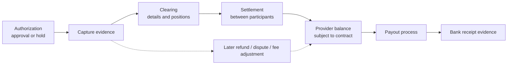
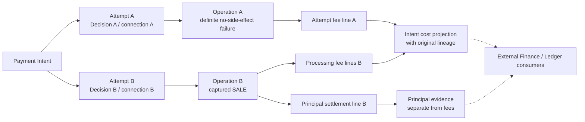
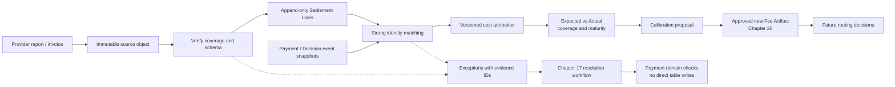

# 第 18 章 Settlement 与 Cost Attribution

Aurora 的新路由策略终于通过了小流量实验。一笔 100.00 USD 的支付，在线预计处理成本为 3.00 USD，最终 Capture 成功。团队把 97.00 USD 写进“商户净收入”，认为经济闭环已经完成。几天后，Provider 报表给出另一组数字：成功通道费用 3.60 USD，前一次获准失败尝试的处理费 0.05 USD，另有 10.00 USD 保证金暂扣。月末还有一张费用更正单。

如果平台把 Capture 当作到账、把所有扣减都当手续费，再把月度 Invoice 总额加到已扣费用上，三个局部合理的操作就会拼出一张错误账单。更严重的是，有人可能顺手把“报表里出现了这笔交易”变成一条 SQL，将内部失败的 Payment 改成成功。

本章的核心命题是：

> **路由的经济结果必须从可验证的结算与费用事实，回连到原 Decision、Attempt、Operation 和精确 connection 后计算。Expected、Accrued、Actual Cost 分列；结算事实只追加，差异走受控工作流，既不覆盖历史决定，也不越权改写支付或 Ledger。**

[第 17 章](reconciliation.md)负责外部交易证据与内部支付事实的比对、差异分类和受控修复；本章消费这些结果，回答“哪次路由承担了什么费用”。[第 7 章](../part-2-routing-engine/cost-aware-routing.md)的估价器仍只产生 Expected Cost，Ledger、Payout 执行和会计政策保持外部边界。当前代码只有 automatic-capture `SALE` 纵向切片，并没有 Settlement 服务；以下设计和 Go 示例是本章待配套增量。

## 18.1 Problem：一次成功响应不能给出最终经济结果

### 18.1.1 五个资金阶段，不能压成一个 `paid`

| 阶段 | 本章如何理解 | 不能由它推导出的结论 |
| --- | --- | --- |
| Authorization | 对支付请求的批准，通常伴随额度或资金保留 | 已 Capture、已结算、商户已到账 |
| Capture | 对已授权金额发起并完成相应请款处理，具体证据依 Provider 而定 | 所有费用已确认、银行已收到资金 |
| Clearing | 传递、核对交易明细并形成结算头寸 | 商户银行入账已经发生 |
| Settlement | 相关参与方履行结算资金义务 | 每笔交易都对应一笔独立 Payout |
| Payout | Provider 向商户银行等目的地划拨可用资金的另一条流程 | 发起划拨等于银行到账，或以后不会有退款与争议 |

CPMI 的术语表将 Clearing 描述为 Settlement 前的交易传递、核对等过程，可能包括轧差与最终头寸形成；这里使用的是语义边界，不是把所有市场画成同一张状态机。[CPMI Glossary](https://www.bis.org/cpmi/glossary.pdf) VisaNet Connect 的官方接口也区分请求批准的 Authorization 与启动后续 Clearing/Settlement 的 Capture；不能把某一个 API 的成功解释成全部阶段同时完成。[VisaNet Connect — Acceptance](https://developer.visa.com/capabilities/visanet-connect-acceptance/docs-getting-started)



这张图展示卡支付中的典型关系，不承诺统一时间间隔。Automatic `SALE` 可以把授权与请款指令合在一个 Provider 操作中，却不能消除后续清结算和资金划拨的异步性。Payment 可以按已证明的 Capture 结果完成面向订单的状态，而不必等待银行到账；经济结果则继续沿独立事实流成熟。

### 18.1.2 `gross - payout` 不是手续费

先把 Aurora 的例子限制为同币种，且各费用项按合同互不重叠：

| 项目 | USD | 归因类别 |
| --- | ---: | --- |
| 成功交易本金 | 100.00 | Principal，不是平台费用 |
| 成功 Attempt 的处理费用 | 3.60 | Actual processing cost |
| 前一失败 Attempt 的费用 | 0.05 | 该 Attempt 的独立费用 |
| 保证金暂扣 | 10.00 | 受限资金变动，不直接等于费用 |
| 对批次可划拨净额的贡献 | 86.35 | 此例的余额变动结果，不是一笔已到账 Payout |

本例实际处理成本为 3.65 USD，而不是 13.65 USD；保证金释放时也不是新增营业收入。是否另计资金占用成本属于经批准的经济模型，必须与原始暂扣事实分开。Refund principal、Chargeback principal、争议手续费也需要分列，不能把全部负数都塞进 `processing_fee`。

单笔费用分解与批次余额桥接是两个检查。前者解释一张费用单如何分给交易，后者解释 opening balance 加各类变动、减 Payout 后为何得到 closing balance；桥接相等本身不证明每条明细都正确。Stripe 的 Payout reconciliation 文档将 Payout 与其对应批次关联，并指出某些划拨方式不能自动定位所含交易，这进一步说明不能假设“一笔销售等于一笔银行入账”。[Stripe Payout Reconciliation](https://docs.stripe.com/reports/payout-reconciliation)

## 18.2 Simple Design：先把估计和已观察事实分开

最初的改进不需要一套完整财务平台。Aurora 可以先保留 Decision 中的估算，再摄取一种 Provider 的 captured-sale 与 fee 报表，输出并排的差异报告。

| 成本层 | 来源 | 当时能承诺什么 | 更新方式 |
| --- | --- | --- | --- |
| Expected | Decision 时的 Fee/FX Artifact 与 Context | 在该版本和已知条件下的估计 | 原 estimate 不变；新决定引用新版本 |
| Accrued | 已发生事件结合合同计算的应计估计 | 费用可能已发生，但外部金额仍未全部确认 | 保留计算依据、覆盖范围和估计版本 |
| Actual | 已验证报表、Invoice、调整行及其归因结果 | 截至指定日期、指定组件已有外部依据的金额 | 追加来源或更正，生成新 projection version |

这里的 Accrued 是平台管理分析口径，不自行决定会计确认政策。它也不是“已收到的费用总和”的别名：已经验证的费用可以属于部分 Actual，尚未确认的组件仍单列 Accrued。没有报表是 `missing`，不是零；没有适用费用则必须由合同或明确证据支持 `not_applicable`。

Actual 同样不是永不变化的单一终值。一份 Capture 费用报表可能已完整，Refund/争议相关费用尚未发生；报告应写成“截至某日，processing 组件已确认，dispute cohort 尚未成熟”，而不是给整笔 Intent 打一个无条件的 `final_cost=true`。这与[第 15 章](observability.md)的成熟水位、[第 16 章](experimentation.md)的 cohort age 保持一致。

第一版数据链可以沿用[第 14 章](routing-decision-store.md)封存的 Decision ID。成功本金只连到产生成功资金效果的 Operation，各次 Attempt 的费用则各回各家，最后才按 Intent 聚合：



这不是在建议多试一次。图中的第二个 Attempt 必须已经满足第 12 章的 Fallback 闸门；本章只做事后归因，不能因为一条费率更低就新增操作。Same-operation 网络重试不产生第二份逻辑本金，但 Provider 是否对请求次数收费仍由合同和实际 fee evidence 决定。

## 18.3 Problems at Scale：文件、身份与金额都可能说出半个真相

### 18.3.1 下载成功不代表业务期间完整

一个 HTTP 200 可能只带回半个文件，分页任务也可能漏掉最后一页。即使 bytes 完整，报告可能只覆盖一个 Merchant Account、部分日期或尚未关闭的 batch。`SettlementFile` 因而需要 source account、report type/schema、Provider report ID/revision、请求窗口、时区、生成时间、获取时间、内容摘要、行数、控制总额与完成标记。

传输校验与业务覆盖要分开：checksum 验证收到的内容是否符合声明，不证明 Provider 没漏交易；我们自己算出的 hash 更不能认证来源。下载身份、TLS/SFTP 信任或 Provider 签名由接入契约落实。只有全部分页/分片到齐且控制检查通过，覆盖 manifest 才能从 `received` 进入 `accepted_complete`；缺少可靠控制信息时保留 `coverage_unverified`。

金额控制总额必须按 account、currency、entry category 分组，至少分别核对 debit、credit 与数量，不能只看相互抵消后的净额。CSV 用版本化表头解析，不按固定列号猜测；多账户文件逐行验证 account，未知类型、错误精度与无法解释的符号进入隔离区。解析中途失败不能把已读的前半张表发布成完整 Actual。

### 18.3.2 重复文件、重复行和费用更正不是同一种重复

| 输入情况 | 处理语义 |
| --- | --- |
| 相同 source file identity/revision、相同 bytes hash | 重投，返回既有摄取结果 |
| 相同 file identity/revision、不同 hash | 来源冲突，隔离并调查，不覆盖 |
| 不同文件包含相同经济 entry identity、相同 payload | 行级重投，增加来源关联，不再计费 |
| 同 entry identity/revision、不同规范化 payload | `payload_mismatch`，不能 last-write-wins |
| 明确的新 revision 或 correction entry | 保存新事实，按 Adapter 声明的修订语义解释 |

`file_hash + row_number` 只标识物理出现位置，不能阻止同一经济行出现在重叠日期报表中。优先采用 Provider 承诺稳定的 entry ID；否则 Adapter 必须定义经过验证的复合键与 multiplicity 规则。仅靠“字段完全一样”也可能把两笔合法相同费用误删；第一版没有可靠行身份的报表就不进入自动归因。

Revision 尤其不能简单相加。Delta correction 表示额外增减，replacement revision 表示此前那份解释被明确修订；只有来源契约给出可验证关联与顺序，投影才能选择有效版本。旧事实仍保留，新版本有 `supersedes` 或 `adjusts` 关系。没有修订语义的两张相反账单只是冲突，不是自动相抵的许可证。

### 18.3.3 同一个 Provider Reference，不一定属于同一个操作

匹配的入口是受信任的 report account 到 Provider namespace 的映射，再定位原始 reference；Payment 事件快照提供已固定的 `provider_connection_id`、revision、namespace、Operation 与 Decision。不能读取当前 Router 配置，把旧交易“迁移”到今天恰好同名的账户。共享外部账户的 connection alias 还必须共享正确的 reference namespace，不能靠新建 alias 绕过碰撞检查。

Principal row 校验的是原交易或具体 Capture 的金额币种；fee row 的 3.60 USD 不能拿来与 100.00 USD 的支付本金比较。后者需要独立的 fee amount，以及来源提供的 parent operation/reference 与计费 basis。部分 Capture、Refund、Chargeback 还可能各有 modification reference，不能只凭 payment-level reference 把它们合并。

引用唯一但金额冲突时，进入 exception；引用不唯一时，不能退化为“同金额、时间最近的那笔”。迟到的 Payment 快照允许 `awaiting_projection` 后重试，人工确认则形成有证据和版本的 Resolution。匹配成功只说明这条经济事实属于谁，不自动证明内部 `failed` 应改为 `succeeded`。

### 18.3.4 币种、精度与时间是身份的一部分

| 字段组 | 必须保存的事实 | 常见错误 |
| --- | --- | --- |
| Transaction money | 原金额、原币种、单位/scale | 把 Provider 净额当原支付金额 |
| Settlement money | 结算币种、gross/net、fee 各自单位 | 不同币种直接相减 |
| Reporting money | 分析基准币、FX source/version、换算时点与舍入规则 | 用今天汇率重算历史后覆盖原值 |
| 时间 | effective/booking/value date、observed/imported time、原时区与期间 | 用文件下载时间决定费用所属月 |

ISO 4217 的币种及 minor-unit 资料需要维护，SIX 作为维护机构同时提供当前与历史列表；平台应固定 currency metadata version，而不是假设所有报表都用两位小数。[SIX Currency Code Maintenance](https://www.six-group.com/en/products-services/financial-information/market-reference-data/data-standards.html) CSV 中的 decimal string 必须精确解析；多余精度不能偷偷截断，批量求和与乘法还要检查溢出。

Stripe Balance Transaction 区分 `amount`、`fee`、`net`、`currency`、`exchange_rate`、`created` 和 `available_on`；其中净额影响的是相应 Stripe balance，不是原币种的订单总价。[Stripe Balance Transaction](https://docs.stripe.com/api/balance_transactions/object) 本书据此要求 Adapter 保存原币和结算币两组事实，而不是把所有金额强转为 USD 后丢掉来源。

参考汇率也不能冒充实际成交汇率。ECB 明确将其 reference rates 限定为信息用途并不建议用于交易目的；它可以成为分析基准，但不能填补未知的 Provider 实际 FX。[ECB Reference Rates](https://www.ecb.europa.eu/stats/policy_and_exchange_rates/euro_reference_exchange_rates/html/index.en.html) 第 7 章使用 `cost_micros`，本章报表可能使用 minor units；两者比较前必须显式换算单位和币种，保留转换版本与残差。

### 18.3.5 一张月度 Invoice 不能再加一遍

费用有 summary 与 component 两种表示。例如 Adyen Settlement details report 在有分项时给出 Markup、Scheme Fees、Interchange；没有分项时可能仅给 Commission。文档还说明部分外部结算记录中的 exchange rate 是参考值，而非外部收单方实际汇率。[Adyen Settlement Details Report](https://docs.adyen.com/reporting/settlement-reconciliation/transaction-level/settlement-details-report) 因而“见到数字就相加”既可能把总项与分项重复计算，也可能把参考值误当成交事实。

月度费用又会与批次已扣款交叉。Adyen 的 Invoice 明确区分总费用、已从 settlement 扣除的金额和 amount due，并说明月度档位等因素可产生后续差额。[Adyen Payment Processing Invoice](https://docs.adyen.com/reporting/invoice-reconciliation/payment-processing-invoice/) Aurora 必须识别“确认旧费用”与“新增调整”，保留 invoice-line 到既有 charge 的关联；不能把 Invoice 总额再次写成新的交易手续费。

## 18.4 Production Design：只追加事实，再建立可重建的归因投影

### 18.4.1 Settlement 的独立数据边界

| 模型 | 主要内容 | 不拥有的权力 |
| --- | --- | --- |
| SettlementFile | 原件引用/hash、来源范围、schema、revision、完整性检查 | 不批准 Payment 成功 |
| SettlementLine | 经济 entry identity、类型、signed money、reference、来源/修订关系 | 不覆盖旧行，不触发资金操作 |
| Attribution | line 到 Intent/Attempt/Operation/Decision 的分配，match/allocation version | 不改历史 Expected Cost |
| Exception | 无匹配、金额冲突、身份冲突、覆盖缺口及证据引用 | 不直接 SQL 修复 Payment |
| CalibrationReport | 同口径 Expected-vs-Actual、覆盖率、成熟窗口与残差 | 不自动发布费率或训练结论 |



Settlement 通过 API 或事件消费最小 Operation/Decision 快照，建立自己 schema 中的可重建 projection；不跨库读 Payment 表。原始报表访问与下载凭证单独授权，分析层只留必要字段，不能因为 Provider 提供了地址或卡数据列就全部复制。PAN、CVV/SAD 和 secret 不进入本章数据流。

摄取分为 staging 与发布：先保留原件、检查全部范围，再事务性登记已接受文件与 outbox；行较多时可分块持久化，但只有完整 manifest 放行的事实集合才能成为“完整期间”报告。Checkpoint 与 inbox/outbox 保证崩溃重跑，消费者按经济行身份去重。服务宕机只使经济报告落后，不应阻断在线 Capture 或凭空让 Payment 失败。

### 18.4.2 Go：相同身份、不同内容必须拒绝覆盖

以下纯函数展示行级判定；`PayloadHash` 是 Adapter 固定 canonicalization version 后对规范化语义的摘要，不是把可能变换空白的 CSV 原行直接拿来比较。数据库实现仍需唯一约束与事务，不能把这个检查当作并发保证。

```go
package settlementfact

import "errors"

type Key struct {
	ProviderNamespaceID string
	EntryID             string
	Revision            string
}

type Fact struct {
	Key         Key
	PayloadHash [32]byte
}

type Action string

const (
	Append     Action = "append"
	Replay     Action = "replay"
	Quarantine Action = "quarantine"
)

func Classify(existing *Fact, incoming Fact) (Action, error) {
	if incoming.Key.ProviderNamespaceID == "" || incoming.Key.EntryID == "" ||
		incoming.Key.Revision == "" || incoming.PayloadHash == ([32]byte{}) {
		return "", errors.New("invalid settlement fact")
	}
	if existing == nil {
		return Append, nil
	}
	if existing.Key != incoming.Key {
		return "", errors.New("lookup returned another fact identity")
	}
	if existing.PayloadHash != incoming.PayloadHash {
		return Quarantine, nil
	}
	return Replay, nil
}
```

`EntryID` 必须在已声明 namespace 中唯一，必要时由 Adapter 加入 entry category、report family 等限定。SQL 冲突后重新读取 winner 并比较 hash；不使用 `ON CONFLICT DO UPDATE amount=...`。收到修订版时新 Key 可以追加，但是否影响有效总额还要经过明确的 replacement/delta 解释，不能把 `Append` 理解成“立刻加进成本”。

### 18.4.3 Go：匹配只产生关联，不产生支付成功

下面是第一版 captured-sale/fee Adapter 的窄匹配器。输入已经过 schema、币种、单位与来源验证；`BasisAmountMinor` 是该费用或结算项关联的原交易金额，不是手续费金额。无法提供可靠 basis 的来源先进入 exception，不猜测。

```go
package settlementmatch

type Line struct {
	ConnectionID       string
	ConnectionRevision string
	NamespaceID        string
	ProviderReference  string
	Kind               string
	BasisAmountMinor   int64
	BasisCurrency      string
}

type Operation struct {
	ID                 string
	IntentID           string
	AttemptID          string
	DecisionID         string
	ConnectionID       string
	ConnectionRevision string
	NamespaceID        string
	ProviderReference  string
	AmountMinor        int64
	Currency           string
	Kind               string
	Status             string
	Integrity          string
}

type Result struct {
	State     string
	Reason    string
	Operation Operation
}

func Match(line Line, snapshots []Operation) Result {
	if line.ConnectionID == "" || line.ConnectionRevision == "" ||
		line.NamespaceID == "" || line.ProviderReference == "" ||
		line.BasisAmountMinor <= 0 || line.BasisCurrency == "" ||
		(line.Kind != "captured_sale" && line.Kind != "fee") {
		return Result{State: "exception", Reason: "invalid_line_contract"}
	}
	var matches []Operation
	for _, operation := range snapshots {
		if operation.NamespaceID == line.NamespaceID &&
			operation.ProviderReference == line.ProviderReference {
			matches = append(matches, operation)
		}
	}
	if len(matches) == 0 {
		return Result{State: "awaiting_projection", Reason: "reference_not_found"}
	}
	if len(matches) != 1 {
		return Result{State: "exception", Reason: "ambiguous_reference"}
	}
	operation := matches[0]
	reject := func(reason string) Result {
		return Result{State: "exception", Reason: reason, Operation: operation}
	}
	if operation.ConnectionID != line.ConnectionID ||
		operation.ConnectionRevision != line.ConnectionRevision {
		return reject("connection_mismatch")
	}
	if operation.Kind != "sale" || operation.Integrity != "healthy" {
		return reject("unsupported_or_review_required")
	}
	if operation.Currency != line.BasisCurrency {
		return reject("currency_mismatch")
	}
	if operation.AmountMinor != line.BasisAmountMinor {
		return reject("amount_mismatch")
	}
	if operation.ID == "" || operation.IntentID == "" ||
		operation.AttemptID == "" || operation.DecisionID == "" {
		return Result{State: "awaiting_projection", Reason: "lineage_incomplete"}
	}
	if line.Kind == "captured_sale" && operation.Status != "succeeded" {
		return reject("payment_evidence_requires_reconciliation")
	}
	return Result{State: "matched", Operation: operation}
}
```

同 reference 出现在两个不同 Operation 时，代码先报 ambiguity，再谈金额；金额相同不会让碰撞自动变安全。生产 projection 还须按 event ID/version 去重，不能把同一 Operation 的多个历史版本当作多笔操作。

`fee` 可以属于失败或尚待收敛的 Operation，因为计费事实与 Capture 事实不是同一件事；这不授予它成功本金，也不能把它加入“已确认成功”分母。若 captured-sale row 与内部状态冲突，Exception 保存 line、Operation snapshot 与第 17 章 Evidence/Difference ID；由 Payment 的领域命令决定收敛或 `review_required`，本服务没有更新支付终态的权限。

### 18.4.4 Go：费用分摊必须精确守恒

有明确 Operation reference 的费用优先直接归因。只有月度最低费、批次费用等确实无法逐笔定位的项目，才按批准的 allocation policy 分配；count、交易额或其他 basis 都是管理选择，不是 Provider 告诉我们的交易级事实。分配结果必须保留原始总额、目标集合、权重快照和 policy version。

若一笔 0.05 USD 的批次费用按两个相同权重分配，分别四舍五入成 0.03 USD 就多出一分钱。以下 largest-remainder 实现先分配整数份额，再按余数和稳定 ID 分配剩余单位。它支持负数调整，并用 `math/big` 避免中间乘法溢出；输出始终以输入币种的同一 minor unit 表示。

```go
package costallocation

import (
	"errors"
	"math/big"
	"sort"
)

type Weight struct {
	TargetID string
	Units    uint64
}

type Share struct {
	TargetID    string
	Currency    string
	AmountMinor int64
}

type portion struct {
	id        string
	amount    *big.Int
	remainder *big.Int
}

func SplitMinor(total int64, currency string, weights []Weight) ([]Share, error) {
	if currency == "" || len(weights) == 0 || len(weights) > 10000 {
		return nil, errors.New("invalid allocation contract")
	}
	seen := make(map[string]bool, len(weights))
	denominator := new(big.Int)
	for _, weight := range weights {
		if weight.TargetID == "" || seen[weight.TargetID] || weight.Units == 0 {
			return nil, errors.New("invalid or duplicate allocation target")
		}
		seen[weight.TargetID] = true
		denominator.Add(denominator, new(big.Int).SetUint64(weight.Units))
	}
	magnitude := new(big.Int).Abs(big.NewInt(total))
	allocated := new(big.Int)
	parts := make([]portion, 0, len(weights))
	for _, weight := range weights {
		product := new(big.Int).Mul(magnitude, new(big.Int).SetUint64(weight.Units))
		quotient, remainder := new(big.Int), new(big.Int)
		quotient.QuoRem(product, denominator, remainder)
		allocated.Add(allocated, quotient)
		parts = append(parts, portion{weight.TargetID, quotient, remainder})
	}
	sort.Slice(parts, func(i, j int) bool {
		comparison := parts[i].remainder.Cmp(parts[j].remainder)
		if comparison != 0 {
			return comparison > 0
		}
		return parts[i].id < parts[j].id
	})
	left := new(big.Int).Sub(magnitude, allocated).Int64()
	for index := int64(0); index < left; index++ {
		parts[index].amount.Add(parts[index].amount, big.NewInt(1))
	}
	result := make([]Share, 0, len(parts))
	for _, part := range parts {
		if total < 0 {
			part.amount.Neg(part.amount)
		}
		if !part.amount.IsInt64() {
			return nil, errors.New("allocation overflow")
		}
		result = append(result, Share{part.id, currency, part.amount.Int64()})
	}
	sort.Slice(result, func(i, j int) bool { return result[i].TargetID < result[j].TargetID })
	return result, nil
}
```

调用前必须验证币种和 unit metadata；金额权重只能来自同一可比较 basis，不能把 USD cents 与 JPY units 直接混合。余数分配规则同样属于版本化 policy。更正旧批次时引用被冻结的目标集合，而不是把上月的差额分给今天新增的商户。

本例只是一个经济行在目标间的精确分摊，不是复式记账。完整投影同时要求：每个有效 line 的分配之和等于原 line；未分配部分显式保留在 unallocated bucket；总项与分项不重复；本金、费用、受限资金与汇兑差异不互相代替。会计科目、分录、关账与重开账期仍由外部 Ledger/Finance 决定。

### 18.4.5 只把可比较的 Actual 送回 Fee Model

校准报告按 connection、合同版本、operation、组件、币种和业务期间比较 `actual - expected`，同时输出 matched ratio、missing components、异常金额和成熟截止点。重投或异常行被排除时要报告数量和金额，不能让“缺了最贵的一批数据”看起来像成本下降。

对单 Attempt 的 estimate，应比较同一 Attempt、同一组件范围的 Actual；对 Intent 的单位经济性，再汇总所有合法 Attempt fee 与后续归因。不能把 A 的预估单次手续费拿来减掉包含 B 的 Fallback、争议本金和月费的 Intent 总额，随后认定 A 的模型错误。失败尝试费用保留在原 Decision，实验归属则沿第 16 章原 assignment 不变。

一种管理指标可以是“指定 cohort 全部纳入范围的实际费用 / 同 cohort 在规定窗口内成功的 Intent 数”；失败 Intent 的费用不能凭空删除，分母为零返回不可计算。退款本金、净收入、争议损失、成本率分别给出定义，成熟度不同不强行合并。原始费用较低也不直接证明某个 Provider 有因果优势。

发现差异后产出 calibration proposal，包含样本、来源、缺项、建议费率与误差分布，再交给[第 20 章](../part-5-global-routing/configuration-platform.md)审批和发布。旧 Decision 的 Expected Cost 永远保留；新 Artifact 只影响未来决定。机器学习如何消费这些标签留给[第 21 章](../part-5-global-routing/intelligent-routing.md)，本章不让一张迟到账单自动改在线权重。

### 18.4.6 当前代码与下一条可验证增量

| 当前工程事实 | 本章待配套能力 |
| --- | --- |
| Payment 已有 Intent/Attempt/Operation、金额币种、精确 connection 与 Provider reference，并原子保存 v3 Context/Decision/Risk/Optimization snapshot | 发布面向经济归因的最小 projection，保留原身份和每个 Attempt 的 estimate |
| `app.RunReconciler` 是在线 UNKNOWN recovery | 不把它称为 Settlement 或完整报表 reconciliation 服务 |
| Router v3 已读取版本化 Fee Schedule/FX evidence，计算 `AttemptCostMicros`、`SucceededCostMicros`、`FailedCostMicros`，并把选择所用 Cost/Scoring evidence 放入 Decision snapshot | 这些值仍是条件 Expected Cost；需由 Settlement 的可比较 Actual 事实校准，不得改写历史 estimate |
| 没有 `services/settlement` 或独立结算 schema | worker/CLI、一种版本化 CSV/JSON Adapter、幂等 facts、exception 与 calibration report |
| 当前只执行 automatic-capture `SALE` | 报表可识别其他类型不等于已实现 manual Capture/Void/Refund API |

最小纵向切片只接收一种已声明行身份和完成语义的 report，匹配 captured sale 与 fee，经真实 PostgreSQL 保存并输出 Expected-vs-Actual。它必须通过重复文件、重叠行、hash mismatch、缺快照、金额币种冲突、负数调整和分配守恒测试，才算配套服务完成。本文纯函数编译通过，以及 Router 已能计算 Expected Cost，都不等于持久化 Actual、真实 Provider 报表接入或财务运营已完成。固定基线与这些边界见[本章交付说明](../deliveries/chapter-18-settlement-and-cost-attribution.md)。

## 18.5 Failure Modes：异常可以等待，事实不能伪造

| 失败场景 | 可证伪的验收条件 | 受控动作 |
| --- | --- | --- |
| 文件下载一半或漏页 | 完整性 manifest 不通过，完整 Actual 报告不发布 | 重取原范围，保留失败证据 |
| 同文件或经济行重投 | 原本金、费用总额与 attribution 数量不变 | 按身份/hash 返回 replay |
| 同身份不同 payload | 旧事实未被覆盖，新内容未计入有效总额 | 隔离并关联 Difference |
| 费用行无法匹配 | 不会匹配到“金额最接近”的另一交易 | 等待快照，超时进入 exception queue |
| captured-sale 与内部失败冲突 | Settlement 无 Payment 表写入、无新 Gateway 调用 | 送第 17 章领域复核 |
| correction 先于原行到达 | 不按到达顺序选 winner，也不重复累加 | 等关联链完整后重新投影 |
| 多 Attempt 后成功 | 本金只归成功 Operation，各次 fee 均保留来源 | 按 Intent 聚合但不改 Decision 归属 |
| 分配 5 个最小单位给两个目标 | 分配和精确为 5，输入乱序结果不变；负数同理 | 稳定余数规则与版本 |
| FX 缺失或币种冲突 | 不产生伪造的统一币种总额 | 原币保留，换算状态 unavailable |
| Worker 在 checkpoint 前崩溃 | 重跑无重复计费、无丢失异常 | staging、事务与 outbox 恢复 |

Exception 的关闭必须说明结果是来源补齐、匹配规则修正、Provider 更正、Payment 领域修复，还是经授权的财务处理。`resolved` 不意味着把数字改到相等；如果剩余差异被接受，也必须记录依据与审批。补偿、Refund、Ledger adjustment 都是另一个被明确授权的工作流，不能由异常队列自动发起。

## 18.6 Trade-offs：及时反馈与可证明完整性

**更快看到与更早下结论。** 部分 Actual 可以尽早帮助排查费用异常，但必须标记覆盖范围，不能与完整 cohort 混合排名。冻结一个截止点能提供可复现报告，却不会阻止迟到事实；后者进入新的版本，而不是修改旧报告背后的数据。

**精确直连与分配估计。** 强 reference 匹配提供较高可信度，月度费用只能按政策归因。强行把每个成本都分到单笔交易会制造虚假精确；保留 unallocated 或 account-level 费用有时更诚实，也更容易解释。

**原件保留与数据最小化。** 原件有助于验证 Adapter 和处理争议，但不能成为无限保存敏感数据的理由。应优先选择必要列与受控来源，隔离权限和保留期限；跨 Region 数据驻留与复制留给[第 19 章](../part-5-global-routing/multi-region.md)。哈希不能替代访问控制，也不自动让数据匿名。

**独立服务与运营成本。** Settlement 独立 schema 与 worker 可以隔离批量摄取、重算和权限，但会增加投影延迟与运维责任。第一步可以是一个可部署 CLI/worker，不必立即引入多层消息平台；不可让离线费用查询成为在线 Payment 的同步依赖。

## 18.7 Summary

本章从一次过早确认的在线手续费，建立了路由经济结果的证据闭环：

1. Authorization、Capture、Clearing、Settlement、Payout 分开，成功、净额、银行到账不是同一事实。
2. Expected、Accrued、Actual 分层；Actual 带来源、覆盖、成熟窗口和版本，缺失不等于零。
3. 文件完整性、经济行幂等与修订语义分别验证；同身份不同内容隔离，更正不覆盖原件。
4. 以精确 connection、namespace、reference 与金额币种建立归因链；本金、每次 Attempt fee、暂扣和后续损失各自保留语义。
5. 所有分配精确守恒，FX 与单位换算显式化；总项、分项、Invoice 已扣额不能重复计费。
6. 差错只产生证据和受控 Resolution，不授予改写 Payment、生成 Refund 或 Ledger 调账的权力。
7. 校准只提出新的 Fee Artifact，历史 Decision 不改；当前真实系统尚无本章 Settlement 服务。

经济反馈至此能够回到路由的下一次决定。下一章转向另一条安全边界：这些决定、身份与事实分布在多个 Region 时，究竟哪一个实例有权产生新的资金副作用。
