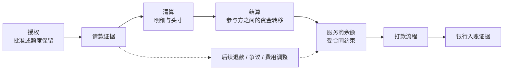
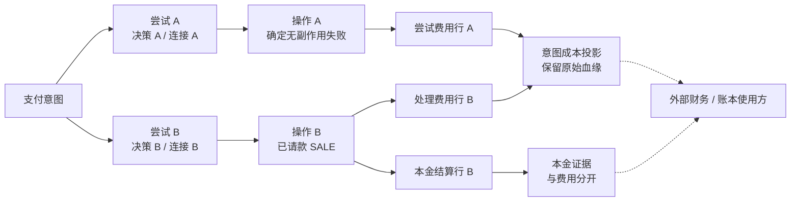
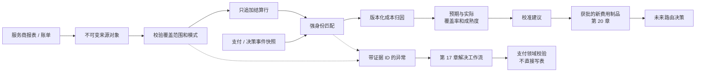

# 第 18 章 结算与成本归因

Aurora 的新路由策略终于通过了小流量实验。一笔 100.00 USD 的支付，在线预计处理成本为 3.00 USD，最终请款成功。团队把 97.00 USD 写进“商户净收入”，认为经济闭环已经完成。几天后，服务商报表给出另一组数字：成功通道费用 3.60 USD，前一次获准失败尝试的处理费 0.05 USD，另有 10.00 USD 保证金暂扣。月末还有一张费用更正单。

如果平台把请款当作到账、把所有扣减都当手续费，再把月度账单总额加到已扣费用上，三个局部合理的操作就会拼出一张错误账单。更严重的是，有人可能顺手把“报表里出现了这笔交易”变成一条 SQL，将内部失败的支付改成成功。

本章的核心命题是：

> **路由的经济结果必须从可验证的结算与费用事实，回连到原决策、尝试、操作和精确连接后计算。预期、应计、实际成本分列；结算事实只追加，差异走受控工作流，既不覆盖历史决定，也不越权改写支付或账本。**

[第 17 章](reconciliation.md)负责外部交易证据与内部支付事实的比对、差异分类和受控修复；本章消费这些结果，回答“哪次路由承担了什么费用”。[第 7 章](../part-2-routing-engine/cost-aware-routing.md)的估价器仍只产生预期成本，账本、打款执行和会计政策保持外部边界。当前代码只有自动请款 `SALE` 纵向切片，并没有结算服务；以下设计和 Go 示例是本章待配套增量。

## 18.1 问题：一次成功响应不能给出最终经济结果

### 18.1.1 五个资金阶段，不能压成一个 `paid`

| 阶段 | 本章如何理解 | 不能由它推导出的结论 |
| --- | --- | --- |
| 授权 | 对支付请求的批准，通常伴随额度或资金保留 | 已请款、已结算、商户已到账 |
| 请款 | 对已授权金额发起并完成相应请款处理，具体证据依服务商而定 | 所有费用已确认、银行已收到资金 |
| 清算 | 传递、核对交易明细并形成结算头寸 | 商户银行入账已经发生 |
| 结算 | 相关参与方履行结算资金义务 | 每笔交易都对应一笔独立打款 |
| 打款 | 服务商向商户银行等目的地划拨可用资金的另一条流程 | 发起划拨等于银行到账，或以后不会有退款与争议 |

CPMI 的术语表将清算描述为结算前的交易传递、核对等过程，可能包括轧差与最终头寸形成；这里使用的是语义边界，不是把所有市场画成同一张状态机。[CPMI 术语表](https://www.bis.org/cpmi/glossary.pdf) VisaNet Connect 的官方接口也区分请求批准的授权与启动后续清算/结算的请款；不能把某一个 API 的成功解释成全部阶段同时完成。[VisaNet Connect：受理](https://developer.visa.com/capabilities/visanet-connect-acceptance/docs-getting-started)



这张图展示卡支付中的典型关系，不承诺统一时间间隔。自动 `SALE` 可以把授权与请款指令合在一个服务商操作中，却不能消除后续清结算和资金划拨的异步性。支付可以按已证明的请款结果完成面向订单的状态，而不必等待银行到账；经济结果则继续沿独立事实流成熟。

### 18.1.2 总额减打款（`gross - payout`）不是手续费

先把 Aurora 的例子限制为同币种，且各费用项按合同互不重叠：

| 项目 | USD | 归因类别 |
| --- | ---: | --- |
| 成功交易本金 | 100.00 | 本金，不是平台费用 |
| 成功尝试的处理费用 | 3.60 | 实际处理成本 |
| 前一失败尝试的费用 | 0.05 | 该尝试的独立费用 |
| 保证金暂扣 | 10.00 | 受限资金变动，不直接等于费用 |
| 对批次可划拨净额的贡献 | 86.35 | 此例的余额变动结果，不是一笔已到账打款 |

本例实际处理成本为 3.65 USD，而不是 13.65 USD；保证金释放时也不是新增营业收入。是否另计资金占用成本属于经批准的经济模型，必须与原始暂扣事实分开。退款本金、拒付本金、争议手续费也需要分列，不能把全部负数都塞进 `processing_fee`。

单笔费用分解与批次余额桥接是两个检查。前者解释一张费用单如何分给交易，后者解释期初余额加各类变动、减打款后为何得到期末余额；桥接相等本身不证明每条明细都正确。Stripe 的打款对账文档将打款与其对应批次关联，并指出某些划拨方式不能自动定位所含交易，这进一步说明不能假设“一笔销售等于一笔银行入账”。[Stripe：打款对账](https://docs.stripe.com/reports/payout-reconciliation)

## 18.2 简单设计：先把估计和已观察事实分开

最初的改进不需要一套完整财务平台。Aurora 可以先保留决策中的估算，再摄取一种服务商的已请款销售操作与费用报表，输出并排的差异报告。

| 成本层 | 来源 | 当时能承诺什么 | 更新方式 |
| --- | --- | --- | --- |
| 预期 | 决策时的费用/FX 制品与上下文 | 在该版本和已知条件下的估计 | 原估计不变；新决定引用新版本 |
| 应计 | 已发生事件结合合同计算的应计估计 | 费用可能已发生，但外部金额仍未全部确认 | 保留计算依据、覆盖范围和估计版本 |
| 实际 | 已验证报表、账单、调整行及其归因结果 | 截至指定日期、指定组件已有外部依据的金额 | 追加来源或更正，生成新投影版本 |

这里的应计是平台管理分析口径，不自行决定会计确认政策。它也不是“已收到的费用总和”的别名：已经验证的费用可以属于部分实际，尚未确认的组件仍单列应计。没有报表是 `missing`，不是零；没有适用费用则必须由合同或明确证据支持 `not_applicable`。

实际同样不是永不变化的单一终值。一份请款费用报表可能已完整，退款/争议相关费用尚未发生；报告应写成“截至某日，处理组件已确认，争议群组尚未成熟”，而不是给整笔意图打一个无条件的 `final_cost=true`。这与[第 15 章](observability.md)的成熟水位、[第 16 章](experimentation.md)的群组时长保持一致。

第一版数据链可以沿用[第 14 章](routing-decision-store.md)封存的决策 ID。成功本金只连到产生成功资金效果的操作，各次尝试的费用则各回各家，最后才按意图聚合：



这不是在建议多试一次。图中的第二个尝试必须已经满足第 12 章的后备路由闸门；本章只做事后归因，不能因为一条费率更低就新增操作。同操作网络重试不产生第二份逻辑本金，但服务商是否对请求次数收费仍由合同和实际费用证据决定。

## 18.3 规模化问题：文件、身份与金额都可能说出半个真相

### 18.3.1 下载成功不代表业务期间完整

一个 HTTP 200 可能只带回半个文件，分页任务也可能漏掉最后一页。即使字节完整，报告可能只覆盖一个商户账户、部分日期或尚未关闭的批次。结算文件（`SettlementFile`）因而需要来源账户、报表类型/模式、服务商报表 ID/修订、请求窗口、时区、生成时间、获取时间、内容摘要、行数、控制总额与完成标记。

传输校验与业务覆盖要分开：校验和验证收到的内容是否符合声明，不证明服务商没漏交易；我们自己算出的哈希更不能认证来源。下载身份、TLS/SFTP 信任或服务商签名由接入契约落实。只有全部分页/分片到齐且控制检查通过，覆盖清单才能从 `received` 进入 `accepted_complete`；缺少可靠控制信息时保留 `coverage_unverified`。

金额控制总额必须按账户、币种、条目类别分组，至少分别核对借方、贷方与数量，不能只看相互抵消后的净额。CSV 用版本化表头解析，不按固定列号猜测；多账户文件逐行验证账户，未知类型、错误精度与无法解释的符号进入隔离区。解析中途失败不能把已读的前半张表发布成完整实际。

### 18.3.2 重复文件、重复行和费用更正不是同一种重复

| 输入情况 | 处理语义 |
| --- | --- |
| 相同来源文件身份/修订、相同字节哈希 | 重投，返回既有摄取结果 |
| 相同文件身份/修订、不同哈希 | 来源冲突，隔离并调查，不覆盖 |
| 不同文件包含相同经济条目身份、相同载荷 | 行级重投，增加来源关联，不再计费 |
| 同一条目身份/修订、不同规范化载荷 | `payload_mismatch`，不能后写覆盖 |
| 明确的新修订或更正条目 | 保存新事实，按适配器声明的修订语义解释 |

`file_hash + row_number` 只标识物理出现位置，不能阻止同一经济行出现在重叠日期报表中。优先采用服务商承诺稳定的条目 ID；否则适配器必须定义经过验证的复合键与重复度规则。仅靠“字段完全一样”也可能把两笔合法相同费用误删；第一版没有可靠行身份的报表就不进入自动归因。

修订尤其不能简单相加。增量更正表示额外增减，替换修订表示此前那份解释被明确修订；只有来源契约给出可验证关联与顺序，投影才能选择有效版本。旧事实仍保留，新版本有 `supersedes` 或 `adjusts` 关系。没有修订语义的两张相反账单只是冲突，不是自动相抵的许可证。

### 18.3.3 同一个服务商引用，不一定属于同一个操作

匹配的入口是受信任的报表账户到服务商命名空间的映射，再定位原始引用；支付事件快照提供已固定的 `provider_connection_id`、修订、命名空间、操作与决策。不能读取当前路由服务配置，把旧交易“迁移”到今天恰好同名的账户。共享外部账户的连接别名还必须共享正确的引用命名空间，不能靠新建别名绕过碰撞检查。

本金记录校验的是原交易或具体请款的金额币种；费用记录的 3.60 USD 不能拿来与 100.00 USD 的支付本金比较。后者需要独立的费用金额，以及来源提供的父操作/引用与计费依据。部分请款、退款、拒付还可能各有修改引用，不能只凭支付级引用把它们合并。

引用唯一但金额冲突时，进入异常；引用不唯一时，不能退化为“同金额、时间最近的那笔”。迟到的支付快照允许 `awaiting_projection` 后重试，人工确认则形成有证据和版本的解决方案。匹配成功只说明这条经济事实属于谁，不自动证明内部 `failed` 应改为 `succeeded`。

### 18.3.4 币种、精度与时间是身份的一部分

| 字段组 | 必须保存的事实 | 常见错误 |
| --- | --- | --- |
| 交易金额 | 原金额、原币种、单位/精度 | 把服务商净额当原支付金额 |
| 结算金额 | 结算币种、总额/净额、费用各自单位 | 不同币种直接相减 |
| 报告金额 | 分析基准币、FX 来源/版本、换算时点与舍入规则 | 用今天汇率重算历史后覆盖原值 |
| 时间 | 生效/记账/价值日期、观察/导入时间、原时区与期间 | 用文件下载时间决定费用所属月 |

ISO 4217 的币种及最小单位资料需要维护，SIX 作为维护机构同时提供当前与历史列表；平台应固定币种元数据版本，而不是假设所有报表都用两位小数。[SIX：币种代码维护](https://www.six-group.com/en/products-services/financial-information/market-reference-data/data-standards.html) CSV 中的十进制字符串必须精确解析；多余精度不能偷偷截断，批量求和与乘法还要检查溢出。

Stripe 余额交易区分 `amount`、`fee`、`net`、`currency`、`exchange_rate`、`created` 和 `available_on`；其中净额影响的是相应 Stripe 余额，不是原币种的订单总价。[Stripe：余额交易](https://docs.stripe.com/api/balance_transactions/object) 本书据此要求适配器保存原币和结算币两组事实，而不是把所有金额强转为 USD 后丢掉来源。

参考汇率也不能冒充实际成交汇率。ECB 明确将其参考汇率限定为信息用途并不建议用于交易目的；它可以成为分析基准，但不能填补未知的服务商实际 FX。[ECB：参考汇率](https://www.ecb.europa.eu/stats/policy_and_exchange_rates/euro_reference_exchange_rates/html/index.en.html) 第 7 章使用 `cost_micros`，本章报表可能使用最小单位；两者比较前必须显式换算单位和币种，保留转换版本与残差。

### 18.3.5 一张月度账单不能再加一遍

费用有总项与分项两种表示。例如 Adyen 结算明细报表在有分项时给出加价（Markup）、卡组织费用（Scheme Fees）、交换费（Interchange）；没有分项时可能仅给出佣金（Commission）。文档还说明部分外部结算记录中的汇率是参考值，而非外部收单方实际汇率。[Adyen：结算明细报表](https://docs.adyen.com/reporting/settlement-reconciliation/transaction-level/settlement-details-report) 因而“见到数字就相加”既可能把总项与分项重复计算，也可能把参考值误当成交事实。

月度费用又会与批次已扣款交叉。Adyen 的账单明确区分总费用、已从结算扣除的金额和应付金额，并说明月度档位等因素可产生后续差额。[Adyen：支付处理账单](https://docs.adyen.com/reporting/invoice-reconciliation/payment-processing-invoice/) Aurora 必须识别“确认旧费用”与“新增调整”，保留账单行到既有费用项的关联；不能把账单总额再次写成新的交易手续费。

## 18.4 生产级设计：只追加事实，再建立可重建的归因投影

### 18.4.1 结算的独立数据边界

| 模型 | 主要内容 | 不拥有的权力 |
| --- | --- | --- |
| 结算文件（`SettlementFile`） | 原件引用/哈希、来源范围、模式、修订、完整性检查 | 不批准支付成功 |
| 结算行（`SettlementLine`） | 经济条目身份、类型、有符号金额、引用、来源/修订关系 | 不覆盖旧行，不触发资金操作 |
| 归因（`Attribution`） | 结算行到意图/尝试/操作/决策的分配，匹配/分配版本 | 不改历史预期成本 |
| 异常（`Exception`） | 无匹配、金额冲突、身份冲突、覆盖缺口及证据引用 | 不直接用 SQL 修复支付 |
| 校准报告（`CalibrationReport`） | 同口径预期与实际、覆盖率、成熟窗口与残差 | 不自动发布费率或训练结论 |



结算通过 API 或事件消费最小操作/决策快照，建立自己模式中的可重建投影；不跨库读支付表。原始报表访问与下载凭证单独授权，分析层只留必要字段，不能因为服务商提供了地址或卡数据列就全部复制。PAN、CVV/SAD 和秘密信息不进入本章数据流。

摄取分为暂存与发布：先保留原件、检查全部范围，再事务性登记已接受文件与发件箱；行较多时可分块持久化，但只有完整清单放行的事实集合才能成为“完整期间”报告。检查点与收件箱/发件箱保证崩溃重跑，消费者按经济行身份去重。服务宕机只使经济报告落后，不应阻断在线请款或凭空让支付失败。

### 18.4.2 Go：相同身份、不同内容必须拒绝覆盖

以下纯函数展示行级判定；`PayloadHash` 是适配器固定规范化版本后对规范化语义的摘要，不是把可能变换空白的 CSV 原行直接拿来比较。数据库实现仍需唯一约束与事务，不能把这个检查当作并发保证。

```go
package settlementfact

import "errors"

type Key struct {
	ProviderNamespaceID string
	EntryID             string
	Revision            string
}

type Fact struct {
	Key         Key
	PayloadHash [32]byte
}

type Action string

const (
	Append     Action = "append"
	Replay     Action = "replay"
	Quarantine Action = "quarantine"
)

func Classify(existing *Fact, incoming Fact) (Action, error) {
	if incoming.Key.ProviderNamespaceID == "" || incoming.Key.EntryID == "" ||
		incoming.Key.Revision == "" || incoming.PayloadHash == ([32]byte{}) {
		return "", errors.New("invalid settlement fact")
	}
	if existing == nil {
		return Append, nil
	}
	if existing.Key != incoming.Key {
		return "", errors.New("lookup returned another fact identity")
	}
	if existing.PayloadHash != incoming.PayloadHash {
		return Quarantine, nil
	}
	return Replay, nil
}
```

`EntryID` 必须在已声明命名空间中唯一，必要时由适配器加入条目类别、报表系列等限定。SQL 冲突后重新读取胜出项并比较哈希；不使用 `ON CONFLICT DO UPDATE amount=...`。收到修订版时新的 `Key` 可以追加，但是否影响有效总额还要经过明确的替换/增量解释，不能把 `Append` 理解成“立刻加进成本”。

### 18.4.3 Go：匹配只产生关联，不产生支付成功

下面是第一版已请款销售操作/费用适配器的窄匹配器。输入已经过模式、币种、单位与来源验证；`BasisAmountMinor` 是该费用或结算项关联的原交易金额，不是手续费金额。无法提供可靠计费依据的来源先进入异常，不猜测。

```go
package settlementmatch

type Line struct {
	ConnectionID       string
	ConnectionRevision string
	NamespaceID        string
	ProviderReference  string
	Kind               string
	BasisAmountMinor   int64
	BasisCurrency      string
}

type Operation struct {
	ID                 string
	IntentID           string
	AttemptID          string
	DecisionID         string
	ConnectionID       string
	ConnectionRevision string
	NamespaceID        string
	ProviderReference  string
	AmountMinor        int64
	Currency           string
	Kind               string
	Status             string
	Integrity          string
}

type Result struct {
	State     string
	Reason    string
	Operation Operation
}

func Match(line Line, snapshots []Operation) Result {
	if line.ConnectionID == "" || line.ConnectionRevision == "" ||
		line.NamespaceID == "" || line.ProviderReference == "" ||
		line.BasisAmountMinor <= 0 || line.BasisCurrency == "" ||
		(line.Kind != "captured_sale" && line.Kind != "fee") {
		return Result{State: "exception", Reason: "invalid_line_contract"}
	}
	var matches []Operation
	for _, operation := range snapshots {
		if operation.NamespaceID == line.NamespaceID &&
			operation.ProviderReference == line.ProviderReference {
			matches = append(matches, operation)
		}
	}
	if len(matches) == 0 {
		return Result{State: "awaiting_projection", Reason: "reference_not_found"}
	}
	if len(matches) != 1 {
		return Result{State: "exception", Reason: "ambiguous_reference"}
	}
	operation := matches[0]
	reject := func(reason string) Result {
		return Result{State: "exception", Reason: reason, Operation: operation}
	}
	if operation.ConnectionID != line.ConnectionID ||
		operation.ConnectionRevision != line.ConnectionRevision {
		return reject("connection_mismatch")
	}
	if operation.Kind != "sale" || operation.Integrity != "healthy" {
		return reject("unsupported_or_review_required")
	}
	if operation.Currency != line.BasisCurrency {
		return reject("currency_mismatch")
	}
	if operation.AmountMinor != line.BasisAmountMinor {
		return reject("amount_mismatch")
	}
	if operation.ID == "" || operation.IntentID == "" ||
		operation.AttemptID == "" || operation.DecisionID == "" {
		return Result{State: "awaiting_projection", Reason: "lineage_incomplete"}
	}
	if line.Kind == "captured_sale" && operation.Status != "succeeded" {
		return reject("payment_evidence_requires_reconciliation")
	}
	return Result{State: "matched", Operation: operation}
}
```

同一引用出现在两个不同操作时，代码先报告含糊匹配，再谈金额；金额相同不会让碰撞自动变安全。生产投影还须按事件 ID/版本去重，不能把同一操作的多个历史版本当作多笔操作。

`fee` 可以属于失败或尚待收敛的操作，因为计费事实与请款事实不是同一件事；这不授予它成功本金，也不能把它加入“已确认成功”分母。若已请款销售操作记录与内部状态冲突，异常记录保存结算行、操作快照与第 17 章证据/差异 ID；由支付的领域命令决定收敛或 `review_required`，本服务没有更新支付终态的权限。

### 18.4.4 Go：费用分摊必须精确守恒

有明确操作引用的费用优先直接归因。只有月度最低费、批次费用等确实无法逐笔定位的项目，才按批准的分配策略分配；笔数、交易额或其他依据都是管理选择，不是服务商告诉我们的交易级事实。分配结果必须保留原始总额、目标集合、权重快照和策略版本。

若一笔 0.05 USD 的批次费用按两个相同权重分配，分别四舍五入成 0.03 USD 就多出一分钱。以下最大余数法先分配整数份额，再按余数和稳定 ID 分配剩余单位。它支持负数调整，并用 `math/big` 避免中间乘法溢出；输出始终以输入币种的同一最小单位表示。

```go
package costallocation

import (
	"errors"
	"math/big"
	"sort"
)

type Weight struct {
	TargetID string
	Units    uint64
}

type Share struct {
	TargetID    string
	Currency    string
	AmountMinor int64
}

type portion struct {
	id        string
	amount    *big.Int
	remainder *big.Int
}

func SplitMinor(total int64, currency string, weights []Weight) ([]Share, error) {
	if currency == "" || len(weights) == 0 || len(weights) > 10000 {
		return nil, errors.New("invalid allocation contract")
	}
	seen := make(map[string]bool, len(weights))
	denominator := new(big.Int)
	for _, weight := range weights {
		if weight.TargetID == "" || seen[weight.TargetID] || weight.Units == 0 {
			return nil, errors.New("invalid or duplicate allocation target")
		}
		seen[weight.TargetID] = true
		denominator.Add(denominator, new(big.Int).SetUint64(weight.Units))
	}
	magnitude := new(big.Int).Abs(big.NewInt(total))
	allocated := new(big.Int)
	parts := make([]portion, 0, len(weights))
	for _, weight := range weights {
		product := new(big.Int).Mul(magnitude, new(big.Int).SetUint64(weight.Units))
		quotient, remainder := new(big.Int), new(big.Int)
		quotient.QuoRem(product, denominator, remainder)
		allocated.Add(allocated, quotient)
		parts = append(parts, portion{weight.TargetID, quotient, remainder})
	}
	sort.Slice(parts, func(i, j int) bool {
		comparison := parts[i].remainder.Cmp(parts[j].remainder)
		if comparison != 0 {
			return comparison > 0
		}
		return parts[i].id < parts[j].id
	})
	left := new(big.Int).Sub(magnitude, allocated).Int64()
	for index := int64(0); index < left; index++ {
		parts[index].amount.Add(parts[index].amount, big.NewInt(1))
	}
	result := make([]Share, 0, len(parts))
	for _, part := range parts {
		if total < 0 {
			part.amount.Neg(part.amount)
		}
		if !part.amount.IsInt64() {
			return nil, errors.New("allocation overflow")
		}
		result = append(result, Share{part.id, currency, part.amount.Int64()})
	}
	sort.Slice(result, func(i, j int) bool { return result[i].TargetID < result[j].TargetID })
	return result, nil
}
```

调用前必须验证币种和单位元数据；金额权重只能来自同一可比口径，不能把 USD 分与 JPY 最小单位直接混合。余数分配规则同样属于版本化策略。更正旧批次时引用被冻结的目标集合，而不是把上月的差额分给今天新增的商户。

本例只是一个经济行在目标间的精确分摊，不是复式记账。完整投影同时要求：每个有效结算行的分配之和等于原结算行；未分配部分显式保留在未分配桶；总项与分项不重复；本金、费用、受限资金与汇兑差异不互相代替。会计科目、分录、关账与重开账期仍由外部账本/财务决定。

### 18.4.5 只把可比较的实际送回费用模型

校准报告按连接、合同版本、操作、组件、币种和业务期间比较实际与预期（`actual - expected`），同时输出匹配比例、缺失组件、异常金额和成熟截止点。重投或异常行被排除时要报告数量和金额，不能让“缺了最贵的一批数据”看起来像成本下降。

对单尝试的估计，应比较同一尝试、同一组件范围的实际；对意图的单位经济性，再汇总所有合法尝试费用与后续归因。不能把 A 的预估单次手续费拿来减掉包含 B 的后备路由、争议本金和月费的意图总额，随后认定 A 的模型错误。失败尝试费用保留在原决策，实验归属则沿第 16 章原分组不变。

一种管理指标可以是“指定群组全部纳入范围的实际费用 / 同群组在规定窗口内成功的意图数”；失败意图的费用不能凭空删除，分母为零返回不可计算。退款本金、净收入、争议损失、成本率分别给出定义，成熟度不同不强行合并。原始费用较低也不直接证明某个服务商有因果优势。

发现差异后产出校准建议，包含样本、来源、缺项、建议费率与误差分布，再交给[第 20 章](../part-5-global-routing/configuration-platform.md)审批和发布。旧决策的预期成本永远保留；新制品只影响未来决定。机器学习如何消费这些标签留给[第 21 章](../part-5-global-routing/intelligent-routing.md)，本章不让一张迟到账单自动改在线权重。

### 18.4.6 当前代码与下一条可验证增量

| 当前工程事实 | 本章待配套能力 |
| --- | --- |
| 支付已有意图/尝试/操作、金额币种、精确连接与服务商引用，并原子保存 v3 上下文/决策/风险/优化快照 | 发布面向经济归因的最小投影，保留原身份和每个尝试的估计 |
| `app.RunReconciler` 是在线 UNKNOWN 恢复 | 不把它称为结算或完整报表对账服务 |
| 路由服务 v3 已读取版本化费用计划/FX 证据，计算 `AttemptCostMicros`、`SucceededCostMicros`、`FailedCostMicros`，并把选择所用成本/评分证据放入决策快照 | 这些值仍是条件预期成本；需由结算的可比较实际事实校准，不得改写历史估计 |
| 没有 `services/settlement` 或独立结算模式 | 工作进程/CLI、一种版本化 CSV/JSON 适配器、幂等事实、异常与校准报表 |
| 当前只执行自动请款 `SALE` | 报表可识别其他类型不等于已实现人工请款/撤销/退款 API |

最小纵向切片只接收一种已声明行身份和完成语义的报表，匹配已请款销售操作与费用，经真实 PostgreSQL 保存并输出预期与实际。它必须通过重复文件、重叠行、哈希不匹配、缺快照、金额币种冲突、负数调整和分配守恒测试，才算配套服务完成。本文纯函数编译通过，以及路由服务已能计算预期成本，都不等于持久化实际、真实服务商报表接入或财务运营已完成。固定基线与这些边界见[本章交付说明](../deliveries/chapter-18-settlement-and-cost-attribution.md)。

## 18.5 故障模式：异常可以等待，事实不能伪造

| 失败场景 | 可证伪的验收条件 | 受控动作 |
| --- | --- | --- |
| 文件下载一半或漏页 | 完整性清单不通过，完整实际报告不发布 | 重取原范围，保留失败证据 |
| 同文件或经济行重投 | 原本金、费用总额与归因数量不变 | 按身份/哈希返回重放 |
| 同身份不同载荷 | 旧事实未被覆盖，新内容未计入有效总额 | 隔离并关联差异 |
| 费用行无法匹配 | 不会匹配到“金额最接近”的另一交易 | 等待快照，超时进入异常队列 |
| 已请款销售操作与内部失败冲突 | 结算无支付表写入、无新网关调用 | 送第 17 章领域复核 |
| 更正先于原行到达 | 不按到达顺序选胜出项，也不重复累加 | 等关联链完整后重新投影 |
| 多尝试后成功 | 本金只归成功操作，各次费用均保留来源 | 按意图聚合但不改决策归属 |
| 分配 5 个最小单位给两个目标 | 分配和精确为 5，输入乱序结果不变；负数同理 | 稳定余数规则与版本 |
| FX 缺失或币种冲突 | 不产生伪造的统一币种总额 | 原币保留，换算状态不可用 |
| 工作进程在检查点前崩溃 | 重跑无重复计费、无丢失异常 | 暂存、事务与发件箱恢复 |

异常的关闭必须说明结果是来源补齐、匹配规则修正、服务商更正、支付领域修复，还是经授权的财务处理。`resolved` 不意味着把数字改到相等；如果剩余差异被接受，也必须记录依据与审批。补偿、退款、账本调整都是另一个被明确授权的工作流，不能由异常队列自动发起。

## 18.6 权衡：及时反馈与可证明完整性

**更快看到与更早下结论。** 部分实际可以尽早帮助排查费用异常，但必须标记覆盖范围，不能与完整群组混合排名。冻结一个截止点能提供可复现报告，却不会阻止迟到事实；后者进入新的版本，而不是修改旧报告背后的数据。

**精确直连与分配估计。** 强引用匹配提供较高可信度，月度费用只能按政策归因。强行把每个成本都分到单笔交易会制造虚假精确；保留未分配或账户级费用有时更诚实，也更容易解释。

**原件保留与数据最小化。** 原件有助于验证适配器和处理争议，但不能成为无限保存敏感数据的理由。应优先选择必要列与受控来源，隔离权限和保留期限；跨区域数据驻留与复制留给[第 19 章](../part-5-global-routing/multi-region.md)。哈希不能替代访问控制，也不自动让数据匿名。

**独立服务与运营成本。** 结算独立模式与工作进程可以隔离批量摄取、重算和权限，但会增加投影延迟与运维责任。第一步可以是一个可部署 CLI/工作进程，不必立即引入多层消息平台；不可让离线费用查询成为在线支付的同步依赖。

## 18.7 小结

本章从一次过早确认的在线手续费，建立了路由经济结果的证据闭环：

1. 授权、请款、清算、结算、打款分开，成功、净额、银行到账不是同一事实。
2. 预期、应计、实际分层；实际带来源、覆盖、成熟窗口和版本，缺失不等于零。
3. 文件完整性、经济行幂等与修订语义分别验证；同身份不同内容隔离，更正不覆盖原件。
4. 以精确连接、命名空间、引用与金额币种建立归因链；本金、每次尝试费用、暂扣和后续损失各自保留语义。
5. 所有分配精确守恒，FX 与单位换算显式化；总项、分项、账单已扣额不能重复计费。
6. 差错只产生证据和受控解决方案，不授予改写支付、生成退款或账本调账的权力。
7. 校准只提出新的费用制品，历史决策不改；当前真实系统尚无本章结算服务。

经济反馈至此能够回到路由的下一次决定。下一章转向另一条安全边界：这些决定、身份与事实分布在多个区域时，究竟哪一个实例有权产生新的资金副作用。
