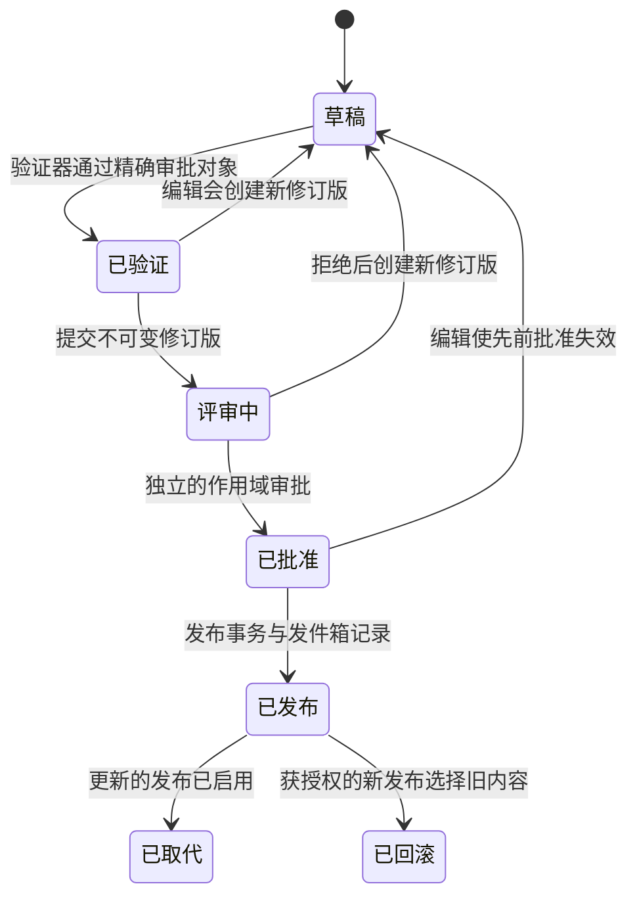
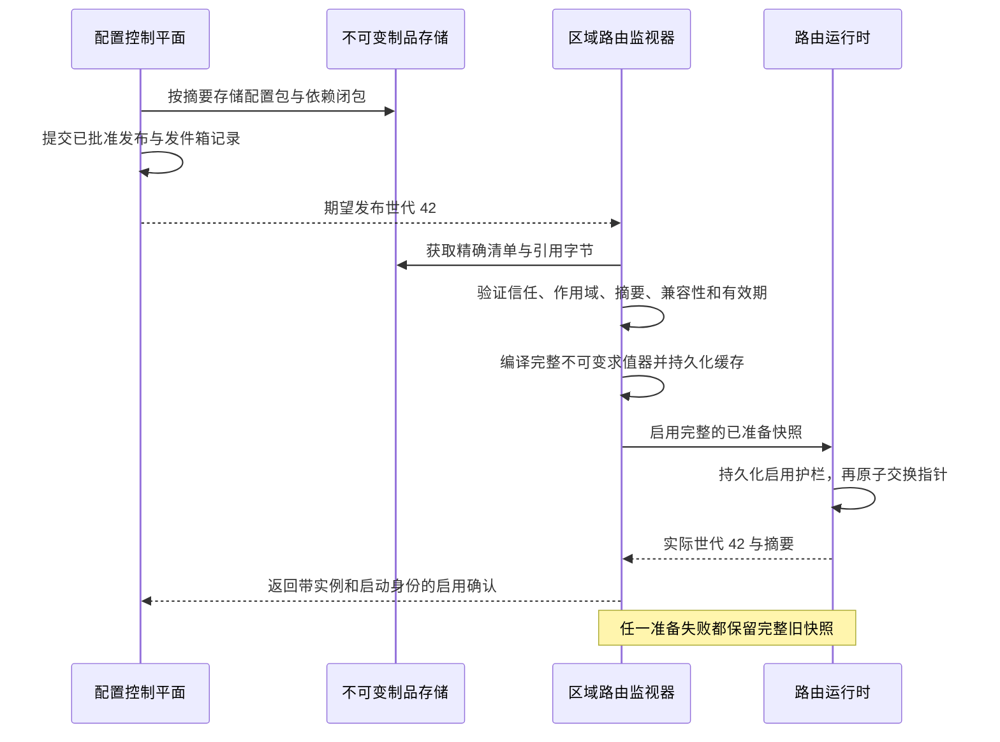
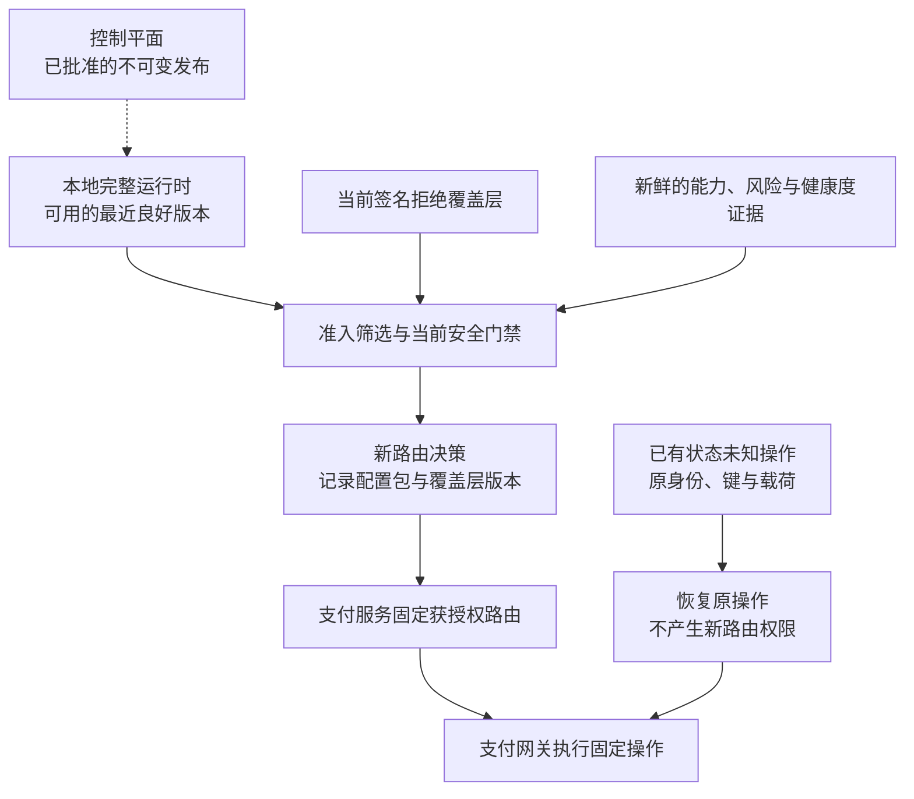

# 第 20 章 路由配置平台

Aurora 准备把欧洲 EUR 流量的首选连接从 A 改为 B。运营更新了规则，财务同时提交新费率模型，接入团队又修订了 B 的能力快照。三个修改各自都通过了检查，但欧洲部分路由实例先拿到新规则、仍使用旧能力和旧费用；美国实例则完全没有更新。事故回看时，大家只能说“发布过 v43”，却说不清 v43 究竟包含哪几份文件。

随后有人把规则切回 v42。成功率没有立刻恢复：B 的紧急禁用被旧文件覆盖，一批已经固定到 B 的状态未知操作又被误当作需要重新选路的支付。配置变更并没有直接调用 PSP，却通过影响未来决策、掩盖版本差异和误导恢复流程，扩大了资金风险。

本章的核心命题是：

> **路由配置是生产制品，不是任意可写的参数表。发布必须绑定完整内容、验证证据、批准主体和作用域；数据平面只原子启用已验证的完整版本。控制平面不在逐笔支付的关键路径上，配置回滚也不获得撤销资金事实或绕过硬约束的权限。**

本章承接[第 19 章](multi-region.md)的区域自治，只治理配置如何产生和生效，不重做支付意图归属。[第 5～9 章](../part-2-routing-engine/rule-based-routing.md)的求值、准入筛选和评分仍由各自组件负责；[第 16 章](../part-4-operating-at-scale/experimentation.md)拥有实验分配语义，模型训练和推理留给[第 21 章](intelligent-routing.md)。

## 20.1 问题：数据库写入成功，不等于变更安全

最初只有两个服务商，直接改数据库显得很高效。下面的反例甚至用了事务：两个字段要么一起写入，要么都不写入。

```go
package naiveconfig

import (
	"context"
	"database/sql"
)

// UnsafePublish 是反例：数据库事务并不是发布门禁。
func UnsafePublish(ctx context.Context, db *sql.DB, preferred string) error {
	tx, err := db.BeginTx(ctx, nil)
	if err != nil {
		return err
	}
	defer tx.Rollback()
	if _, err := tx.ExecContext(ctx,
		`UPDATE routing_settings SET preferred_candidate=$1, version=version+1`,
		preferred); err != nil {
		return err
	}
	return tx.Commit()
}
```

事务只能维护它覆盖的存储一致性。它不知道操作者是否可修改所有商户，也不知道首选连接是否支持 EUR、旧规则为什么如此选择、审批者是否看过最终内容。其他实例什么时候读取、读取期间会不会拼接新旧字段，同样不由这个事务证明。

更危险的是“改配置不用发代码”的文化。金额上限、比例单位、候选通道包含规则、实验范围和降级策略都能改变大量真实支付。把 250 个基点当作 250%，或让“强制选择 B”绕过准入筛选，并不因为文件后缀是 JSON 就比程序缺陷轻微。

真正的问题不是缺少一个配置编辑页面，而是没有把变更对象、授权、验证、传播和运行时承认分开建模。页面上出现绿色提示，只能证明某个 API 返回成功，不能证明所有数据平面实例已安全运行同一套内容。

## 20.2 简单设计：一份完整文件，比多张可变表更容易解释

第一个合理改进，是把规则与候选配置放在版本控制中，走代码评审，构建完整文件，部署时一次加载。对于少量实例和低频变更，这已经可以工作：有差异、有作者、有回退目标，进程启动时拒绝非法配置。

当前配套路由服务正是“完整快照随进程启动装载”的起点。v1 的 `loadRoutingConfig` 读取 `ROUTER_CONFIG_JSON`；v2/v3 分别装载版本化能力与规则，以及 v3 的风险、成本、性能和评分优化。三条路径都拒绝未知字段和多个 JSON 对象，非开发环境不能省略部署声明的必需版本；引擎校验后复制完整配置，在线请求只能提交非敏感上下文，不能夹带自己的策略或制品。它没有每笔请求读取配置数据库，也没有在运行中热切换共享快照。

但环境变量改变并不意味着已运行进程改变。Kubernetes 官方说明，由 ConfigMap 注入的环境变量不会随源数据更新，通常需要重启 Pod；挂载文件也有传播过程，应用仍需正确读取。[Kubernetes：ConfigMaps](https://kubernetes.io/docs/concepts/configuration/configmap/) 因此“集群对象已修改”与“路由服务已启用”之间必须有显式证据。

当变更越来越频繁、不同区域需要渐进启用时，重启整个服务不再是唯一理想入口。我们可以增加监视器，但它首先应学会取得一个完整、可验证的版本，而不是分别监视五张表，再把最后收到的字段拼在一起。

## 20.3 规模化问题：先约束谁能改变什么

### 20.3.1 一个发布包不意味着一个团队拥有全部事实

能力快照来自账户合同、服务商配置和受信任的探测；费率来自商业条款与经济模型；策略表达允许的业务偏好。配置平台可以编排它们，却不能为了让验证通过而自行宣布某条连接支持某种认证方式。

| 制品或状态 | 事实负责人 | 发布时检查 | 运行时边界 |
| --- | --- | --- | --- |
| 规则/评分器配置组合 | 路由策略团队 | 受限语义、冲突、单位、默认策略 | 只能在合格集合内选择 |
| 能力快照 | 接入与合同责任人 | 精确连接/修订版、来源、有效期 | 未知、过期仍按第 6 章保守拒绝 |
| 费率模型 | 费用与财务建模责任人 | 币种、量纲、整数溢出、适用范围 | 不是已结算费用或账本事实 |
| 实验制品 | 实验责任人 | 人群、稳定分桶、预算、停止条件 | 不重分配既有支付意图 |
| 模型/特征模式 | 模型与特征责任人 | 兼容性、验证报告、降级引用 | 不能越过风险与准入筛选 |
| 动态健康度 | 第 13 章健康子系统 | 不把实时状态封进长期配置包 | 独立时效、故障域和探测预算 |
| 凭证/秘密 | 支付网关与安全边界 | 只核对允许的注册表引用 | 秘密不进入路由制品或审计差异 |

控制平台没有支付、支付网关或结算数据库的任意写权限。它也不能通过修改配置关闭差异项、重置未知状态或删除服务商引用。数据所有权和发布所有权是两条不同边界。

### 20.3.2 校验要逐层证明，不是返回一个“已通过”

模式校验先拒绝未知字段、错误类型、超长列表和非法单位。领域校验继续检查不存在的候选通道、同优先级规则冲突、空默认路径、权重范围、费率溢出，以及模型与特征模式是否兼容。能力快照的来源、有效时间和同一连接的执行修订版也必须匹配。

跨制品校验最容易被遗漏：单独合法的 `include B`，放进只允许 USD 的能力快照与 EUR 人群中，可能使整段流量没有候选。能够静态证明不合法的组合必须拒绝；无法静态证明的条件进入明确的测试矩阵和回放，不能把“没发现冲突”写成“对所有输入都正确”。运行时仍始终执行硬约束。

影响报告至少展示新增或消失的候选、空候选比例、预计连接流量、成本估计变化、稀疏切片和执行耗时。历史回放只能重算可见上下文，不能为过去未选择的服务商编造批准结果；影子评估也不调用支付网关。扩大真实流量应继承第 16 章的稳定分配、样本和成熟结果合同。

每次验证记录输入摘要、验证器构建版本、依赖版本、数据窗口、覆盖率和失效时间。上周对旧能力快照得到的“已通过”，不能批准今天内容已经变化的配置包；验证证据过期时应重新验证，必要时重新审批。

### 20.3.3 审批的是一个不可变提案，不是可继续编辑的页面

本书选择作者不得自批，并把发布权限与普通编辑权限分开。NIST SP 800-53 中 AC-5、AC-6 和 CM-3 分别提供职责分离、最小权限与配置变更控制的参考；这里是将这些原则用于本平台的工程设计，不是宣称双人点击就完成所有合规要求。[NIST SP 800-53 Rev. 5](https://csrc.nist.gov/pubs/sp/800/53/r5/upd1/final)

职责分离按受信任身份系统中的人员身份检查，不能让同一个人换一个账户就变成第二位审批者。作用域包含环境、区域或批准的业务范围；测试环境的审核者不能批准生产全球发布。自动验证器可以生成证据，但不能伪装成独立的人类批准者。

## 20.4 生产级设计：制品不变，发布与启用分别留痕

### 20.4.1 用状态机管理变更，用摘要固定审批对象



图中变化的是生命周期投影，不是原制品内容。修改已提交版本时创建新的草稿修订版，历史批准仍保留，但对新修订版无效。已取代或已回滚也不删除旧配置包。跨区域只完成部分启用时，要保留逐区域状态，不能靠一个全局字段掩盖分歧。

审批对象不只包含配置包摘要，还包括目标作用域、推出计划与批准策略版本。验证报告记录受验对象摘要，批准记录再同时绑定审批对象和报告摘要；报告不把自己的摘要塞回受验对象，避免循环定义。否则运营可以先审批 1% 人群，随后不改变配置包就直接发给全球。并发编辑使用预期修订版；陈旧页面的保存或批准必须冲突，而不是后写覆盖。

下面的 Go 函数只表达批准前置条件。`Review` 来自持久化记录，`Actor` 来自服务端认证与作用域授权，二者都不是调用者随意提交的可信标记。

```go
package configapproval

import (
	"errors"
	"time"
)

type Review struct {
	ChangeID            string
	Revision            uint64
	State               string
	Scope               string
	SubjectDigest       [32]byte
	ValidatedDigest     [32]byte
	ReportDigest        [32]byte
	ValidatorVersion    string
	ValidationPassed    bool
	ValidationExpiresAt time.Time
	AuthorPersonIDs     []string
}

type Actor struct {
	PersonID   string
	Scope      string
	CanApprove bool
}

type Approval struct {
	ChangeID      string
	Revision      uint64
	SubjectDigest [32]byte
	ReportDigest  [32]byte
	PersonID      string
	ApprovedAt    time.Time
}

var ErrApprovalDenied = errors.New("approval preconditions not met")

func Approve(review Review, actor Actor, expectedRevision uint64, now time.Time) (Approval, error) {
	if review.ChangeID == "" || review.Revision == 0 || review.Revision != expectedRevision ||
		review.State != "in_review" || review.Scope == "" || actor.Scope != review.Scope ||
		actor.PersonID == "" || !actor.CanApprove || len(review.AuthorPersonIDs) == 0 ||
		review.SubjectDigest == ([32]byte{}) || review.SubjectDigest != review.ValidatedDigest ||
		review.ReportDigest == ([32]byte{}) ||
		!review.ValidationPassed || review.ValidatorVersion == "" ||
		!now.Before(review.ValidationExpiresAt) {
		return Approval{}, ErrApprovalDenied
	}
	for _, author := range review.AuthorPersonIDs {
		if author == "" || author == actor.PersonID {
			return Approval{}, ErrApprovalDenied
		}
	}
	return Approval{
		ChangeID: review.ChangeID, Revision: review.Revision,
		SubjectDigest: review.SubjectDigest, ReportDigest: review.ReportDigest,
		PersonID: actor.PersonID, ApprovedAt: now,
	}, nil
}
```

纯函数不解决持久并发。真正的批准事务必须锁定当前修订版，核对最新授权，将批准记录、状态投影和只追加审计事件一起提交。发布再检查批准仍对应完整审批对象、证据仍有效、权限未被撤销；创建发布记录并与 `config.published` 发件箱记录原子提交，网络分发由后续工作进程完成。崩溃后重投同一发布，而不是重新生成一份未审批内容。

### 20.4.2 配置包、发布与启用不是同一个版本号

| 对象 | 描述的事实 | 身份与内容 |
| --- | --- | --- |
| 配置包 | 哪些制品组成一个兼容决策单元 | 模式、规范化版本、精确引用、清单摘要 |
| 发布 | 谁批准把哪个完整包用于什么范围 | 发布 ID、单调世代、配置包摘要、作用域、推出计划、批准证据 |
| 启用 | 哪个实例实际开始使用了什么 | 实例/启动身份、发布/世代、摘要、时间、结果 |

清单固定规则、能力、费率、实验、模型与特征模式的内容摘要，不保留 `latest` 这种会漂移的引用。不需要的可选制品显式声明缺席，而不是在加载失败后从另一版本补一份默认模型。依赖闭包、最低路由服务构建版本和支付网关注册表修订版的兼容性也要可验证。

规范化沿用第 14 章的协议：保留有业务含义的顺序，规范无序集合和数字表示，再对确定字节求摘要。摘要只能检测内容变化，不能证明发布者身份。生产分发还需要受信任的签名与密钥 ID、作用域校验、密钥轮换和撤销流程，不能接受清单自己带来的任意公钥。

构建与验证来源也应可追溯。SLSA 构建来源描述构建平台、输入与产物之间的关系；本平台可以借鉴其方式记录编译器、依赖和验证报告，但不把一份自填 JSON 冒称为已达到某个供应链安全等级。[SLSA：构建来源](https://slsa.dev/spec/v1.2/build-provenance)

发布世代按已定义的发布作用域单调增长。假设第 42 次发布有问题，回滚到第 40 次使用的配置包，也应该产生第 43 次发布；不能把世代从 42 改回 40。这样实例既能拒绝旧分发消息，又能接受新的合法回滚。TUF 对回退、冻结和版本混搭的威胁建模说明：可信签名之外，还需要版本、有效期与依赖一致性检查；这里借鉴这些约束，不把简化加载器称为完整 TUF 实现。[更新框架规范](https://theupdateframework.github.io/specification/latest/)

回滚也不是恢复旧权限。新的发布按当前职责分离、作用域授权与信任根审批，不能从旧配置包取回已经撤销的管理员权限、签名密钥或宽松审批策略。目标内容还要通过当前时间下的兼容性检查：旧能力快照已过期、原连接已退役或新路由服务不再支持旧模式时，过去成功运行并不构成今天的启用许可。

如果回滚目标不再合格，就停止这次回滚，并以仍获批准的安全版本或明确阻断承接流量。需要刷新能力快照或替换不兼容引用时，生成新的配置包与验证证据；不能原地延长旧制品的有效期，同时继续声称摘要和历史事实没有改变。

### 20.4.3 先完整准备，再一次启用，最后报告事实



监视事件只是“可能有新发布”的通知。重复、漏通知和乱序都允许发生，工作进程要按持久期望世代重新拉取；分发服务不把事件恰好一次当作正确性基础。下载、签名和编译发生在旁路，不能让在线路由服务等待全球控制中心。

确认回执至少区分“已获取”“已验证”“已启用”与“已拒绝”。下载成功不等于启用成功，容器存活也不等于使用了目标版本。每个回执绑定实例、启动身份、作用域、世代、实际摘要和稳定原因；旧进程的回执不能让刚重启的实例被误算为已收敛。

跨地区通常不要求同一纳秒切换，而是要求每次决定使用完整包，并能解释该地区当时的版本。发布进度按目标实例集合和有效容量计算，不能只看“多数实例已更新”；没有生效证据的关键地区必须暂停推进或退出新流量准入。收敛详情进入查询表和日志，不把每个摘要、实例标识都扩散为无界业务指标标签。

### 20.4.4 一次请求只读取一个完整运行时快照

下面代码将一个已准备完成的求值器与发布元数据一起切换。`Prepared` 只能由受信任加载器在验签、摘要校验、完整依赖编译和本地缓存持久化后构造；它不是 HTTP 请求结构，也不是仅凭一个 `verified=true` 就可以传入的对象。

```go
package configruntime

import (
	"context"
	"errors"
	"sync"
	"sync/atomic"
	"time"
)

type Request struct {
	AmountMinor                 int64
	Currency, Method, Operation string
}

type Decision struct {
	Candidate  string
	ReleaseID  string
	Generation uint64
	Digest     [32]byte
}

type Evaluator interface {
	Evaluate(context.Context, Request) (Decision, error)
}

type Activation struct {
	Scope, ReleaseID     string
	Generation           uint64
	Digest               [32]byte
	NotBefore, ExpiresAt time.Time
}

type Prepared struct {
	Activation Activation
	Engine     Evaluator
}

type ActivationJournal interface {
	// 持久化受 CAS 保护的启用记录，该记录引用已经持久化的字节。
	// 相同重试保持幂等；同一世代若内容不同则失败。
	Commit(context.Context, uint64, Activation) error
}

type snapshot struct {
	activation Activation
	engine     Evaluator
}

type Runtime struct {
	mu      sync.Mutex
	scope   string
	journal ActivationJournal
	active  atomic.Pointer[snapshot]
}

func validPrepared(p Prepared) bool {
	a := p.Activation
	return a.Scope != "" && a.ReleaseID != "" && a.Generation > 0 &&
		a.Digest != ([32]byte{}) && a.NotBefore.Before(a.ExpiresAt) && p.Engine != nil
}

func sameActivation(a, b Activation) bool {
	return a.Scope == b.Scope && a.ReleaseID == b.ReleaseID &&
		a.Generation == b.Generation && a.Digest == b.Digest &&
		a.NotBefore.Equal(b.NotBefore) && a.ExpiresAt.Equal(b.ExpiresAt)
}

// restored 若存在，必须由精确的持久日志记录和已验证不可变字节重建。
// 过期内容不能服务新决策。
func NewRuntime(scope string, journal ActivationJournal, restored *Prepared) (*Runtime, error) {
	if scope == "" || journal == nil {
		return nil, errors.New("runtime scope and durable journal are required")
	}
	r := &Runtime{scope: scope, journal: journal}
	if restored != nil {
		if !validPrepared(*restored) || restored.Activation.Scope != scope {
			return nil, errors.New("invalid restored activation")
		}
		r.active.Store(&snapshot{restored.Activation, restored.Engine})
	}
	return r, nil
}

func (r *Runtime) Apply(ctx context.Context, next Prepared, now time.Time) error {
	r.mu.Lock()
	defer r.mu.Unlock()
	a := next.Activation
	if !validPrepared(next) || a.Scope != r.scope ||
		now.Before(a.NotBefore) || !now.Before(a.ExpiresAt) {
		return errors.New("invalid, mistargeted or expired activation")
	}
	var expected uint64
	if old := r.active.Load(); old != nil {
		expected = old.activation.Generation
		if a.Generation == expected && sameActivation(a, old.activation) {
			return nil
		}
		if a.Generation <= expected {
			return errors.New("stale or conflicting release generation")
		}
	}
	if err := r.journal.Commit(ctx, expected, a); err != nil {
		return err
	}
	r.active.Store(&snapshot{a, next.Engine})
	return nil
}

func (r *Runtime) Decide(ctx context.Context, req Request, now time.Time) (Decision, error) {
	s := r.active.Load() // 整个决策只加载一次。
	if s == nil || now.Before(s.activation.NotBefore) || !now.Before(s.activation.ExpiresAt) {
		return Decision{}, errors.New("no currently usable approved configuration")
	}
	d, err := s.engine.Evaluate(ctx, req)
	d.ReleaseID, d.Generation, d.Digest = s.activation.ReleaseID, s.activation.Generation, s.activation.Digest
	return d, err
}
```

这里的原子指针只保证指针交换，不会自动冻结它指向的映射、切片或模型权重。加载器必须构造独占、只读且并发安全的求值器；当前引擎的配置复制是可以继承的做法。一次决策不能先加载规则，计算一半再加载费率。Go 的原子操作文档给出相应同步语义，但业务对象的不可变性仍由程序负责。[Go：sync/atomic](https://pkg.go.dev/sync/atomic)

`ActivationJournal` 不是内存开关。新内容先以不可变字节可靠保存，随后将启用记录与世代高水位原子持久化，最后切内存指针。若日志提交后、指针切换前崩溃，重启按该记录重建完整包；若提交失败，旧运行环境不变。相同提交的回执丢失可幂等重试。代码只声明这个持久化契约，真正的磁盘故障与恢复必须另测。

重启时恢复的是已承认的世代，而不是遍历缓存挑一个版本号看起来最大的文件。高水位跨进程启动保留，新的启动身份只更新回执身份，不能把防回退状态清零。缺少被引用字节、摘要不符或无法验证当前信任根时，不用“最近文件”猜测；新实例保持未就绪。旧实例可继续使用仍有效的旧快照，二者并不矛盾。

### 20.4.5 最近可用良好版本有条件，紧急停用开关有边界

控制平面不可用不应立即让正在运行的路由服务失效，但最近可用良好版本也不等于永久可用。签名与发布授权有有效范围，能力快照有自己的有效期，动态健康度与风险信息也有时效。上面 `now` 来自可信在线时间，不由商户或历史回放任意指定；时间不可信时需要安全降级和告警。

配置包封装过期可以阻止新的决策；某一候选通道的能力过期则由准入筛选排除该候选通道，不必机械让所有连接同时下线。软模型缺失时能否使用预先批准的静态评分器，由对应降级合同决定；硬约束缺失时不能借最近可用良好版本继续假定为真。冷启动没有可信缓存，或硬事实已经过期，牺牲新请求可用性是明确的停止条件。

紧急禁用可以先实现为一个更快发布的完整“只拒绝”配置包。规模扩大后，才考虑独立的、受签名保护的拒绝覆盖层：它只收缩候选集合，有单独的单调世代、作用域和审计，不修改普通配置包字节，也不允许强制启用。决策同时记录配置包与覆盖层版本，普通回滚不能清除仍有效的禁用。

到期策略必须写清楚：紧急禁用记录超过响应期限后应告警、续审或保持阻断，不能因 TTL 到期自动恢复高风险连接。解除禁用是新的授权变更，不是删除一行缓存。紧急授权可以按预先批准的事故流程缩短审批等待，但仍保留操作者、原因、受影响范围、发布摘要、到期处置和事后复核；它不能跳过来源认证、完整性和支付红线。

这些措施只改变未来新路由的准入。已经固定到 B 的状态未知操作继续查询原连接；请款、撤销、退款仍绑定原引用。若凭证或账户已经失效，支付网关可以阻止进一步不安全发送并转复核，但不能据此把原操作换到 A。淘汰旧配置包也不能顺手删除仍被恢复任务或历史决策引用的执行修订版。



图中普通发布只能更新完整运行时，当前禁用和新证据继续约束新决策；已有状态未知操作走另一条恢复入口。不存在一条“回滚配置便重新执行全部支付”的箭头。

## 20.5 故障模式：证明失败不会产生半套配置

| 失败 | 必须保持的结果 |
| --- | --- |
| 作者通过另一个账户自批 | 以稳定人员身份拒绝，不只比较显示名称 |
| 审批后改人群、比例或内容 | 审批对象/修订版改变，旧批准不可复用 |
| 强制指向不合格连接 | 发布校验拒绝明显矛盾；运行时仍不能越过准入筛选 |
| 费率单位错误、乘法溢出 | 验证器拒绝，不截断为零或最高分 |
| 只下载到新规则，费率缺失 | 不激活；保留完整旧包，不拼接版本 |
| 同一世代来了另一摘要 | 隔离、告警，不按最后到达者覆盖 |
| 新包落盘失败或日志提交失败 | 旧运行时保持不变，确认回执为“已拒绝” |
| 启用提交后进程崩溃 | 按持久记录恢复完整包，再报告本次启动的事实 |
| 控制平面离线 | 有效的最近良好版本可服务；过期硬约束不被自动延期 |
| 回滚时禁用覆盖层仍在 | 旧内容仍受当前禁用约束，不恢复已撤销能力 |
| 已存在状态未知操作，发布全新顺序 | 不创建新支付尝试，不改变原键、账户、区域或载荷 |

批准门禁可以从标准库测试开始。它证明的是审批对象和职责分离，不声称替代认证系统与数据库事务。

```go
package configapproval

import (
	"crypto/sha256"
	"errors"
	"testing"
	"time"
)

func TestApprovalBindsSubjectAndIndependentPerson(t *testing.T) {
	now := time.Unix(1_800_000_000, 0)
	digest := sha256.Sum256([]byte("fixed review subject"))
	review := Review{
		ChangeID: "change_7", Revision: 3, State: "in_review", Scope: "prod/eu",
		SubjectDigest: digest, ValidatedDigest: digest, ValidatorVersion: "validator_v2",
		ReportDigest:     sha256.Sum256([]byte("validation report for fixed subject")),
		ValidationPassed: true, ValidationExpiresAt: now.Add(time.Hour),
		AuthorPersonIDs: []string{"person_author"},
	}
	author := Actor{PersonID: "person_author", Scope: "prod/eu", CanApprove: true}
	if _, err := Approve(review, author, 3, now); !errors.Is(err, ErrApprovalDenied) {
		t.Fatalf("author self approval: %v", err)
	}
	reviewer := Actor{PersonID: "person_reviewer", Scope: "prod/eu", CanApprove: true}
	if _, err := Approve(review, reviewer, 3, now); err != nil {
		t.Fatal(err)
	}
	review.SubjectDigest[0] ^= 1
	if _, err := Approve(review, reviewer, 3, now); !errors.Is(err, ErrApprovalDenied) {
		t.Fatalf("changed subject reused prior validation: %v", err)
	}
}
```

原子切换也可以用确定性输入检查：每个求值器返回一个固定候选通道，其配置包摘要根据该值构造。并发读取期间，只要求值器和元数据混用了两个版本，就会被测试发现。这里的日志桩只用于隔离运行时单元测试，不提供生产持久性。

```go
package configruntime

import (
	"context"
	"crypto/sha256"
	"errors"
	"fmt"
	"sync"
	"testing"
	"time"
)

type memoryJournal struct {
	current Activation
	reject  bool
}

func (j *memoryJournal) Commit(_ context.Context, expected uint64, next Activation) error {
	if j.reject {
		return errors.New("injected durable-store failure")
	}
	if sameActivation(j.current, next) {
		return nil
	}
	if j.current.Generation != expected || next.Generation <= expected {
		return errors.New("activation CAS conflict")
	}
	j.current = next
	return nil
}

type fixedEvaluator string

func (e fixedEvaluator) Evaluate(context.Context, Request) (Decision, error) {
	return Decision{Candidate: string(e)}, nil
}

func prepared(generation uint64, candidate string, now time.Time) Prepared {
	return Prepared{
		Activation: Activation{
			Scope: "prod/eu", ReleaseID: fmt.Sprintf("release_%d", generation),
			Generation: generation, Digest: sha256.Sum256([]byte(candidate)),
			NotBefore: now.Add(-time.Minute), ExpiresAt: now.Add(time.Hour),
		},
		Engine: fixedEvaluator(candidate),
	}
}

func TestFailedApplyAndConcurrentReadersKeepWholeSnapshots(t *testing.T) {
	now := time.Unix(1_800_000_000, 0)
	ctx := context.Background()
	journal := &memoryJournal{}
	runtime, err := NewRuntime("prod/eu", journal, nil)
	if err != nil {
		t.Fatal(err)
	}
	if err := runtime.Apply(ctx, prepared(1, "a", now), now); err != nil {
		t.Fatal(err)
	}
	journal.reject = true
	if err := runtime.Apply(ctx, prepared(2, "b", now), now); err == nil {
		t.Fatal("store failure was ignored")
	}
	decision, err := runtime.Decide(ctx, Request{}, now)
	if err != nil || decision.Generation != 1 || decision.Candidate != "a" {
		t.Fatalf("failed apply changed active snapshot: %+v, %v", decision, err)
	}
	journal.reject = false
	var readers sync.WaitGroup
	for reader := 0; reader < 8; reader++ {
		readers.Add(1)
		go func() {
			defer readers.Done()
			for iteration := 0; iteration < 500; iteration++ {
				d, err := runtime.Decide(ctx, Request{}, now)
				if err != nil || d.Digest != sha256.Sum256([]byte(d.Candidate)) ||
					d.ReleaseID != fmt.Sprintf("release_%d", d.Generation) {
					t.Errorf("mixed snapshot: %+v, %v", d, err)
					return
				}
			}
		}()
	}
	for generation := uint64(2); generation <= 40; generation++ {
		candidate := "a"
		if generation%2 == 0 {
			candidate = "b"
		}
		if err := runtime.Apply(ctx, prepared(generation, candidate, now), now); err != nil {
			t.Errorf("apply: %v", err)
			break
		}
	}
	readers.Wait()
}
```

真实工程还要测试恶意篡改字节、未知签名密钥、缺失依赖、过期能力快照、旧消息重放、重启高水位，以及发布发件箱的崩溃重投。故意让控制平面不可达，检查在线路径没有隐藏的同步配置请求；再让最近良好版本过期，确认系统按声明的硬停止条件响应，而不是为了维持绿灯继续使用它。

回滚演练同时检查路由服务版本、当前禁用项、支付尝试数和服务商操作数。若回滚后出现新的资金路径，即使配置版本完全恢复，也不能宣布演练成功。审计信息的访问、修改和删除同样需要保护；只把记录写到发布者自己可以清空的表里，不构成独立审计边界。[NIST SP 800-53：AU-9](https://csrc.nist.gov/pubs/sp/800/53/r5/upd1/final)

## 20.6 权衡与配套实现边界

Git 提案、评审和不可变文件可以是首个控制平台，不必立即建设复杂管理后台；但 Git 提交本身不证明实例启用。推送通知响应快，监视/轮询补偿更容易从丢消息中恢复；两者都应最终读取同一个不可变发布。严格全区同步扩大故障耦合，受控异步则要求明确哪些区域可落后、多久必须阻断新流量。

过长的有效期提高控制平面失联时的可用性，却延长陈旧事实的风险窗口；过短会让配置基础设施成为间接故障源。不同制品应按其事实寿命制定时效，不共享一个随意的 TTL。灰度减少一次发布的影响面，但小流量不自动提供统计结论，更不能免除硬约束检查。

| 当前工程位置 | 已具备的基线 | 本章仍待配套的能力 |
| --- | --- | --- |
| 路由服务 `cmd/server/main.go` / `v3_config.go` | 启动时严格解析 v1/v2/v3 环境配置；非开发必须显式提供所需版本，v3 优化配置缺失即不可用 | 配置包加载器、监视器、可信缓存与启用确认 |
| 路由服务 v3 引擎 | 已编译能力、规则、风险、费率、性能与评分的依赖闭包，在一个请求内产生确定候选顺序和完整优化证据 | 经批准配置包的原子热切换、作用域校验、世代防回退与跨实例启用水位 |
| 路由服务 OpenAPI 0.4 | 上下文不含调用者策略/制品；v3 响应带策略、风险、成本、性能、评分证据与 `executable_until` | 配置包/发布/启用证据与独立控制 API |
| 配置治理服务 | 尚无 `services/routing-config` | 独立二进制程序/模式、草稿/批准/发布、审计与发件箱 |
| 现有测试 | 非开发隐式配置拒绝、严格 JSON、v3 黄金契约、过期制品/就绪检查、确定性与并发安全 | 双人批准、跨制品发布影响验证、分发崩溃与真实持久缓存测试 |

这些已有事实来自当前 Go 代码检查；不能把正文里的接口称为已运行的控制平面微服务。首个纵向增量可以只发布现有的 v3 规则、能力、成本、性能和评分全套快照：使用真实 PostgreSQL 保存草稿修订版、验证结果、独立批准与发布，路由服务拉取完整制品、原子启用并返回确认回执，再验证控制平面离线时的有效最近良好版本。费率与性能已是数据平面代码包；模型、实验和 `services/routing-config` 仍明确缺席，不能为了凑齐清单造假引用。

代码组织上，未来的 `services/routing-config/internal/domain` 管生命周期，存储适配器兑现事务与发件箱；路由服务的 `internal/configbundle` 管验证、缓存和监视器，继续复用只读决策引擎。控制面不持有服务商执行凭证，也不向支付服务下达资金命令。只有这条路径和失败测试进入代码仓库并通过发布门禁后，才能宣称本章平台已实现。当前固定基线和缺口见[本章交付说明](../deliveries/chapter-20-routing-configuration-platform.md)。

## 20.7 小结：发布权限不是资金执行权限

配置平台把零散参数变成有来源、有审批、有完整性和有生效证据的生产制品。配置包固定内容，发布固定授权与范围，启用说明实例实际使用了什么；三者共同解释“这次变更到底生效在哪里”。

一次请求读取一个完整运行时快照，控制面故障不必立即中断有效版本，硬事实过期却不能被缓存掩盖。回滚发布新的授权记录，不改旧字节、不抹掉紧急禁用，更不把状态未知操作换一条路重做。下一章的模型只能成为这个发布闭环中的一种制品，而不能拿走既有的硬约束与停止权。
