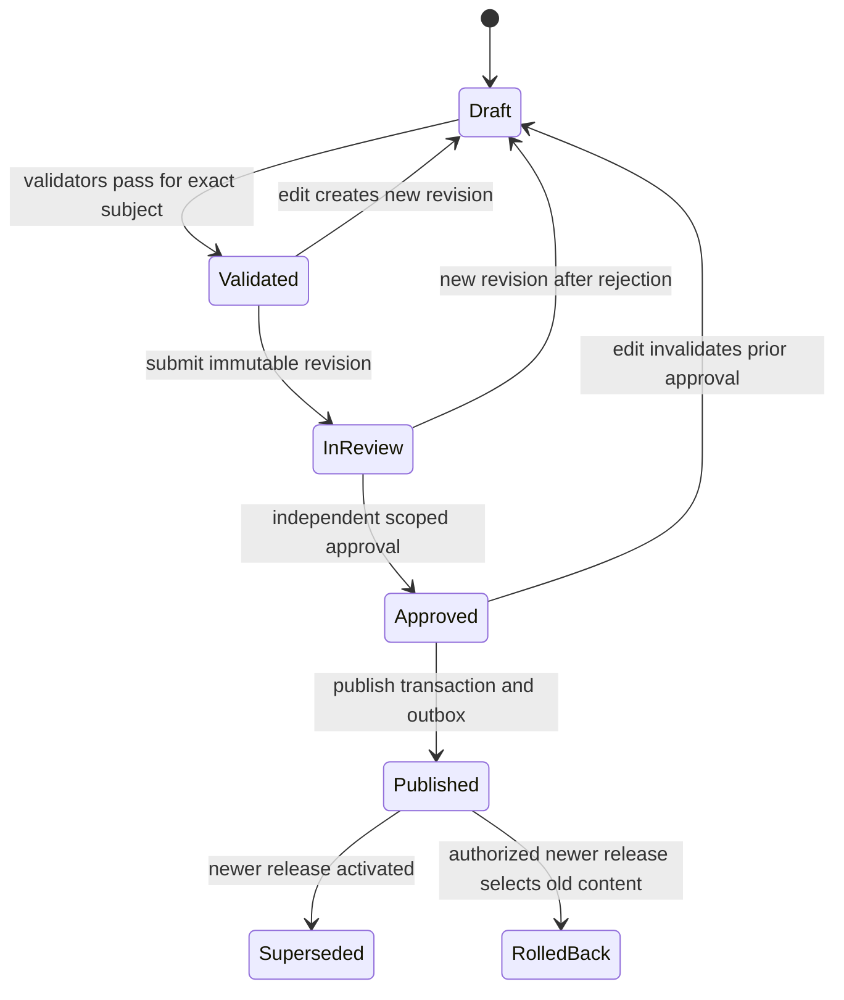
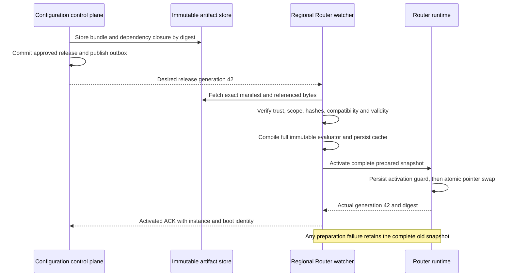
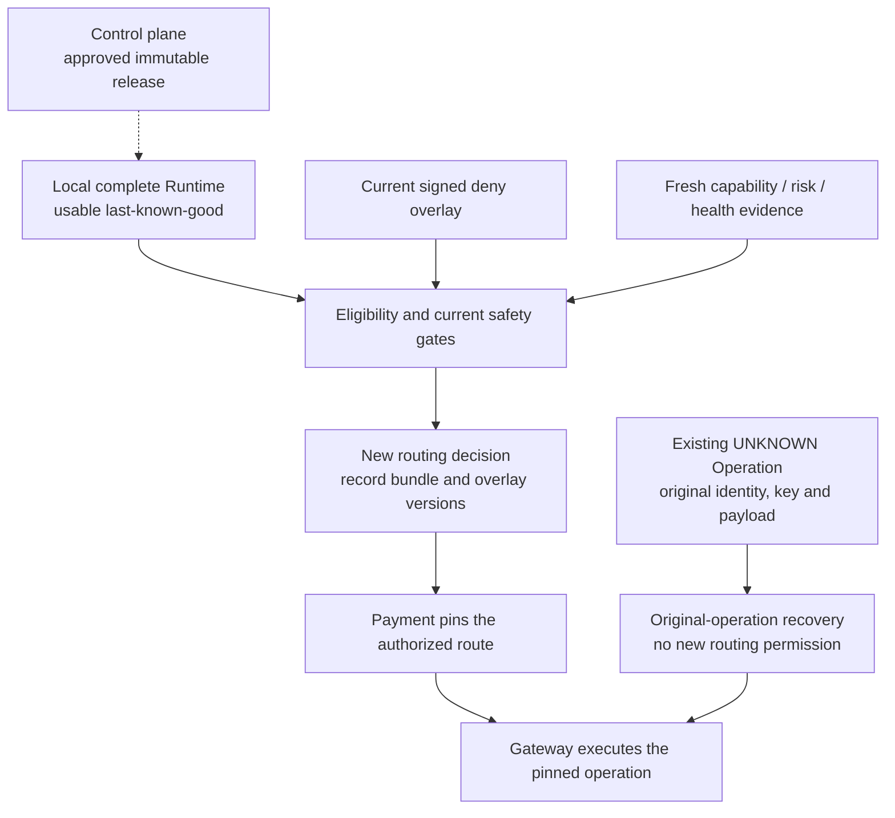

# 第 20 章 Routing Configuration Platform

Aurora 准备把欧洲 EUR 流量的首选连接从 A 改为 B。运营更新了 Rule，财务同时提交新 Fee Model，接入团队又修订了 B 的 Capability。三个修改各自都通过了检查，但欧洲部分 Router 先拿到新规则、仍使用旧能力和旧费用；美国实例则完全没有更新。事故回看时，大家只能说“发布过 v43”，却说不清 v43 究竟包含哪几份文件。

随后有人把规则切回 v42。成功率没有立刻恢复：B 的紧急禁用被旧文件覆盖，一批已经固定到 B 的 UNKNOWN Operation 又被误当作需要重新选路的支付。配置变更并没有直接调用 PSP，却通过影响未来决策、掩盖版本差异和误导恢复流程，扩大了资金风险。

本章的核心命题是：

> **Routing Configuration 是生产制品，不是任意可写的参数表。发布必须绑定完整内容、验证证据、批准主体和作用域；Data Plane 只原子启用已验证的完整版本。控制平面不在逐笔支付的关键路径上，配置回滚也不获得撤销资金事实或绕过硬约束的权限。**

本章承接[第 19 章](multi-region.md)的区域自治，只治理配置如何产生和生效，不重做 Intent ownership。[第 5～9 章](../part-2-routing-engine/rule-based-routing.md)的求值、Eligibility 和评分仍由各自组件负责；[第 16 章](../part-4-operating-at-scale/experimentation.md)拥有实验分配语义，模型训练和 inference 留给[第 21 章](intelligent-routing.md)。

## 20.1 Problem：数据库写入成功，不等于变更安全

最初只有两个 Provider，直接改数据库显得很高效。下面的反例甚至用了事务：两个字段要么一起写入，要么都不写入。

```go
package naiveconfig

import (
	"context"
	"database/sql"
)

// UnsafePublish is a counterexample: a DB transaction is not a release gate.
func UnsafePublish(ctx context.Context, db *sql.DB, preferred string) error {
	tx, err := db.BeginTx(ctx, nil)
	if err != nil {
		return err
	}
	defer tx.Rollback()
	if _, err := tx.ExecContext(ctx,
		`UPDATE routing_settings SET preferred_candidate=$1, version=version+1`,
		preferred); err != nil {
		return err
	}
	return tx.Commit()
}
```

事务只能维护它覆盖的存储一致性。它不知道操作者是否可修改所有商户，也不知道 preferred 是否支持 EUR、旧规则为什么如此选择、审批者是否看过最终内容。其他实例什么时候读取、读取期间会不会拼接新旧字段，同样不由这个事务证明。

更危险的是“改配置不用发代码”的文化。金额上限、比例单位、Candidate include、实验范围和降级策略都能改变大量真实支付。把 250 basis points 当作 250%，或让 `force B` 绕过 Eligibility，并不因为文件后缀是 JSON 就比程序缺陷轻微。

真正的问题不是缺少一个配置编辑页面，而是没有把变更对象、授权、验证、传播和运行时承认分开建模。页面上出现绿色提示，只能证明某个 API 返回成功，不能证明所有 Data Plane 已安全运行同一套内容。

## 20.2 Simple Design：一份完整文件，比多张可变表更容易解释

第一个合理改进，是把 Rule 与候选配置放在版本控制中，走代码评审，构建完整文件，部署时一次加载。对于少量实例和低频变更，这已经可以工作：有 diff、有作者、有回退目标，进程启动时拒绝非法配置。

当前配套 Router 正是“完整快照随进程启动装载”的起点。v1 的 `loadRoutingConfig` 读取 `ROUTER_CONFIG_JSON`；v2/v3 分别装载版本化 Capability/Rule，以及 v3 的 Risk/Cost/Performance/Scoring optimization。三条路径都拒绝未知字段和多个 JSON 对象，非开发环境不能省略部署声明的必需版本；Engine 校验后复制完整配置，在线请求只能提交非敏感 Context，不能夹带自己的 Policy 或 Artifact。它没有每笔请求读取配置数据库，也没有运行中热切换共享 snapshot。

但环境变量改变并不意味着已运行进程改变。Kubernetes 官方说明，由 ConfigMap 注入的环境变量不会随源数据更新，通常需要重启 Pod；挂载文件也有传播过程，应用仍需正确读取。[Kubernetes：ConfigMaps](https://kubernetes.io/docs/concepts/configuration/configmap/) 因此“集群对象已修改”与“Router 已启用”之间必须有显式证据。

当变更越来越频繁、不同地区需要渐进启用时，重启整个服务不再是唯一理想入口。我们可以增加 watcher，但它首先应学会取得一个完整、可验证的版本，而不是分别 watch 五张表，再把最后收到的字段拼在一起。

## 20.3 Problems at Scale：先约束谁能改变什么

### 20.3.1 一个发布包不意味着一个团队拥有全部事实

Capability 来自账户合同、Provider 配置和受信任的探测；Fee 来自商业条款与经济模型；Policy 表达允许的业务偏好。配置平台可以编排它们，却不能为了让验证通过而自行宣布某条 connection 支持某种认证方式。

| 制品或状态 | 事实 owner | 发布时检查 | 运行时边界 |
| --- | --- | --- | --- |
| Rule / Scorer Profile | 路由策略团队 | 受限语义、冲突、单位、默认策略 | 只能在 eligible set 内选择 |
| Capability Snapshot | 接入与合同责任人 | 精确 connection/revision、来源、有效期 | unknown、stale 仍按第 6 章关闭 |
| Fee Model | 费用与财务建模责任人 | 币种、量纲、整数溢出、适用范围 | 不是已结算费用或 Ledger 事实 |
| Experiment Artifact | 实验责任人 | 人群、稳定分桶、预算、停止条件 | 不重分配既有 Intent |
| Model / Feature Schema | 模型与特征责任人 | 兼容性、验证报告、降级引用 | 不能越过 Risk、Eligibility |
| Dynamic Health | 第 13 章健康子系统 | 不把实时状态封进长期 bundle | 独立时效、故障域和探测预算 |
| Credential / Secret | Gateway 与安全边界 | 只核对允许的 registry 引用 | 秘密不进入 Router 制品或审计 diff |

控制平台没有 Payment、Gateway 或 Settlement 数据库的任意写权限。它也不能通过修改配置关闭 Difference、重置 UNKNOWN 或删除 Provider reference。数据所有权和发布所有权是两条不同边界。

### 20.3.2 校验要逐层证明，不是返回一个 passed

Schema 校验先拒绝未知字段、错误类型、超长列表和非法单位。领域校验继续检查不存在的 Candidate、同优先级规则冲突、空默认路径、权重范围、费率溢出，以及 Model 与 Feature Schema 是否兼容。Capability 的来源、有效时间和同 connection 的执行 revision 也必须匹配。

跨制品校验最容易被遗漏：单独合法的 `include B`，放进只允许 USD 的 Capability 与 EUR 人群中，可能使整段流量没有候选。能够静态证明不合法的组合必须拒绝；无法静态证明的条件进入明确的测试矩阵和回放，不能把“没发现冲突”写成“对所有输入都正确”。运行时仍始终执行硬约束。

影响报告至少展示新增或消失的候选、空候选比例、预计连接流量、成本估计变化、稀疏切片和执行耗时。历史回放只能重算可见 Context，不能为过去未选择的 Provider 编造批准结果；shadow 也不调用 Gateway。扩大真实流量应继承第 16 章的 assignment、样本和成熟结果合同。

每次验证记录输入 digest、validator build、依赖版本、数据窗口、覆盖率和失效时间。上周对旧 Capability 得到的 passed，不能批准今天内容已经变化的包；验证证据过期时应重新验证，必要时重新审批。

### 20.3.3 审批的是一个不可变提案，不是可继续编辑的页面

本书选择作者不得自批，并把发布权限与普通编辑权限分开。NIST SP 800-53 中 AC-5、AC-6 和 CM-3 分别提供职责分离、最小权限与配置变更控制的参考；这里是将这些原则用于本平台的工程设计，不是宣称双人点击就完成所有合规要求。[NIST SP 800-53 Rev. 5](https://csrc.nist.gov/pubs/sp/800/53/r5/upd1/final)

职责分离按受信任身份系统中的 person identity 检查，不能让同一个人换一个账户就变成第二位审批者。作用域包含环境、区域或批准的业务范围；测试环境的 reviewer 不能批准生产全球发布。自动 validator 可以生成证据，但不能伪装成独立的人类批准者。

## 20.4 Production Design：制品不变，发布与启用分别留痕

### 20.4.1 用状态机管理变更，用摘要固定审批对象



图中变化的是生命周期投影，不是原制品内容。修改已提交版本时创建新的 Draft revision，历史批准仍保留，但对新 revision 无效。`Superseded` 或 `RolledBack` 也不删除旧 Bundle。跨地区只完成部分启用时，要保留逐地区状态，不能靠一个全局字段掩盖分歧。

审批 subject 不只包含 Bundle digest，还包括目标 scope、rollout plan 与批准策略版本。验证报告记录受验 subject digest，Approval 再同时绑定 subject 和 report digest；报告不把自己的摘要塞回受验对象，避免循环定义。否则运营可以先审批 1% 人群，随后不改变 Bundle 就直接发给全球。并发编辑使用 expected revision；陈旧页面的保存或批准必须冲突，而不是后写覆盖。

下面的 Go 函数只表达批准前置条件。`Review` 来自持久化记录，`Actor` 来自服务端认证与作用域授权，二者都不是调用者随意提交的可信标记。

```go
package configapproval

import (
	"errors"
	"time"
)

type Review struct {
	ChangeID            string
	Revision            uint64
	State               string
	Scope               string
	SubjectDigest       [32]byte
	ValidatedDigest     [32]byte
	ReportDigest        [32]byte
	ValidatorVersion    string
	ValidationPassed    bool
	ValidationExpiresAt time.Time
	AuthorPersonIDs     []string
}

type Actor struct {
	PersonID   string
	Scope      string
	CanApprove bool
}

type Approval struct {
	ChangeID      string
	Revision      uint64
	SubjectDigest [32]byte
	ReportDigest  [32]byte
	PersonID      string
	ApprovedAt    time.Time
}

var ErrApprovalDenied = errors.New("approval preconditions not met")

func Approve(review Review, actor Actor, expectedRevision uint64, now time.Time) (Approval, error) {
	if review.ChangeID == "" || review.Revision == 0 || review.Revision != expectedRevision ||
		review.State != "in_review" || review.Scope == "" || actor.Scope != review.Scope ||
		actor.PersonID == "" || !actor.CanApprove || len(review.AuthorPersonIDs) == 0 ||
		review.SubjectDigest == ([32]byte{}) || review.SubjectDigest != review.ValidatedDigest ||
		review.ReportDigest == ([32]byte{}) ||
		!review.ValidationPassed || review.ValidatorVersion == "" ||
		!now.Before(review.ValidationExpiresAt) {
		return Approval{}, ErrApprovalDenied
	}
	for _, author := range review.AuthorPersonIDs {
		if author == "" || author == actor.PersonID {
			return Approval{}, ErrApprovalDenied
		}
	}
	return Approval{
		ChangeID: review.ChangeID, Revision: review.Revision,
		SubjectDigest: review.SubjectDigest, ReportDigest: review.ReportDigest,
		PersonID: actor.PersonID, ApprovedAt: now,
	}, nil
}
```

纯函数不解决持久并发。真正的 approval transaction 必须锁定当前 revision，核对最新授权，将 Approval、状态投影和 append-only audit event 一起提交。发布再检查批准仍对应完整 subject、证据仍有效、权限未被撤销；创建 Release 与 `config.published` outbox 原子提交，网络分发由后续 worker 完成。崩溃后重投同一 Release，而不是重新生成一份未审批内容。

### 20.4.2 Bundle、Release、Activation 不是同一个版本号

| 对象 | 描述的事实 | 身份与内容 |
| --- | --- | --- |
| ConfigBundle | 哪些制品组成一个兼容决策单元 | schema、canonicalization version、精确 refs、manifest digest |
| Release | 谁批准把哪个完整包用于什么范围 | release ID、单调 generation、bundle digest、scope、rollout、批准证据 |
| Activation | 哪个实例实际开始使用了什么 | instance/boot identity、release/generation、digest、时间、结果 |

Manifest 固定 Rule、Capability、Fee、Experiment、Model 与 Feature Schema 的内容摘要，不保留 `latest` 这种会漂移的引用。不需要的可选制品显式声明 absent，而不是在加载失败后从另一版本补一份默认模型。依赖闭包、最低 Router build 和 Gateway registry revision 兼容性也要可验证。

Canonicalization 沿用第 14 章的协议：保留有业务含义的顺序，规范无序集合和数字表示，再对确定字节求摘要。摘要只能检测内容变化，不能证明发布者身份。生产分发还需要受信任的签名与 key ID、作用域校验、密钥轮换和撤销流程，不能接受 Manifest 自己带来的任意公钥。

构建与验证来源也应可追溯。SLSA Build Provenance 描述构建平台、输入与产物之间的关系；本平台可以借鉴其方式记录编译器、依赖和验证报告，但不把一份自填 JSON 冒称为已达到某个供应链安全等级。[SLSA：Build Provenance](https://slsa.dev/spec/v1.2/build-provenance)

Release generation 按已定义的发布 scope 单调增长。假设第 42 次发布有问题，回滚到第 40 次使用的 Bundle，也应该产生第 43 次 Release；不能把 generation 从 42 改回 40。这样实例既能拒绝旧分发消息，又能接受新的合法回滚。TUF 对 rollback、freeze 和 mix-and-match 的威胁建模说明：可信签名之外，还需要版本、有效期与依赖一致性检查；这里借鉴这些约束，不把简化 loader 称为完整 TUF 实现。[The Update Framework Specification](https://theupdateframework.github.io/specification/latest/)

回滚也不是恢复旧权限。新的 Release 按当前职责分离、作用域授权与信任根审批，不能从旧 Bundle 取回已经撤销的管理员权限、签名 key 或宽松审批策略。目标内容还要通过当前时间下的兼容性检查：旧 Capability 已过期、原连接已退役或新 Router 不再支持旧 schema 时，过去成功运行并不构成今天的启用许可。

如果回滚目标不再合格，就停止这次回滚，并以仍获批准的安全版本或明确阻断承接流量。需要刷新 Capability 或替换不兼容引用时，生成新的 Bundle 与验证证据；不能原地延长旧制品的有效期，同时继续声称摘要和历史事实没有改变。

### 20.4.3 先完整准备，再一次启用，最后报告事实



watch 事件只是“可能有新 Release”的通知。重复、漏通知和乱序都允许发生，worker 要按持久 desired generation 重新拉取；分发服务不把事件恰好一次当作正确性基础。下载、签名和编译发生在旁路，不能让在线 Router 等待全球控制中心。

ACK 至少区分 fetched、validated、activated 与 rejected。下载成功不等于启用成功，容器存活也不等于使用了目标版本。每个 ACK 绑定实例、boot identity、scope、generation、实际 digest 和稳定 reason；旧进程的 ACK 不能让刚重启的实例被误算为已收敛。

跨地区通常不要求同一纳秒切换，而是要求每次决定使用完整包，并能解释该地区当时的版本。发布进度按目标实例集合和有效容量计算，不能只看“多数实例已更新”；没有生效证据的关键地区必须暂停推进或退出新流量 admission。收敛详情进入查询表和日志，不把每个 digest、实例 ID 都扩散为无界业务 metric label。

### 20.4.4 一次请求只读取一个完整 Runtime

下面代码将一个已准备完成的 evaluator 与 Release metadata 一起切换。`Prepared` 只能由受信任 loader 在验签、摘要校验、完整依赖编译和本地缓存持久化后构造；它不是 HTTP 请求结构，也不是仅凭一个 `verified=true` 就可以传入的对象。

```go
package configruntime

import (
	"context"
	"errors"
	"sync"
	"sync/atomic"
	"time"
)

type Request struct {
	AmountMinor                 int64
	Currency, Method, Operation string
}

type Decision struct {
	Candidate  string
	ReleaseID  string
	Generation uint64
	Digest     [32]byte
}

type Evaluator interface {
	Evaluate(context.Context, Request) (Decision, error)
}

type Activation struct {
	Scope, ReleaseID     string
	Generation           uint64
	Digest               [32]byte
	NotBefore, ExpiresAt time.Time
}

type Prepared struct {
	Activation Activation
	Engine     Evaluator
}

type ActivationJournal interface {
	// Persist a CAS-protected activation referencing already durable bytes.
	// An identical retry is idempotent; same generation with other content fails.
	Commit(context.Context, uint64, Activation) error
}

type snapshot struct {
	activation Activation
	engine     Evaluator
}

type Runtime struct {
	mu      sync.Mutex
	scope   string
	journal ActivationJournal
	active  atomic.Pointer[snapshot]
}

func validPrepared(p Prepared) bool {
	a := p.Activation
	return a.Scope != "" && a.ReleaseID != "" && a.Generation > 0 &&
		a.Digest != ([32]byte{}) && a.NotBefore.Before(a.ExpiresAt) && p.Engine != nil
}

func sameActivation(a, b Activation) bool {
	return a.Scope == b.Scope && a.ReleaseID == b.ReleaseID &&
		a.Generation == b.Generation && a.Digest == b.Digest &&
		a.NotBefore.Equal(b.NotBefore) && a.ExpiresAt.Equal(b.ExpiresAt)
}

// restored, if present, is rebuilt from the exact durable journal record
// and verified immutable bytes. Expired content cannot serve new decisions.
func NewRuntime(scope string, journal ActivationJournal, restored *Prepared) (*Runtime, error) {
	if scope == "" || journal == nil {
		return nil, errors.New("runtime scope and durable journal are required")
	}
	r := &Runtime{scope: scope, journal: journal}
	if restored != nil {
		if !validPrepared(*restored) || restored.Activation.Scope != scope {
			return nil, errors.New("invalid restored activation")
		}
		r.active.Store(&snapshot{restored.Activation, restored.Engine})
	}
	return r, nil
}

func (r *Runtime) Apply(ctx context.Context, next Prepared, now time.Time) error {
	r.mu.Lock()
	defer r.mu.Unlock()
	a := next.Activation
	if !validPrepared(next) || a.Scope != r.scope ||
		now.Before(a.NotBefore) || !now.Before(a.ExpiresAt) {
		return errors.New("invalid, mistargeted or expired activation")
	}
	var expected uint64
	if old := r.active.Load(); old != nil {
		expected = old.activation.Generation
		if a.Generation == expected && sameActivation(a, old.activation) {
			return nil
		}
		if a.Generation <= expected {
			return errors.New("stale or conflicting release generation")
		}
	}
	if err := r.journal.Commit(ctx, expected, a); err != nil {
		return err
	}
	r.active.Store(&snapshot{a, next.Engine})
	return nil
}

func (r *Runtime) Decide(ctx context.Context, req Request, now time.Time) (Decision, error) {
	s := r.active.Load() // Exactly one load for the entire decision.
	if s == nil || now.Before(s.activation.NotBefore) || !now.Before(s.activation.ExpiresAt) {
		return Decision{}, errors.New("no currently usable approved configuration")
	}
	d, err := s.engine.Evaluate(ctx, req)
	d.ReleaseID, d.Generation, d.Digest = s.activation.ReleaseID, s.activation.Generation, s.activation.Digest
	return d, err
}
```

这里的 atomic pointer 只保证指针交换，不会自动冻结它指向的 map、slice 或模型权重。Loader 必须构造独占、只读且并发安全的 evaluator；当前 Engine 的配置复制是可以继承的做法。一次 Decide 不能先 Load Rule，计算一半再 Load Fee。Go 的 atomic 文档给出相应同步语义，但业务对象的不可变性仍由程序负责。[Go：sync/atomic](https://pkg.go.dev/sync/atomic)

`ActivationJournal` 不是内存开关。新内容先以不可变字节可靠保存，随后将 activation 与 generation high-water mark 原子持久化，最后切内存指针。若 journal 提交后、指针切换前崩溃，重启按该记录重建完整包；若提交失败，旧 Runtime 不变。相同提交的回执丢失可幂等重试。代码只声明这个持久化契约，真正的磁盘故障与恢复必须另测。

重启时恢复的是已承认的 generation，而不是遍历缓存挑一个版本号看起来最大的文件。High-water mark 跨 boot 保留，新 boot identity 只更新回执身份，不能把防回退状态清零。缺少被引用字节、摘要不符或无法验证当前信任根时，不用“最近文件”猜测；新实例保持未就绪。旧实例可继续使用仍有效的旧快照，二者并不矛盾。

### 20.4.5 Last-known-good 有条件，Kill Switch 有边界

控制平面不可用不应立即让正在运行的 Router 失效，但 last-known-good 也不等于 forever-good。签名与发布授权有有效范围，Capability 有自己的有效期，动态 Health/Risk 也有时效。上面 `now` 来自可信在线时间，不由 Merchant 或历史回放任意指定；时间不可信时需要安全降级和告警。

Bundle envelope 过期可以阻止新的决策；某一 Candidate 的能力过期则由 Eligibility 排除该 Candidate，不必机械让所有连接同时下线。软模型缺失时能否使用预先批准的静态 scorer，由对应降级合同决定；硬约束缺失时不能借 last-known-good 继续假定为 true。冷启动没有可信缓存，或硬事实已经过期，牺牲新请求可用性是明确的停止条件。

紧急禁用可以先实现为一个更快发布的完整 deny-only Bundle。规模扩大后，才考虑独立的、受签名保护的 deny overlay：它只收缩候选集合，有单独的单调 generation、作用域和审计，不修改普通 Bundle 字节，也不允许 force-enable。Decision 同时记录 Bundle 与 overlay 版本，普通回滚不能清除仍有效的禁用。

到期策略必须写清楚：紧急禁用记录超过响应期限后应告警、续审或保持阻断，不能因 TTL 到期自动恢复高风险连接。解除禁用是新的授权变更，不是删除一行缓存。Break-glass 可以按预先批准的事故流程缩短审批等待，但仍保留操作者、原因、受影响范围、发布摘要、到期处置和事后复核；它不能跳过来源认证、完整性和支付红线。

这些措施只改变未来新路由的 admission。已经固定到 B 的 UNKNOWN 继续查询原 connection；Capture、Void、Refund 仍绑定原引用。若凭证或账户已经失效，Gateway 可以阻止进一步不安全发送并转复核，但不能据此把原 Operation 换到 A。淘汰旧 bundle 也不能顺手删除仍被恢复任务或历史 Decision 引用的执行 revision。



图中普通发布只能更新完整 Runtime，当前禁用和新证据继续约束新决策；已有 UNKNOWN 走另一条恢复入口。不存在一条“回滚配置便重新执行全部支付”的箭头。

## 20.5 Failure Modes：证明失败不会产生半套配置

| 失败 | 必须保持的结果 |
| --- | --- |
| 作者通过另一个账户自批 | 以稳定 person identity 拒绝，不只比较显示名称 |
| 审批后改人群、比例或内容 | subject/revision 改变，旧批准不可复用 |
| force 指向不合格连接 | 发布校验拒绝明显矛盾；Runtime 仍不能越过 Eligibility |
| 费率单位错误、乘法溢出 | validator 拒绝，不截断为零或最高分 |
| 只下载到新 Rule，Fee 缺失 | 不激活；保留完整旧包，不拼接版本 |
| 同 generation 来了另一 digest | 隔离、告警，不按最后到达者覆盖 |
| 新包落盘失败或 journal 提交失败 | 旧 Runtime 保持不变，ACK 为 rejected |
| activation 提交后进程崩溃 | 按持久记录恢复完整包，再报告本次 boot 的事实 |
| 控制平面离线 | 有效 LKG 可服务；过期硬约束不被自动延期 |
| 回滚时禁用 overlay 仍在 | 旧内容仍受当前禁用约束，不恢复已撤销能力 |
| 已存在 UNKNOWN，发布全新顺序 | 不创建新 Attempt，不改变原 key、账户、区域或 payload |

批准门禁可以从标准库测试开始。它证明的是 subject 和职责分离，不声称替代认证系统与数据库事务。

```go
package configapproval

import (
	"crypto/sha256"
	"errors"
	"testing"
	"time"
)

func TestApprovalBindsSubjectAndIndependentPerson(t *testing.T) {
	now := time.Unix(1_800_000_000, 0)
	digest := sha256.Sum256([]byte("fixed review subject"))
	review := Review{
		ChangeID: "change_7", Revision: 3, State: "in_review", Scope: "prod/eu",
		SubjectDigest: digest, ValidatedDigest: digest, ValidatorVersion: "validator_v2",
		ReportDigest:     sha256.Sum256([]byte("validation report for fixed subject")),
		ValidationPassed: true, ValidationExpiresAt: now.Add(time.Hour),
		AuthorPersonIDs: []string{"person_author"},
	}
	author := Actor{PersonID: "person_author", Scope: "prod/eu", CanApprove: true}
	if _, err := Approve(review, author, 3, now); !errors.Is(err, ErrApprovalDenied) {
		t.Fatalf("author self approval: %v", err)
	}
	reviewer := Actor{PersonID: "person_reviewer", Scope: "prod/eu", CanApprove: true}
	if _, err := Approve(review, reviewer, 3, now); err != nil {
		t.Fatal(err)
	}
	review.SubjectDigest[0] ^= 1
	if _, err := Approve(review, reviewer, 3, now); !errors.Is(err, ErrApprovalDenied) {
		t.Fatalf("changed subject reused prior validation: %v", err)
	}
}
```

原子切换也可以用确定性输入检查：每个 evaluator 返回一个固定 Candidate，其 Bundle digest 根据该值构造。并发读取期间，只要 evaluator 和 metadata 混用了两个版本，就会被测试发现。这里的 journal fake 只隔离 Runtime 单元测试，不提供生产持久性。

```go
package configruntime

import (
	"context"
	"crypto/sha256"
	"errors"
	"fmt"
	"sync"
	"testing"
	"time"
)

type memoryJournal struct {
	current Activation
	reject  bool
}

func (j *memoryJournal) Commit(_ context.Context, expected uint64, next Activation) error {
	if j.reject {
		return errors.New("injected durable-store failure")
	}
	if sameActivation(j.current, next) {
		return nil
	}
	if j.current.Generation != expected || next.Generation <= expected {
		return errors.New("activation CAS conflict")
	}
	j.current = next
	return nil
}

type fixedEvaluator string

func (e fixedEvaluator) Evaluate(context.Context, Request) (Decision, error) {
	return Decision{Candidate: string(e)}, nil
}

func prepared(generation uint64, candidate string, now time.Time) Prepared {
	return Prepared{
		Activation: Activation{
			Scope: "prod/eu", ReleaseID: fmt.Sprintf("release_%d", generation),
			Generation: generation, Digest: sha256.Sum256([]byte(candidate)),
			NotBefore: now.Add(-time.Minute), ExpiresAt: now.Add(time.Hour),
		},
		Engine: fixedEvaluator(candidate),
	}
}

func TestFailedApplyAndConcurrentReadersKeepWholeSnapshots(t *testing.T) {
	now := time.Unix(1_800_000_000, 0)
	ctx := context.Background()
	journal := &memoryJournal{}
	runtime, err := NewRuntime("prod/eu", journal, nil)
	if err != nil {
		t.Fatal(err)
	}
	if err := runtime.Apply(ctx, prepared(1, "a", now), now); err != nil {
		t.Fatal(err)
	}
	journal.reject = true
	if err := runtime.Apply(ctx, prepared(2, "b", now), now); err == nil {
		t.Fatal("store failure was ignored")
	}
	decision, err := runtime.Decide(ctx, Request{}, now)
	if err != nil || decision.Generation != 1 || decision.Candidate != "a" {
		t.Fatalf("failed apply changed active snapshot: %+v, %v", decision, err)
	}
	journal.reject = false
	var readers sync.WaitGroup
	for reader := 0; reader < 8; reader++ {
		readers.Add(1)
		go func() {
			defer readers.Done()
			for iteration := 0; iteration < 500; iteration++ {
				d, err := runtime.Decide(ctx, Request{}, now)
				if err != nil || d.Digest != sha256.Sum256([]byte(d.Candidate)) ||
					d.ReleaseID != fmt.Sprintf("release_%d", d.Generation) {
					t.Errorf("mixed snapshot: %+v, %v", d, err)
					return
				}
			}
		}()
	}
	for generation := uint64(2); generation <= 40; generation++ {
		candidate := "a"
		if generation%2 == 0 {
			candidate = "b"
		}
		if err := runtime.Apply(ctx, prepared(generation, candidate, now), now); err != nil {
			t.Errorf("apply: %v", err)
			break
		}
	}
	readers.Wait()
}
```

真实工程还要测试恶意篡改字节、未知签名 key、缺失依赖、过期 Capability、旧消息重放、重启 high-water mark，以及 publish outbox 的崩溃重投。故意让控制平面不可达，检查在线路径没有隐藏的同步配置请求；再让 LKG 过期，确认系统按声明的硬停止条件响应，而不是为了维持绿灯继续使用它。

回滚演练同时检查 Router 版本、当前禁用、Payment Attempt 数和 Provider Operation 数。若回滚后出现新的资金路径，即使配置版本完全恢复，也不能宣布演练成功。审计信息的访问、修改和删除同样需要保护；只把记录写到发布者自己可以清空的表里，不构成独立审计边界。[NIST SP 800-53：AU-9](https://csrc.nist.gov/pubs/sp/800/53/r5/upd1/final)

## 20.6 Trade-offs 与配套实现边界

Git 提案、评审和不可变文件可以是首个控制平台，不必立即建设复杂管理后台；但 Git commit 本身不证明实例启用。Push 通知响应快，watch/poll 补偿更容易从丢消息中恢复；两者都应最终读取同一个不可变 Release。严格全区同步扩大故障耦合，受控异步则要求明确哪些地区可落后、多久必须阻断新流量。

过长的有效期提高控制平面失联时的可用性，却延长陈旧事实的风险窗口；过短会让配置基础设施成为间接故障源。不同制品应按其事实寿命制定时效，不共享一个随意的 TTL。灰度减少一次发布的影响面，但小流量不自动提供统计结论，更不能免除硬约束检查。

| 当前工程位置 | 已具备的基线 | 本章仍待配套的能力 |
| --- | --- | --- |
| Router `cmd/server/main.go` / `v3_config.go` | 启动时严格解析 v1/v2/v3 环境配置；非开发必须显式提供所需版本，v3 optimization 缺失即不可用 | ConfigBundle loader、watcher、可信缓存与 activation ACK |
| Router v3 engine | 已编译 Capability、Rule、Risk、Fee、Performance 与 Scoring 的依赖闭包，在一个请求内产生确定 candidate order 和完整 Optimization evidence | 经批准 bundle 的原子热切换、作用域校验、generation 防回退与跨实例 activation 水位 |
| Router OpenAPI 0.4 | Context 不含 caller Policy/Artifact；v3 响应带 policy、Risk、Cost/Performance/Scoring 证据与 `executable_until` | bundle/release/activation 证据与独立控制 API |
| 配置治理服务 | 尚无 `services/routing-config` | 独立 binary/schema、Draft/Approval/Release、审计与 outbox |
| 现有测试 | 非开发隐式配置拒绝、严格 JSON、v3 golden contract、过期 Artifact/readiness、确定性与并发安全 | 双人批准、跨制品发布影响验证、分发崩溃与真实持久缓存测试 |

这些已有事实来自当前 Go 代码检查；不能把正文里的接口称为已运行的控制平面微服务。首个纵向增量可以只发布现有的 v3 Rule/Capability/Cost/Performance/Scoring 全套快照：使用真实 PostgreSQL 保存 Draft revision、验证结果、独立批准与 Release，Router 拉取完整制品、原子启用并返回 ACK，再验证控制平面离线时的有效 LKG。Fee/Performance 已是 data-plane package；Model、Experiment 和 `services/routing-config` 仍明确 absent，不能为了凑齐 manifest 造假引用。

代码组织上，未来的 `services/routing-config/internal/domain` 管生命周期，存储适配器兑现事务与 outbox；Router 的 `internal/configbundle` 管验证、缓存和 watcher，继续复用只读 decision Engine。控制面不持有 Provider 执行凭证，也不向 Payment 下达资金命令。只有这条路径和失败测试进入代码仓库并通过发布门禁后，才能宣称本章平台已实现。当前固定基线和缺口见[本章交付说明](../deliveries/chapter-20-routing-configuration-platform.md)。

## 20.7 Summary：发布权限不是资金执行权限

配置平台把零散参数变成有来源、有审批、有完整性和有生效证据的生产制品。Bundle 固定内容，Release 固定授权与范围，Activation 说明实例实际使用了什么；三者共同解释“这次变更到底生效在哪里”。

一次请求读取一个完整 Runtime，控制面故障不必立即中断有效版本，硬事实过期却不能被缓存掩盖。回滚发布新的授权记录，不改旧字节、不抹掉紧急禁用，更不把 UNKNOWN 换一条路重做。下一章的模型只能成为这个发布闭环中的一种制品，而不能拿走既有的硬约束与停止权。
