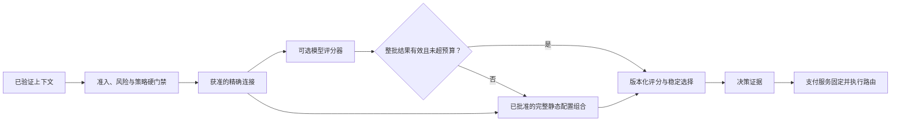
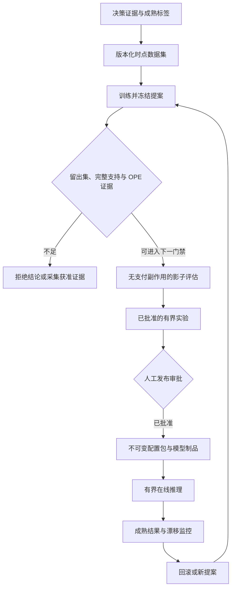
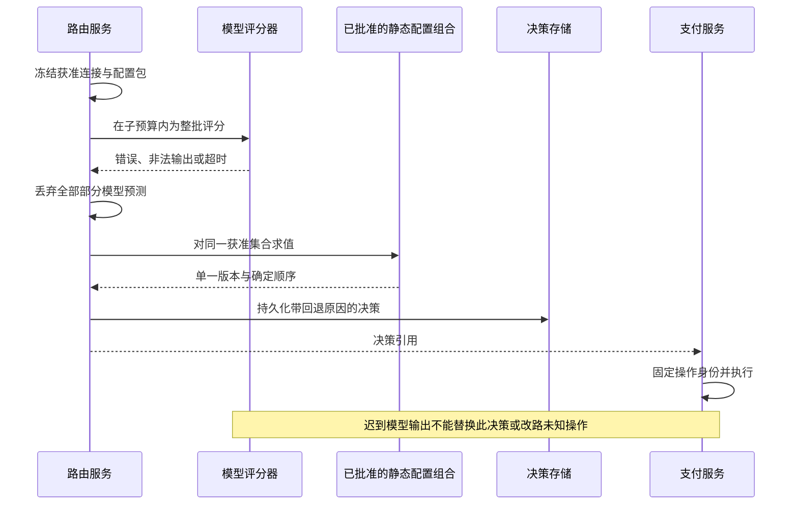

# 第 21 章 智能路由

Aurora 已经积累几个月的路由日志。数据团队训练了一个模型：给出上下文和候选通道，预测支付完成概率。离线分类准确率很高，模型推荐的 B 也显得比 A 更好。上线讨论却卡在一个简单问题上：过去困难交易几乎全部交给 A，B 只处理少量熟悉人群，那么模型凭什么知道 B 接到 A 的流量后仍然更好？

另一份报告把尚未出现的拒付记为零，又从评估集中删除了状态未知记录。模型因此偏爱最近加入、结果还没成熟的连接。问题不是缺少更深的网络，而是训练数据只包含过去策略允许我们看见的事实。

本章的核心命题是：

> **模型只是评分流水线中可替换的估计器。它不创造候选通道，不修改准入筛选或风险判断，也不获得新的资金权限；没有可信的选择概率、完整支持范围和成熟标签，就不能用离线数字宣称新策略具有因果优势。保持已验证的规则路由，始终是合法结论。**

本章连接[第 8 章](../part-2-routing-engine/success-rate-routing.md)的选择偏差、[第 9 章](../part-2-routing-engine/provider-scoring.md)的评分接口，以及[第 16 章](../part-4-operating-at-scale/experimentation.md)的实验合同。制品发布继续遵守[第 20 章](configuration-platform.md)；综合容量和上线验收留给[第 22 章](../part-6-case-study/global-payment-routing-platform.md)。当前配套系统没有完整训练、模型服务或离线策略评估（OPE）流水线，以下是待配套设计。

## 21.1 问题：预测历史结果，不等于证明改路有效

监督学习可以从已观察样本估计某个结果，却不会自动补齐未选择动作的反事实。一笔交易走了 A，我们可以观察 A 的最终证据；没有执行 B，就不能把 B 的模型预测当作真实批准或请款。为了获得标签而同时向 A、B 发起支付，更是越过了资金安全边界。

分类指标也不是策略指标。一个模型即使很好地预测了旧策略会遇到的失败，新的排序仍可能把大量流量送到缺乏证据的连接。AUC、校准误差、离线策略价值和生产实验效果分别回答不同问题，不能用一张 ROC 曲线代替发布证据。

上下文老虎机（Contextual Bandit）把“给定上下文选择动作，只观察已选动作反馈”作为基本问题。Li 等人的新闻推荐研究提供了这一建模方式及随机日志上的评估思路，但新闻点击的实验结果不是支付收益保证；支付还受到资金副作用、账户能力和风险预算约束。[Li 等：上下文老虎机方法](https://arxiv.org/abs/1003.0146)

引入模型之前，团队应先证明：现有规则在哪些稳定、合法人群中有可改善空间；结果标签能否可靠成熟；是否有足够可识别的历史选择机制；预期收益能否覆盖数据、模型、评审和事故成本。没有这些条件，“暂不使用机器学习”不是落后，而是对证据的正确判断。

## 21.2 简单设计：先让一个小模型替换一个软估计

最小模型可以是有界逻辑函数：`p = sigmoid(b + Σ wj × xj)`。特征是在决策前可见、经过批准与归一化的数值；输出是一个有明确标签定义的概率，而不是资金状态。

在自动请款的 `SALE` 切片中，可以先固定“在声明的 H 内已被证据确认的请款结果”这一标签。收益归属选中连接对应的支付尝试，不能把后续另一支付尝试的请款结果回填给原连接。它不能被命名为通用授权率，更不等于结算或最终经济收益。模型输出进入同口径的概率输入，再由第 9 章的完整评分器配置组合处理成本、单位和稳定排序。

模型只能接收硬门禁已经给出的候选集合。即使某个未启用连接的预测为 99.9%，它也没有进入评分的资格。风险判断 `BLOCK`、必须的认证、令牌可迁移性、账户合同和容量保护都不是可以被预测概率抵消的负分。



这个切口不会重新实现反欺诈引擎。PAN、CVV/SAD、令牌、原始设备指纹和未获准的个人资料不进入模型制品或路由特征；风险系统仍拥有自己的高维输入。需要新增字段时先经过用途、数据最小化和模式审查，不能以“模型需要”为理由扩大日志边界。

## 21.3 规模化问题：先证明数据回答的是同一个问题

### 21.3.1 数据集是带时间与证据版本的制品

| 数据项 | 最低要求 | 常见错误 |
| --- | --- | --- |
| 上下文/特征 | 决策时可见值、模式、来源、水位和缺失状态 | 用结算后信息补齐过去的在线特征 |
| 动作 | 精确候选通道 + 连接修订版 + 操作语义 | 把同 PSP 的不同账户合并成一个动作 |
| 日志策略 | 实际生效版本、硬门禁与降级路径 | 只记准备启用的模型名字 |
| 选择概率 | 当时选择该动作的真实条件概率 | 用成功概率或实验变体比例代替 |
| 结果 | 标签定义、H、观察截止时间、证据与更正版本 | 状态未知或未成熟拒付直接记零 |
| 评估人群 | 预先冻结的人群与去重业务单位 | 删除困难、未完成或效果不好的样本 |

训练集、调参集和最终评估集按时间与业务身份隔离。同一支付意图的重复请求、多个支付尝试和后来到达的事件不能随机散到不同集合；否则模型可能在训练中见过评估对象的未来。目标策略在留出集评估前冻结，不能反复挑选最漂亮的结果后仍使用最初的显著性解释。

标签成熟不只是“经过三天”。请款、实际费用和拒付各有自己的观察范围与证据水位；未知资金事实不能因为进入训练表就变成确定失败。若一批预定人群仍有缺失结果，先报告成熟覆盖和缺失原因，必要时拒绝评估，不能悄悄只留下已经有答案的记录。合法的删失建模需要单独方法与假设，本章不以默认删除代替它。

第 17、18 章的更正会产生新的数据集/标签版本，旧分析报告仍引用原版本。一个模型在新标签下不再优秀，可以撤回或重训，但不能原地修改过去的评估文件，使它看起来从未出错。

### 21.3.2 支持范围是每个上下文的集合关系

令 `μ(a|x)` 为历史日志策略在上下文 x 下选择动作 a 的概率，`π(a|x)` 为待评估目标策略的概率。允许标准重要性加权评估的关键前提之一是：

`对目标人群中的每个 x、每个 a：π(a|x) > 0 ⇒ μ(a|x) > 0。`

这不是检查日志里被选中行的选择概率大于零。历史本来就不可能抽中概率为零的动作；真正要检查的是目标策略会不会选择历史在同一上下文下从不允许选择的动作。

| 同一上下文的完整分布 | 历史已选动作 | 目标策略 | 可作出的结论 |
| --- | --- | --- | --- |
| μ(A)=1，μ(B)=0 | A，选择概率=1 | π(B)=1 | 无支持；A 的概率非零没有帮助 |
| μ(A)=0.9，μ(B)=0.1 | A 或 B | π(A)=0.5，π(B)=0.5 | 集合支持存在，还需检查权重与其他假设 |
| μ(A)=0.999，μ(B)=0.001 | 多数为 A | π(B)=1 | 理论支持存在，但权重可能极端集中 |
| 只保存了已选 A 和 p=0.9 | A | 目标还可能选 B | 不能还原完整支持，必须补证据或拒绝结论 |

生产重放器需要从不可变策略、候选通道/准入快照和当时全部选择条件重建完整分布。若容量门禁、规则覆盖或模型降级改变了选择，记录的是改变后的真实机制。第 16 章的变体分配概率不是候选通道暴露概率；把 10% 实验组比例直接放进分母会计算另一个量。

历史确定性策略可能只支持一个动作。随机摘要分桶只有在分配机制、随机性假设和版本确实成立时才提供相应选择概率，不能事后看到 70% 流量走 A 就声称每个上下文的 μ(A) 都是 0.7。也不能给从未可选的 B 人工填一个极小值，制造虚假的覆盖。

支持不足时，可以把目标策略限制在有证据的动作集合内，但这已经是另一个目标策略，必须产生新版本、重新冻结问题。不能先评价受限策略，再用它的数字为原本覆盖所有连接的策略背书。新连接的证据采集也需要独立审批，不能把“离线评估失败”解释为默认获准在线试钱。

有限日志上的逐上下文检查，只证明受审人群的可评估范围，不证明未来所有国家、发卡行或新连接都有支持。冷启动与新账户首先是证据缺失，不是可以随意从品牌平均值外推的机会。CRM 的原始研究正是围绕已记录的老虎机反馈、选择概率与估计方差建立学习原则，而非将任意历史日志当作完整监督数据。[Swaminathan、Joachims：反事实风险最小化](https://proceedings.mlr.press/v37/swaminathan15.html)

### 21.3.3 IPS、SNIPS 与 ESS 各自只能证明一部分

对 n 条合法且成熟的观察，定义 `wi = π(ai|xi) / μ(ai|xi)`，`ri` 为声明的有界收益。本章用 `[0,1]` 内的固定标签举例，金额和账务仍不使用浮点数。

| 量 | 计算 | 解释与限制 |
| --- | --- | --- |
| IPS | `Σ wi ri / n` | 在选择机制、支持、结果与抽样假设成立时估计目标价值；有限样本可能很不稳定 |
| SNIPS | `Σ wi ri / Σ wi` | 自归一化估计；有限样本一般有偏，不修复零支持 |
| 权重 ESS 诊断 | `(Σ wi)² / Σ wi²` | 观察权重是否集中；不是置信区间，也不是严格独立样本数 |

SNIPS 的原始论文讨论了自归一化与倾向概率过拟合；这不是反复用同一份留出集挑策略的通行证。[自归一化估计器](https://proceedings.neurips.cc/paper_files/paper/2015/hash/39027dfad5138c9ca0c474d71db915c3-Abstract.html) Elvira 等人也专门讨论了常用 ESS 近似的假设与局限，因此本书只把它用作权重集中告警。[重新审视有效样本量](https://arxiv.org/abs/1809.04129)

构造一个极端教学例子：一百条观察里只有一条来自概率 0.001 的 B，目标策略全选 B，这条记录的权重就是 1000。若其收益为 1，IPS 得到 10，SNIPS 得到 1，而权重 ESS 只有 1。IPS 超过 1 不应被悄悄截断成“100% 成功率”；这些数字说明样本不足以支持稳定结论，而不是 B 已经创造十倍收益。

限制最大权重可以控制工程风险，但剪裁会改变估计偏差。本章的最小工具选择在超出预先声明门槛时拒绝报告，而不是悄悄剪裁后输出漂亮数字。双重稳健方法结合收益模型与选择机制信息，可以在相应假设下改善评估，但不能凭名字为完全未支持的动作创造已观察证据。[Dudík 等：双重稳健策略评估](https://arxiv.org/abs/1103.4601)

### 21.3.4 Go：没有完整支持证明，就不返回收益数字

下面接口的 `FullDistributions` 必须由受信任重放器，从指定上下文与两个固定策略还原完整动作分布。没有原始掩码、策略版本或必要随机机制时，它返回错误；不能仅用已选动作的倾向概率构造一张看似完整的映射。此接口的真实证据重建仍是待配套工作。

```go
package ope

import (
	"context"
	"errors"
	"math"
	"sort"
)

type Row struct {
	UnitID, ContextID, LoggingPolicy, Action, LabelID string
	Propensity, Reward                                float64
	Mature                                            bool
}

type PolicyPair struct {
	ContextID, LoggingPolicy, TargetPolicy string
	Logging, Target                        map[string]float64
}

type Replay interface {
	FullDistributions(context.Context, Row, string) (PolicyPair, error)
}

type Plan struct {
	TargetPolicy, LabelID                string
	MinPropensity, MaxWeight, MinimumESS float64
}

type Report struct {
	N               int
	IPS, SNIPS, ESS float64
	Status          string
}

var ErrInsufficientEvidence = errors.New("insufficient evidence for this target policy")

func finite(value float64) bool {
	return !math.IsNaN(value) && !math.IsInf(value, 0)
}

func distribution(probabilities map[string]float64) bool {
	if len(probabilities) == 0 || len(probabilities) > 64 {
		return false
	}
	actions := make([]string, 0, len(probabilities))
	for action := range probabilities {
		actions = append(actions, action)
	}
	sort.Strings(actions)
	var total float64
	for _, action := range actions {
		probability := probabilities[action]
		if action == "" || !finite(probability) || probability < 0 || probability > 1 {
			return false
		}
		total += probability
	}
	return math.Abs(total-1) <= 1e-9
}

func Estimate(ctx context.Context, replay Replay, rows []Row, plan Plan) (Report, error) {
	if replay == nil || len(rows) == 0 || len(rows) > 1_000_000 ||
		plan.TargetPolicy == "" || plan.LabelID == "" ||
		!finite(plan.MinPropensity) || plan.MinPropensity <= 0 || plan.MinPropensity > 1 ||
		!finite(plan.MaxWeight) || plan.MaxWeight < 1 || plan.MaxWeight > 1_000_000 ||
		!finite(plan.MinimumESS) || plan.MinimumESS < 1 {
		return Report{}, ErrInsufficientEvidence
	}
	seen := make(map[string]bool, len(rows))
	var sumWeight, sumWeightSquared, sumWeightedReward float64
	for _, row := range rows {
		if err := ctx.Err(); err != nil {
			return Report{}, err
		}
		if row.UnitID == "" || seen[row.UnitID] || row.ContextID == "" || row.LoggingPolicy == "" ||
			row.Action == "" || row.LabelID != plan.LabelID || !row.Mature ||
			!finite(row.Propensity) || row.Propensity <= 0 || row.Propensity > 1 ||
			!finite(row.Reward) || row.Reward < 0 || row.Reward > 1 {
			return Report{}, ErrInsufficientEvidence
		}
		seen[row.UnitID] = true
		pair, err := replay.FullDistributions(ctx, row, plan.TargetPolicy)
		if err != nil {
			return Report{}, err
		}
		if pair.ContextID != row.ContextID || pair.LoggingPolicy != row.LoggingPolicy ||
			pair.TargetPolicy != plan.TargetPolicy || !distribution(pair.Logging) || !distribution(pair.Target) {
			return Report{}, ErrInsufficientEvidence
		}
		chosenProbability := pair.Logging[row.Action]
		if chosenProbability <= 0 ||
			math.Abs(chosenProbability-row.Propensity) > 1e-10*math.Max(chosenProbability, row.Propensity) {
			return Report{}, ErrInsufficientEvidence
		}
		// 检查目标策略支持的每个动作，而不只检查本行中的动作。
		for action, targetProbability := range pair.Target {
			if targetProbability == 0 {
				continue
			}
			loggingProbability := pair.Logging[action]
			if loggingProbability < plan.MinPropensity || targetProbability/loggingProbability > plan.MaxWeight {
				return Report{}, ErrInsufficientEvidence
			}
		}
		weight := pair.Target[row.Action] / row.Propensity
		sumWeight += weight
		sumWeightSquared += weight * weight
		sumWeightedReward += weight * row.Reward
	}
	if sumWeight <= 0 || sumWeightSquared <= 0 || !finite(sumWeight) ||
		!finite(sumWeightSquared) || !finite(sumWeightedReward) {
		return Report{}, ErrInsufficientEvidence
	}
	ess := sumWeight * sumWeight / sumWeightSquared
	if !finite(ess) || ess < plan.MinimumESS {
		return Report{}, ErrInsufficientEvidence
	}
	if err := ctx.Err(); err != nil {
		return Report{}, err
	}
	return Report{
		N: len(rows), IPS: sumWeightedReward / float64(len(rows)),
		SNIPS: sumWeightedReward / sumWeight, ESS: ess, Status: "estimate_only",
	}, nil
}
```

这里的验证对象是整批固定人群，不是逐行挑选成功案例。一次缺失标签、支持缺口或重复业务单位就拒绝这批报告；重放器不能向函数提交删掉问题后的集合，仍沿用原人群名称。证据来源、完整人群与上下文真实性是上游持久审计责任，Go 映射本身不证明它们。

即使返回 `estimate_only`，也没有输出“更优”或置信区间。后续报告还需记录目标策略、日志策略、数据集、标签和估计器版本，以及分层覆盖、权重分布、依赖与干扰假设。模型改变共享服务商负载后可能影响所有交易，单步 OPE 不模拟全量容量效应；多次后备切换的策略轨迹也不能直接套用这里的单步权重。

同样重要的是选择机制的可识别性：如果运营人员依据未记录的风险信息临时改路，后来重放默认策略得到的概率就不是当时的概率。完整映射、漂亮的 ESS 都无法纠正这类证据失真。随机实验日志也需要核验实际分配与执行是否一致，而不是只看到一个实验标识就假定没有偏差。

## 21.4 生产级设计：把模型能力装进原有护栏

### 21.4.1 训练不是发布，发布不是执行

Aurora 现在把训练输出称为提案。它可以申请进入影子评估，不能自行改写生产配置包。评估不足可以退回补证据，模型不优于规则也可以终止项目；流水线没有“训练完成必上线”的默认分支。



每一步输出有来源、负责人和不可变版本。影子评估比较预测与耗时，不触发第二次支付；受限实验沿用第 16 章的分配、护栏和停止规则。OPE 是进入下一道门的证据之一，不代替实验授权，更不自动豁免未覆盖的人群。

制品至少固定模型标识、格式、摘要、特征模式与顺序、标签及 H、训练时间窗、适用候选通道与人群范围、数值边界、评估报告和过期时间。报告还记录校准人群和不适用区域。模型版本相同但归一化改变，仍然是不同语义；特征存储不能给线上“顺手补”另一个版本的值。

模型适用性是额外的软估计门禁，不是准入筛选的替代品。一个连接可以合法接单，却不在该模型验证过的人群中；此时使用批准的静态配置组合，而不是拿邻近国家的系数强行外推。反过来，模型在某人群上有很好的验证结果，也不会授予该连接新的国家、支付方式或账户能力。

数据团队拥有估计器，配置平台拥有发布事实，支付服务拥有资金操作。它们的权限互不替代。NIST AI RMF 可作为治理、测量和风险管理的组织参考，但引用框架不等于通过支付合规认证，也不替代具体商户的数据用途审查。[NIST 人工智能风险管理框架](https://www.nist.gov/itl/ai-risk-management-framework)

### 21.4.2 Go：一个可审查的有界制品加载器

第一版不必引入远程通用模型运行时。十几个归一化特征的确定性逻辑模型，便于检查时间上界、制品内容和线上线下一致性。复杂模型不是被禁止，而是需要重新证明同样的边界。

下面是严格加载链路的语义层。字节层先按第 20 章合同限制大小、拒绝重复或未知 JSON 字段、验证摘要、签名和审批，再把可信对象交给 `Load`；不能把外部请求直接解码后调用它。`Schema` 来自已批准注册表，标签标识在注册表中绑定明确 H 与成熟规则。示例没有伪造证书验证器，也没有实现特征存储。

```go
package model

import (
	"context"
	"errors"
	"math"
	"time"
)

type FeatureSpec struct {
	Name     string
	Min, Max float64
}

type Schema struct {
	ID, LabelID string
	Features    []FeatureSpec
}

type Artifact struct {
	Format, ID, FeatureSchema, LabelID string
	Digest                             [32]byte
	TrainFrom, TrainThrough, ExpiresAt time.Time
	FeatureOrder                       []string
	Weights                            []float64
	Bias                               float64
}

type Vector struct {
	SchemaID  string
	Values    []float64
	Known     []bool
	ExpiresAt time.Time
}

type Model struct {
	id, schemaID string
	digest       [32]byte
	expiresAt    time.Time
	features     []FeatureSpec
	weights      []float64
	bias         float64
}

var ErrUnusable = errors.New("model or feature evidence unusable")

func finite(value float64) bool {
	return !math.IsNaN(value) && !math.IsInf(value, 0)
}

// Load 接收已经认证的制品和已批准的不可变模式。
func Load(artifact Artifact, schema Schema, now time.Time) (*Model, error) {
	n := len(schema.Features)
	if artifact.Format != "bounded_logistic_v1" || artifact.ID == "" || len(artifact.ID) > 128 ||
		artifact.Digest == ([32]byte{}) || schema.ID == "" || schema.LabelID == "" ||
		artifact.FeatureSchema != schema.ID || artifact.LabelID != schema.LabelID ||
		n == 0 || n > 16 || len(artifact.FeatureOrder) != n || len(artifact.Weights) != n ||
		artifact.TrainFrom.IsZero() || !artifact.TrainFrom.Before(artifact.TrainThrough) ||
		artifact.TrainThrough.After(now) || !now.Before(artifact.ExpiresAt) ||
		!finite(artifact.Bias) || math.Abs(artifact.Bias) > 32 {
		return nil, ErrUnusable
	}
	seen := make(map[string]bool, n)
	for i, feature := range schema.Features {
		if feature.Name == "" || len(feature.Name) > 64 || seen[feature.Name] ||
			artifact.FeatureOrder[i] != feature.Name ||
			!finite(feature.Min) || !finite(feature.Max) ||
			feature.Min < -1 || feature.Max > 1 || feature.Min >= feature.Max ||
			!finite(artifact.Weights[i]) || math.Abs(artifact.Weights[i]) > 32 {
			return nil, ErrUnusable
		}
		seen[feature.Name] = true
	}
	return &Model{
		id: artifact.ID, schemaID: schema.ID, digest: artifact.Digest,
		expiresAt: artifact.ExpiresAt,
		features:  append([]FeatureSpec(nil), schema.Features...),
		weights:   append([]float64(nil), artifact.Weights...), bias: artifact.Bias,
	}, nil
}

func (m *Model) Probability(ctx context.Context, vector Vector, now time.Time) (float64, error) {
	if err := ctx.Err(); err != nil {
		return 0, err
	}
	if m == nil || vector.SchemaID != m.schemaID || !now.Before(m.expiresAt) ||
		!now.Before(vector.ExpiresAt) || len(vector.Values) != len(m.features) ||
		len(vector.Known) != len(m.features) {
		return 0, ErrUnusable
	}
	z := m.bias
	for i, feature := range m.features {
		if err := ctx.Err(); err != nil {
			return 0, err
		}
		value := vector.Values[i]
		if !vector.Known[i] || !finite(value) || value < feature.Min || value > feature.Max {
			return 0, ErrUnusable
		}
		z += m.weights[i] * value
	}
	var probability float64
	if z >= 0 {
		probability = 1 / (1 + math.Exp(-z))
	} else {
		exp := math.Exp(z)
		probability = exp / (1 + exp)
	}
	if err := ctx.Err(); err != nil {
		return 0, err
	}
	return probability, nil
}
```

缺失状态通过 `Known` 明示，不能把缺失年龄、不可用健康值或未知账户能力统统填零。零只有在模式声明的归一化语义中才是合法数值。未知硬能力在进入本函数前已经被准入筛选排除，不能靠缺失特征的默认值重新进入。

`now` 是路由服务在本次评估取到的受信任时间，不是商户可指定的时间。构建后的模型复制参数而不持有外部可变切片；特征向量同样必须是上下文快照的一部分。这样一次决策不会前半使用旧归一化、后半读到训练进程刚写的新权重。

### 21.4.3 回退必须是完整配置组合，不是混合半份预测

假设 A 在模型服务超时前已经得到 0.8，B 没有返回。保留 A 的模型分数、给 B 填规则分数，是把不同单位和不同人群口径放进同一排序。正确行为是丢弃整批模型结果，按同一个已批准后备配置组合对全部合法候选重新处理。

下面批处理器展示这个边界。模型路径只返回候选通道对应的 `SuccessPPM`，再交第 9 章的同版完整评分器；静态路径返回批准的确定顺序，不伪造一组概率。`StaticProfile` 和 `Scorer` 只能从当前批准配置包装载，不能由支付请求提供。

```go
package model

import (
	"context"
	"errors"
	"math"
	"sort"
	"time"
)

type Candidate struct {
	ID     string
	Vector Vector
}

type StaticProfile struct {
	Version   string
	Digest    [32]byte
	ExpiresAt time.Time
	Order     []string
}

type Scorer struct {
	Version     string
	Digest      [32]byte
	Probability func(context.Context, Vector, time.Time) (float64, error)
}

type Prediction struct {
	CandidateID string
	SuccessPPM  int64
}

type Batch struct {
	Mode, Version, Reason string
	Digest                [32]byte
	Predictions           []Prediction
	Order                 []string
}

func ScoreBatch(ctx context.Context, allowed []Candidate, scorer *Scorer,
	fallback StaticProfile, now time.Time, budget time.Duration) (Batch, error) {
	if err := ctx.Err(); err != nil {
		return Batch{}, err
	}
	if len(allowed) == 0 || len(allowed) > 64 || budget <= 0 || budget > 50*time.Millisecond ||
		fallback.Version == "" || fallback.Digest == ([32]byte{}) ||
		!now.Before(fallback.ExpiresAt) || len(fallback.Order) > 4096 {
		return Batch{}, ErrUnusable
	}
	ids := make(map[string]bool, len(allowed))
	for _, candidate := range allowed {
		if candidate.ID == "" || ids[candidate.ID] {
			return Batch{}, ErrUnusable
		}
		ids[candidate.ID] = true
	}
	var staticOrder []string
	seen := make(map[string]bool, len(fallback.Order))
	for _, id := range fallback.Order {
		if id == "" || seen[id] {
			return Batch{}, ErrUnusable
		}
		seen[id] = true
		if ids[id] {
			staticOrder = append(staticOrder, id)
		}
	}
	if len(staticOrder) != len(allowed) {
		return Batch{}, ErrUnusable
	}
	useStatic := func(reason string) (Batch, error) {
		if err := ctx.Err(); err != nil {
			return Batch{}, err
		}
		return Batch{Mode: "static", Version: fallback.Version, Digest: fallback.Digest,
			Reason: reason, Order: staticOrder}, nil
	}
	if scorer == nil || scorer.Version == "" || scorer.Digest == ([32]byte{}) || scorer.Probability == nil {
		return useStatic("model_unavailable")
	}
	inferenceCtx, cancel := context.WithTimeout(ctx, budget)
	defer cancel()
	ordered := append([]Candidate(nil), allowed...)
	sort.Slice(ordered, func(i, j int) bool { return ordered[i].ID < ordered[j].ID })
	var predictions []Prediction
	for _, candidate := range ordered {
		probability, err := scorer.Probability(inferenceCtx, candidate.Vector, now)
		if err != nil || inferenceCtx.Err() != nil {
			reason := "model_error"
			if errors.Is(err, context.DeadlineExceeded) || inferenceCtx.Err() != nil {
				reason = "model_budget_exhausted"
			}
			return useStatic(reason)
		}
		if !finite(probability) || probability < 0 || probability > 1 {
			return useStatic("invalid_model_output")
		}
		predictions = append(predictions, Prediction{CandidateID: candidate.ID,
			SuccessPPM: int64(math.Round(probability * 1_000_000))})
	}
	return Batch{Mode: "model", Version: scorer.Version, Digest: scorer.Digest,
		Predictions: predictions}, nil
}
```

示例的五十毫秒是代码上限，不是全书承诺的生产 SLO。实际预算从路由服务总截止时间中分配，还要给静态决策和持久证据留出时间。父请求已取消时函数返回错误，不能在总预算耗尽后假装正常降级。

Go 的 `context` 包提供的是合作式取消，不会强制终止忽略取消信号的函数。这里可证明有界的本地模型最多检查十六个特征；若改为远程推理，必须同时限制连接、读取、并发和排队，并要求实现遵守取消。不要给无限任务外面套一个 goroutine，就宣称推理已经有资源上界。[Go：`context` 包官方文档](https://pkg.go.dev/context)



决策记录模型、特征、完整评分器、回退和配置包的版本，以及有限原因码；不把高维敏感特征复制进普通日志。回退只能改变尚未创建资金操作的新决策。已固定的支付操作遇到状态未知仍沿原连接查询和收敛，不能因为新模型认为另一家更好就换路。

## 21.5 故障模式：让错误的聪明方案必然失败

一次正常预测通过测试，不能证明模型可上线。最有价值的用例是“看起来能得到高收益，但证据或权限不成立”。下面测试的重放器只是固定夹具，用来验证算法拒绝路径，不代表持久决策存储已实现完整分布恢复。

```go
package ope

import (
	"context"
	"errors"
	"math"
	"testing"
)

type fixedReplay struct {
	logging, target map[string]float64
}

func (f fixedReplay) FullDistributions(_ context.Context, row Row, target string) (PolicyPair, error) {
	return PolicyPair{ContextID: row.ContextID, LoggingPolicy: row.LoggingPolicy,
		TargetPolicy: target, Logging: f.logging, Target: f.target}, nil
}

func TestPositiveChosenPropensityDoesNotProveSupport(t *testing.T) {
	rows := []Row{{UnitID: "intent-1", ContextID: "context-1", LoggingPolicy: "old-v1",
		Action: "A@7", LabelID: "capture-h-v1", Propensity: 1, Reward: 1, Mature: true}}
	replay := fixedReplay{logging: map[string]float64{"A@7": 1, "B@3": 0},
		target: map[string]float64{"A@7": 0, "B@3": 1}}
	plan := Plan{TargetPolicy: "new-v1", LabelID: "capture-h-v1",
		MinPropensity: 0.001, MaxWeight: 1000, MinimumESS: 1}
	if report, err := Estimate(context.Background(), replay, rows, plan); !errors.Is(err, ErrInsufficientEvidence) || report.Status != "" {
		t.Fatalf("unsupported B must produce no report: %+v, %v", report, err)
	}
}

func TestEvidenceAndESSGates(t *testing.T) {
	base := []Row{
		{UnitID: "i-1", ContextID: "x-1", LoggingPolicy: "old", Action: "A@7",
			LabelID: "capture-h-v1", Propensity: 0.5, Reward: 1, Mature: true},
		{UnitID: "i-2", ContextID: "x-2", LoggingPolicy: "old", Action: "B@3",
			LabelID: "capture-h-v1", Propensity: 0.5, Reward: 0, Mature: true},
	}
	replay := fixedReplay{logging: map[string]float64{"A@7": 0.5, "B@3": 0.5},
		target: map[string]float64{"A@7": 0.5, "B@3": 0.5}}
	plan := Plan{TargetPolicy: "new", LabelID: "capture-h-v1",
		MinPropensity: 0.01, MaxWeight: 10, MinimumESS: 2}
	report, err := Estimate(context.Background(), replay, base, plan)
	if err != nil || report.IPS != 0.5 || report.SNIPS != 0.5 || report.ESS != 2 ||
		report.Status != "estimate_only" {
		t.Fatalf("valid fixture: %+v, %v", report, err)
	}
	for name, mutate := range map[string]func([]Row){
		"immature":         func(rows []Row) { rows[1].Mature = false },
		"wrong propensity": func(rows []Row) { rows[0].Propensity = 0.25 },
		"duplicate unit":   func(rows []Row) { rows[1].UnitID = rows[0].UnitID },
		"NaN reward":       func(rows []Row) { rows[0].Reward = math.NaN() },
	} {
		t.Run(name, func(t *testing.T) {
			rows := append([]Row(nil), base...)
			mutate(rows)
			if _, err := Estimate(context.Background(), replay, rows, plan); err == nil {
				t.Fatal("invalid evidence accepted")
			}
		})
	}
	plan.MinimumESS = 3
	if _, err := Estimate(context.Background(), replay, base, plan); err == nil {
		t.Fatal("two effective observations cannot meet an ESS gate of three")
	}
}
```

在线测试则必须证明“一项错误污染不了半个排序”。测试候选列表来自硬门禁，因此批准静态列表中即使保留 C，C 也不会出现在此次返回中。实际接入还要测试真实准入筛选能排除预测分最高的非法候选；不能只靠模型包的入参约定宣称整条链路已验证。

```go
package model

import (
	"context"
	"errors"
	"math"
	"reflect"
	"testing"
	"time"
)

func fixture(t *testing.T) (*Model, Artifact, Schema, Vector, time.Time) {
	t.Helper()
	now := time.Date(2026, 1, 2, 0, 0, 0, 0, time.UTC)
	schema := Schema{ID: "f-v1", LabelID: "capture-h-v1",
		Features: []FeatureSpec{{Name: "bucket", Min: 0, Max: 1}}}
	artifact := Artifact{Format: "bounded_logistic_v1", ID: "m-v1",
		FeatureSchema: schema.ID, LabelID: schema.LabelID, Digest: [32]byte{1},
		TrainFrom: now.Add(-48 * time.Hour), TrainThrough: now.Add(-24 * time.Hour),
		ExpiresAt: now.Add(time.Hour), FeatureOrder: []string{"bucket"}, Weights: []float64{1}}
	vector := Vector{SchemaID: schema.ID, Values: []float64{0.5},
		Known: []bool{true}, ExpiresAt: now.Add(time.Minute)}
	m, err := Load(artifact, schema, now)
	if err != nil {
		t.Fatal(err)
	}
	return m, artifact, schema, vector, now
}

func TestLoaderAndFeatureBoundaries(t *testing.T) {
	m, artifact, schema, vector, now := fixture(t)
	before, err := m.Probability(context.Background(), vector, now)
	if err != nil || before <= 0.5 || before >= 1 {
		t.Fatalf("invalid bounded inference: %v, %v", before, err)
	}
	artifact.Weights[0] = 20
	schema.Features[0].Max = 0.1
	after, err := m.Probability(context.Background(), vector, now)
	if err != nil || before != after {
		t.Fatal("loaded model retained mutable external slices")
	}
	_, validArtifact, validSchema, _, _ := fixture(t)
	for name, mutate := range map[string]func(*Artifact){
		"NaN":          func(a *Artifact) { a.Bias = math.NaN() },
		"Inf":          func(a *Artifact) { a.Bias = math.Inf(1) },
		"schema":       func(a *Artifact) { a.FeatureSchema = "unknown" },
		"expired":      func(a *Artifact) { a.ExpiresAt = now },
		"future train": func(a *Artifact) { a.TrainThrough = now.Add(time.Second) },
	} {
		t.Run(name, func(t *testing.T) {
			candidate := validArtifact
			mutate(&candidate)
			if _, err := Load(candidate, validSchema, now); err == nil {
				t.Fatal("unusable artifact loaded")
			}
		})
	}
	vector.Values[0] = math.NaN()
	if _, err := m.Probability(context.Background(), vector, now); err == nil {
		t.Fatal("NaN feature accepted")
	}
	vector.Values[0], vector.Known[0] = 0, false
	if _, err := m.Probability(context.Background(), vector, now); err == nil {
		t.Fatal("unknown feature silently filled with zero")
	}
}

func TestWholeBatchFallbackPreservesAllowedSet(t *testing.T) {
	_, _, _, vector, now := fixture(t)
	allowed := []Candidate{{ID: "A@7", Vector: vector}, {ID: "B@3", Vector: vector}}
	fallback := StaticProfile{Version: "static-v4", Digest: [32]byte{4},
		ExpiresAt: now.Add(time.Hour), Order: []string{"C@9", "B@3", "A@7"}}
	for _, mode := range []string{"NaN", "Inf", "timeout"} {
		t.Run(mode, func(t *testing.T) {
			calls := 0
			scorer := &Scorer{Version: "model-v2", Digest: [32]byte{2},
				Probability: func(ctx context.Context, _ Vector, _ time.Time) (float64, error) {
					calls++
					if calls == 1 {
						return 0.8, nil
					}
					if mode == "timeout" {
						<-ctx.Done()
						return 0, ctx.Err()
					}
					if mode == "Inf" {
						return math.Inf(1), nil
					}
					return math.NaN(), nil
				}}
			batch, err := ScoreBatch(context.Background(), allowed, scorer, fallback, now, 50*time.Millisecond)
			if err != nil || calls != 2 || batch.Mode != "static" || batch.Version != fallback.Version ||
				batch.Digest != fallback.Digest || len(batch.Predictions) != 0 ||
				!reflect.DeepEqual(batch.Order, []string{"B@3", "A@7"}) {
				t.Fatalf("partial model or excluded candidate escaped: %+v, %v", batch, err)
			}
		})
	}
	ctx, cancel := context.WithCancel(context.Background())
	cancel()
	if _, err := ScoreBatch(ctx, allowed, nil, fallback, now, time.Millisecond); !errors.Is(err, context.Canceled) {
		t.Fatal("expired parent request must not pretend to succeed through fallback")
	}
}

func TestModelModeCannotCreateCandidate(t *testing.T) {
	m, _, _, vector, now := fixture(t)
	scorer := &Scorer{Version: m.id, Digest: m.digest, Probability: m.Probability}
	fallback := StaticProfile{Version: "static-v4", Digest: [32]byte{4},
		ExpiresAt: now.Add(time.Hour), Order: []string{"C@9", "A@7"}}
	batch, err := ScoreBatch(context.Background(), []Candidate{{ID: "A@7", Vector: vector}},
		scorer, fallback, now, 50*time.Millisecond)
	if err != nil || batch.Mode != "model" || len(batch.Order) != 0 ||
		len(batch.Predictions) != 1 || batch.Predictions[0].CandidateID != "A@7" ||
		batch.Predictions[0].SuccessPPM != 622459 {
		t.Fatalf("model must only estimate the allowed connection: %+v, %v", batch, err)
	}
}
```

| 故障或误用 | 必须出现的结果 | 仍需补齐的系统级证据 |
| --- | --- | --- |
| 模型偏爱不合格候选通道 | 候选在模型之前已排除 | 真实规则、风险与准入筛选的组合测试 |
| 模式未知、模型过期、特征缺失 | 模型拒绝；整套批准评分器接管 | 配置包依赖闭包和有效期测试 |
| 单个候选出现 NaN、Inf 或推理超时 | 丢弃全部部分预测，记录有限原因 | 总截止时间、并发与排队上界 |
| 已选概率非零但目标动作零支持 | 不输出离线收益报告 | 不可变完整分布与固定人群重放 |
| 标签未成熟、权重过于集中 | 报告不可评估或证据不足 | 标签水位、分层覆盖和方差分析 |
| 服务商响应超时进入未知状态 | 恢复原操作，不重新调用模型换 PSP | 支付服务、支付网关和对账链路故障测试 |

漂移监控同样不只是盯住模型输出均值。特征覆盖和缺失、预测校准、技术故障、成熟请款结果与经济结果分别有窗口。观察到下降时先区分数据管道损坏、流量构成变化和真实概念变化；任何一个都不自动授权扩大探索或将未成熟结果解释为失败。

回滚也要复用第 20 章的单调发布语义：新发布可以引用仍有效的旧模型内容，不能倒退世代、恢复已撤销签名或放宽硬门禁。若旧模型依赖的特征模式已停止供给，所谓最近可用良好版本已不再可用；应选择当前仍有效的规则配置组合，而不是为了恢复历史分数而接受未知输入。

## 21.6 权衡：先选择能被证明的复杂度

规则的优势是可解释、确定、证据成本低；监督模型可以改善同一合法空间中的软估计；上下文老虎机还要求可解释的选择概率与明确探索授权。三者不是必须逐级升级的成熟度阶梯。复杂模型增加的风险不能只用离线准确率抵扣。

探索不是随机把钱发到任何连接。它只发生在同一硬门禁允许的集合中，受商户范围、服务商容量、金额暴露、风险和实验预算限制。探索策略与选择概率在执行前随决策持久化，事后不能从流量频率猜回。安全门禁若覆盖随机选择，记录实际生效机制；无法重建时标为不可评估。

强化学习若把重试、认证、请款、退款都纳入动作空间，就不再只是替换评分器，而是在申请新的业务控制权。本书不实现这种自治真钱策略。即使未来研究多步优化，也必须由原领域状态机约束动作，不得把状态未知当作低收益后换 PSP，不得在已有请款结果上“探索”另一条支付路径。

当前配套仓库的路由服务 v3 已把版本化成本与观察性性能证据送入同一受约束评分流水线，支付服务也会固定完整候选顺序与优化快照；这是一条可审计的非机器学习基线，不是模型平台。仓库仍没有生产 `services/router/internal/model`、特征流水线、实验/影子运行时或 `tools/routing-replay` 的完整 OPE 工具。本文 Go 块是独立可编译的待配套增量：先把有界加载器与纯评分器接到影子评估，再补持久决策分布证据和成熟标签重放。真实服务接入、跨组件回归和发布 CI 未完成前，不能称为已上线智能路由。固定代码证据与缺口见[本章交付说明](../deliveries/chapter-21-intelligent-routing.md)。

最窄的下一步是选择一个已有合法流量、标签可成熟的固定人群，冻结模式和一个小模型，比较影子评估的预测、拒绝原因与推理预算。若日志缺少支持，交付物可以是一份明确列出证据缺口的报告，而不是虚构提升比例。第 22 章再把通过门禁的能力放进全平台上线顺序。

## 21.7 小结

智能路由的难点不是计算一个分数，而是知道什么时候这个分数有资格参与决策。准入筛选和风险判断决定候选空间；成熟标签与真实日志选择概率决定可以从历史学到什么；完整支持检查和权重诊断决定哪些离线问题暂时不能回答。

模型制品有不可变来源、时间与版本，推理有数值和资源上界，任何不完整结果都回到同一个已批准评分器。学习系统可以提出更好的估计，却不能越过支付系统已经建立的资金权限、未知状态恢复和审计事实。这条界限越清楚，团队越能安全地尝试真正有价值的优化。
