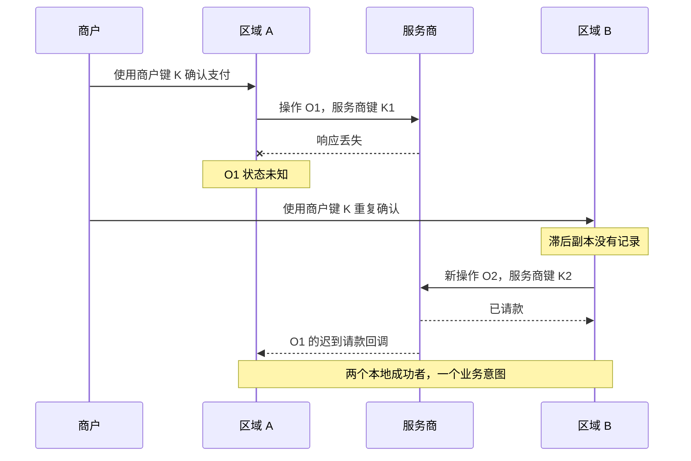
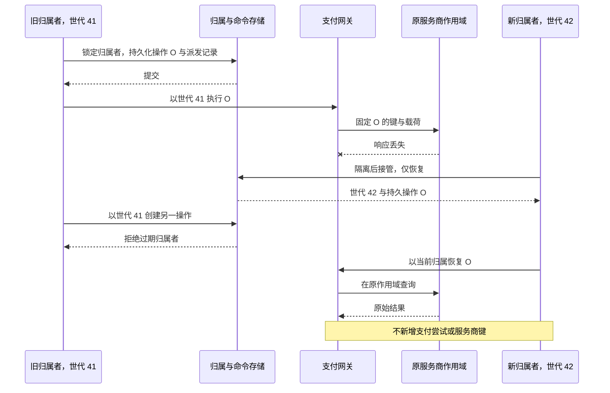
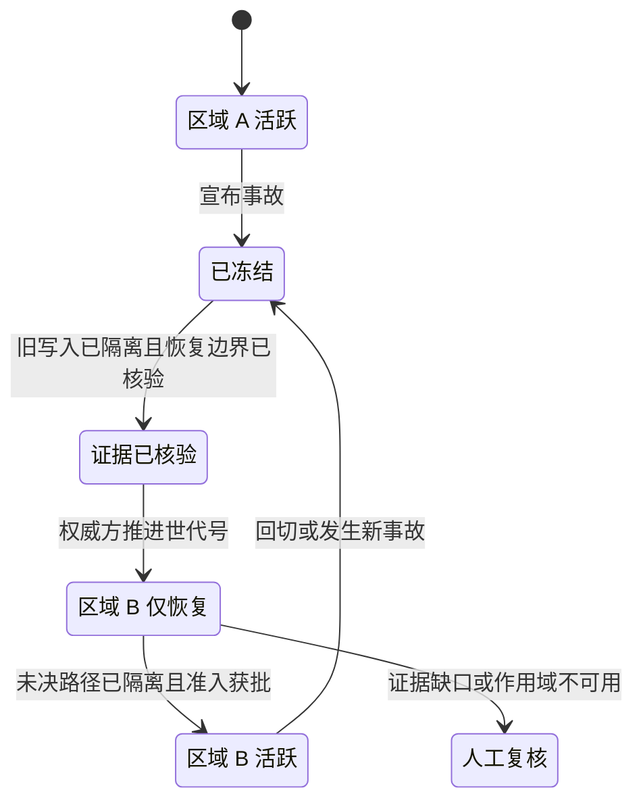
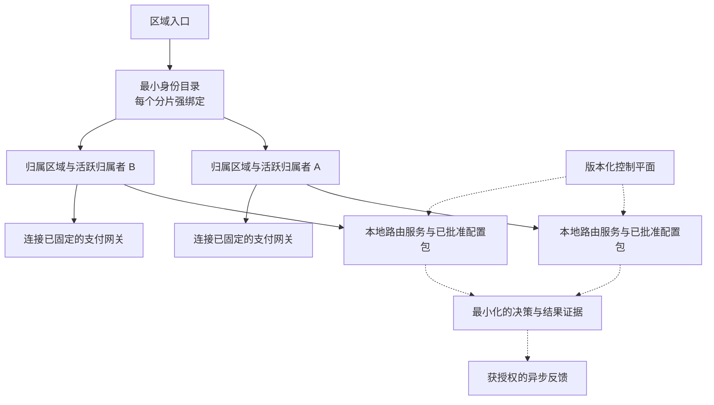

# 第 19 章 多区域支付路由

**中文** | [English](../en/part-5-global-routing/multi-region.md)

Aurora 已经在北美稳定运行。欧洲商户抱怨跨洋延迟，业务团队又希望一次区域故障不再影响所有国家。工程师把支付服务、路由服务、支付网关各复制一套到欧洲，用地理 DNS 分流，并异步复制支付数据库。第一次演练中，美国入口失联，欧洲实例接到商户的重复确认：幂等表里没有这笔请求，于是它生成新的支付操作，向同一家 PSP 的欧洲端点发起支付。

几分钟后，美国的回调恢复投递。两个区域各有一条成功记录，而且两边都认为自己遵守了本地唯一约束。问题不在负载均衡器切得太慢，而在“哪个区域能接收请求”和“谁有权产生资金副作用”被当成了同一个问题。

本章的核心命题是：

> **路由服务可以在多个区域独立计算，但同一个支付意图必须有唯一的执行归属者。区域故障转移是带证据、版本和隔离令牌（fencing）的权力交接，不是把 DNS 指向新地址。已经发出的状态未知操作继续绑定原服务商连接、账户、服务商区域、幂等键和请求载荷；更换平台执行区域不能把它变成一笔新支付。**

[第 17 章](../part-4-operating-at-scale/reconciliation.md)解决事实发现与修复权限，[第 18 章](../part-4-operating-at-scale/settlement.md)建立经济结果关联。本章把这些所有权放进跨区故障中检验。配置制品的审批与分发留给[第 20 章](configuration-platform.md)，完整容量预算留给[第 22 章](../part-6-case-study/global-payment-routing-platform.md)。当前配套系统仍是单逻辑区域的 PostgreSQL 纵向切片；连接身份已进入设计与实现演进，但它本身不等于已经实现多区域归属协议。

## 19.1 问题：一个 DNS 名称不能协调两本幂等账

下面的代码很适合表达一个危险的直觉：本地网络失败，就换远端地址再试。

```go
package naiveregion

import "context"

type RegionClient interface {
	Confirm(context.Context, string, string) error
}

// UnsafeFailover 是反例，不是支付重试策略。
func UnsafeFailover(ctx context.Context, local, remote RegionClient,
	intentID, merchantKey string) error {
	if err := local.Confirm(ctx, intentID, merchantKey); err == nil {
		return nil
	}
	return remote.Confirm(ctx, intentID, merchantKey)
}
```

即使它保留了商户幂等键，远端也必须能够找到相同的业务身份，并证明自己的执行权。若两个区域各自维护独立的 `(merchant_id, key)` 唯一索引，数据库只能证明“本区域没有重复”，不能证明另一区域尚未提交。如果复制还没有追上，读不到记录不是不存在的证据；网络分区也无法告诉欧洲进程，美国工作进程是已终止、暂停，还是仍在与 PSP 通信。



把服务商幂等键也强行设成同一个字符串仍不够。以 Adyen 的公开契约为例，幂等存储有公司账户作用域，而且面向多个区域端点时，不会跨区域检查重复。因此，“同品牌、同键、不同端点”不能被推导为全局去重。[Adyen：API 幂等文档](https://docs.adyen.com/development-resources/api-idempotency)

多区域设计首先要保住的是上一章之前已经成立的不变量：一份业务意图、一组不可变资金操作、可解释的证据，以及唯一有权推进它们的写入者。提高可用性不能通过把这些约束局部化来实现。

## 19.2 简单设计：入口可多活，支付意图先保持单归属

### 19.2.1 四种区域不是同一个字段

| 名称 | 含义 | 是否随一次入口故障改变 |
| --- | --- | --- |
| 入口区域 | 接收商户 HTTP 请求的位置 | 可以改变，不授予资金写权限 |
| 归属区域 | 支付意图创建时确定的业务数据归属 | 通常不变，正式迁移需独立流程 |
| 执行区域 | 当前获权执行和恢复该支付意图的平台区域 | 可经受控交接改变 |
| 服务商区域 | 固定连接对应的 PSP 执行与幂等作用域 | 已有操作不得因平台切区而改变 |

一个欧洲入口可以把美国支付意图的确认请求安全转发给美国归属者。它不是重新创建支付意图，也不是重新路由支付。美国归属者故障时，欧洲入口可以接受只读查询或明确返回暂时不可执行；是否允许欧洲接管写入，要由归属协议决定，而不是入口健康检查决定。

最小可用方案是按商户或支付意图分区的单写者。不同分区可以同时分布在多个区域，所以整个系统可以在多区域服务流量；但某个分区在任一时刻只有一个权威写入位置。我们不需要先实现全球任意节点都可写同一行，才能获得延迟、隔离或地域部署收益。

### 19.2.2 先找到同一支付意图，再判断谁能执行

全局最小目录可以保存 `merchant_scope + business_key_digest → intent_id + home_region`，再附上创建状态和请求摘要。这里的键可以是公开 API 幂等键或预先规定的商户业务引用，但必须与[第 11 章](../part-3-reliability/idempotency.md)的契约一致，不能在跨区时悄悄换作用域。

目录必须提供一次线性化的“预留或读取已有绑定”，而不是两个区域先读空、再分别写入。相同键、不同请求摘要仍然冲突。相同键的两个创建请求只能得到一个支付意图标识；归属数据库暂不可用时，目录保留 `reserved`，后台以这个标识幂等补建，不能删除预留后让另一区重新分配。

这会产生目录与区域数据库之间的提交间隙，但间隙可以被显式建模：`reserved → materialized` 只向前推进；API 未完成物化就不报告支付创建成功；恢复者使用原标识和摘要重试。全局目录中不放令牌、完整商户请求或 PAN，也不把摘要描述成天然匿名数据。若目录失去写入仲裁，新业务身份的创建应拒绝；不能退化为“各区先创建，事后去重”。

全局不必意味着一台中心数据库。可以按商户分片，把每个分片的一致性范围固定到批准的容灾组。关键是一个键只有一个权威仲裁点，以及故障时不能同时提升两个互不相认的权威，而不是产品名称里是否出现“全球数据库”。

## 19.3 规模化问题：每类数据需要不同的一致性

把全部状态放进跨洲同步事务，会把最慢链路带进每次支付；全部异步复制，又会失去唯一身份与执行历史。应逐项回答：这份数据丢一条，会导致慢一点、选得差一点，还是可能多扣一次？

| 数据 | 一致性与复制原则 | 落后时允许的行为 |
| --- | --- | --- |
| 商户键到支付意图的目录 | 分片内强一致、唯一绑定 | 不能证明绑定时拒绝新建 |
| 支付意图、支付尝试、支付操作、服务商键 | 归属者内事务一致，恢复时有完整执行前证据 | 缺失区间只读或复核，不凭空重建资金操作 |
| 归属世代与执行许可 | 与受保护写入形成原子验证边界 | 无法确认当前权力时停止新副作用 |
| 规则、能力、费率、模型配置包 | 区域内完整原子版本，跨区可受控滞后 | 用批准的最近可用良好版本，记录实际版本 |
| 服务商健康度 | 按执行区域、连接、操作分域且有 TTL | 过期按安全策略降级，不借用另一区域的绿色灯 |
| 性能与实际费用聚合 | 异步、带窗口、水位和覆盖率 | 估计缺失或过期，不伪装成当前事实 |
| 决策、收件箱/发件箱、对账证据 | 可延迟投影，不丢执行关联，重放幂等 | 显示滞后量，保留恢复入口 |
| 令牌与密钥引用 | 按授权和驻留边界可访问 | 不可访问就停止该操作，不跨区复制解禁 |

PostgreSQL 官方文档明确区分异步复制的数据丢失窗口与同步复制的确认等待。选择一个更严格的提交模式，需要同时说明同步副本的位置、确认条件和失联后的服务策略；不能把“开启复制”写成自动满足零数据损失。[PostgreSQL 备用服务器与同步复制](https://www.postgresql.org/docs/current/warm-standby.html)

### 19.3.1 支付执行记录的 RPO 不能照抄分析仓

如果主库在发出支付操作后毁损，而备库没有那条操作、服务商键和请求摘要，平台已经失去判断重复发送的必要证据。即使总体数据库只丢了两秒，这两秒也可能包含已在外部产生副作用的请求。备区不得因为新表里没有记录就重新生成键。

因此，生产合同应把“允许外发之前的持久派发证据”纳入声明故障模型下的恢复保护：例如在批准的故障域中确认复制后才允许外发，并对无法证明完整性的区间封锁新执行。恢复过程还需核对支付网关的外发记录、收件箱/发件箱水位和服务商证据。已确认写入不丢失也不是对所有灾难的绝对承诺，仍受副本损坏、错误运维、恢复时间线和配置选择限制。

RTO 衡量能容忍多长服务中断，RPO 衡量能容忍多大的数据恢复缺口；二者是业务目标，不是组件名字。支付入口恢复、旧未知状态完成收敛、结算投影追平也应分别计时，不能用 `/readyz` 变绿代替全部恢复。[AWS 恢复目标说明](https://aws.amazon.com/disaster-recovery/faqs/)

### 19.3.2 恢复旧备份也会恢复旧权力

归属记录不能被当成普通缓存重建。若协调数据库从昨日备份恢复，世代号可能比已经签发给工作进程的版本更小；简单执行一次 `epoch + 1` 仍可能复用历史许可。灾难恢复必须证明权威时间线没有倒退，或建立新的权威世代，撤销所有旧世代的执行权限，并对缺失窗口重新核对证据。

这不是让每个服务自行生成随机世代号。它仍须由唯一的恢复授权过程发布，并让所有接收资金命令的边界共同承认；旧支付网关、旧数据库或未更新的出站路径不能继续接受旧权力。无法完成这个隔离时，应延长写入停机，而不是把备份成功解压等同于安全提升。备份、恢复与隔离令牌演练因此必须一起验收。

## 19.4 生产级设计：租约用于交接，世代号用于拒绝旧写者

### 19.4.1 心跳超时不是旧进程终止的证明

假设美国工作进程持有租约，在检查成功后暂停了十秒。协调器因为租约到期把归属者改成欧洲。美国进程随后恢复，如果只在函数入口检查过一次锁，它仍可能写库、写入发件箱或调用支付网关。租约解决“何时允许开始交接”，不能让旧进程忘记它曾经得到的许可。

我们给每次交接分配单调递增的 `ownership_epoch`。持久化层拒绝低于当前世代号的命令，支付网关也不能把任意请求头里的世代号当成权威。租约时间由协调存储判定，不依赖两个应用节点的本地时钟相同；世代号是版本，不是密码，调用者仍须通过服务身份与授权检查。

最容易验证的第一步，是把归属行与受保护的支付写入放在同一 PostgreSQL 事务里。锁定归属行后检查区域、世代、租约和模式，创建支付尝试、支付操作和发件箱记录，再一起提交。交接事务也必须锁同一行，不能用“先问 etcd，再写另一个数据库”冒充原子隔离。etcd 的并发 API 同样把锁所有权与事务条件配合使用；这不自动扩展成对另一个数据库或 PSP 的事务保证。[etcd 并发 API](https://etcd.io/docs/v3.6/dev-guide/api_concurrency_reference_v3/)

```go
package regionownership

import (
	"errors"
	"time"
)

type Permit struct {
	IntentID string
	Region   string
	Epoch    int64
}

type Lease struct {
	IntentID   string
	Region     string
	Epoch      int64
	ValidUntil time.Time
	Mode       string // active（活跃）、recovery_only（仅恢复）、frozen（冻结）
}

var ErrFenced = errors.New("execution owner is not current")

// Check 在归属行锁内运行，并使用数据库时间。
// 它本身不授权后续网络请求。
func Check(lease Lease, permit Permit, dbNow time.Time, newFunds bool) error {
	if lease.IntentID == "" || permit.Region == "" || permit.Epoch <= 0 ||
		lease.IntentID != permit.IntentID || lease.Region != permit.Region ||
		lease.Epoch != permit.Epoch || !dbNow.Before(lease.ValidUntil) {
		return ErrFenced
	}
	if lease.Mode != "active" && lease.Mode != "recovery_only" {
		return ErrFenced
	}
	if newFunds && lease.Mode != "active" {
		return ErrFenced
	}
	return nil
}
```

这是可编译的纯判断函数，不是分布式锁实现。它必须嵌入存储事务；把 `Lease` 放在进程缓存里十分钟再检查没有相同语义。数据库锁保护的是竞争写入，不会回滚外部已经发生的扣款。[PostgreSQL：显式锁定](https://www.postgresql.org/docs/current/explicit-locking.html)

### 19.4.2 把授权检查和持久命令放进同一个提交

下面接口刻意不暴露“读取租约后由调用者随便写”的便利方法。存储适配器负责锁定归属者、读取数据库时间、校验许可，并在同一事务里持久化命令。`InsertOnce` 对操作标识和不可变请求摘要做一致性校验；事件与命令一起提交。

```go
package fencedcommand

import (
	"context"
	"errors"
)

type Permit struct {
	IntentID string
	Region   string
	Epoch    int64
}

type Command struct {
	OperationID        string
	IntentID           string
	ConnectionID       string
	ConnectionRevision string
	NamespaceID        string
	PayloadDigest      string
	ProviderKey        string
}

type OwnedTx interface {
	InsertOnce(context.Context, Command) error
	AppendDispatchEvent(context.Context, Command) error
}

type Store interface {
	// 实现必须锁定归属记录与支付意图，在活跃模式下校验当前许可，
	// 并将 fn 与发件箱记录原子提交。
	WithActiveOwnership(context.Context, Permit, func(OwnedTx) error) error
}

func Prepare(ctx context.Context, store Store, permit Permit, cmd Command) error {
	if permit.IntentID == "" || permit.Region == "" || permit.Epoch <= 0 ||
		cmd.IntentID != permit.IntentID || cmd.OperationID == "" ||
		cmd.ConnectionID == "" || cmd.ConnectionRevision == "" ||
		cmd.NamespaceID == "" || cmd.PayloadDigest == "" || cmd.ProviderKey == "" {
		return errors.New("incomplete or mismatched command identity")
	}
	return store.WithActiveOwnership(ctx, permit, func(tx OwnedTx) error {
		if err := tx.InsertOnce(ctx, cmd); err != nil {
			return err
		}
		return tx.AppendDispatchEvent(ctx, cmd)
	})
}
```

这里省略的是存储代码，不是约束：适配器必须校验 `cmd.IntentID == permit.IntentID`、字段完整、支付状态允许新操作，并保证重复命令不重复新增派发事件。接口只说明事务边界，不能以一个内存实现的测试替代真实数据库中的双区域并发测试。

同一条持久派发事件可能被至少一次投递，也可能在交接后才到达支付网关。支付网关的执行许可必须关联支付操作、当前归属者与原始资金身份：旧世代的新命令被拒绝；已知操作的恢复由新归属者显式认领，沿用原键和载荷，而不是把旧消息的区域字段改掉后当新请求。若支付服务与支付网关各有数据库，就需要可证明的接收/认领协议；仅在两边都增加一个世代字段不足以构成分布式事务。

### 19.4.3 隔离令牌不能收回已经离开机器的字节

最重要的反例是：支付网关在世代 41 下通过了发送门禁，PSP 请求已经上路；之后归属世代变成 42。数据库可以拒绝旧支付网关后续写入，却不能让 PSP 忘记它收到的请求。多数服务商 API 也不会理解平台自定义的世代号。

因此，世代 41 下已经持久化或可能发送的支付操作，必须被接管为原操作的恢复任务。新归属者不创建新支付尝试，不切服务商区域。允许使用同一键重发时，也必须证实原作用域、载荷与服务商幂等保留期仍有效；否则仅查询、等待回调或人工复核。隔离令牌限制新的授权命令，原操作身份与服务商契约限制重复网络发送的副作用，两者缺一不可。



## 19.5 故障模式：切区必须是一份可执行操作手册

### 19.5.1 从冻结到恢复，不从红灯直接跳绿灯



冻结新流量不等于取消已有支付。演练应依次验证：停止旧归属者获得新许可；隔离旧写入路径和旧数据库提升路径；核对恢复时间线及派发证据；原子推进归属世代；让新归属者先进入 `recovery_only`；按原支付操作恢复和对账；满足证据、容量与授权条件后，才放开新业务身份的准入。

`recovery_only` 可以接收验签后的回调、读取服务商事实并处理已存在操作。它不允许生成另一条资金路径。某些不确定支付意图需要长期隔离，不能让所有新交易永远等待它们；系统可以对已证明安全的分区恢复新支付意图，同时保留这些旧支付意图的未知/复核状态。这个分区边界要有持久化证据，不能只是值班者记在聊天里。

回切也应按同一协议执行。原区域恢复后不能凭“我曾经是主库”自动接回写入；它必须遵守更高世代，重建投影、核对配置和事件水位，再经过新的受控交接。否则一次恢复可能成为第二次事故。

| 故障 | 不安全的捷径 | 允许的结果 |
| --- | --- | --- |
| 目录不可达 | 在本地生成新的支付意图 ID | 保守拒绝新建，已有权威绑定按契约处理 |
| 两个区域同时申请归属权 | 以本地时间或较近入口决定 | 强一致条件写只产生一个世代获胜者 |
| 旧工作进程暂停后恢复 | 接着执行缓存里的许可 | 持久化层拒绝旧世代，新命令不外发 |
| PSP 请求已发送但状态未复制 | 把备库未命中当失败 | 证据缺口冻结，查询原服务商与执行记录 |
| 原服务商区域不可访问 | 使用同一键切另一端点 | 保持状态未知，不推定跨区域幂等 |
| 备区路由服务版本滞后 | 混用新规则和旧能力 | 使用完整的最近可用良好版本，必要时拒绝新决策 |
| 回调到达旧区域 | 丢弃或重新生成操作 ID | 按原身份持久接收并投递当前归属者，重复安全 |
| 旧区域重新上线 | 自动抢回领导权 | 只读追平，显式回切 |

### 19.5.2 路由服务区域自治，但不能篡改既有执行计划

路由服务的请求关键路径应尽量使用区域内的上下文、完整配置包、健康度快照和可用特征。控制平面失联时，实例不必为了每笔支付跨洲查询最新配置；它可以使用仍有效的已批准版本，并在决策中记录 `execution_region`、配置包摘要、特征水位和本地健康度版本。

不过，两个区域有不同健康度观察并不必然矛盾：同一个 PSP 从美国连接超时、从欧洲连接正常，可能是网络路径问题。全局聚合可用来调查或形成版本化建议，不能无条件覆盖区域事实。能力是能否执行某操作的合同事实，健康度是特定路径近期表现，性能又是带选择偏差的历史估计；跨区域汇总不应把三者合成一盏全球绿灯。

已经固定决策和支付尝试的支付，不因新归属者看到更新配置包就重新选路。执行恢复读取原快照；只有新的业务决定才使用当地有效配置。对于允许的后备切换，[第 12 章](../part-3-reliability/fallback-routing.md)的无副作用、允许列表、重试预算和固定路由计划仍然生效，区域故障不会额外授予后备切换权限。

## 19.6 数据驻留：最小复制也需要明确用途

“只复制令牌”“只复制摘要”“只保存到欧洲磁盘”都不能单独构成合规结论。跨境访问、处理者关系、数据类型、用途、密钥控制、日志和备份都需要进入数据流审查。EDPB 对国际传输强调保护与适用保障机制；是否构成传输及使用何种机制，需由相应安全、隐私和法律负责人结合具体安排判断。[EDPB 国际传输说明](https://www.edpb.europa.eu/topics/international-transfers-and-international-cooperation_en)

工程上可以先把限制变成可执行配置：允许的归属/执行区域集合、目录允许字段、事件投影白名单、密钥解析地点、备份与分析目的地、保留和删除策略。路由服务只消费已审核的区域准入条件，不在运行时猜测法律适用性。原令牌在备区无法合法访问时，故障转移操作手册的答案可能就是暂停相关操作，而不是复制整个密钥库。



图中的跨区箭头不是默认许可。每一类数据都应有负责人、字段清单和批准路径。故障演练也要检查日志、追踪数据导出、异常队列与人工排障工具是否偷偷形成另一条未审查的数据流。

## 19.7 权衡与本章工程验收

| 方案 | 优点 | 必须承担的代价 |
| --- | --- | --- |
| 单区域、多故障域 | 所有权简单，事务边界清晰 | 区域级故障会中断写入 |
| 多区域、按支付意图单写 | 本地化与隔离收益，单笔语义仍可证明 | 需要目录、归属转发与受控交接 |
| 同一支付意图全球多写 | 看似入口自由、局部延迟低 | 需要真实全球仲裁和外部副作用协议，无法靠异步复制补齐 |
| 全部跨区同步 | 恢复边界更明确 | 广域延迟与仲裁故障进入写入可用性 |
| 全部跨区异步 | 本地写入快 | 丢失执行证据时必须牺牲自动恢复可用性 |

配套仓库本章应增加的是可验证的归属纵向能力，而不是先画三个 Kubernetes 集群：`region_id/home_region/ownership_epoch`、支付服务拥有的 `RegionOwnership` 存储适配器、受控接管命令、支付网关执行许可，以及两个逻辑区域的竞争测试。测试可以共用一个真实 PostgreSQL 来证明事务隔离，但这种测试不证明异地灾备、全球延迟或数据驻留；那些需要目标部署环境的独立证据。

至少保留以下可证伪验收：

1. 两个区域同时创建相同商户键，只绑定一个支付意图；同键不同载荷必须冲突。
2. 两个区域同时确认支付，只有当前世代的事务能创建资金操作；旧归属者在暂停后恢复仍被拒绝。
3. 在外发之前、外发之后、结果落库之前分别终止进程；接管后保持相同操作、连接、修订版、命名空间、键与载荷。
4. 人为制造“服务商已请款、恢复库缺失执行证据”，系统必须隔离该区间，不能产生一个新的 `SALE`。
5. 状态未知的操作切区后只查询或合法恢复同一操作，支付尝试数和外部资金路径不增加；原端点不可达时保持未解决。
6. 丢失控制平面或推送半套配置包，路由服务仍使用完整旧版或拒绝加载；决策能解释区域差异。
7. 备区容量不足、授权数据不可用、旧主未被可靠隔离时，演练结论是“不准上线”，而不是“入口已通”。

当前代码不具备上述完整多区域协议，不能把连接固定、单库并发测试或两个进程启动成功标成灾备验收。现有恢复截止时间、预算、租约和支付网关首次派发标记都是单逻辑区域内的资金安全证据，不是跨区归属世代。实施时也不应把本章接口直接拼到现有 HTTP 请求上就宣布完成：最难的部分是所有权与业务写入的原子边界、支付网关外发承认的权限，以及证据缺口的停止条件。

## 19.8 小结：多一座机房，不多一份扣款权

这一章从复制服务和 DNS 分流开始，却最终落在身份、事务与外部事实。无状态路由服务很容易区域化；支付意图的唯一绑定、支付操作的历史和发送权限不能跟着入口随意漂移。

归属区域定义业务归属，执行区域表达当前获权位置，服务商区域保留原外部作用域。租约帮助交接，世代号拒绝旧命令，持久支付操作和服务商幂等合同约束已经在途的请求。RPO 决定恢复时哪些证据还可信，RTO 决定愿意等待多久；两者都不能通过把未知状态改成失败来优化。

当这些边界明确后，各地区可以独立加载完整决策版本，而不必每次调用全球控制中心。下一章将解决剩下的问题：谁可以修改这些版本、如何证明一套配置通过审批，以及怎样确保所有地区要么拿到完整新版，要么继续运行可解释的旧版。
