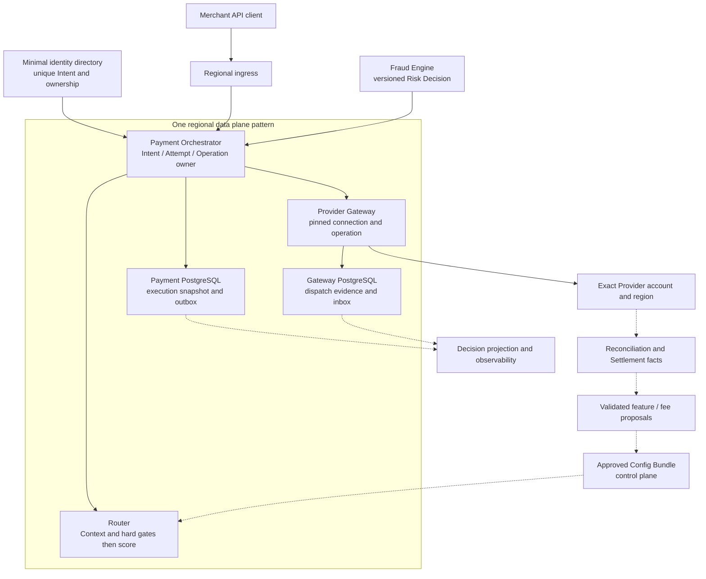
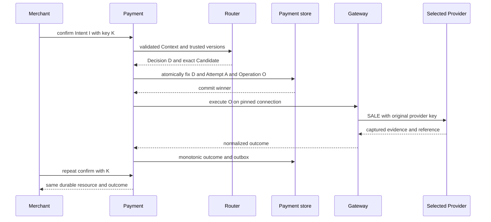
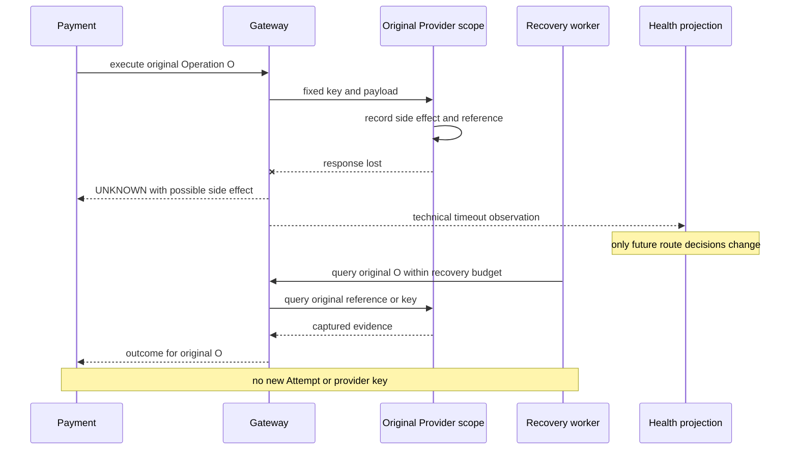
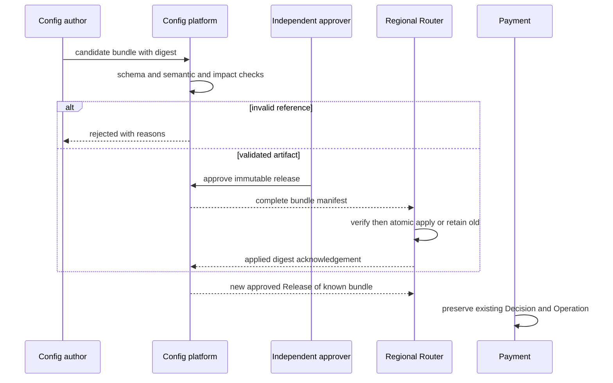
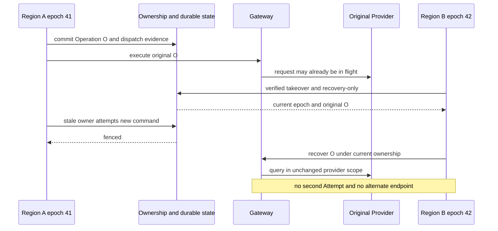

# 第 22 章 从零设计 Global Payment Routing Platform

Aurora 的业务计划里出现了一行新的目标：服务 10,000 个 Merchant，覆盖 50 个国家、30 种币种、20 种 Payment Method、15 家 PSP，承受 100k TPS 峰值。工程师很快画出三座 Region、几十个服务和一条粗大的事件总线，但评审者只问了四个问题：这里的 TPS 到底数什么？PSP 已扣款但响应丢失怎么办？错误配置发到一半怎么办？旧 Region 恢复后还能不能再扣一次？

一张拥有所有组件的大图，并不能回答这些问题。本章不再发明新的 Router、幂等机制或状态机，而是用同一组需求、容量预算和故障旅程，检验前 21 章能否组成一套边界一致的系统。

> **综合架构的价值，在于每个 SLO、容量假设、降级动作和数据所有者都可以被具体场景检验。100k TPS 是本案例的设计要求，不是配套仓库的实测结果；设计通过、代码通过、部署通过和 live-payment 上线通过，是四种不同证据。**

下面的生产设计承接前文合同，不表示相关增量已经全部实现。当前 Go 系统仍是 tokenized card、automatic-capture `SALE` 和本地 Simulator 的窄纵向切片，但 Router 已演进到 v3：Risk、Capability/Rule、版本化 Cost/Performance 与受约束 Scoring 形成一条可审计流水线；Payment 也已有持久 recovery deadline/budget/lease。Fallback successor、动态 Health、全书系统级 harness、配置控制面和全球 ownership 仍未实现。章节最后会把现有能力与目标能力逐项分开。

## 22.1 Problem：先定义系统要承担什么，才能谈规模

### 22.1.1 业务规模不是一个巨大的笛卡尔积

| 需求假设 | 本案例的解释 | 不能据此宣称 |
| --- | --- | --- |
| 10,000 Merchant | 身份、合同和流量隔离的规模 | 每个 Merchant 流量均匀 |
| 50 国家、30 币种 | 目标覆盖范围，由资格矩阵逐项开放 | 任意国家与币种组合都能处理 |
| 20 Payment Method | 多生命周期的长期接入目标 | 所有方式都支持同步 `SALE` 或相同 Fallback |
| 15 PSP | 商业接入数量 | 只有 15 个 Candidate，或每笔请求要调用 15 家 |
| 100k TPS 峰值 | 每秒到达且希望被接纳的 100,000 个新 Intent 业务目标 | 100k HTTP RPS、100k Capture/s 或持续整天此流量 |
| 三个 Region | 经批准的地域部署与容灾目标 | 同一个 Intent 在三地同时有写权限 |

一个 PSP 可能对应多个 Merchant Account、Connector、Region 和不可变 connection revision。合法路径是稀疏矩阵，由[第 6 章](../part-2-routing-engine/provider-eligibility.md)的 Eligibility 决定；增加支付方式必须补齐其 Adapter、认证、最终性与恢复契约，不能只扩展一个 enum。

容量先选择一个可计算切片：假设峰值期间主要是 automatic-capture card，每个新 Intent 通常对应一次首次选路；其他 Payment Method 以独立 workload class 建模后相加。还要提供峰值持续时间、突发斜率、最大 Merchant 占比、地域分布、金额分布和重复请求比例。把总量平均除以 10,000，会掩盖单一 Merchant 热点与同 key 竞争。

### 22.1.2 SLO 必须绑定观察边界

| 合同项 | 示例目标，均待目标环境验证 | 责任与限制 |
| --- | --- | --- |
| Router 服务 | 合法请求月度履约率 99.99%，p99 决策延迟不超过 20 ms | 包含明确 no-candidate 结果；不等于授权批准率 |
| Confirm 首次响应 | p99 在 1.5 s 内给出最终结果或已持久化的 processing 资源 | 202 不代表 Capture 成功，不用等待伪装成失败 |
| UNKNOWN 收敛 | Provider 查询恢复可用后，95% 目标在 5 min 内获得确定结果 | 不确定者继续恢复或 review，不能为达标改成 failed |
| Decision 投影 | 正常运行时投影 lag 目标不超过 60 s | 本地执行快照必须先持久化；远端投影可以延迟 |
| 区域故障 | 在批准的故障模型内保留外发前执行证据 | RPO/RTO 由证据和演练定义，不由 DNS 健康决定 |
| 资金正确性 | 非预期重复资金路径为零，身份和金额约束必须成立 | 正确性不作为可用性错误预算消耗 |

这些数字是评审输入，不是对任何 Provider 或当前实现的服务承诺。业务拒绝、请求无效、技术故障、UNKNOWN 与尚未成熟的经济结果要使用[第 15 章](../part-4-operating-at-scale/observability.md)的不同分母。尤其不能通过不统计超时、只统计已 dispatch 请求或删除迟到结果，让 SLO 看起来更好。

本案例的非目标也要写在第一页：不设计 Card Network 内部路由，不自建 Ledger/Payout，不重做 Fraud Engine，不实现自治强化学习，不默认跨境复制敏感数据，也不以 Simulator 替代 PSP certification 或真实资金上线评审。

## 22.2 Simple Design：保留那个最容易证明正确的起点

从零建设时，第一阶段仍应是一个逻辑 Region、少量 connection、静态 Policy、真实 PostgreSQL，以及 Payment、Router、Gateway 三个清楚的数据所有者。Router 可以独立部署，但没有 Provider 凭证；Payment 创建 Intent/Attempt/Operation；Gateway 只执行已经固定的 connection。进程数量不是架构成熟度。配套仓库已经越过这个历史起点进入 v3 受约束评分，但本章保留该起点，是为了说明每一层复杂度必须由证据推动，而不是把当前代码倒退成静态 Router。

这个版本先证明商户幂等、明确拒绝、响应丢失后的 UNKNOWN、原 Operation 查询和重复事件收敛。没有这些证据，增加 Provider 只会增加不确定路径。数据库也不必为了将来的 100k TPS 立即换成另一套模型：先测清事务、锁、索引、WAL、连接池和恢复路径，再按已定义的 Merchant/Intent 所有权分区扩展。

| 演进阶段 | 迫使它出现的压力 | 增加的能力 | 可以暂不增加的东西 |
| --- | --- | --- | --- |
| 0：安全收款切片 | 先完成并解释一笔支付 | 第 1～3、10～11 章的身份、执行与恢复 | 多目标评分、全球多活 |
| 1：可解释选路 | 多账户能力和商户策略开始分化 | 第 4～9 章的 Context、资格、规则和 typed features | ML、实时大数据平台 |
| 2：可靠运营 | 故障扩散、历史不可解释、反馈迟到 | 第 12～18 章的受限 Fallback、Health、证据和经济反馈 | 自动让所有异常资金流转 |
| 3：多区域与治理 | 地域延迟、容灾、多人发布配置 | 第 19～20 章的单 Intent owner、fencing、完整 bundle | 同一 Intent 全球任意写入 |
| 4：可选优化 | 可靠数据证明确有可改善空间 | 第 21 章的可替换 ModelScorer | 没有 propensity 的因果承诺 |

阶段并不靠流量跨过某个整数自动升级。比如控制平面审批可能在很小的规模就必要，而模型在很大规模仍未必值得引入。每一步的进入条件都是可观察的痛点和对应失败测试，不是“同行都用了”。

## 22.3 Problems at Scale：一次业务支付会放大成多少工作

### 22.3.1 把 API、Operation 与恢复请求分开计量

以下系数全部是假设，必须用实际流量校准。令能形成首次 Route Plan 的新 Intent 需求为 `λ=100,000/s`；每个 Intent 平均 2.2 次商户 API 请求，包含创建、确认与重复/查询；每个 Intent 平均新增 0.03 个合法 Fallback Attempt。本版预算限制每个 Intent 至多一次合法 Fallback，本切片每个 Attempt 一个 `SALE`，因此逻辑 Operation 需求为 `A=λ×1.03=103,000/s`。本算例另假设每个成功创建的 Fallback 恰好经过一次 guardrail-only revalidation；生产报告必须把被 veto 后没有创建 Attempt 的检查也计入，不能从 Operation 数反推。

完整 Router evaluation 不能再直接写成 `A`。首个 Attempt 需要一次求值；获准但尚未固定 Attempt 的路由重试、返回 `no_candidate` 的额外求值和 shadow 分别计为 `R_retry`、`R_no_candidate`、`R_shadow`，所以 `R=λ+R_retry+R_no_candidate+R_shadow`。Router 首次返回不可变 `RoutePlanDecision`，其中固定 candidate order、版本、预算和有效期；Fallback 不生成新 Plan。Payment 刷新 Risk 后，把 Plan 中固定的下一 Candidate 交给 Router-owned `RevalidatePlanCandidate` 做 guardrail-only 检查：它只能 allow 或 veto，不能增加 Candidate、重排、重评分或延长 Plan；Plan/guardrail 过期或检查不可用都必须 Stop。获准时，Payment 再写自己的不可变 `FallbackExecutionBinding`，关联原 Plan、前序 Attempt、固定 successor、Risk/guardrail 证据和剩余预算；它不是 Router Decision。因而 Fallback 不增加完整 `R`，但会增加单列的 `G_fallback` guardrail 工作；本例取 `G_fallback=λ×0.03=3,000/s`。

再假设每个 Operation 平均增加 0.01 次同 key 重送，5% 进入需要查询的 UNKNOWN，每个 UNKNOWN 平均查询三次。这些系数是受控恢复后的期望次数，不是允许重试的规则；资金安全闸门仍来自第 10～12 章。

| 工作类别 | 公式 | 本例需求 |
| --- | --- | ---: |
| Merchant API | `λ × 2.2` | 220,000 requests/s |
| 逻辑 SALE Operation | `A = λ × (1 + 0.03)` | 103,000 operations/s |
| Router evaluation | `R = λ + R_retry + R_no_candidate + R_shadow` | 至少 100,000 evaluations/s；三项增量单列 |
| Fallback guardrail revalidation | `G_fallback = λ × 0.03`（本例假设） | 3,000 checks/s；被 veto 的额外检查另计 |
| 外部 execute 请求 | `A × (1 + 0.01)` | 104,030 calls/s |
| 外部 recovery query | `A × 0.05 × 3` | 15,450 calls/s |
| 总 Provider 出站调用 | execute + query | 119,480 calls/s |
| 入站 webhook | 假设每 Operation 平均 1.1 个事件 | 113,300 events/s |

这些量不能互相冒充，也不能全部简单加成一个“系统 TPS”。API replay 会消耗鉴权和数据库读取，却不能新增资金操作；Query 消耗 Provider 配额，却不是第二次支付；webhook 还会放大 inbox、outbox 和结果投影。manual Capture、Refund、对账扫描与其他支付方式不在这个数字中，加入它们需要另外的 workload 行。

这里的 `λ` 是本次 selected-SALE 容量切片；额外 `no_candidate` 求值若来自切片外的新请求，也必须同时加回 Merchant API offered load，不能只给 Router 加一个漂亮的孤立数字。需求包含非 2xx 和超时请求，不能用成功响应数反推输入。完整 Router evaluation、guardrail-only revalidation 与 Operation 已经明确分开：`no_candidate`、创建 Attempt 前获准的路由重试或 shadow 会增加完整求值，却不产生 Provider Operation；固定 Plan 中的 Fallback Attempt 增加 Operation 并至少经过一次安全检查，却不重新评分或生成 Plan。三者都不能由另一者倒推。

平均 fan-out 只适合预算起点。某条 connection 故障时，UNKNOWN、查询次数和延迟会一起上升，形成相关的突发压力。恢复服务必须有共享预算、退避、per-connection bulkhead 和期限，不能依赖“只有 5%”保护系统。Stripe 官方文档将 account/endpoint 速率限制与并发限制分开；所以全平台聚合预算通过后，每个真实账户和端点仍需单独验算与获得相应配额。[Stripe Rate Limits](https://docs.stripe.com/rate-limits)

### 22.3.2 三个 Region 不是三份可以随时互借的容量

先做最乐观的均衡算术：119,480 calls/s 平摊三地，每地约 39,827；失去一地后，剩余两地各承担 59,740。若运行利用率上限取 65%，每个剩余地区的可验证容量至少应为 `59,740 / 0.65 ≈ 91,908 calls/s`。

如果评审表中填写的单区容量假设只有 85,000 calls/s，故障后利用率约为 70.28%，已经不满足 65% 预算，尽管还没到名义极限。这里的 85,000 也是演示输入，不是本机或配套系统的测量结果。

真实情况通常比均分更严格：部分数据不能跨区，某个 Merchant 的合格 connection 只在原地区，Provider 账户配额也未必随计算实例迁移。[第 19 章](../part-5-global-routing/multi-region.md)还要求先证明唯一 owner 与完整执行证据。剩余 CPU 有空闲，不能授予旧 UNKNOWN 一条新的 Provider 路径；算术余量只是必要条件。

### 22.3.3 Go：让假设和单位一起进入容量模型

下面函数只计算当前 card `SALE` 切片，不调用服务，也不批准上线。所有速率单位都显式命名；浮点数用于容量估算，不用于金额、费率结算或资金身份。最后的布尔值只表示均衡算术是否满足给定上限。

```go
package capacityplan

import (
	"errors"
	"math"
)

type Input struct {
	NewIntentsPS                  float64
	MerchantRequestsPerIntent     float64
	FallbackAttemptsPerIntent     float64
	FallbackGuardrailChecksPerIntent float64
	AuthorizedRouteRetriesPerIntent float64
	NoCandidateEvaluationsPerIntent float64
	ShadowEvaluationsPerIntent      float64
	SameKeyResubmitsPerOperation  float64
	UnknownFraction               float64
	QueriesPerUnknown             float64
	WebhookEventsPerOperation     float64
	ProviderMeanSeconds           float64
	DecisionBytes                 float64
	OutboxOutageSeconds           float64
	CatchupSeconds                float64
	GatewayCallsCapacityPerRegion float64
	TargetUtilization             float64
	Regions                       int
	LostRegions                   int
}

type Plan struct {
	ModelVersion                   string
	MerchantRequestsPS             float64
	LogicalOperationsPS            float64
	RouterEvaluationsPS            float64
	GuardrailRevalidationsPS        float64
	ExecuteCallsPS                 float64
	QueryCallsPS                   float64
	ProviderCallsPS                float64
	WebhookEventsPS                float64
	CallsPerSurvivingRegionPS      float64
	MinimumCapacityPerRegionPS     float64
	PostLossUtilization            float64
	MeanInflightPerSurvivingRegion float64
	RouterEvaluationBytesPS        float64
	DecisionBytesPS                float64
	BacklogEvents                  float64
	RequiredProjectorEventsPS      float64
	WithinArithmeticBudget         bool
}

func Calculate(input Input) (Plan, error) {
	values := []float64{
		input.NewIntentsPS, input.MerchantRequestsPerIntent,
		input.FallbackAttemptsPerIntent, input.AuthorizedRouteRetriesPerIntent,
		input.FallbackGuardrailChecksPerIntent,
		input.NoCandidateEvaluationsPerIntent, input.ShadowEvaluationsPerIntent,
		input.SameKeyResubmitsPerOperation,
		input.UnknownFraction, input.QueriesPerUnknown, input.WebhookEventsPerOperation,
		input.ProviderMeanSeconds, input.DecisionBytes, input.OutboxOutageSeconds,
		input.CatchupSeconds, input.GatewayCallsCapacityPerRegion, input.TargetUtilization,
	}
	for _, value := range values {
		if math.IsNaN(value) || math.IsInf(value, 0) || value < 0 {
			return Plan{}, errors.New("capacity inputs must be finite and nonnegative")
		}
	}
	if input.NewIntentsPS == 0 || input.MerchantRequestsPerIntent < 1 ||
		input.FallbackAttemptsPerIntent > 1 || input.UnknownFraction > 1 ||
		input.FallbackGuardrailChecksPerIntent < input.FallbackAttemptsPerIntent ||
		input.ProviderMeanSeconds == 0 || input.DecisionBytes == 0 ||
		input.CatchupSeconds == 0 || input.GatewayCallsCapacityPerRegion == 0 ||
		input.TargetUtilization <= 0 || input.TargetUtilization >= 1 ||
		input.Regions <= 0 || input.LostRegions < 0 || input.LostRegions >= input.Regions {
		return Plan{}, errors.New("invalid capacity assumptions")
	}
	operations := input.NewIntentsPS * (1 + input.FallbackAttemptsPerIntent)
	routerEvaluations := input.NewIntentsPS * (1 + input.AuthorizedRouteRetriesPerIntent +
		input.NoCandidateEvaluationsPerIntent + input.ShadowEvaluationsPerIntent)
	guardrailRevalidations := input.NewIntentsPS * input.FallbackGuardrailChecksPerIntent
	execute := operations * (1 + input.SameKeyResubmitsPerOperation)
	queries := operations * input.UnknownFraction * input.QueriesPerUnknown
	provider := execute + queries
	survivors := float64(input.Regions - input.LostRegions)
	perRegion := provider / survivors
	backlog := operations * input.OutboxOutageSeconds
	plan := Plan{
		ModelVersion:                   "card-sale-capacity-v1",
		MerchantRequestsPS:             input.NewIntentsPS * input.MerchantRequestsPerIntent,
		LogicalOperationsPS:            operations,
		RouterEvaluationsPS:            routerEvaluations,
		GuardrailRevalidationsPS:        guardrailRevalidations,
		ExecuteCallsPS:                 execute,
		QueryCallsPS:                   queries,
		ProviderCallsPS:                provider,
		WebhookEventsPS:                operations * input.WebhookEventsPerOperation,
		CallsPerSurvivingRegionPS:      perRegion,
		MinimumCapacityPerRegionPS:     math.Ceil(perRegion / input.TargetUtilization),
		PostLossUtilization:            perRegion / input.GatewayCallsCapacityPerRegion,
		MeanInflightPerSurvivingRegion: perRegion * input.ProviderMeanSeconds,
		RouterEvaluationBytesPS:        routerEvaluations * input.DecisionBytes,
		DecisionBytesPS:                operations * input.DecisionBytes,
		BacklogEvents:                  backlog,
		RequiredProjectorEventsPS:      operations + backlog/input.CatchupSeconds,
	}
	outputs := []float64{
		plan.MerchantRequestsPS, operations, routerEvaluations, guardrailRevalidations, execute, queries, provider,
		plan.WebhookEventsPS, perRegion, plan.MinimumCapacityPerRegionPS,
		plan.PostLossUtilization, plan.MeanInflightPerSurvivingRegion,
		plan.RouterEvaluationBytesPS, plan.DecisionBytesPS, backlog, plan.RequiredProjectorEventsPS,
	}
	for _, value := range outputs {
		if math.IsNaN(value) || math.IsInf(value, 0) {
			return Plan{}, errors.New("capacity calculation overflow")
		}
	}
	plan.WithinArithmeticBudget = plan.PostLossUtilization <= input.TargetUtilization
	return plan, nil
}
```

输入上一节的系数，并在这次算例中显式令三类额外完整 Router evaluation 为零、令 guardrail-only revalidation 为 3,000 checks/s，再令平均 Provider 调用耗时为 0.25 s、每份路由证据为 2 KiB、投影停机 600 s、希望 3,600 s 追平，模型给出：Router evaluation 输出约 204.8 MB/s；若每个 Fallback Operation 仍保存同一固定 Route Plan 的执行快照，则 Operation 侧路由证据约 210.944 MB/s；失区后每区平均在途约 14,935；停机积压 6,180 万条，追平期间 projector 至少处理约 120,167 events/s。两种字节率故意分开：复制既有 Plan 作为新 Attempt 的审计证据，不等于重新执行 Router。guardrail checks 的 CPU、缓存与 RPC 预算也必须单列，本教学模型只输出其速率，不把它折算成完整 evaluation bytes。这些仍是假设计算，未含索引、WAL、副本、消息封装和其他事件。

在稳定且均值存在等条件下，平均在途可用 `L=λW` 理解；Little 的原始论文讨论了这一关系及成立条件。[Little, A Proof for the Queuing Formula](https://pubsonline.informs.org/doi/10.1287/opre.9.3.383) 这里的 W 是包含 execute/query 混合的相应平均耗时，不是 p99；该公式不证明尾延迟，也不意味着创建同样数量的 goroutine 就有相应容量。

按本例持续峰值一小时，仅每 Operation 2 KiB 的路由执行快照就约 759.4 GB。峰值持续时间、压缩率、留存和分区策略因此必须回到第 14 章的证据设计，不能把平均 QPS 乘一天再当真实日流量。Outbox 也不是无限缓冲：追平能力必须高于新流入；本地存储逼近安全水位时限制新 admission，不能跳过执行证据后继续外发。

### 22.3.4 数据库预算不能从 HTTP TPS 直接换算

Payment 创建、幂等 claim、prepare、发送状态、outcome、inbox/outbox 各自带来事务和索引工作；Gateway 还有独立的执行记录。应测量每类业务操作的 transaction count、写入字节、锁等待和 WAL，再按 workload 组合。数据库 TPS、磁盘 IOPS、网络 RPS 与支付完成率不是可互换的单位。

同 Merchant 热点、重复 confirm、迟到 webhook 和 recovery 扫描应进入压力分布。分区后必须保留第 11、19 章的唯一身份与 owner 仲裁，不能为了提高并发把同一 Intent 的幂等记录复制成多个独立真相。只读缓存可以加速，不能让缓存 miss 决定是否再发一笔资金操作。

## 22.4 Production Design：一张图只画已经解释过的责任



各 Region 复用图中的数据平面模式，不是复制一份相互独立的扣款权。Home/Execution Region、Provider Region 和 owner epoch 沿第 19 章处理；全局目录只保存批准的最小身份，不放完整请求或支付凭证。Ledger、Payout、Vault 与 Fraud 的原始数据继续在各自边界，本图没有把它们吞进 Router。

在线流水线仍固定为 `Context validation → Eligibility → Rule guardrail → Risk contract → Feature lookup → Score → Stable selection`。完整 bundle、Capability 与允许的 Feature snapshot 尽量区域内读取；一个请求固定一次版本，不能在循环中先后拼出不同版本。Candidate 数量增加主要扩大本地求值工作，不意味着向所有 PSP 发探测或资金请求。

该流水线生成 Router-authored、不可变的 `RoutePlanDecision`，固定 candidate order、版本、最大 Attempt、风险边界和有效期。后续只有在前一 Attempt 已证明无副作用、policy 明确允许且预算仍有效时，Payment 才能提交 Plan 中固定的下一 Candidate；它刷新 Risk，并调用 Router-owned guardrail-only revalidation。这个检查只能 veto，不能增加 Candidate、重排或重新评分；Plan/guardrail 过期、证据不完整或检查不可用一律 Stop。获准后 Payment 写 `FallbackExecutionBinding`，引用原 Plan、前序 Attempt、固定 successor 与本次 Risk/guardrail 证据，它不冒充第二个 Router Decision。

Stop 与 review 也不是同义词。没有下一 Candidate、Plan 过期或 guardrail veto/不可用时，停止新增副作用并返回明确领域结果；只有已有资金事实互相冲突、执行身份/证据完整性冲突，或 UNKNOWN 在恢复预算耗尽后仍无法裁决时，才进入人工 review。不得因为“想再试一个 Provider”把普通 Stop 升级成 review，更不能借 review 绕过原 Plan。

Payment 验证返回的 selected Candidate、connection revision 与 Decision hash，在创建 Attempt/Operation 的同一事务中封存执行快照和 outbox，提交后才允许 Gateway 外发。远端 Decision Store、报表和分析后端不在这个同步提交链上；但本地事务失败时必须停止，不能把“异步投影可延迟”误解成“执行前证据也可以稍后补”。

### 22.4.1 Deadline 与降级是同一份执行合同

本案例可先把 1.5 s 首次响应预算划成接入/持久化、Router、Provider 等子预算，例如为 Provider 首次等待最多保留 800 ms，同时留出排队和返回余量。这是逐请求 deadline 约束，不是把各服务 p99 简单相加。Go 的 `http.Client.Timeout` 覆盖连接、重定向及读取响应等阶段；取消本地等待不能撤回已到达 Provider 的请求。[Go HTTP Client](https://pkg.go.dev/net/http#Client)

| 失去的依赖或预算 | 允许的降级 | 不允许的捷径 |
| --- | --- | --- |
| 可选 Model/Performance feature | 使用已验证、仍有效的完整 rule/static profile，并记录原因 | 把缺值当零，或重新解释旧 Decision |
| 必需 Capability/Risk 事实 | fail explicit，停止新路由或进入明确 action/review | 用较高分数补偿未知资格 |
| 控制平面 | 使用仍有效的完整 last-known-good bundle | 拼接半套新版，在线请求临时补取所有制品 |
| Provider `SALE` 超时 | 当前 Operation 进入 UNKNOWN，沿原身份恢复 | 将当前支付切到健康的另一条 connection |
| Provider 局部故障 | Health 约束未来新路由，bulkhead 限制该故障域 | 将所有 issuer decline 变成全局熔断 |
| Outbox/恢复积压 | 给既有操作保留恢复预算，限制新 admission，停止额外实验暴露 | 删除事实、重置 UNKNOWN age 或无限扩大队列 |

降级顺序不是按服务重要性随意排序。它首先保护已发生或可能发生的资金操作，再减少可选优化工作，最后按批准的容量与公平性策略拒绝新工作。优化开关可以回滚，原 operation、key、payload 和 connection 不能回滚成另一个身份。

## 22.5 Failure Modes：四条端到端验收旅程

下面四条旅程包含一条正常/重复投递基线和三条系统故障。它们不重复设计前文机制，而是检查责任交接的缝隙。每条旅程同时保留 API 结果、领域快照、Gateway 调用记录、版本与观测证据；只断言最终 `succeeded` 不够。

### 旅程一：正常支付成功，重复 confirm 不新增工作

Aurora 创建一笔 129.00 USD 的 Intent。Context 只含获准事实；中央 Risk 返回有效 `ALLOW`；Eligibility 先排除不可执行连接。Router 选择 `cand_us_a`，Payment 固定 Decision 与唯一 Operation，Gateway 在对应账户执行 `SALE`。最终成功证据包括原 reference 和 Capture 金额，不包括“资金已经银行到账”的推断。



验收必须检查相同 key、不同 payload 返回冲突；重复 confirm 返回相同资源；重复 webhook 不重复应用。没有 Fallback 时只有一个 Attempt、一个逻辑 Payment Operation 和一个 Gateway 执行副本。Decision 投影暂不可用时，本地证据仍在；之后按 ID+hash 补齐，不能重算当时选择。

该旅程对应现有 `test/e2e/payment_flow_test.go` 中 approved/idempotency 基线；当前 Payment 还会原子保存 v3 Context/Decision、Risk/Optimization、candidate order 与 `executable_until`，并用共享 golden contract 防止 Router/Payment 漂移。远端 Decision projector 与投影停机补送仍需配套增量，所以现有测试覆盖执行快照，不等于图中的全部生产设计已经运行。

### 旅程二：Provider 已成功，响应丢失与恢复风暴同时出现

故障注入点必须位于 Provider 落下副作用之后、Gateway 获得结果之前。只让 Simulator 在调用前报错，证明不了 UNKNOWN 安全性。此时 API 在预算内返回 processing，重启 Payment worker，再注入 webhook 重投与 Query 延迟。



验收不仅看收敛，还看恢复期间的 Attempt/Operation 数、connection/revision/namespace、Provider key 与 request hash 全部保持原值。5% 故障负载下，query 计入真实出站速率，其他连接不被共享池拖死。当前代码已经持久化 24 小时本地 SALE recovery deadline、32 次初始调用预算、claim generation/lease、动作与结构化 absence evidence；每次领取原子扣减预算，deadline 和预算不可重置。它们是仓库的本地 Simulator 策略，不是生产 PSP 保留期承诺。Query 继续失败或预算耗尽时进入复核，不把 UNKNOWN 改成失败以触发 Fallback。

Provider 幂等不能跨账户或地区想当然地成立。Adyen 官方文档明确说明多区域端点不会跨地区检查重复，所以平台恢复地区改变时，原 Provider scope 仍必须固定。[Adyen API Idempotency](https://docs.adyen.com/development-resources/api-idempotency/) Capture、Void、Refund 也继续绑定原 connection 和 transaction reference，不重新调用 Router。

### 旅程三：坏配置被拒绝，合法但退化的配置能够回滚

先提交一个引用不存在 Capability version 的 bundle：validator 必须拒绝它进入 Approved，所有地区继续使用完整旧版。再选择一份语义合法但表现不佳的制品，在获准 canary 中注入故障；检查停止新暴露、回滚授权和区域 ack，而不是直接修改线上费率行。回滚创建新的 Release 来引用已验证的旧 Bundle，仍保留当前有效的紧急禁用与硬约束，不复活已经撤销的 route。



这里要刻意断开下载、打乱制品到达顺序、重启 watcher。每个 Router 要么使用完整旧版，要么使用完整新版，Decision 能指出实际版本；作者不能自批，控制平面断线不使有效的 last-known-good 消失。已 dispatch 的 Operation 不因回滚改路，已分配实验的 Intent 不改 variant；shadow 即使选中另一 Candidate，也没有 Gateway Operation。

Configuration Platform、稳定 assignment 与 ModelScorer 的设计分别来自[第 20 章](../part-5-global-routing/configuration-platform.md)、[第 16 章](../part-4-operating-at-scale/experimentation.md)与[第 21 章](../part-5-global-routing/intelligent-routing.md)。当前代码没有完整发布/回滚链，本旅程必须标为待实现的系统验收，不能用静态 JSON 启动成功替代。

### 旅程四：Region 失联，旧 owner 复活仍没有新扣款权

Region A 在 epoch 41 下持久化并可能发送了 Operation O，随后被隔离。Region B 收到同商户 key，先找到原 Intent，不能因为本地副本未命中就新建。只有旧执行路径被可靠 fencing、恢复证据和容量通过后，才能在权威事务中推进 epoch，进入 `recovery_only`。



最关键的断言不是“B 的健康检查变绿”，而是旧 A 恢复后无法再创建或外发新的获权命令；A 已在途的字节无法收回，因此 B 仍按原 Operation 恢复。若恢复库缺失外发记录，或原 Provider scope 无法访问，就隔离相关 Intent，不能生成一个新的 SALE。

PostgreSQL 官方文档区分异步复制的数据丢失窗口与同步确认等待，因此“有备库”不是完整执行证据已经安全的证明。[PostgreSQL Standby and Replication](https://www.postgresql.org/docs/current/warm-standby.html) 在本例 85k calls/s 的单区容量假设下，剩余地区还不满足 65% 运行上限；即便 fencing 正确，也不能直接放开全部新流量。Failback 同样需要更高 epoch 与受控交接，不允许旧主自动抢回权力。

### 22.5.5 压测报告必须把没服务好的流量带回来

每条旅程都应在 steady state、慢 Provider、冷缓存/缺依赖和 Region loss 条件下执行。负载发生器记录 offered、started、completed、schedule lag、timeout、取消与未发送工作；系统变慢时，客户端不能因为等待前一请求而自动减少到达量，再把较低吞吐报告为稳定容量。

HTTP 层保留各状态码与 transport error，业务层另列成功、明确拒绝、processing/UNKNOWN 和 review。ApacheBench 官方输出把 `Failed requests` 与 `Non-2xx responses` 分开，前者为零不代表没有 HTTP 502；同样，200 中的 decline 与 202 中的 UNKNOWN 也不是 Capture 成功。[ApacheBench Output](https://httpd.apache.org/docs/2.4/programs/ab.html)

数据库压测还要保留 scheduled start 到实际完成的等待。PostgreSQL `pgbench` 的 rate/latency-limit 文档显式区分 schedule lag、late 与 skipped transaction；被跳过的负载不能从需求中消失，数据库基准也不能冒充整条支付链的容量。[PostgreSQL pgbench](https://www.postgresql.org/docs/current/pgbench.html)

| 报告维度 | 至少提交的证据 |
| --- | --- |
| 场景与版本 | workload/seed、duration、故障时间线、代码 SHA、bundle digest、环境拓扑 |
| 流量与响应 | offered/started/completed、各 HTTP code、transport failure、业务 outcome |
| 延迟与资源 | 分阶段 p50/p95/p99、排队、CPU/内存/GC、连接池、锁/WAL/网络 |
| 恢复与证据 | query/resubmit/fallback 次数、UNKNOWN age、outbox age/depth、projection watermark |
| 资金不变量 | Attempt/Operation 基数、固定身份、冲突与重复副作用检查 |
| 故障余量 | 剩余 Region 和每 connection 配额、恢复追平速率、admission 决策 |

压测流量只能进入明确的测试环境。Provider Simulator 可用于确定性故障注入，真实 PSP sandbox 用于接口语义验证；两者都不自动代表 live 延迟或容量，更不能未经批准向真实资金端点发 100k TPS。只有目标环境、真实限额与经批准的上线演练，才能支持相应生产声明。

## 22.6 Trade-offs、Owners 与实际交付边界

### 22.6.1 谁能按下哪个按钮

| Owner | 拥有的决策或事实 | 事故中不能越过的边界 |
| --- | --- | --- |
| Payment 团队 | Intent/Attempt/Operation、幂等、状态迁移和恢复 | 不把 UNKNOWN 猜成 failed |
| Router 团队 | Context 契约消费、Eligibility/Rule/Score 与解释 | 不执行资金，不修改 Fraud 判断 |
| Gateway/Connector 团队 | 外部执行、reference、凭证与 Provider 契约 | 不暗中更换账户、区域或 key |
| Config/Risk 批准者 | 发布制品或风险合同 | 分数、实验和 break-glass 不突破硬约束 |
| SRE/值班负责人 | admission、资源、隔离和批准的 failover 步骤 | DNS、进程存活或低 CPU 不授予资金写权限 |
| Reconciliation/Settlement | 外部证据、Difference、费用归因与校准建议 | 不直接改 Payment 终态，不自动 Ledger 调账 |
| 安全与财务负责人 | 数据用途、凭证边界、上线风险与会计处理 | 不把 Tokenization 或教学实现当认证证明 |

统一事故指挥不等于统一数据库超级账号。跨团队操作通过有原因、身份和版本的命令完成；停止新 admission 与恢复原 UNKNOWN 可以由不同预算并行推进。Runbook 必须写明触发条件、owner、证据、回滚和失败出口，而不是留一句“联系相关同学”。

主要取舍也由这些边界决定。更严格的跨区确认提高恢复证据完整性，却增加写入延迟与仲裁依赖；本地单写保留简单状态语义，却需要归属转发。小比例实验限制潜在损失，但样本成熟慢，不能证明全量容量。多存 Decision 便于解释，却增加存储和数据管理成本；无论怎样优化，都不能用丢弃关键证据购买吞吐。

### 22.6.2 配套仓库目前完成了什么

| 能力 | 当前代码事实 | 本章不能代替的后续证据 |
| --- | --- | --- |
| 支付纵向链 | Payment、Router、Gateway、Simulator，真实 PostgreSQL；初始操作为单个 `SALE` | 真实 PSP sandbox/live Connector、认证与运营 |
| 路由 | v3 `routing_context.v2`、Risk、Capability/Rule、版本化 Cost/Performance、受约束 Scoring、稳定 candidate order 与执行截止点 | 生产 Artifact 来源、动态 Health、Fallback executor、真实数据校准 |
| 可靠性 | 商户幂等、inbox/outbox、追加式 Provider observation、UNKNOWN 原操作恢复、持久 deadline/budget/lease、first-dispatch marker 与冲突隔离 | 从固定 Plan 创建受限 successor Attempt、生产 Provider recovery contract 与跨连接 Health |
| 系统回归 | 单元/race/真实 PostgreSQL/Compose E2E 覆盖 approved、declined、response loss、重复 confirm 与单资金路径 | 本章统一 `test/system`、坏配置、owner failover 和故障负载组合 |
| 运营反馈 | 本地完整 Context/Decision/Risk/Optimization snapshot 和 Gateway observation ledger | telemetry、experiment、远端 Decision projector、独立 reconciliation/settlement |
| 全球运行 | connection 已有 region 身份 | Intent ownership、fencing、真实跨区恢复和驻留评审 |
| 容量与上线 | 尚无本章 `test/system`、`tools/capacity-plan` 全链工具 | 可复现容量报告、100k TPS 证据、Go/No-Go 签核 |

因此，正确结论是“有一个具备重要支付安全边界的可运行起点”，不是“已经拥有覆盖 15 PSP、20 支付方式的全球真钱平台”。代码文件存在、单测通过或 Compose 启动，都不能把未实现行自动变成已实现。

本章的工程增量不增加新的业务抽象：把四条旅程编排到 `test/system`，复用现有故障注入，增加标准库容量模型 CLI，并让 Makefile/CI 输出版本化结果。[附录 C](../appendices/capacity-planning-and-launch-checklist.md)复用这份证据，不再创建第二套压测体系；状态与安全核查分别对照[附录 A](../appendices/payment-state-models.md)、[附录 B](../appendices/security-compliance.md)。这些工具仍是未实现边界；本章固定代码基线与逐项证据记录在[交付说明](../deliveries/chapter-22-global-payment-routing-platform.md)中。

上线门禁应分别回答代码/契约/真实数据库是否通过，四条旅程是否满足不变量，吞吐与故障余量是否实测，真实 Provider 与安全运营是否获准。缺任一必要证据就是未通过；本章的算术函数、结构图和教学 Simulator 都不具有豁免权。

## 22.7 Summary：用故障证明边界，用证据证明规模

我们从单区域、静态路由和一条 `SALE` 的历史起点出发，走到当前 v3 受约束评分与持久 recovery 基线，再沿业务差异、运行故障、反馈延迟与全球所有权逐步组合前文机制。最终方案的关键不是组件齐全，而是每条链路仍保留同一套规则：

1. 先定义业务单位、SLO、负载分布与非目标；100k TPS 是需要验证的需求，不是现有容量结论。
2. Eligibility/Risk 先于软评分，Router 决策、Payment 拥有资金状态、Gateway 固定执行连接。
3. 容量包含 API、Operation、query/resubmit/fallback、事件、存储和故障剩余余量，不能只报成功 RPS。
4. 正常重复、响应丢失、错误配置和区域故障四条旅程必须同时守住身份、证据与所有权。
5. 配置、实验或模型可以改变未来选择，不能重写旧 Decision，也不能移动 UNKNOWN 或 Capture/Void/Refund 的原路径。
6. Reconciliation 纠正认知，Settlement 建立经济归因，Ledger 与资金执行仍各有权威边界。
7. 设计、代码、测试环境与 live readiness 分层交付；没有证据的能力保持未完成，而不是被一张全球架构图隐藏。

这也是全书希望留下的工程习惯：每次让支付系统变得更聪明、更快或更全球化之前，先确认它仍然知道自己已经做过什么、现在有权做什么，以及哪些事情还不能确定。
