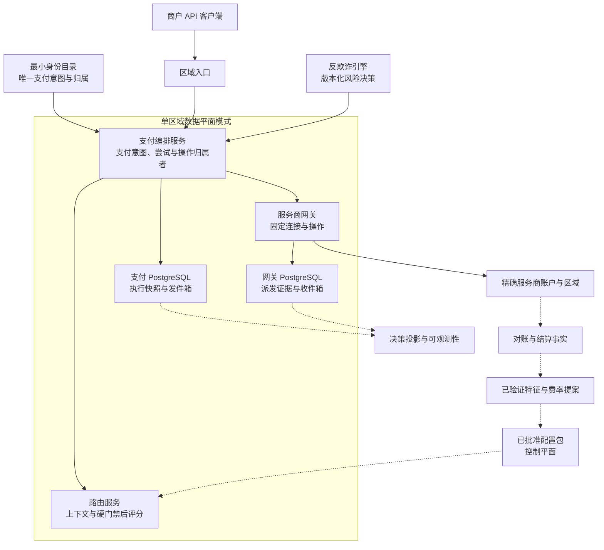
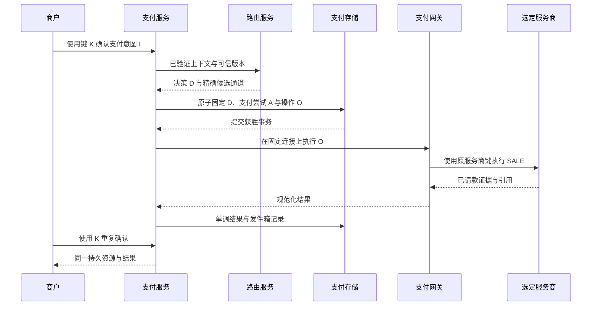
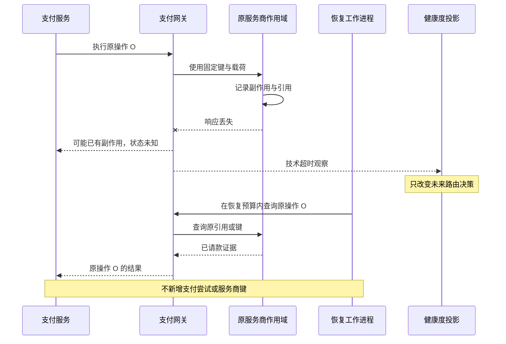
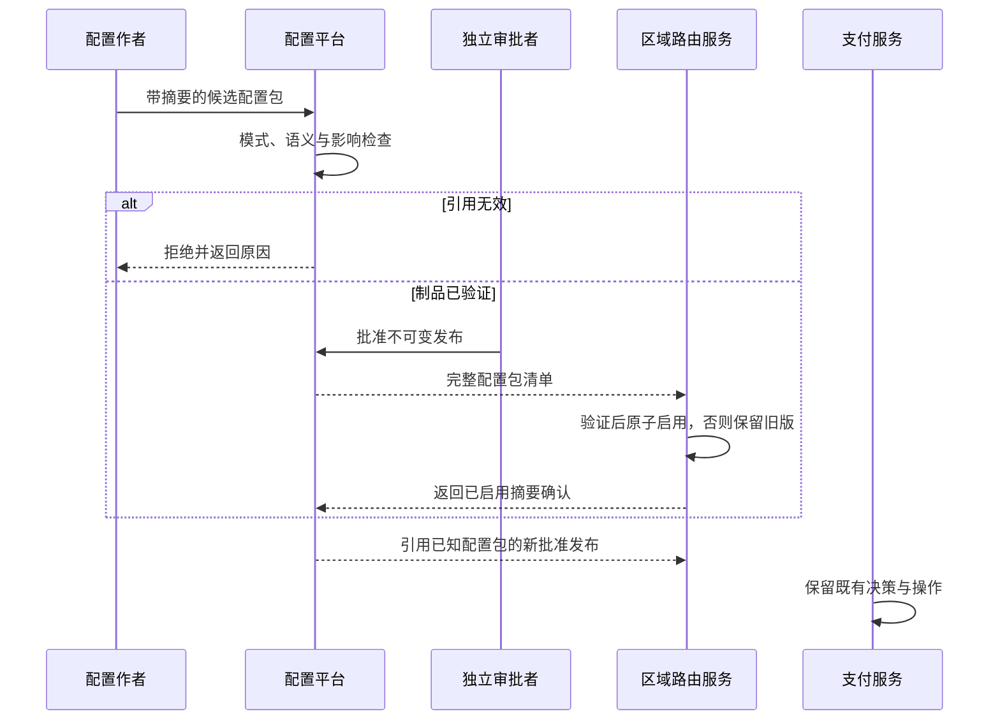
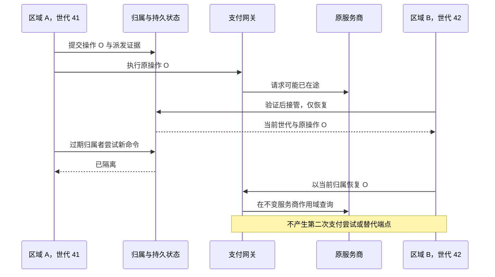

# 第 22 章 从零设计全球支付路由平台

**中文** | [English](../en/part-6-case-study/global-payment-routing-platform.md)

Aurora 的业务计划里出现了一行新的目标：服务 1 万个商户，覆盖 50 个国家、30 种币种、20 种支付方式、15 家 PSP，承受 10 万 TPS 峰值。工程师很快画出三个区域、几十个服务和一条粗大的事件总线，但评审者只问了四个问题：这里的 TPS 到底数什么？PSP 已扣款但响应丢失怎么办？错误配置发到一半怎么办？旧区域恢复后还能不能再扣一次？

一张拥有所有组件的大图，并不能回答这些问题。本章不再发明新的路由服务、幂等机制或状态机，而是用同一组需求、容量预算和故障旅程，检验前 21 章能否组成一套边界一致的系统。

> **综合架构的价值，在于每个 SLO、容量假设、降级动作和数据所有者都可以被具体场景检验。10 万 TPS 是本案例的设计要求，不是配套仓库的实测结果；设计通过、代码通过、部署通过和真实资金上线通过，是四种不同证据。**

下面的生产设计承接前文合同，不表示相关增量已经全部实现。当前 Go 系统仍是令牌化卡支付、自动请款 `SALE` 和本地模拟器的窄纵向切片，但路由服务已演进到 v3：风险、能力/规则、版本化成本/性能与受约束评分形成一条可审计流水线；支付服务也已有持久恢复截止时间、预算和租约。后备继任支付尝试、动态健康度、全书系统级测试框架、配置控制面和全球归属协议仍未实现。章节最后会把现有能力与目标能力逐项分开。

## 22.1 问题：先定义系统要承担什么，才能谈规模

### 22.1.1 业务规模不是一个巨大的笛卡尔积

| 需求假设 | 本案例的解释 | 不能据此宣称 |
| --- | --- | --- |
| 1 万个商户 | 身份、合同和流量隔离的规模 | 每个商户流量均匀 |
| 50 国家、30 币种 | 目标覆盖范围，由准入矩阵逐项开放 | 任意国家与币种组合都能处理 |
| 20 种支付方式 | 多生命周期的长期接入目标 | 所有方式都支持同步 `SALE` 或相同后备切换 |
| 15 家 PSP | 商业接入数量 | 只有 15 个候选通道，或每笔请求要调用 15 家 |
| 10 万 TPS 峰值 | 每秒到达且希望被接纳的 100,000 个新支付意图业务目标 | 10 万 HTTP RPS、10 万次请款/秒或持续整天此流量 |
| 三个区域 | 经批准的地域部署与容灾目标 | 同一个支付意图在三地同时有写权限 |

一个 PSP 可能对应多个商户账户、连接器、区域和不可变连接修订版。合法路径是稀疏矩阵，由[第 6 章](../part-2-routing-engine/provider-eligibility.md)的准入筛选决定；增加支付方式必须补齐其适配器、认证、最终性与恢复契约，不能只扩展一个枚举值。

容量先选择一个可计算切片：假设峰值期间主要是自动请款卡支付，每个新支付意图通常对应一次首次选路；其他支付方式以独立工作负载类别建模后相加。还要提供峰值持续时间、突发斜率、最大商户占比、地域分布、金额分布和重复请求比例。把总量平均除以 1 万，会掩盖单一商户热点与同一键竞争。

### 22.1.2 SLO 必须绑定观察边界

| 合同项 | 示例目标，均待目标环境验证 | 责任与限制 |
| --- | --- | --- |
| 路由服务 | 合法请求月度履约率 99.99%，p99 决策延迟不超过 20 ms | 包含明确的无候选结果；不等于授权批准率 |
| 首次确认响应 | p99 在 1.5 s 内给出最终结果或已持久化的处理中资源 | 202 不代表请款成功，不用等待伪装成失败 |
| 未知状态收敛 | 服务商查询恢复可用后，95% 目标在 5 分钟内获得确定结果 | 不确定者继续恢复或复核，不能为达标改成失败 |
| 决策投影 | 正常运行时投影滞后目标不超过 60 秒 | 本地执行快照必须先持久化；远端投影可以延迟 |
| 区域故障 | 在批准的故障模型内保留外发前执行证据 | RPO/RTO 由证据和演练定义，不由 DNS 健康决定 |
| 资金正确性 | 非预期重复资金路径为零，身份和金额约束必须成立 | 正确性不作为可用性错误预算消耗 |

这些数字是评审输入，不是对任何服务商或当前实现的服务承诺。业务拒绝、请求无效、技术故障、状态未知与尚未成熟的经济结果要使用[第 15 章](../part-4-operating-at-scale/observability.md)的不同分母。尤其不能通过不统计超时、只统计已派发请求或删除迟到结果，让 SLO 看起来更好。

本案例的非目标也要写在第一页：不设计卡组织内部路由，不自建账本或打款系统，不重做反欺诈引擎，不实现自治强化学习，不默认跨境复制敏感数据，也不以模拟器替代 PSP 认证或真实资金上线评审。

## 22.2 简单设计：保留那个最容易证明正确的起点

从零建设时，第一阶段仍应是一个逻辑区域、少量连接、静态策略、真实 PostgreSQL，以及支付服务、路由服务、支付网关三个清楚的数据所有者。路由服务可以独立部署，但没有服务商凭证；支付服务创建支付意图、支付尝试与支付操作；支付网关只执行已经固定的连接。进程数量不是架构成熟度。配套仓库已经越过这个历史起点进入 v3 受约束评分，但本章保留该起点，是为了说明每一层复杂度必须由证据推动，而不是把当前代码倒退成静态路由服务。

这个版本先证明商户幂等、明确拒绝、响应丢失后的状态未知、原操作查询和重复事件收敛。没有这些证据，增加服务商只会增加不确定路径。数据库也不必为了将来的 10 万 TPS 立即换成另一套模型：先测清事务、锁、索引、WAL、连接池和恢复路径，再按已定义的商户/支付意图所有权分区扩展。

| 演进阶段 | 迫使它出现的压力 | 增加的能力 | 可以暂不增加的东西 |
| --- | --- | --- | --- |
| 0：安全收款切片 | 先完成并解释一笔支付 | 第 1～3、10～11 章的身份、执行与恢复 | 多目标评分、全球多活 |
| 1：可解释选路 | 多账户能力和商户策略开始分化 | 第 4～9 章的上下文、准入筛选、规则和强类型特征 | 机器学习、实时大数据平台 |
| 2：可靠运营 | 故障扩散、历史不可解释、反馈迟到 | 第 12～18 章的受限后备切换、健康度、证据和经济反馈 | 自动让所有异常资金流转 |
| 3：多区域与治理 | 地域延迟、容灾、多人发布配置 | 第 19～20 章的单支付意图归属者、隔离令牌、完整配置包 | 同一支付意图全球任意写入 |
| 4：可选优化 | 可靠数据证明确有可改善空间 | 第 21 章的可替换模型评分器 | 没有选择概率的因果承诺 |

阶段并不靠流量跨过某个整数自动升级。比如控制平面审批可能在很小的规模就必要，而模型在很大规模仍未必值得引入。每一步的进入条件都是可观察的痛点和对应失败测试，不是“同行都用了”。

## 22.3 规模化问题：一次业务支付会放大成多少工作

### 22.3.1 把 API、支付操作与恢复请求分开计量

以下系数全部是假设，必须用实际流量校准。令能形成首个路由计划的新支付意图需求为 `λ=100,000/s`；每个支付意图平均 2.2 次商户 API 请求，包含创建、确认与重复/查询；每个支付意图平均新增 0.03 个合法后备支付尝试。本版预算限制每个支付意图至多一次合法后备切换，本切片每个支付尝试一个 `SALE`，因此逻辑操作需求为 `A=λ×1.03=103,000/s`。本算例另假设每个成功创建的后备支付尝试恰好经过一次仅护栏复核；生产报告必须把被否决后没有创建支付尝试的检查也计入，不能从操作数反推。

完整路由求值不能再直接写成 `A`。首个支付尝试需要一次求值；获准但尚未固定支付尝试的路由重试、返回 `no_candidate` 的额外求值和影子求值分别计为 `R_retry`、`R_no_candidate`、`R_shadow`，所以 `R=λ+R_retry+R_no_candidate+R_shadow`。路由服务首次返回不可变的 `RoutePlanDecision`，其中固定候选顺序、版本、预算和有效期；后备切换不生成新计划。支付服务刷新风险结论后，把计划中固定的下一候选通道交给路由服务拥有的 `RevalidatePlanCandidate` 做仅护栏检查：它只能允许或否决，不能增加候选通道、重排、重评分或延长计划；计划或护栏过期，或检查不可用，都必须停止。获准时，支付服务再写自己的不可变 `FallbackExecutionBinding`，关联原计划、前序支付尝试、固定后继项、风险与护栏证据和剩余预算；它不是路由决策。因而后备切换不增加完整 `R`，但会增加单列的 `G_fallback` 护栏工作；本例取 `G_fallback=λ×0.03=3,000/s`。

再假设每个操作平均增加 0.01 次同键重送，5% 进入需要查询的状态未知，每个状态未知操作平均查询三次。这些系数是受控恢复后的期望次数，不是允许重试的规则；资金安全闸门仍来自第 10～12 章。

| 工作类别 | 公式 | 本例需求 |
| --- | --- | ---: |
| 商户 API | `λ × 2.2` | 220,000 次请求/秒 |
| 逻辑 `SALE` 操作 | `A = λ × (1 + 0.03)` | 103,000 次操作/秒 |
| 路由求值 | `R = λ + R_retry + R_no_candidate + R_shadow` | 至少 100,000 次求值/秒；三项增量单列 |
| 后备护栏复核 | `G_fallback = λ × 0.03`（本例假设） | 3,000 次检查/秒；被否决的额外检查另计 |
| 外部执行请求 | `A × (1 + 0.01)` | 104,030 次调用/秒 |
| 外部恢复查询 | `A × 0.05 × 3` | 15,450 次调用/秒 |
| 服务商出站调用总量 | 执行 + 查询 | 119,480 次调用/秒 |
| 入站回调 | 假设每次操作平均 1.1 个事件 | 113,300 个事件/秒 |

这些量不能互相冒充，也不能全部简单加成一个“系统 TPS”。API 重放会消耗鉴权和数据库读取，却不能新增资金操作；查询消耗服务商配额，却不是第二次支付；回调还会放大收件箱、发件箱和结果投影。手动请款、退款、对账扫描与其他支付方式不在这个数字中，加入它们需要另外的工作负载行。

这里的 `λ` 是本次已选 `SALE` 容量切片；额外 `no_candidate` 求值若来自切片外的新请求，也必须同时加回商户 API 的到达负载，不能只给路由服务加一个漂亮的孤立数字。需求包含非 2xx 和超时请求，不能用成功响应数反推输入。完整路由求值、仅护栏复核与支付操作已经明确分开：`no_candidate`、创建支付尝试前获准的路由重试或影子求值会增加完整求值，却不产生服务商操作；固定计划中的后备支付尝试增加操作并至少经过一次安全检查，却不重新评分或生成计划。三者都不能由另一者倒推。

平均扇出只适合预算起点。某条连接故障时，状态未知比例、查询次数和延迟会一起上升，形成相关的突发压力。恢复服务必须有共享预算、退避、逐连接舱壁和期限，不能依赖“只有 5%”保护系统。Stripe 官方文档将账户与端点的速率限制同并发限制分开；所以全平台聚合预算通过后，每个真实账户和端点仍需单独验算与获得相应配额。[Stripe：速率限制](https://docs.stripe.com/rate-limits)

### 22.3.2 三个区域不是三份可以随时互借的容量

先做最乐观的均衡算术：每秒 119,480 次调用平摊三地，每地约 39,827 次；失去一地后，剩余两地各承担 59,740 次。若运行利用率上限取 65%，每个剩余地区的可验证容量至少应为 `59,740 / 0.65 ≈ 91,908 calls/s`。

如果评审表中填写的单区容量假设只有每秒 85,000 次调用，故障后利用率约为 70.28%，已经不满足 65% 预算，尽管还没到名义极限。这里的 85,000 也是演示输入，不是本机或配套系统的测量结果。

真实情况通常比均分更严格：部分数据不能跨区，某个商户的合格连接只在原地区，服务商账户配额也未必随计算实例迁移。[第 19 章](../part-5-global-routing/multi-region.md)还要求先证明唯一归属者与完整执行证据。剩余 CPU 有空闲，不能授予旧的状态未知操作一条新的服务商路径；算术余量只是必要条件。

### 22.3.3 Go：让假设和单位一起进入容量模型

下面函数只计算当前卡支付 `SALE` 切片，不调用服务，也不批准上线。所有速率单位都显式命名；浮点数用于容量估算，不用于金额、费率结算或资金身份。最后的布尔值只表示均衡算术是否满足给定上限。

```go
package capacityplan

import (
	"errors"
	"math"
)

type Input struct {
	NewIntentsPS                  float64
	MerchantRequestsPerIntent     float64
	FallbackAttemptsPerIntent     float64
	FallbackGuardrailChecksPerIntent float64
	AuthorizedRouteRetriesPerIntent float64
	NoCandidateEvaluationsPerIntent float64
	ShadowEvaluationsPerIntent      float64
	SameKeyResubmitsPerOperation  float64
	UnknownFraction               float64
	QueriesPerUnknown             float64
	WebhookEventsPerOperation     float64
	ProviderMeanSeconds           float64
	DecisionBytes                 float64
	OutboxOutageSeconds           float64
	CatchupSeconds                float64
	GatewayCallsCapacityPerRegion float64
	TargetUtilization             float64
	Regions                       int
	LostRegions                   int
}

type Plan struct {
	ModelVersion                   string
	MerchantRequestsPS             float64
	LogicalOperationsPS            float64
	RouterEvaluationsPS            float64
	GuardrailRevalidationsPS        float64
	ExecuteCallsPS                 float64
	QueryCallsPS                   float64
	ProviderCallsPS                float64
	WebhookEventsPS                float64
	CallsPerSurvivingRegionPS      float64
	MinimumCapacityPerRegionPS     float64
	PostLossUtilization            float64
	MeanInflightPerSurvivingRegion float64
	RouterEvaluationBytesPS        float64
	DecisionBytesPS                float64
	BacklogEvents                  float64
	RequiredProjectorEventsPS      float64
	WithinArithmeticBudget         bool
}

func Calculate(input Input) (Plan, error) {
	values := []float64{
		input.NewIntentsPS, input.MerchantRequestsPerIntent,
		input.FallbackAttemptsPerIntent, input.AuthorizedRouteRetriesPerIntent,
		input.FallbackGuardrailChecksPerIntent,
		input.NoCandidateEvaluationsPerIntent, input.ShadowEvaluationsPerIntent,
		input.SameKeyResubmitsPerOperation,
		input.UnknownFraction, input.QueriesPerUnknown, input.WebhookEventsPerOperation,
		input.ProviderMeanSeconds, input.DecisionBytes, input.OutboxOutageSeconds,
		input.CatchupSeconds, input.GatewayCallsCapacityPerRegion, input.TargetUtilization,
	}
	for _, value := range values {
		if math.IsNaN(value) || math.IsInf(value, 0) || value < 0 {
			return Plan{}, errors.New("capacity inputs must be finite and nonnegative")
		}
	}
	if input.NewIntentsPS == 0 || input.MerchantRequestsPerIntent < 1 ||
		input.FallbackAttemptsPerIntent > 1 || input.UnknownFraction > 1 ||
		input.FallbackGuardrailChecksPerIntent < input.FallbackAttemptsPerIntent ||
		input.ProviderMeanSeconds == 0 || input.DecisionBytes == 0 ||
		input.CatchupSeconds == 0 || input.GatewayCallsCapacityPerRegion == 0 ||
		input.TargetUtilization <= 0 || input.TargetUtilization >= 1 ||
		input.Regions <= 0 || input.LostRegions < 0 || input.LostRegions >= input.Regions {
		return Plan{}, errors.New("invalid capacity assumptions")
	}
	operations := input.NewIntentsPS * (1 + input.FallbackAttemptsPerIntent)
	routerEvaluations := input.NewIntentsPS * (1 + input.AuthorizedRouteRetriesPerIntent +
		input.NoCandidateEvaluationsPerIntent + input.ShadowEvaluationsPerIntent)
	guardrailRevalidations := input.NewIntentsPS * input.FallbackGuardrailChecksPerIntent
	execute := operations * (1 + input.SameKeyResubmitsPerOperation)
	queries := operations * input.UnknownFraction * input.QueriesPerUnknown
	provider := execute + queries
	survivors := float64(input.Regions - input.LostRegions)
	perRegion := provider / survivors
	backlog := operations * input.OutboxOutageSeconds
	plan := Plan{
		ModelVersion:                   "card-sale-capacity-v1",
		MerchantRequestsPS:             input.NewIntentsPS * input.MerchantRequestsPerIntent,
		LogicalOperationsPS:            operations,
		RouterEvaluationsPS:            routerEvaluations,
		GuardrailRevalidationsPS:        guardrailRevalidations,
		ExecuteCallsPS:                 execute,
		QueryCallsPS:                   queries,
		ProviderCallsPS:                provider,
		WebhookEventsPS:                operations * input.WebhookEventsPerOperation,
		CallsPerSurvivingRegionPS:      perRegion,
		MinimumCapacityPerRegionPS:     math.Ceil(perRegion / input.TargetUtilization),
		PostLossUtilization:            perRegion / input.GatewayCallsCapacityPerRegion,
		MeanInflightPerSurvivingRegion: perRegion * input.ProviderMeanSeconds,
		RouterEvaluationBytesPS:        routerEvaluations * input.DecisionBytes,
		DecisionBytesPS:                operations * input.DecisionBytes,
		BacklogEvents:                  backlog,
		RequiredProjectorEventsPS:      operations + backlog/input.CatchupSeconds,
	}
	outputs := []float64{
		plan.MerchantRequestsPS, operations, routerEvaluations, guardrailRevalidations, execute, queries, provider,
		plan.WebhookEventsPS, perRegion, plan.MinimumCapacityPerRegionPS,
		plan.PostLossUtilization, plan.MeanInflightPerSurvivingRegion,
		plan.RouterEvaluationBytesPS, plan.DecisionBytesPS, backlog, plan.RequiredProjectorEventsPS,
	}
	for _, value := range outputs {
		if math.IsNaN(value) || math.IsInf(value, 0) {
			return Plan{}, errors.New("capacity calculation overflow")
		}
	}
	plan.WithinArithmeticBudget = plan.PostLossUtilization <= input.TargetUtilization
	return plan, nil
}
```

输入上一节的系数，并在这次算例中显式令三类额外完整路由求值为零、令仅护栏复核为每秒 3,000 次检查，再令平均服务商调用耗时为 0.25 秒、每份路由证据为 2 KiB、投影停机 600 秒、希望 3,600 秒追平，模型给出：路由求值输出约 204.8 MB/s；若每个后备操作仍保存同一固定路由计划的执行快照，则操作侧路由证据约 210.944 MB/s；失区后每区平均在途约 14,935；停机积压 6,180 万条，追平期间投影器至少处理每秒约 120,167 个事件。两种字节率故意分开：复制既有计划作为新支付尝试的审计证据，不等于重新执行路由服务。护栏检查的 CPU、缓存与 RPC 预算也必须单列，本教学模型只输出其速率，不把它折算成完整求值字节数。这些仍是假设计算，未含索引、WAL、副本、消息封装和其他事件。

在稳定且均值存在等条件下，平均在途可用 `L=λW` 理解；Little 的原始论文讨论了这一关系及成立条件。[Little：排队公式的证明](https://pubsonline.informs.org/doi/10.1287/opre.9.3.383) 这里的 W 是包含执行与查询混合的相应平均耗时，不是 p99；该公式不证明尾延迟，也不意味着创建同样数量的 goroutine 就有相应容量。

按本例持续峰值一小时，仅每个操作 2 KiB 的路由执行快照就约 759.4 GB。峰值持续时间、压缩率、留存和分区策略因此必须回到第 14 章的证据设计，不能把平均 QPS 乘一天再当真实日流量。发件箱也不是无限缓冲：追平能力必须高于新流入；本地存储逼近安全水位时限制新工作准入，不能跳过执行证据后继续外发。

### 22.3.4 数据库预算不能从 HTTP TPS 直接换算

支付服务创建记录、取得幂等权、准备执行、记录发送状态与结果，以及处理收件箱和发件箱，各自带来事务和索引工作；网关还有独立的执行记录。应测量每类业务操作的事务数、写入字节、锁等待和 WAL，再按工作负载组合。数据库 TPS、磁盘 IOPS、网络 RPS 与支付完成率不是可互换的单位。

同一商户热点、重复确认、迟到回调和恢复扫描应进入压力分布。分区后必须保留第 11、19 章的唯一身份与归属者仲裁，不能为了提高并发把同一支付意图的幂等记录复制成多个独立真相。只读缓存可以加速，不能让缓存未命中决定是否再发一笔资金操作。

## 22.4 生产级设计：一张图只画已经解释过的责任



各区域复用图中的数据平面模式，不是复制一份相互独立的扣款权。归属区域、执行区域、服务商区域和归属者世代沿第 19 章处理；全局目录只保存批准的最小身份，不放完整请求或支付凭证。账本、打款、密钥库与反欺诈系统的原始数据继续留在各自边界，本图没有把它们吞进路由服务。

在线流水线仍固定为“上下文验证 → 准入筛选 → 规则护栏 → 风险合同 → 特征查询 → 评分 → 稳定选择”。完整配置包、能力数据与允许的特征快照尽量在区域内读取；一个请求固定一次版本，不能在循环中先后拼出不同版本。候选通道数量增加主要扩大本地求值工作，不意味着向所有 PSP 发探测或资金请求。

该流水线生成由路由服务签发、不可变的 `RoutePlanDecision`，固定候选顺序、版本、最大支付尝试数、风险边界和有效期。后续只有在前一支付尝试已证明无副作用、策略明确允许且预算仍有效时，支付服务才能提交计划中固定的下一候选通道；它刷新风险结论，并调用路由服务拥有的仅护栏复核。这个检查只能否决，不能增加候选通道、重排或重新评分；计划或护栏过期、证据不完整或检查不可用，一律停止。获准后支付服务写入 `FallbackExecutionBinding`，引用原计划、前序支付尝试、固定后继项与本次风险和护栏证据，它不冒充第二个路由决策。

停止与人工复核也不是同义词。没有下一候选通道、计划过期或护栏否决与不可用时，停止新增副作用并返回明确领域结果；只有已有资金事实互相冲突、执行身份或证据完整性冲突，或状态未知操作在恢复预算耗尽后仍无法裁决时，才进入人工复核。不得因为“想再试一个服务商”把普通停止升级成人工复核，更不能借人工复核绕过原计划。

支付服务验证返回的已选候选通道、连接修订版与决策哈希，在创建支付尝试和操作的同一事务中封存执行快照和发件箱记录，提交后才允许网关外发。远端决策存储、报表和分析后端不在这个同步提交链上；但本地事务失败时必须停止，不能把“异步投影可延迟”误解成“执行前证据也可以稍后补”。

### 22.4.1 截止时间与降级是同一份执行合同

本案例可先把 1.5 秒首次响应预算划成接入/持久化、路由服务、服务商等子预算，例如为服务商首次等待最多保留 800 毫秒，同时留出排队和返回余量。这是逐请求截止时间约束，不是把各服务 p99 简单相加。Go 的 `http.Client.Timeout` 覆盖连接、重定向及读取响应等阶段；取消本地等待不能撤回已到达服务商的请求。[Go HTTP 客户端](https://pkg.go.dev/net/http#Client)

| 失去的依赖或预算 | 允许的降级 | 不允许的捷径 |
| --- | --- | --- |
| 可选模型与性能特征 | 使用已验证、仍有效的完整规则或静态配置档案，并记录原因 | 把缺值当零，或重新解释旧决策 |
| 必需能力与风险事实 | 明确失败，停止新路由或进入明确动作与人工复核 | 用较高分数补偿未知准入状态 |
| 控制平面 | 使用仍有效的完整最近可用良好配置包 | 拼接半套新版，在线请求临时补取所有制品 |
| 服务商 `SALE` 超时 | 当前操作进入状态未知，沿原身份恢复 | 将当前支付切到健康的另一条连接 |
| 服务商局部故障 | 健康度约束未来新路由，舱壁限制该故障域 | 将所有发卡行拒绝变成全局熔断 |
| 发件箱或恢复积压 | 给既有操作保留恢复预算，限制新工作准入，停止额外实验暴露 | 删除事实、重置状态未知年龄或无限扩大队列 |

降级顺序不是按服务重要性随意排序。它首先保护已发生或可能发生的资金操作，再减少可选优化工作，最后按批准的容量与公平性策略拒绝新工作。优化开关可以回滚，原操作、键、载荷和连接不能回滚成另一个身份。

## 22.5 故障模式：四条端到端验收旅程

下面四条旅程包含一条正常/重复投递基线和三条系统故障。它们不重复设计前文机制，而是检查责任交接的缝隙。每条旅程同时保留 API 结果、领域快照、网关调用记录、版本与观测证据；只断言最终 `succeeded` 不够。

### 旅程一：正常支付成功，重复确认不新增工作

Aurora 创建一笔 129.00 USD 的支付意图。上下文只含获准事实；中央风控返回有效的 `ALLOW`；准入筛选先排除不可执行连接。路由服务选择 `cand_us_a`，支付服务固定决策与唯一操作，网关在对应账户执行 `SALE`。最终成功证据包括原引用和请款金额，不包括“资金已经银行到账”的推断。



验收必须检查相同键、不同载荷返回冲突；重复确认返回相同资源；重复回调不重复应用。没有后备切换时只有一个支付尝试、一个逻辑支付操作和一个网关执行副本。决策投影暂不可用时，本地证据仍在；之后按标识和哈希补齐，不能重算当时选择。

该旅程对应现有 `test/e2e/payment_flow_test.go` 中批准与幂等基线；当前支付服务还会原子保存 v3 上下文、决策、风险、优化、候选顺序与 `executable_until`，并用共享黄金契约防止路由与支付服务漂移。远端决策投影器与投影停机补送仍需配套增量，所以现有测试覆盖执行快照，不等于图中的全部生产设计已经运行。

### 旅程二：服务商已成功，响应丢失与恢复风暴同时出现

故障注入点必须位于服务商落下副作用之后、支付网关获得结果之前。只让模拟器在调用前报错，证明不了未知状态安全性。此时 API 在预算内返回处理中，重启支付工作进程，再注入回调重投与查询延迟。



验收不仅看收敛，还看恢复期间的支付尝试与操作数量，以及连接、修订版、命名空间、服务商键与请求哈希全部保持原值。5% 故障负载下，查询计入真实出站速率，其他连接不被共享池拖死。当前代码已经持久化 24 小时本地 `SALE` 恢复截止时间、32 次初始调用预算、领取世代与租约、动作和结构化缺席证据；每次领取原子扣减预算，截止时间和预算不可重置。它们是仓库的本地模拟器策略，不是生产 PSP 保留期承诺。查询继续失败或预算耗尽时进入复核，不把状态未知改成失败以触发后备切换。

服务商幂等不能跨账户或地区想当然地成立。Adyen 官方文档明确说明多区域端点不会跨地区检查重复，所以平台恢复地区改变时，原服务商作用域仍必须固定。[Adyen：API 幂等](https://docs.adyen.com/development-resources/api-idempotency/) 请款、撤销与退款也继续绑定原连接和交易引用，不重新调用路由服务。

### 旅程三：坏配置被拒绝，合法但退化的配置能够回滚

先提交一个引用不存在能力版本的配置包：验证器必须拒绝它进入已批准状态，所有区域继续使用完整旧版。再选择一份语义合法但表现不佳的制品，在获准金丝雀发布中注入故障；检查停止新暴露、回滚授权和区域确认，而不是直接修改线上费率行。回滚创建新的发布来引用已验证的旧配置包，仍保留当前有效的紧急禁用与硬约束，不复活已经撤销的路由。



这里要刻意断开下载、打乱制品到达顺序、重启监视器。每个路由实例要么使用完整旧版，要么使用完整新版，决策能指出实际版本；作者不能自批，控制平面断线不使有效的最近良好版本消失。已派发的支付操作不因回滚改路，已分配实验的支付意图不改变体；影子评估即使选中另一候选通道，也没有网关操作。

配置平台、稳定分配与 `ModelScorer` 的设计分别来自[第 20 章](../part-5-global-routing/configuration-platform.md)、[第 16 章](../part-4-operating-at-scale/experimentation.md)与[第 21 章](../part-5-global-routing/intelligent-routing.md)。当前代码没有完整发布与回滚链，本旅程必须标为待实现的系统验收，不能用静态 JSON 启动成功替代。

### 旅程四：区域失联，旧归属者复活仍没有新扣款权

区域 A 在世代 41 下持久化并可能发送了操作 O，随后被隔离。区域 B 收到同一商户键，先找到原支付意图，不能因为本地副本未命中就新建。只有旧执行路径被可靠隔离、恢复证据和容量通过后，才能在权威事务中推进世代，进入 `recovery_only`。



最关键的断言不是“B 的健康检查变绿”，而是旧 A 恢复后无法再创建或外发新的获权命令；A 已在途的字节无法收回，因此 B 仍按原操作恢复。若恢复库缺失外发记录，或原服务商作用域无法访问，就隔离相关支付意图，不能生成一个新的 `SALE`。

PostgreSQL 官方文档区分异步复制的数据丢失窗口与同步确认等待，因此“有备库”不是完整执行证据已经安全的证明。[PostgreSQL：备用服务器与复制](https://www.postgresql.org/docs/current/warm-standby.html) 在本例单区每秒 85,000 次调用的容量假设下，剩余地区还不满足 65% 运行上限；即便隔离机制正确，也不能直接放开全部新流量。故障恢复后的回切同样需要更高世代号与受控交接，不允许旧主自动抢回权力。

### 22.5.5 压测报告必须把没服务好的流量带回来

每条旅程都应在稳态、慢服务商、冷缓存/缺依赖和区域丢失条件下执行。负载发生器记录提供量、启动量、完成量、调度滞后、超时、取消与未发送工作；系统变慢时，客户端不能因为等待前一请求而自动减少到达量，再把较低吞吐报告为稳定容量。

HTTP 层保留各状态码与传输错误，业务层另列成功、明确拒绝、处理中、状态未知和人工复核。ApacheBench 官方输出把失败请求与非 2xx 响应分开，前者为零不代表没有 HTTP 502；同样，200 中的拒绝与 202 中的状态未知也不是请款成功。[ApacheBench：输出说明](https://httpd.apache.org/docs/2.4/programs/ab.html)

数据库压测还要保留计划开始到实际完成的等待。PostgreSQL `pgbench` 的速率与延迟上限文档显式区分调度滞后、迟到与跳过的事务；被跳过的负载不能从需求中消失，数据库基准也不能冒充整条支付链的容量。[PostgreSQL：pgbench](https://www.postgresql.org/docs/current/pgbench.html)

| 报告维度 | 至少提交的证据 |
| --- | --- |
| 场景与版本 | 工作负载/随机种子、持续时间、故障时间线、代码 SHA、配置包摘要、环境拓扑 |
| 流量与响应 | 提供量/启动量/完成量、各 HTTP 状态码、传输失败、业务结果 |
| 延迟与资源 | 分阶段 p50/p95/p99、排队、CPU/内存/GC、连接池、锁/WAL/网络 |
| 恢复与证据 | 查询/重送/后备切换次数、未知状态年龄、发件箱年龄/深度、投影水位 |
| 资金不变量 | 支付尝试/操作基数、固定身份、冲突与重复副作用检查 |
| 故障余量 | 剩余区域和每连接配额、恢复追平速率、准入决策 |

压测流量只能进入明确的测试环境。服务商模拟器可用于确定性故障注入，真实 PSP 沙箱用于接口语义验证；两者都不自动代表生产延迟或容量，更不能未经批准向真实资金端点发送 10 万 TPS。只有目标环境、真实限额与经批准的上线演练，才能支持相应生产声明。

## 22.6 权衡、负责人及实际交付边界

### 22.6.1 谁能按下哪个按钮

| 负责人 | 拥有的决策或事实 | 事故中不能越过的边界 |
| --- | --- | --- |
| 支付团队 | 支付意图/尝试/操作、幂等、状态迁移和恢复 | 不把未知状态猜成失败 |
| 路由团队 | 上下文契约消费、准入筛选/规则/评分与解释 | 不执行资金，不修改反欺诈判断 |
| 网关/连接器团队 | 外部执行、引用、凭证与服务商契约 | 不暗中更换账户、区域或键 |
| 配置/风险批准者 | 发布制品或风险合同 | 分数、实验和紧急授权不突破硬约束 |
| SRE/值班负责人 | 准入、资源、隔离和批准的故障转移步骤 | DNS、进程存活或低 CPU 不授予资金写权限 |
| 对账/结算团队 | 外部证据、差异项、费用归因与校准建议 | 不直接改支付终态，不自动调整账本 |
| 安全与财务负责人 | 数据用途、凭证边界、上线风险与会计处理 | 不把令牌化或教学实现当认证证明 |

统一事故指挥不等于统一数据库超级账号。跨团队操作通过有原因、身份和版本的命令完成；停止新准入与恢复原未知状态可以由不同预算并行推进。操作手册必须写明触发条件、负责人、证据、回滚和失败出口，而不是留一句“联系相关同学”。

主要取舍也由这些边界决定。更严格的跨区确认提高恢复证据完整性，却增加写入延迟与仲裁依赖；本地单写保留简单状态语义，却需要归属转发。小比例实验限制潜在损失，但样本成熟慢，不能证明全量容量。多存决策便于解释，却增加存储和数据管理成本；无论怎样优化，都不能用丢弃关键证据购买吞吐。

### 22.6.2 配套仓库目前完成了什么

| 能力 | 当前代码事实 | 本章不能代替的后续证据 |
| --- | --- | --- |
| 支付纵向链 | 支付、路由、网关、模拟器，真实 PostgreSQL；初始操作为单个 `SALE` | 真实 PSP 沙箱/生产连接器、认证与运营 |
| 路由 | v3 `routing_context.v2`、风险、能力/规则、版本化成本/性能、受约束评分、稳定候选顺序与执行截止点 | 生产制品来源、动态健康度、后备执行器、真实数据校准 |
| 可靠性 | 商户幂等、收件箱/发件箱、追加式服务商观察、未知状态原操作恢复、持久截止时间/预算/租约、首次派发标记与冲突隔离 | 从固定计划创建受限继任支付尝试、生产服务商恢复合同与跨连接健康度 |
| 系统回归 | 单元测试、竞态检测、真实 PostgreSQL 与 Compose 端到端测试覆盖已批准、已拒绝、响应丢失、重复确认与单资金路径 | 本章统一 `test/system`、坏配置、归属者故障转移和故障负载组合 |
| 运营反馈 | 本地完整上下文/决策/风险/优化快照和网关观察账本 | 遥测、实验、远端决策投影器、独立对账/结算 |
| 全球运行 | 连接已有区域身份 | 支付意图归属、隔离令牌、真实跨区恢复和驻留评审 |
| 容量与上线 | 尚无本章 `test/system`、`tools/capacity-plan` 全链工具 | 可复现容量报告、10 万 TPS 证据、上线/不上线签核 |

因此，正确结论是“有一个具备重要支付安全边界的可运行起点”，不是“已经拥有覆盖 15 家 PSP、20 种支付方式的全球真钱平台”。代码文件存在、单元测试通过或 Compose 启动，都不能把未实现行自动变成已实现。

本章的工程增量不增加新的业务抽象：把四条旅程编排到 `test/system`，复用现有故障注入，增加标准库容量模型命令行工具，并让 Makefile 与 CI 输出版本化结果。[附录 C](../appendices/capacity-planning-and-launch-checklist.md)复用这份证据，不再创建第二套压测体系；状态与安全核查分别对照[附录 A](../appendices/payment-state-models.md)、[附录 B](../appendices/security-compliance.md)。这些工具仍有待实现。

上线门禁应分别回答代码、契约与真实数据库是否通过，四条旅程是否满足不变量，吞吐与故障余量是否实测，真实服务商与安全运营是否获准。缺任一必要证据就是未通过；本章的算术函数、结构图和教学模拟器都不具有豁免权。

## 22.7 小结：用故障证明边界，用证据证明规模

我们从单区域、静态路由和一条 `SALE` 的历史起点出发，走到当前 v3 受约束评分与持久恢复基线，再沿业务差异、运行故障、反馈延迟与全球所有权逐步组合前文机制。最终方案的关键不是组件齐全，而是每条链路仍保留同一套规则：

1. 先定义业务单位、SLO、负载分布与非目标；10 万 TPS 是需要验证的需求，不是现有容量结论。
2. 准入筛选/风险判断先于软评分，路由服务决策、支付服务拥有资金状态、支付网关固定执行连接。
3. 容量包含 API、支付操作、查询/重送/后备切换、事件、存储和故障后的剩余容量，不能只报成功 RPS。
4. 正常重复、响应丢失、错误配置和区域故障四条旅程必须同时守住身份、证据与所有权。
5. 配置、实验或模型可以改变未来选择，不能重写旧决策，也不能移动未知状态或请款/撤销/退款的原路径。
6. 对账纠正认知，结算建立经济归因，账本与资金执行仍各有权威边界。
7. 设计、代码、测试环境与生产就绪状态分层交付；没有证据的能力保持未完成，而不是被一张全球架构图隐藏。

这也是全书希望留下的工程习惯：每次让支付系统变得更聪明、更快或更全球化之前，先确认它仍然知道自己已经做过什么、现在有权做什么，以及哪些事情还不能确定。
